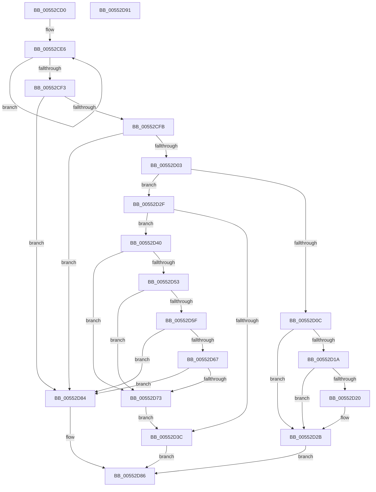

# HalCancelAdapterChannelDmarThin

- RVA: `0x00552CD0`–`0x00552D92` (길이 `194` bytes)
- VA: `0x0000000140552CD0`
- 실행 섹션: `.text`
- PDB 이름 있음: `예`; PDB Function 태그: `아니요`
- unwind 정보 RVA: `0x0005CAAC`
- 디코드: `60`개 명령, `194/194` bytes 표시
- 미해석 바이트: `0` (있으면 어셈블리에 `.byte`로 보존)

> 이 문서는 커널 이미지의 기계어와 PDB 기호를 분석해 생성했습니다. 4번과 5번은 함수 원형과 자료형을 바이너리 사용 방식에서 추정한 C 해석이며 원본 소스 복구 결과는 아닙니다.

## 1. Dependencies

- 직접 호출 지점: **7**; 고유 호출 대상: **6**
- 직접 호출자로 확인된 함수: **0**
- RIP 상대 이미지 참조: **0**

### Outgoing calls
- `0x00552D0F` → [HalpDmaRemoveFromEmergencyLogicalAddressQueue](../53/HalpDmaRemoveFromEmergencyLogicalAddressQueue_function_0053E3B8.md) (function, `0x0053E3B8`)
- `0x00552D26` → [ExFreePoolWithTag](../../poolcode/B8/ExFreePoolWithTag_function_00B82870.md) (function, `0x00B82870`)
- `0x00552D33` → [HalpDmaRemoveWcb](../53/HalpDmaRemoveWcb_function_0053E450.md) (function, `0x0053E450`)
- `0x00552D4A` → [HalpDmaRemoveFromEmergencyLogicalAddressQueue](../53/HalpDmaRemoveFromEmergencyLogicalAddressQueue_function_0053E3B8.md) (function, `0x0053E3B8`)
- `0x00552D56` → [HalpDmaRemoveAdapterFromMasterQueue](../53/HalpDmaRemoveAdapterFromMasterQueue_function_0053E2FC.md) (function, `0x0053E2FC`)
- `0x00552D6A` → [HalpDmaRemoveAdapterFromChannelQueue](HalpDmaRemoveAdapterFromChannelQueue_function_00554374.md) (function, `0x00554374`)
- `0x00552D7D` → [IoFreeAdapterChannelV3](../3D/IoFreeAdapterChannelV3_function_003DAA20.md) (function, `0x003DAA20`)

### Direct callers
- 이 함수 시작 RVA로 연결되는 직접 call은 확인되지 않았습니다. 간접 호출은 완전히 역산할 수 없습니다.

### Static image references
- 디코드된 RIP-relative 메모리 참조가 없습니다.

## 2. Other-region calls and transfers

- 다른 실행 섹션으로 향하는 call: **1**
  - `0x00552D26` → [ExFreePoolWithTag](../../poolcode/B8/ExFreePoolWithTag_function_00B82870.md) (`.text` → `POOLCODE`)
- 별도 외부 분기/꼬리 이동을 확인하지 못했습니다.

## 3. Assembly (complete function range)

```asm
00552CD0  48 89 5C 24 08                  mov qword ptr [rsp + 8], rbx
00552CD5  57                              push rdi
00552CD6  48 83 EC 20                     sub rsp, 0x20
00552CDA  48 8B D9                        mov rbx, rcx
00552CDD  41 0F 0D 48 08                  prefetchw byte ptr [r8 + 8]
00552CE2  41 8B 40 08                     mov eax, dword ptr [r8 + 8]
00552CE6  8B D0                           mov edx, eax
00552CE8  83 CA 02                        or edx, 2
00552CEB  F0 41 0F B1 50 08               lock cmpxchg dword ptr [r8 + 8], edx
00552CF1  75 F3                           jne 0x140552ce6
00552CF3  A8 01                           test al, 1
00552CF5  0F 85 89 00 00 00               jne 0x140552d84
00552CFB  A8 04                           test al, 4
00552CFD  0F 84 81 00 00 00               je 0x140552d84
00552D03  49 8B 78 58                     mov rdi, qword ptr [r8 + 0x58]
00552D07  48 85 FF                        test rdi, rdi
00552D0A  74 23                           je 0x140552d2f
00552D0C  48 8B D7                        mov rdx, rdi
00552D0F  E8 A4 B6 FE FF                  call 0x14053e3b8
00552D14  8A D8                           mov bl, al
00552D16  84 C0                           test al, al
00552D18  74 11                           je 0x140552d2b
00552D1A  80 7F 61 00                     cmp byte ptr [rdi + 0x61], 0
00552D1E  74 0B                           je 0x140552d2b
00552D20  48 8B 4F 50                     mov rcx, qword ptr [rdi + 0x50]
00552D24  33 D2                           xor edx, edx
00552D26  E8 45 FB 62 00                  call 0x140b82870
00552D2B  8A C3                           mov al, bl
00552D2D  EB 57                           jmp 0x140552d86
00552D2F  49 8D 50 10                     lea rdx, [r8 + 0x10]
00552D33  E8 18 B7 FE FF                  call 0x14053e450
00552D38  84 C0                           test al, al
00552D3A  74 04                           je 0x140552d40
00552D3C  B0 01                           mov al, 1
00552D3E  EB 46                           jmp 0x140552d86
00552D40  48 8D 93 58 02 00 00            lea rdx, [rbx + 0x258]
00552D47  48 8B CB                        mov rcx, rbx
00552D4A  E8 69 B6 FE FF                  call 0x14053e3b8
00552D4F  84 C0                           test al, al
00552D51  75 20                           jne 0x140552d73
00552D53  48 8B CB                        mov rcx, rbx
00552D56  E8 A1 B5 FE FF                  call 0x14053e2fc
00552D5B  84 C0                           test al, al
00552D5D  75 14                           jne 0x140552d73
00552D5F  38 83 B9 01 00 00               cmp byte ptr [rbx + 0x1b9], al
00552D65  75 1D                           jne 0x140552d84
00552D67  48 8B CB                        mov rcx, rbx
00552D6A  E8 05 16 00 00                  call 0x140554374
00552D6F  84 C0                           test al, al
00552D71  74 11                           je 0x140552d84
00552D73  83 A3 F8 00 00 00 00            and dword ptr [rbx + 0xf8], 0
00552D7A  48 8B CB                        mov rcx, rbx
00552D7D  E8 9E 7C E8 FF                  call 0x1403daa20
00552D82  EB B8                           jmp 0x140552d3c
00552D84  32 C0                           xor al, al
00552D86  48 8B 5C 24 30                  mov rbx, qword ptr [rsp + 0x30]
00552D8B  48 83 C4 20                     add rsp, 0x20
00552D8F  5F                              pop rdi
00552D90  C3                              ret
00552D91  CC                              int3
```

## 4. C-style interpretation (structured pseudocode)

```c
__int64 __fastcall HalCancelAdapterChannelDmarThin(__int64 a1, __int64 a2, __int64 a3)
{
    __int64 result;
    __int64 v_rsp;
    unsigned __int64 v_stack_p8;

    v_stack_p8 = v_rbx;
    v_rsp = (v_rsp) - (32);
loc_00552CE6:
    a2 = (unsigned int)(((unsigned int)((unsigned int)((unsigned int)(*(unsigned int *)(a3 + 8))))) | (2));
    if (condition_is_not_equal) goto loc_00552CE6;
    if ((((unsigned __int8)((unsigned int)(*(unsigned int *)(a3 + 8)))) & (1)) != 0) goto loc_00552D84;
    if ((((unsigned __int8)((unsigned int)(*(unsigned int *)(a3 + 8)))) & (4)) == 0) goto loc_00552D84;
    if (*(unsigned __int64 *)(a3 + 88) == 0) goto loc_00552D2F;
    result = HalpDmaRemoveFromEmergencyLogicalAddressQueue(a1, *(unsigned __int64 *)(a3 + 88), a3, a4);
    if ((unsigned __int8)(result) == 0) goto loc_00552D2B;
    if ((*(unsigned __int8 *)(*(unsigned __int64 *)(a3 + 88) + 97)) != 0) {
        a1 = *(unsigned __int64 *)(*(unsigned __int64 *)(a3 + 88) + 80);
        a2 = 0;
        result = ExFreePoolWithTag(a1, a2, a3, a4);
    }
    goto loc_00552D86;
loc_00552D2F:
    result = HalpDmaRemoveWcb(a1, a3 + 16, a3, a4);
    if ((unsigned __int8)(result) == 0) goto loc_00552D40;
loc_00552D3C:
    goto loc_00552D86;
loc_00552D40:
    result = HalpDmaRemoveFromEmergencyLogicalAddressQueue((unsigned __int8)(result), (unsigned __int8)(result) + 600, a3, a4);
    if ((unsigned __int8)(result) != 0) goto loc_00552D73;
    result = HalpDmaRemoveAdapterFromMasterQueue((unsigned __int8)(result), (unsigned __int8)(result) + 600, a3, a4);
    if ((unsigned __int8)(result) != 0) goto loc_00552D73;
    if ((*(unsigned __int8 *)((unsigned __int8)(result) + 441)) != ((unsigned __int8)(result))) goto loc_00552D84;
    result = HalpDmaRemoveAdapterFromChannelQueue((unsigned __int8)(result), (unsigned __int8)(result) + 600, a3, a4);
    if ((unsigned __int8)(result) == 0) goto loc_00552D84;
loc_00552D73:
    result = IoFreeAdapterChannelV3((unsigned __int8)(result), (unsigned __int8)(result) + 600, a3, a4);
    goto loc_00552D3C;
loc_00552D84:
    result = 0;
loc_00552D86:
    v_rsp = (v_rsp) + (32);
    return result;
}
```

## 5. (Beta) C Style

```c
int64_t HalCancelAdapterChannelDmarThin(void *Arg1, int64_t Arg2, void *Arg3)
{
    uint8_t *arg1 = (uint8_t *)Arg1;
    uint8_t *arg3 = (uint8_t *)Arg3;

    int64_t result;
    int64_t local_rsp;
    uint64_t v_stack_p8;

    v_stack_p8 = local_rbx;
    local_rsp = (local_rsp) - (32);
loc_00552CE6:
    Arg2 = (uint32_t)(((uint32_t)((uint32_t)((uint32_t)(*(uint32_t *)(arg3 + 0x8))))) | (2));
    if (condition_is_not_equal) goto loc_00552CE6;
    if ((((uint8_t)((uint32_t)(*(uint32_t *)(arg3 + 0x8)))) & (1)) != 0) goto loc_00552D84;
    if ((((uint8_t)((uint32_t)(*(uint32_t *)(arg3 + 0x8)))) & (4)) == 0) goto loc_00552D84;
    if (*(uint64_t *)(arg3 + 0x58) == 0) goto loc_00552D2F;
    result = HalpDmaRemoveFromEmergencyLogicalAddressQueue(Arg1, *(uint64_t *)(arg3 + 0x58), Arg3, a4);
    if ((uint8_t)(result) == 0) goto loc_00552D2B;
    if ((*(uint8_t *)(*(uint64_t *)(arg3 + 0x58) + 0x61)) != 0) {
        Arg1 = *(uint64_t *)(*(uint64_t *)(arg3 + 0x58) + 0x50);
        Arg2 = 0;
        result = ExFreePoolWithTag(Arg1, Arg2, Arg3, a4);
    }
    goto loc_00552D86;
loc_00552D2F:
    result = HalpDmaRemoveWcb(Arg1, Arg3 + 16, Arg3, a4);
    if ((uint8_t)(result) == 0) goto loc_00552D40;
loc_00552D3C:
    goto loc_00552D86;
loc_00552D40:
    result = HalpDmaRemoveFromEmergencyLogicalAddressQueue((uint8_t)(result), (uint8_t)(result) + 600, Arg3, a4);
    if ((uint8_t)(result) != 0) goto loc_00552D73;
    result = HalpDmaRemoveAdapterFromMasterQueue((uint8_t)(result), (uint8_t)(result) + 600, Arg3, a4);
    if ((uint8_t)(result) != 0) goto loc_00552D73;
    if ((*(uint8_t *)((uint8_t)(result) + 0x1B9)) != ((uint8_t)(result))) goto loc_00552D84;
    result = HalpDmaRemoveAdapterFromChannelQueue((uint8_t)(result), (uint8_t)(result) + 600, Arg3, a4);
    if ((uint8_t)(result) == 0) goto loc_00552D84;
loc_00552D73:
    result = IoFreeAdapterChannelV3((uint8_t)(result), (uint8_t)(result) + 600, Arg3, a4);
    goto loc_00552D3C;
loc_00552D84:
    result = 0;
loc_00552D86:
    local_rsp = (local_rsp) + (32);
    return result;
}
```

### 관측된 메모리 오프셋

구조체 형식이 확인되지 않은 접근은 인자 기준의 오프셋으로만 기록했습니다.

| 기준 인자 | 오프셋 표현 | 폭 (bit) | 접근 |
|---|---:|---:|---|
| `Arg1` | `+ 0xF8` | `32` | `R/W` |
| `Arg1` | `+ 0x1B9` | `8` | `R` |
| `Arg1` | `+ 0x258` | `64` | `R` |
| `Arg3` | `+ 0x8` | `8` | `R` |
| `Arg3` | `+ 0x8` | `32` | `R` |
| `Arg3` | `+ 0x10` | `64` | `R` |
| `Arg3` | `+ 0x58` | `64` | `R` |

## 6. Execution-region graph

[열기: 2D/3D 그래프와 함수 탐색 컨트롤 패널](../../../control-panel.html?section=text&rva=0x00552CD0&view=graph)

- 2D 그래프는 위에서 아래로 흐르고, 3D 그래프는 빈 공간을 드래그해 회전합니다. Shift+드래그는 이동, 휠은 확대·축소, 함수 노드 선택은 대상 보고서 이동입니다.

### Static fallback


