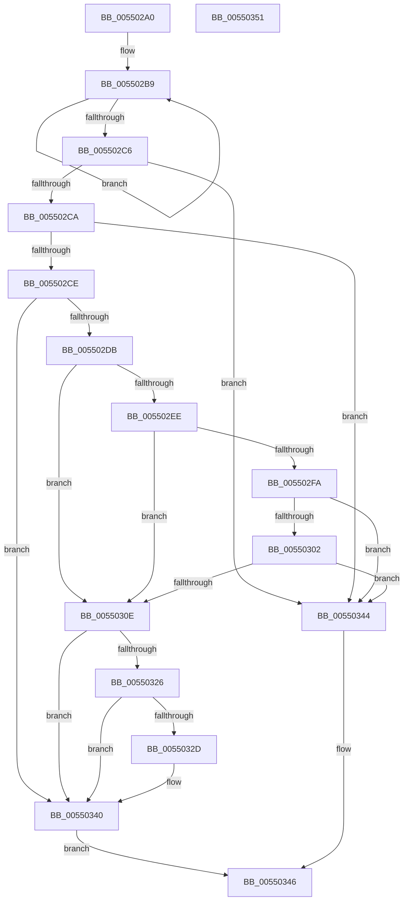

# HalCancelAdapterChannel

- RVA: `0x005502A0`–`0x00550352` (길이 `178` bytes)
- VA: `0x00000001405502A0`
- 실행 섹션: `.text`
- PDB 이름 있음: `예`; PDB Function 태그: `아니요`
- unwind 정보 RVA: `0x0005CAAC`
- 디코드: `55`개 명령, `178/178` bytes 표시
- 미해석 바이트: `0` (있으면 어셈블리에 `.byte`로 보존)

> 이 문서는 커널 이미지의 기계어와 PDB 기호를 분석해 생성했습니다. 4번과 5번은 함수 원형과 자료형을 바이너리 사용 방식에서 추정한 C 해석이며 원본 소스 복구 결과는 아닙니다.

## 1. Dependencies

- 직접 호출 지점: **6**; 고유 호출 대상: **6**
- 직접 호출자로 확인된 함수: **0**
- RIP 상대 이미지 참조: **0**

### Outgoing calls
- `0x005502D2` → [HalpDmaRemoveWcb](../53/HalpDmaRemoveWcb_function_0053E450.md) (function, `0x0053E450`)
- `0x005502E5` → [HalpDmaRemoveFromEmergencyLogicalAddressQueue](../53/HalpDmaRemoveFromEmergencyLogicalAddressQueue_function_0053E3B8.md) (function, `0x0053E3B8`)
- `0x005502F1` → [HalpDmaRemoveAdapterFromMasterQueue](../53/HalpDmaRemoveAdapterFromMasterQueue_function_0053E2FC.md) (function, `0x0053E2FC`)
- `0x00550305` → [HalpDmaRemoveAdapterFromChannelQueue](HalpDmaRemoveAdapterFromChannelQueue_function_00554374.md) (function, `0x00554374`)
- `0x00550318` → [IoFreeAdapterChannelV3](../3D/IoFreeAdapterChannelV3_function_003DAA20.md) (function, `0x003DAA20`)
- `0x00550336` → [ExFreePoolWithTag](../../poolcode/B8/ExFreePoolWithTag_function_00B82870.md) (function, `0x00B82870`)

### Direct callers
- 이 함수 시작 RVA로 연결되는 직접 call은 확인되지 않았습니다. 간접 호출은 완전히 역산할 수 없습니다.

### Static image references
- 디코드된 RIP-relative 메모리 참조가 없습니다.

## 2. Other-region calls and transfers

- 다른 실행 섹션으로 향하는 call: **1**
  - `0x00550336` → [ExFreePoolWithTag](../../poolcode/B8/ExFreePoolWithTag_function_00B82870.md) (`.text` → `POOLCODE`)
- 별도 외부 분기/꼬리 이동을 확인하지 못했습니다.

## 3. Assembly (complete function range)

```asm
005502A0  48 89 5C 24 08                  mov qword ptr [rsp + 8], rbx
005502A5  57                              push rdi
005502A6  48 83 EC 20                     sub rsp, 0x20
005502AA  49 8B F8                        mov rdi, r8
005502AD  48 8B D9                        mov rbx, rcx
005502B0  41 0F 0D 48 08                  prefetchw byte ptr [r8 + 8]
005502B5  41 8B 40 08                     mov eax, dword ptr [r8 + 8]
005502B9  8B D0                           mov edx, eax
005502BB  83 CA 02                        or edx, 2
005502BE  F0 41 0F B1 50 08               lock cmpxchg dword ptr [r8 + 8], edx
005502C4  75 F3                           jne 0x1405502b9
005502C6  A8 01                           test al, 1
005502C8  75 7A                           jne 0x140550344
005502CA  A8 04                           test al, 4
005502CC  74 76                           je 0x140550344
005502CE  49 8D 50 10                     lea rdx, [r8 + 0x10]
005502D2  E8 79 E1 FE FF                  call 0x14053e450
005502D7  84 C0                           test al, al
005502D9  75 65                           jne 0x140550340
005502DB  48 8D 93 58 02 00 00            lea rdx, [rbx + 0x258]
005502E2  48 8B CB                        mov rcx, rbx
005502E5  E8 CE E0 FE FF                  call 0x14053e3b8
005502EA  84 C0                           test al, al
005502EC  75 20                           jne 0x14055030e
005502EE  48 8B CB                        mov rcx, rbx
005502F1  E8 06 E0 FE FF                  call 0x14053e2fc
005502F6  84 C0                           test al, al
005502F8  75 14                           jne 0x14055030e
005502FA  38 83 B9 01 00 00               cmp byte ptr [rbx + 0x1b9], al
00550300  75 42                           jne 0x140550344
00550302  48 8B CB                        mov rcx, rbx
00550305  E8 6A 40 00 00                  call 0x140554374
0055030A  84 C0                           test al, al
0055030C  74 36                           je 0x140550344
0055030E  83 A3 F8 00 00 00 00            and dword ptr [rbx + 0xf8], 0
00550315  48 8B CB                        mov rcx, rbx
00550318  E8 03 A7 E8 FF                  call 0x1403daa20
0055031D  48 8B 4F 58                     mov rcx, qword ptr [rdi + 0x58]
00550321  48 85 C9                        test rcx, rcx
00550324  74 1A                           je 0x140550340
00550326  8B 11                           mov edx, dword ptr [rcx]
00550328  F6 C2 01                        test dl, 1
0055032B  75 13                           jne 0x140550340
0055032D  48 8B 89 A0 00 00 00            mov rcx, qword ptr [rcx + 0xa0]
00550334  33 D2                           xor edx, edx
00550336  E8 35 25 63 00                  call 0x140b82870
0055033B  48 83 67 58 00                  and qword ptr [rdi + 0x58], 0
00550340  B0 01                           mov al, 1
00550342  EB 02                           jmp 0x140550346
00550344  32 C0                           xor al, al
00550346  48 8B 5C 24 30                  mov rbx, qword ptr [rsp + 0x30]
0055034B  48 83 C4 20                     add rsp, 0x20
0055034F  5F                              pop rdi
00550350  C3                              ret
00550351  CC                              int3
```

## 4. C-style interpretation (structured pseudocode)

```c
__int64 __fastcall HalCancelAdapterChannel(__int64 a1, __int64 a2, __int64 a3)
{
    __int64 result;
    __int64 v_rsp;
    unsigned __int64 v_stack_p8;

    v_stack_p8 = v_rbx;
    v_rsp = (v_rsp) - (32);
loc_005502B9:
    a2 = (unsigned int)(((unsigned int)((unsigned int)((unsigned int)(*(unsigned int *)(a3 + 8))))) | (2));
    if (condition_is_not_equal) goto loc_005502B9;
    if ((((unsigned __int8)((unsigned int)(*(unsigned int *)(a3 + 8)))) & (1)) != 0) goto loc_00550344;
    if ((((unsigned __int8)((unsigned int)(*(unsigned int *)(a3 + 8)))) & (4)) == 0) goto loc_00550344;
    result = HalpDmaRemoveWcb(a1, a3 + 16, a3, a4);
    if ((unsigned __int8)(result) != 0) goto loc_00550340;
    result = HalpDmaRemoveFromEmergencyLogicalAddressQueue(a1, a1 + 600, a3, a4);
    if ((unsigned __int8)(result) != 0) goto loc_0055030E;
    result = HalpDmaRemoveAdapterFromMasterQueue(a1, a1 + 600, a3, a4);
    if ((unsigned __int8)(result) != 0) goto loc_0055030E;
    if ((*(unsigned __int8 *)(a1 + 441)) != ((unsigned __int8)(result))) goto loc_00550344;
    result = HalpDmaRemoveAdapterFromChannelQueue(a1, a1 + 600, a3, a4);
    if ((unsigned __int8)(result) == 0) goto loc_00550344;
loc_0055030E:
    result = IoFreeAdapterChannelV3(a1, a1 + 600, a3, a4);
    if (*(unsigned __int64 *)(a3 + 88) == 0) goto loc_00550340;
    if ((((unsigned __int8)((unsigned int)(*(unsigned int *)(*(unsigned __int64 *)(a3 + 88))))) & (1)) == 0) {
        a1 = *(unsigned __int64 *)(*(unsigned __int64 *)(a3 + 88) + 160);
        a2 = 0;
        result = ExFreePoolWithTag(a1, a2, a3, a4);
    }
    goto loc_00550346;
loc_00550344:
    result = 0;
loc_00550346:
    v_rsp = (v_rsp) + (32);
    return result;
}
```

## 5. (Beta) C Style

```c
int64_t HalCancelAdapterChannel(void *Arg1, int64_t Arg2, void *Arg3)
{
    uint8_t *arg1 = (uint8_t *)Arg1;
    uint8_t *arg3 = (uint8_t *)Arg3;

    int64_t result;
    int64_t local_rsp;
    uint64_t v_stack_p8;

    v_stack_p8 = local_rbx;
    local_rsp = (local_rsp) - (32);
loc_005502B9:
    Arg2 = (uint32_t)(((uint32_t)((uint32_t)((uint32_t)(*(uint32_t *)(arg3 + 0x8))))) | (2));
    if (condition_is_not_equal) goto loc_005502B9;
    if ((((uint8_t)((uint32_t)(*(uint32_t *)(arg3 + 0x8)))) & (1)) != 0) goto loc_00550344;
    if ((((uint8_t)((uint32_t)(*(uint32_t *)(arg3 + 0x8)))) & (4)) == 0) goto loc_00550344;
    result = HalpDmaRemoveWcb(Arg1, Arg3 + 16, Arg3, a4);
    if ((uint8_t)(result) != 0) goto loc_00550340;
    result = HalpDmaRemoveFromEmergencyLogicalAddressQueue(Arg1, Arg1 + 600, Arg3, a4);
    if ((uint8_t)(result) != 0) goto loc_0055030E;
    result = HalpDmaRemoveAdapterFromMasterQueue(Arg1, Arg1 + 600, Arg3, a4);
    if ((uint8_t)(result) != 0) goto loc_0055030E;
    if ((*(uint8_t *)(arg1 + 0x1B9)) != ((uint8_t)(result))) goto loc_00550344;
    result = HalpDmaRemoveAdapterFromChannelQueue(Arg1, Arg1 + 600, Arg3, a4);
    if ((uint8_t)(result) == 0) goto loc_00550344;
loc_0055030E:
    result = IoFreeAdapterChannelV3(Arg1, Arg1 + 600, Arg3, a4);
    if (*(uint64_t *)(arg3 + 0x58) == 0) goto loc_00550340;
    if ((((uint8_t)((uint32_t)(*(uint32_t *)(*(uint64_t *)(arg3 + 0x58))))) & (1)) == 0) {
        Arg1 = *(uint64_t *)(*(uint64_t *)(arg3 + 0x58) + 0xA0);
        Arg2 = 0;
        result = ExFreePoolWithTag(Arg1, Arg2, Arg3, a4);
    }
    goto loc_00550346;
loc_00550344:
    result = 0;
loc_00550346:
    local_rsp = (local_rsp) + (32);
    return result;
}
```

### 관측된 메모리 오프셋

구조체 형식이 확인되지 않은 접근은 인자 기준의 오프셋으로만 기록했습니다.

| 기준 인자 | 오프셋 표현 | 폭 (bit) | 접근 |
|---|---:|---:|---|
| `Arg1` | `+ 0xF8` | `32` | `R/W` |
| `Arg1` | `+ 0x1B9` | `8` | `R` |
| `Arg1` | `+ 0x258` | `64` | `R` |
| `Arg3` | `+ 0x8` | `8` | `R` |
| `Arg3` | `+ 0x8` | `32` | `R` |
| `Arg3` | `+ 0x10` | `64` | `R` |
| `Arg3` | `+ 0x58` | `64` | `R` |
| `Arg3` | `+ 0x58` | `64` | `R/W` |

## 6. Execution-region graph

[열기: 2D/3D 그래프와 함수 탐색 컨트롤 패널](../../../control-panel.html?section=text&rva=0x005502A0&view=graph)

- 2D 그래프는 위에서 아래로 흐르고, 3D 그래프는 빈 공간을 드래그해 회전합니다. Shift+드래그는 이동, 휠은 확대·축소, 함수 노드 선택은 대상 보고서 이동입니다.

### Static fallback


