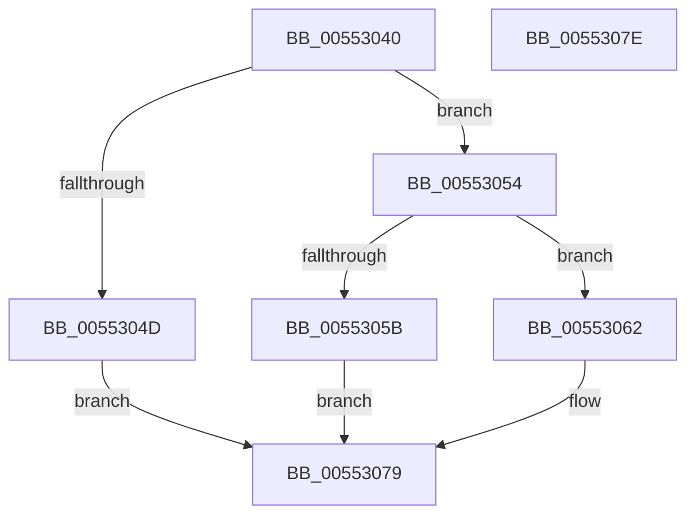

# HalCancelMappedTransfer

- RVA: `0x00553040`–`0x0055307F` (길이 `63` bytes)
- VA: `0x0000000140553040`
- 실행 섹션: `.text`
- PDB 이름 있음: `예`; PDB Function 태그: `아니요`
- unwind 정보 RVA: `0x0005C788`
- 디코드: `18`개 명령, `63/63` bytes 표시
- 미해석 바이트: `0` (있으면 어셈블리에 `.byte`로 보존)

> 이 문서는 커널 이미지의 기계어와 PDB 기호를 분석해 생성했습니다. 4번과 5번은 함수 원형과 자료형을 바이너리 사용 방식에서 추정한 C 해석이며 원본 소스 복구 결과는 아닙니다.

## 1. Dependencies

- 직접 호출 지점: **1**; 고유 호출 대상: **1**
- 직접 호출자로 확인된 함수: **0**
- RIP 상대 이미지 참조: **0**

### Outgoing calls
- `0x00553072` → [HalpDmaControllerCancelTransfer](HalpDmaControllerCancelTransfer_function_00554090.md) (function, `0x00554090`)

### Direct callers
- 이 함수 시작 RVA로 연결되는 직접 call은 확인되지 않았습니다. 간접 호출은 완전히 역산할 수 없습니다.

### Static image references
- 디코드된 RIP-relative 메모리 참조가 없습니다.

## 2. Other-region calls and transfers

- 다른 실행 섹션으로 향하는 call: **0**
- 별도 외부 분기/꼬리 이동을 확인하지 못했습니다.

## 3. Assembly (complete function range)

```asm
00553040  48 83 EC 28                     sub rsp, 0x28
00553044  80 B9 B9 01 00 00 00            cmp byte ptr [rcx + 0x1b9], 0
0055304B  74 07                           je 0x140553054
0055304D  B8 0D 00 00 C0                  mov eax, 0xc000000d
00553052  EB 25                           jmp 0x140553079
00553054  8B 42 0C                        mov eax, dword ptr [rdx + 0xc]
00553057  A8 01                           test al, 1
00553059  74 07                           je 0x140553062
0055305B  B8 20 01 00 C0                  mov eax, 0xc0000120
00553060  EB 17                           jmp 0x140553079
00553062  4C 8B C2                        mov r8, rdx
00553065  8B 91 7C 01 00 00               mov edx, dword ptr [rcx + 0x17c]
0055306B  48 8B 89 70 01 00 00            mov rcx, qword ptr [rcx + 0x170]
00553072  E8 19 10 00 00                  call 0x140554090
00553077  33 C0                           xor eax, eax
00553079  48 83 C4 28                     add rsp, 0x28
0055307D  C3                              ret
0055307E  CC                              int3
```

## 4. C-style interpretation (structured pseudocode)

```c
__int64 __fastcall HalCancelMappedTransfer(__int64 a1, __int64 a2)
{
    __int64 result;
    __int64 v_rsp;

    v_rsp = (v_rsp) - (40);
    if ((*(unsigned __int8 *)(a1 + 441)) == 0) goto loc_00553054;
    goto loc_00553079;
loc_00553054:
    if ((((unsigned __int8)((unsigned int)(*(unsigned int *)(a2 + 12)))) & (1)) == 0) goto loc_00553062;
    goto loc_00553079;
loc_00553062:
    result = HalpDmaControllerCancelTransfer(*(unsigned __int64 *)(a1 + 368), (unsigned int)(*(unsigned int *)(a1 + 380)), a2, a4);
    result = 0;
loc_00553079:
    v_rsp = (v_rsp) + (40);
    return result;
}
```

## 5. (Beta) C Style

```c
int64_t HalCancelMappedTransfer(void *Arg1, void *Arg2)
{
    uint8_t *arg1 = (uint8_t *)Arg1;
    uint8_t *arg2 = (uint8_t *)Arg2;

    int64_t result;
    int64_t local_rsp;

    local_rsp = (local_rsp) - (40);
    if ((*(uint8_t *)(arg1 + 0x1B9)) == 0) goto loc_00553054;
    goto loc_00553079;
loc_00553054:
    if ((((uint8_t)((uint32_t)(*(uint32_t *)(arg2 + 0xC)))) & (1)) == 0) goto loc_00553062;
    goto loc_00553079;
loc_00553062:
    result = HalpDmaControllerCancelTransfer(*(uint64_t *)(arg1 + 0x170), (uint32_t)(*(uint32_t *)(arg1 + 0x17C)), Arg2, a4);
    result = 0;
loc_00553079:
    local_rsp = (local_rsp) + (40);
    return result;
}
```

### 관측된 메모리 오프셋

구조체 형식이 확인되지 않은 접근은 인자 기준의 오프셋으로만 기록했습니다.

| 기준 인자 | 오프셋 표현 | 폭 (bit) | 접근 |
|---|---:|---:|---|
| `Arg1` | `+ 0x170` | `64` | `R` |
| `Arg1` | `+ 0x17C` | `32` | `R` |
| `Arg1` | `+ 0x1B9` | `8` | `R` |
| `Arg2` | `+ 0xC` | `32` | `R` |

## 6. Execution-region graph

[열기: 2D/3D 그래프와 함수 탐색 컨트롤 패널](../../../control-panel.html?section=text&rva=0x00553040&view=graph)

- 2D 그래프는 위에서 아래로 흐르고, 3D 그래프는 빈 공간을 드래그해 회전합니다. Shift+드래그는 이동, 휠은 확대·축소, 함수 노드 선택은 대상 보고서 이동입니다.

### Static fallback


