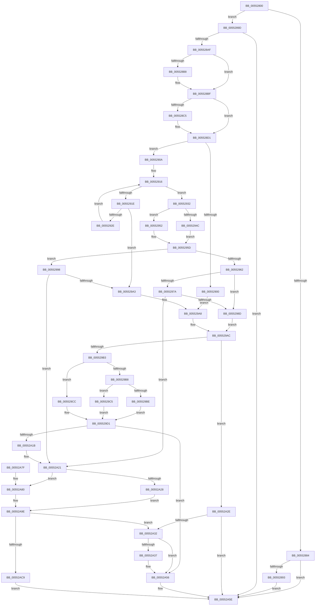

# HalCreateCommonBufferFromMdlDmaThin

- RVA: `0x00552800`–`0x00552AD6` (길이 `726` bytes)
- VA: `0x0000000140552800`
- 실행 섹션: `.text`
- PDB 이름 있음: `예`; PDB Function 태그: `아니요`
- unwind 정보 RVA: `0x000C43D0`
- 디코드: `205`개 명령, `726/726` bytes 표시
- 미해석 바이트: `0` (있으면 어셈블리에 `.byte`로 보존)

> 이 문서는 커널 이미지의 기계어와 PDB 기호를 분석해 생성했습니다. 4번과 5번은 함수 원형과 자료형을 바이너리 사용 방식에서 추정한 C 해석이며 원본 소스 복구 결과는 아닙니다.

## 1. Dependencies

- 직접 호출 지점: **8**; 고유 호출 대상: **7**
- 직접 호출자로 확인된 함수: **0**
- RIP 상대 이미지 참조: **2**

### Outgoing calls
- `0x00552879` → [HalpCreateCommonBufferFromMdlVerifyParams](HalpCreateCommonBufferFromMdlVerifyParams_function_00550478.md) (function, `0x00550478`)
- `0x005528A0` → [HalpDmaReferenceDomainObject](../3E/HalpDmaReferenceDomainObject_function_003E9B08.md) (function, `0x003E9B08`)
- `0x00552A10` → [guard_dispatch_icall](../6B/guard_dispatch_icall_function_006BAAD0.md) (function, `0x006BAAD0`)
- `0x00552A51` → [guard_dispatch_icall](../6B/guard_dispatch_icall_function_006BAAD0.md) (function, `0x006BAAD0`)
- `0x00552A59` → [HalpDmaDereferenceDomainObject](../3F/HalpDmaDereferenceDomainObject_function_003F69DC.md) (function, `0x003F69DC`)
- `0x00552A67` → [_security_check_cookie](../6A/_security_check_cookie_function_006AC640.md) (function, `0x006AC640`)
- `0x00552A99` → [MmMapLockedPagesSpecifyCache](../31/MmMapLockedPagesSpecifyCache_function_00318800.md) (function, `0x00318800`)
- `0x00552ABA` → [HalpAllocateCommonBufferEntry](../3E/HalpAllocateCommonBufferEntry_function_003E99F4.md) (function, `0x003E99F4`)

### Direct callers
- 이 함수 시작 RVA로 연결되는 직접 call은 확인되지 않았습니다. 간접 호출은 완전히 역산할 수 없습니다.

### Static image references
- `0x00552818` → RVA `0x00E0A740` (`.data`; read)
- `0x005529F4` → RVA `0x00FC1778` (`.data`; read)

## 2. Other-region calls and transfers

- 다른 실행 섹션으로 향하는 call: **0**
- 별도 외부 분기/꼬리 이동을 확인하지 못했습니다.

## 3. Assembly (complete function range)

```asm
00552800  40 55                           push rbp
00552802  53                              push rbx
00552803  56                              push rsi
00552804  41 54                           push r12
00552806  41 55                           push r13
00552808  41 56                           push r14
0055280A  41 57                           push r15
0055280C  48 8D 6C 24 E1                  lea rbp, [rsp - 0x1f]
00552811  48 81 EC C0 00 00 00            sub rsp, 0xc0
00552818  48 8B 05 21 7F 8B 00            mov rax, qword ptr [rip + 0x8b7f21]
0055281F  48 33 C4                        xor rax, rsp
00552822  48 89 45 0F                     mov qword ptr [rbp + 0xf], rax
00552826  4C 8B B1 00 02 00 00            mov r14, qword ptr [rcx + 0x200]
0055282D  0F 57 C0                        xorps xmm0, xmm0
00552830  48 89 55 B7                     mov qword ptr [rbp - 0x49], rdx
00552834  33 F6                           xor esi, esi
00552836  48 8B 55 7F                     mov rdx, qword ptr [rbp + 0x7f]
0055283A  41 8B C1                        mov eax, r9d
0055283D  48 89 55 DF                     mov qword ptr [rbp - 0x21], rdx
00552841  4C 8D 4D E7                     lea r9, [rbp - 0x19]
00552845  33 D2                           xor edx, edx
00552847  48 89 4D AF                     mov qword ptr [rbp - 0x51], rcx
0055284B  4D 8B D0                        mov r10, r8
0055284E  48 89 55 07                     mov qword ptr [rbp + 7], rdx
00552852  89 55 CF                        mov dword ptr [rbp - 0x31], edx
00552855  48 8D 4D B7                     lea rcx, [rbp - 0x49]
00552859  49 8B D2                        mov rdx, r10
0055285C  48 89 75 A7                     mov qword ptr [rbp - 0x59], rsi
00552860  44 8B C0                        mov r8d, eax
00552863  48 89 75 9F                     mov qword ptr [rbp - 0x61], rsi
00552867  0F 11 45 E7                     movups xmmword ptr [rbp - 0x19], xmm0
0055286B  44 8A E6                        mov r12b, sil
0055286E  44 8B EE                        mov r13d, esi
00552871  0F 11 45 F7                     movups xmmword ptr [rbp - 9], xmm0
00552875  0F 11 45 BF                     movups xmmword ptr [rbp - 0x41], xmm0
00552879  E8 FA DB FF FF                  call 0x140550478
0055287E  8B D8                           mov ebx, eax
00552880  85 C0                           test eax, eax
00552882  79 19                           jns 0x14055289d
00552884  8D 88 11 FF FF 3F               lea ecx, [rax + 0x3fffff11]
0055288A  83 F9 01                        cmp ecx, 1
0055288D  0F 87 CB 01 00 00               ja 0x140552a5e
00552893  BB 0D 00 00 C0                  mov ebx, 0xc000000d
00552898  E9 C1 01 00 00                  jmp 0x140552a5e
0055289D  49 8B CE                        mov rcx, r14
005528A0  E8 63 72 E9 FF                  call 0x1403e9b08
005528A5  8B D8                           mov ebx, eax
005528A7  85 C0                           test eax, eax
005528A9  0F 88 AF 01 00 00               js 0x140552a5e
005528AF  49 8B 46 38                     mov rax, qword ptr [r14 + 0x38]
005528B3  48 85 C0                        test rax, rax
005528B6  74 07                           je 0x1405528bf
005528B8  C6 80 0C 02 00 00 01            mov byte ptr [rax + 0x20c], 1
005528BF  40 38 75 0B                     cmp byte ptr [rbp + 0xb], sil
005528C3  74 0C                           je 0x1405528d1
005528C5  48 8D 45 E7                     lea rax, [rbp - 0x19]
005528C9  48 89 45 9F                     mov qword ptr [rbp - 0x61], rax
005528CD  4C 8D 6D EF                     lea r13, [rbp - 0x11]
005528D1  4C 8B 7D B7                     mov r15, qword ptr [rbp - 0x49]
005528D5  33 DB                           xor ebx, ebx
005528D7  48 8B 4D FF                     mov rcx, qword ptr [rbp - 1]
005528DB  4C 8B 45 07                     mov r8, qword ptr [rbp + 7]
005528DF  48 8B 75 F7                     mov rsi, qword ptr [rbp - 9]
005528E3  45 8B 5F 2C                     mov r11d, dword ptr [r15 + 0x2c]
005528E7  4C 03 D9                        add r11, rcx
005528EA  48 89 4D D7                     mov qword ptr [rbp - 0x29], rcx
005528EE  49 C1 EB 0C                     shr r11, 0xc
005528F2  49 83 C3 06                     add r11, 6
005528F6  4F 8D 1C DF                     lea r11, [r15 + r11*8]
005528FA  41 83 F8 02                     cmp r8d, 2
005528FE  74 0A                           je 0x14055290a
00552900  BB BB 00 00 C0                  mov ebx, 0xc00000bb
00552905  E9 9E 00 00 00                  jmp 0x1405529a8
0055290A  4C 8B CE                        mov r9, rsi
0055290D  BA 01 00 00 00                  mov edx, 1
00552912  49 C1 E9 0C                     shr r9, 0xc
00552916  44 8B D2                        mov r10d, edx
00552919  4D 3B D1                        cmp r10, r9
0055291C  73 14                           jae 0x140552932
0055291E  4B 8B 04 D3                     mov rax, qword ptr [r11 + r10*8]
00552922  8D 4A FF                        lea ecx, [rdx - 1]
00552925  48 FF C8                        dec rax
00552928  49 3B 04 CB                     cmp rax, qword ptr [r11 + rcx*8]
0055292C  75 75                           jne 0x1405529a3
0055292E  FF C2                           inc edx
00552930  EB E4                           jmp 0x140552916
00552932  49 8B 03                        mov rax, qword ptr [r11]
00552935  48 8B 4D AF                     mov rcx, qword ptr [rbp - 0x51]
00552939  48 C1 E0 0C                     shl rax, 0xc
0055293D  48 89 45 A7                     mov qword ptr [rbp - 0x59], rax
00552941  8B 89 C0 01 00 00               mov ecx, dword ptr [rcx + 0x1c0]
00552947  83 F9 40                        cmp ecx, 0x40
0055294A  72 06                           jb 0x140552952
0055294C  48 83 CA FF                     or rdx, 0xffffffffffffffff
00552950  EB 0B                           jmp 0x14055295d
00552952  BA 01 00 00 00                  mov edx, 1
00552957  48 D3 E2                        shl rdx, cl
0055295A  48 FF CA                        dec rdx
0055295D  4D 85 ED                        test r13, r13
00552960  74 36                           je 0x140552998
00552962  4D 8B 45 00                     mov r8, qword ptr [r13]
00552966  4C 8B 4D 9F                     mov r9, qword ptr [rbp - 0x61]
0055296A  4C 3B C2                        cmp r8, rdx
0055296D  4C 0F 43 C2                     cmovae r8, rdx
00552971  4D 89 45 00                     mov qword ptr [r13], r8
00552975  49 3B 01                        cmp rax, qword ptr [r9]
00552978  72 13                           jb 0x14055298d
0055297A  48 8B 4D A7                     mov rcx, qword ptr [rbp - 0x59]
0055297E  48 FF C9                        dec rcx
00552981  48 03 CE                        add rcx, rsi
00552984  49 3B C8                        cmp rcx, r8
00552987  0F 86 94 00 00 00               jbe 0x140552a21
0055298D  4C 8B 45 07                     mov r8, qword ptr [rbp + 7]
00552991  BB 0D 00 00 C0                  mov ebx, 0xc000000d
00552996  EB 14                           jmp 0x1405529ac
00552998  48 FF C8                        dec rax
0055299B  48 03 C6                        add rax, rsi
0055299E  48 3B C2                        cmp rax, rdx
005529A1  76 7E                           jbe 0x140552a21
005529A3  BB 0D 00 00 C0                  mov ebx, 0xc000000d
005529A8  4C 8B 4D 9F                     mov r9, qword ptr [rbp - 0x61]
005529AC  41 83 7E 30 02                  cmp dword ptr [r14 + 0x30], 2
005529B1  75 7B                           jne 0x140552a2e
005529B3  45 85 C0                        test r8d, r8d
005529B6  74 14                           je 0x1405529cc
005529B8  41 83 F8 01                     cmp r8d, 1
005529BC  74 07                           je 0x1405529c5
005529BE  BA 03 00 00 00                  mov edx, 3
005529C3  EB 0C                           jmp 0x1405529d1
005529C5  BA 02 00 00 00                  mov edx, 2
005529CA  EB 05                           jmp 0x1405529d1
005529CC  BA 01 00 00 00                  mov edx, 1
005529D1  C7 45 BF 02 00 00 00            mov dword ptr [rbp - 0x41], 2
005529D8  48 8D 4D A7                     lea rcx, [rbp - 0x59]
005529DC  48 89 4C 24 30                  mov qword ptr [rsp + 0x30], rcx
005529E1  4C 8D 45 BF                     lea r8, [rbp - 0x41]
005529E5  4C 89 5D C7                     mov qword ptr [rbp - 0x39], r11
005529E9  48 8B C6                        mov rax, rsi
005529EC  48 C1 E8 0C                     shr rax, 0xc
005529F0  48 89 45 CF                     mov qword ptr [rbp - 0x31], rax
005529F4  48 8B 05 7D ED A6 00            mov rax, qword ptr [rip + 0xa6ed7d]
005529FB  49 8B 4E 28                     mov rcx, qword ptr [r14 + 0x28]
005529FF  4C 89 6C 24 28                  mov qword ptr [rsp + 0x28], r13
00552A04  4C 89 4C 24 20                  mov qword ptr [rsp + 0x20], r9
00552A09  45 33 C9                        xor r9d, r9d
00552A0C  48 8B 40 38                     mov rax, qword ptr [rax + 0x38]
00552A10  E8 BB 80 16 00                  call 0x1406baad0
00552A15  8B D8                           mov ebx, eax
00552A17  85 C0                           test eax, eax
00552A19  78 3B                           js 0x140552a56
00552A1B  41 B4 01                        mov r12b, 1
00552A1E  49 8B DF                        mov rbx, r15
00552A21  41 F6 47 0A 05                  test byte ptr [r15 + 0xa], 5
00552A26  74 58                           je 0x140552a80
00552A28  49 8B 47 18                     mov rax, qword ptr [r15 + 0x18]
00552A2C  EB 70                           jmp 0x140552a9e
00552A2E  85 DB                           test ebx, ebx
00552A30  79 2C                           jns 0x140552a5e
00552A32  45 84 E4                        test r12b, r12b
00552A35  74 1F                           je 0x140552a56
00552A37  48 8B 05 3A ED A6 00            mov rax, qword ptr [rip + 0xa6ed3a]
00552A3E  48 8B 55 A7                     mov rdx, qword ptr [rbp - 0x59]
00552A42  49 8B 4E 28                     mov rcx, qword ptr [r14 + 0x28]
00552A46  48 C1 EE 0C                     shr rsi, 0xc
00552A4A  48 8B 40 40                     mov rax, qword ptr [rax + 0x40]
00552A4E  4C 8B C6                        mov r8, rsi
00552A51  E8 7A 80 16 00                  call 0x1406baad0
00552A56  49 8B CE                        mov rcx, r14
00552A59  E8 7E 3F EA FF                  call 0x1403f69dc
00552A5E  8B C3                           mov eax, ebx
00552A60  48 8B 4D 0F                     mov rcx, qword ptr [rbp + 0xf]
00552A64  48 33 CC                        xor rcx, rsp
00552A67  E8 D4 9B 15 00                  call 0x1406ac640
00552A6C  48 81 C4 C0 00 00 00            add rsp, 0xc0
00552A73  41 5F                           pop r15
00552A75  41 5E                           pop r14
00552A77  41 5D                           pop r13
00552A79  41 5C                           pop r12
00552A7B  5E                              pop rsi
00552A7C  5B                              pop rbx
00552A7D  5D                              pop rbp
00552A7E  C3                              ret
00552A7F  CC                              int3
00552A80  45 33 C9                        xor r9d, r9d
00552A83  C7 44 24 28 00 00 00 40         mov dword ptr [rsp + 0x28], 0x40000000
00552A8B  83 64 24 20 00                  and dword ptr [rsp + 0x20], 0
00552A90  33 D2                           xor edx, edx
00552A92  49 8B CF                        mov rcx, r15
00552A95  45 8D 41 01                     lea r8d, [r9 + 1]
00552A99  E8 62 5D DC FF                  call 0x140318800
00552A9E  48 8B 55 D7                     mov rdx, qword ptr [rbp - 0x29]
00552AA2  4D 8B CE                        mov r9, r14
00552AA5  48 83 64 24 28 00               and qword ptr [rsp + 0x28], 0
00552AAB  48 03 D0                        add rdx, rax
00552AAE  4C 8B 45 A7                     mov r8, qword ptr [rbp - 0x59]
00552AB2  48 8B CB                        mov rcx, rbx
00552AB5  C6 44 24 20 00                  mov byte ptr [rsp + 0x20], 0
00552ABA  E8 35 6F E9 FF                  call 0x1403e99f4
00552ABF  8B D8                           mov ebx, eax
00552AC1  85 C0                           test eax, eax
00552AC3  0F 88 69 FF FF FF               js 0x140552a32
00552AC9  48 8B 4D DF                     mov rcx, qword ptr [rbp - 0x21]
00552ACD  48 8B 45 A7                     mov rax, qword ptr [rbp - 0x59]
00552AD1  48 89 01                        mov qword ptr [rcx], rax
00552AD4  EB 88                           jmp 0x140552a5e
```

## 4. C-style interpretation (structured pseudocode)

```c
__int64 __fastcall HalCreateCommonBufferFromMdlDmaThin(__int64 a1, __int64 a2, __int64 a3, int a4, __int64 a5)
{
    __int64 result;
    __int64 v_r11;
    __int64 v_r13;
    __int64 v_rbx;
    __int64 v_rsi;
    __int64 v_rsp;
    unsigned __int64 v_stack_m48;
    unsigned __int8 v_stack_m4C;
    unsigned __int64 v_stack_m50;
    unsigned __int64 v_stack_m57;
    unsigned __int64 v_stack_m58;
    unsigned __int64 v_stack_m60;
    unsigned __int64 v_stack_m68;
    unsigned __int64 v_stack_m70;
    unsigned __int64 v_stack_m78;
    unsigned __int64 v_stack_m80;
    unsigned int v_stack_m88;
    unsigned __int64 v_stack_m90;
    unsigned __int64 v_stack_m98;
    unsigned __int64 v_stack_mA0;
    unsigned __int64 v_stack_mA8;
    unsigned __int64 v_stack_mB0;
    unsigned __int64 v_stack_mB8;
    unsigned __int64 v_stack_mC8;
    unsigned __int64 v_stack_mD0;
    unsigned __int64 v_stack_mD8;
    unsigned int v_stack_p20;
    unsigned int v_stack_p28;

    v_rsp = (v_rsp) - (192);
    result = (*(unsigned __int64 *)(v_rip + 9142049)) ^ (v_rsp);
    v_stack_m48 = result;
    v_stack_mA0 = a2;
    v_rsi = 0;
    v_stack_m78 = a5;
    a2 = 0;
    v_stack_mA8 = a1;
    v_stack_m50 = 0;
    v_stack_m88 = 0;
    v_stack_mB0 = 0;
    v_stack_mB8 = 0;
    v_stack_m70 = v_xmm0;
    v_stack_m60 = v_xmm0;
    v_stack_m98 = v_xmm0;
    result = HalpCreateCommonBufferFromMdlVerifyParams(v_stack_mA0, a3, (unsigned int)((unsigned int)((unsigned int)(a4))), v_stack_m70);
    if (!sign_flag) goto loc_0055289D;
    if (((unsigned int)(result + 1073741585)) > 1) goto loc_00552A5E;
    goto loc_00552A5E;
loc_0055289D:
    result = HalpDmaReferenceDomainObject(*(unsigned __int64 *)(a1 + 512), a3, (unsigned int)((unsigned int)((unsigned int)(a4))), v_stack_m70);
    if (sign_flag) goto loc_00552A5E;
    if (*(unsigned __int64 *)(*(unsigned __int64 *)(a1 + 512) + 56) != 0) {
        *(unsigned __int8 *)(*(unsigned __int64 *)(*(unsigned __int64 *)(a1 + 512) + 56) + 524) = 1;
    }
    result = *(unsigned __int64 *)(*(unsigned __int64 *)(a1 + 512) + 56);
    v_r13 = 0;
    if (v_stack_m4C != 0) {
        result = v_stack_m70;
        v_stack_mB8 = result;
        v_r13 = v_stack_m68;
    }
    v_rbx = 0;
    v_r11 = ((unsigned int)(*(unsigned int *)(v_stack_mA0 + 44))) + (v_stack_m58);
    v_stack_m80 = v_stack_m58;
    v_r11 = (v_r11) >> (12);
    v_r11 = (v_r11) + (6);
    if (((unsigned int)(v_stack_m50)) == 2) goto loc_0055290A;
    goto loc_005529A8;
loc_0055290A:
    a4 = (v_stack_m60) >> (12);
loc_00552916:
    if (1 >= a4) goto loc_00552932;
    result = (*(unsigned __int64 *)(v_stack_mA0 + v_r11 * 8 + 1 * 8)) - 1;
    if (result != (*(unsigned __int64 *)(v_stack_mA0 + v_r11 * 8 + 1 - 1 * 8))) goto loc_005529A3;
    a2 = (unsigned int)((1) + 1);
    goto loc_00552916;
loc_00552932:
    result = (*(unsigned __int64 *)(v_stack_mA0 + v_r11 * 8)) << (12);
    v_stack_mB0 = result;
    if (((unsigned int)((unsigned int)(*(unsigned int *)(v_stack_mA8 + 448)))) < 64) goto loc_00552952;
    a2 = (a2) | (-1);
    goto loc_0055295D;
loc_00552952:
    a2 = (1) << ((unsigned __int8)((unsigned int)(*(unsigned int *)(v_stack_mA8 + 448))));
    a2 = (a2) - 1;
loc_0055295D:
    if (v_r13 == 0) goto loc_00552998;
    a3 = *(unsigned __int64 *)(v_r13);
    if ((*(unsigned __int64 *)(v_r13)) >= a2) { a3 = a2; }
    *(unsigned __int64 *)(v_r13) = a3;
    if (result < (*(unsigned __int64 *)(v_stack_mB8))) goto loc_0055298D;
    a1 = (v_stack_mB0) - 1;
    a1 = (a1) + (v_stack_m60);
    if (a1 <= a3) goto loc_00552A21;
loc_0055298D:
    goto loc_005529AC;
loc_00552998:
    result = (result) - 1;
    result = (result) + (v_stack_m60);
    if (result <= a2) goto loc_00552A21;
loc_005529A3:
loc_005529A8:
loc_005529AC:
    if ((*(unsigned int *)(*(unsigned __int64 *)(a1 + 512) + 48)) != 2) goto loc_00552A2E;
    if ((unsigned int)(v_stack_m50) == 0) goto loc_005529CC;
    if (((unsigned int)(v_stack_m50)) == 1) goto loc_005529C5;
    goto loc_005529D1;
loc_005529C5:
    goto loc_005529D1;
loc_005529CC:
loc_005529D1:
    v_stack_m98 = 2;
    v_stack_mC8 = v_stack_mB0;
    v_stack_m90 = v_stack_mA0 + v_r11 * 8;
    result = (v_stack_m60) >> (12);
    v_stack_m88 = result;
    v_stack_mD0 = v_r13;
    v_stack_mD8 = v_stack_mB8;
    a4 = 0;
    result = guard_dispatch_icall(*(unsigned __int64 *)(*(unsigned __int64 *)(a1 + 512) + 40), 1, v_stack_m98, a4);
    if (sign_flag) goto loc_00552A56;
loc_00552A21:
    if (((*(unsigned __int8 *)(v_stack_mA0 + 10)) & (5)) == 0) goto loc_00552A80;
    goto loc_00552A9E;
loc_00552A2E:
    if (!sign_flag) goto loc_00552A5E;
loc_00552A32:
    result = *(unsigned __int64 *)(v_stack_mA0 + 24);
    v_rsi = v_stack_m60;
    if (1 != 0) {
        result = *(unsigned __int64 *)(v_rip + 10939706);
        a2 = v_stack_mB0;
        a1 = *(unsigned __int64 *)(*(unsigned __int64 *)(a1 + 512) + 40);
        v_rsi = (v_stack_m60) >> (12);
        result = *(unsigned __int64 *)(result + 64);
        a3 = v_rsi;
        result = guard_dispatch_icall(a1, a2, a3, a4);
    }
    result = HalpDmaDereferenceDomainObject(*(unsigned __int64 *)(a1 + 512), a2, a3, a4);
loc_00552A5E:
    a1 = (v_stack_m48) ^ (v_rsp);
    result = _security_check_cookie(a1, a2, a3, a4);
    v_rsp = (v_rsp) + (192);
    return result;
loc_00552A80:
    a4 = 0;
    v_stack_p28 = 0x40000000ULL;
    a2 = 0;
    result = MmMapLockedPagesSpecifyCache(v_stack_mA0, a2, a4 + 1, a4);
loc_00552A9E:
    a2 = (v_stack_m80) + (result);
    v_stack_p20 = 0;
    result = HalpAllocateCommonBufferEntry(v_stack_mA0, a2, v_stack_mB0, *(unsigned __int64 *)(a1 + 512));
    if (sign_flag) goto loc_00552A32;
    *(unsigned __int64 *)(v_stack_m78) = v_stack_mB0;
    goto loc_00552A5E;
}
```

## 5. (Beta) C Style

```c
int64_t HalCreateCommonBufferFromMdlDmaThin(void *Arg1, int64_t Arg2, int64_t Arg3, int32_t Arg4, int64_t Arg5)
{
    uint8_t *arg1 = (uint8_t *)Arg1;

    int64_t result;
    int64_t local_r11;
    int64_t local_r13;
    int64_t local_rbx;
    int64_t local_rsi;
    int64_t local_rsp;
    uint64_t v_stack_m48;
    uint8_t v_stack_m4C;
    uint64_t v_stack_m50;
    uint64_t v_stack_m57;
    uint64_t v_stack_m58;
    uint64_t v_stack_m60;
    uint64_t v_stack_m68;
    uint64_t v_stack_m70;
    uint64_t v_stack_m78;
    uint64_t v_stack_m80;
    uint32_t v_stack_m88;
    uint64_t v_stack_m90;
    uint64_t v_stack_m98;
    uint64_t v_stack_mA0;
    uint64_t v_stack_mA8;
    uint64_t v_stack_mB0;
    uint64_t v_stack_mB8;
    uint64_t v_stack_mC8;
    uint64_t v_stack_mD0;
    uint64_t v_stack_mD8;
    uint32_t v_stack_p20;
    uint32_t v_stack_p28;

    local_rsp = (local_rsp) - (192);
    result = (*(uint64_t *)(v_rip + 0x8B7F21)) ^ (local_rsp);
    v_stack_m48 = result;
    v_stack_mA0 = Arg2;
    local_rsi = 0;
    v_stack_m78 = Arg5;
    Arg2 = 0;
    v_stack_mA8 = Arg1;
    v_stack_m50 = 0;
    v_stack_m88 = 0;
    v_stack_mB0 = 0;
    v_stack_mB8 = 0;
    v_stack_m70 = v_xmm0;
    v_stack_m60 = v_xmm0;
    v_stack_m98 = v_xmm0;
    result = HalpCreateCommonBufferFromMdlVerifyParams(v_stack_mA0, Arg3, (uint32_t)((uint32_t)((uint32_t)(Arg4))), v_stack_m70);
    if (!sign_flag) goto loc_0055289D;
    if (((uint32_t)(result + 1073741585)) > 1) goto loc_00552A5E;
    goto loc_00552A5E;
loc_0055289D:
    result = HalpDmaReferenceDomainObject(*(uint64_t *)(arg1 + 0x200), Arg3, (uint32_t)((uint32_t)((uint32_t)(Arg4))), v_stack_m70);
    if (sign_flag) goto loc_00552A5E;
    if (*(uint64_t *)(*(uint64_t *)(arg1 + 0x200) + 0x38) != 0) {
        *(uint8_t *)(*(uint64_t *)(*(uint64_t *)(arg1 + 0x200) + 0x38) + 0x20C) = 1;
    }
    result = *(uint64_t *)(*(uint64_t *)(arg1 + 0x200) + 0x38);
    local_r13 = 0;
    if (v_stack_m4C != 0) {
        result = v_stack_m70;
        v_stack_mB8 = result;
        local_r13 = v_stack_m68;
    }
    local_rbx = 0;
    local_r11 = ((uint32_t)(*(uint32_t *)(v_stack_mA0 + 0x2C))) + (v_stack_m58);
    v_stack_m80 = v_stack_m58;
    local_r11 = (local_r11) >> (12);
    local_r11 = (local_r11) + (6);
    if (((uint32_t)(v_stack_m50)) == 2) goto loc_0055290A;
    goto loc_005529A8;
loc_0055290A:
    Arg4 = (v_stack_m60) >> (12);
loc_00552916:
    if (1 >= Arg4) goto loc_00552932;
    result = (*(uint64_t *)(v_stack_mA0 + local_r11 * 8 + 0x1 * 8)) - 1;
    if (result != (*(uint64_t *)(v_stack_mA0 + local_r11 * 8 + 0x1 - 0x1 * 8))) goto loc_005529A3;
    Arg2 = (uint32_t)((1) + 1);
    goto loc_00552916;
loc_00552932:
    result = (*(uint64_t *)(v_stack_mA0 + local_r11 * 8)) << (12);
    v_stack_mB0 = result;
    if (((uint32_t)((uint32_t)(*(uint32_t *)(v_stack_mA8 + 0x1C0)))) < 64) goto loc_00552952;
    Arg2 = (Arg2) | (-1);
    goto loc_0055295D;
loc_00552952:
    Arg2 = (1) << ((uint8_t)((uint32_t)(*(uint32_t *)(v_stack_mA8 + 0x1C0))));
    Arg2 = (Arg2) - 1;
loc_0055295D:
    if (local_r13 == 0) goto loc_00552998;
    Arg3 = *(uint64_t *)(local_r13);
    if ((*(uint64_t *)(local_r13)) >= Arg2) { Arg3 = Arg2; }
    *(uint64_t *)(local_r13) = Arg3;
    if (result < (*(uint64_t *)(v_stack_mB8))) goto loc_0055298D;
    Arg1 = (v_stack_mB0) - 1;
    Arg1 = (Arg1) + (v_stack_m60);
    if (Arg1 <= Arg3) goto loc_00552A21;
loc_0055298D:
    goto loc_005529AC;
loc_00552998:
    result = (result) - 1;
    result = (result) + (v_stack_m60);
    if (result <= Arg2) goto loc_00552A21;
loc_005529A3:
loc_005529A8:
loc_005529AC:
    if ((*(uint32_t *)(*(uint64_t *)(arg1 + 0x200) + 0x30)) != 2) goto loc_00552A2E;
    if ((uint32_t)(v_stack_m50) == 0) goto loc_005529CC;
    if (((uint32_t)(v_stack_m50)) == 1) goto loc_005529C5;
    goto loc_005529D1;
loc_005529C5:
    goto loc_005529D1;
loc_005529CC:
loc_005529D1:
    v_stack_m98 = 2;
    v_stack_mC8 = v_stack_mB0;
    v_stack_m90 = v_stack_mA0 + local_r11 * 8;
    result = (v_stack_m60) >> (12);
    v_stack_m88 = result;
    v_stack_mD0 = local_r13;
    v_stack_mD8 = v_stack_mB8;
    Arg4 = 0;
    result = guard_dispatch_icall(*(uint64_t *)(*(uint64_t *)(arg1 + 0x200) + 0x28), 1, v_stack_m98, Arg4);
    if (sign_flag) goto loc_00552A56;
loc_00552A21:
    if (((*(uint8_t *)(v_stack_mA0 + 0xA)) & (5)) == 0) goto loc_00552A80;
    goto loc_00552A9E;
loc_00552A2E:
    if (!sign_flag) goto loc_00552A5E;
loc_00552A32:
    result = *(uint64_t *)(v_stack_mA0 + 0x18);
    local_rsi = v_stack_m60;
    if (1 != 0) {
        result = *(uint64_t *)(v_rip + 0xA6ED3A);
        Arg2 = v_stack_mB0;
        Arg1 = *(uint64_t *)(*(uint64_t *)(arg1 + 0x200) + 0x28);
        local_rsi = (v_stack_m60) >> (12);
        result = *(uint64_t *)(result + 0x40);
        Arg3 = local_rsi;
        result = guard_dispatch_icall(Arg1, Arg2, Arg3, Arg4);
    }
    result = HalpDmaDereferenceDomainObject(*(uint64_t *)(arg1 + 0x200), Arg2, Arg3, Arg4);
loc_00552A5E:
    Arg1 = (v_stack_m48) ^ (local_rsp);
    result = _security_check_cookie(Arg1, Arg2, Arg3, Arg4);
    local_rsp = (local_rsp) + (192);
    return result;
loc_00552A80:
    Arg4 = 0;
    v_stack_p28 = 0x40000000ULL;
    Arg2 = 0;
    result = MmMapLockedPagesSpecifyCache(v_stack_mA0, Arg2, Arg4 + 1, Arg4);
loc_00552A9E:
    Arg2 = (v_stack_m80) + (result);
    v_stack_p20 = 0;
    result = HalpAllocateCommonBufferEntry(v_stack_mA0, Arg2, v_stack_mB0, *(uint64_t *)(arg1 + 0x200));
    if (sign_flag) goto loc_00552A32;
    *(uint64_t *)(v_stack_m78) = v_stack_mB0;
    goto loc_00552A5E;
}
```

### 관측된 메모리 오프셋

구조체 형식이 확인되지 않은 접근은 인자 기준의 오프셋으로만 기록했습니다.

| 기준 인자 | 오프셋 표현 | 폭 (bit) | 접근 |
|---|---:|---:|---|
| `Arg1` | `+ 0x200` | `64` | `R` |

## 6. Execution-region graph

[열기: 2D/3D 그래프와 함수 탐색 컨트롤 패널](../../../control-panel.html?section=text&rva=0x00552800&view=graph)

- 2D 그래프는 위에서 아래로 흐르고, 3D 그래프는 빈 공간을 드래그해 회전합니다. Shift+드래그는 이동, 휠은 확대·축소, 함수 노드 선택은 대상 보고서 이동입니다.

### Static fallback


