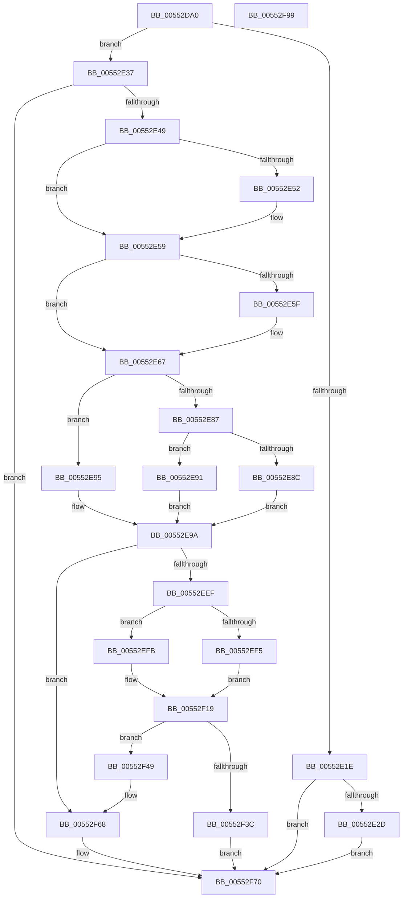

# HalCreateCommonBufferFromMdlDmarThin

- RVA: `0x00552DA0`–`0x00552F9A` (길이 `506` bytes)
- VA: `0x0000000140552DA0`
- 실행 섹션: `.text`
- PDB 이름 있음: `예`; PDB Function 태그: `아니요`
- unwind 정보 RVA: `0x000C43F4`
- 디코드: `142`개 명령, `506/506` bytes 표시
- 미해석 바이트: `0` (있으면 어셈블리에 `.byte`로 보존)

> 이 문서는 커널 이미지의 기계어와 PDB 기호를 분석해 생성했습니다. 4번과 5번은 함수 원형과 자료형을 바이너리 사용 방식에서 추정한 C 해석이며 원본 소스 복구 결과는 아닙니다.

## 1. Dependencies

- 직접 호출 지점: **8**; 고유 호출 대상: **7**
- 직접 호출자로 확인된 함수: **0**
- RIP 상대 이미지 참조: **2**

### Outgoing calls
- `0x00552E13` → [HalpCreateCommonBufferFromMdlVerifyParams](HalpCreateCommonBufferFromMdlVerifyParams_function_00550478.md) (function, `0x00550478`)
- `0x00552E3A` → [HalpDmaReferenceDomainObject](../3E/HalpDmaReferenceDomainObject_function_003E9B08.md) (function, `0x003E9B08`)
- `0x00552EE1` → [guard_dispatch_icall](../6B/guard_dispatch_icall_function_006BAAD0.md) (function, `0x006BAAD0`)
- `0x00552F14` → [MmMapLockedPagesSpecifyCache](../31/MmMapLockedPagesSpecifyCache_function_00318800.md) (function, `0x00318800`)
- `0x00552F31` → [HalpAllocateCommonBufferEntry](../3E/HalpAllocateCommonBufferEntry_function_003E99F4.md) (function, `0x003E99F4`)
- `0x00552F63` → [guard_dispatch_icall](../6B/guard_dispatch_icall_function_006BAAD0.md) (function, `0x006BAAD0`)
- `0x00552F6B` → [HalpDmaDereferenceDomainObject](../3F/HalpDmaDereferenceDomainObject_function_003F69DC.md) (function, `0x003F69DC`)
- `0x00552F79` → [_security_check_cookie](../6A/_security_check_cookie_function_006AC640.md) (function, `0x006AC640`)

### Direct callers
- 이 함수 시작 RVA로 연결되는 직접 call은 확인되지 않았습니다. 간접 호출은 완전히 역산할 수 없습니다.

### Static image references
- `0x00552DBC` → RVA `0x00E0A740` (`.data`; read)
- `0x00552ED2` → RVA `0x00FC1778` (`.data`; read)

## 2. Other-region calls and transfers

- 다른 실행 섹션으로 향하는 call: **0**
- 별도 외부 분기/꼬리 이동을 확인하지 못했습니다.

## 3. Assembly (complete function range)

```asm
00552DA0  48 89 5C 24 20                  mov qword ptr [rsp + 0x20], rbx
00552DA5  55                              push rbp
00552DA6  56                              push rsi
00552DA7  57                              push rdi
00552DA8  41 54                           push r12
00552DAA  41 55                           push r13
00552DAC  41 56                           push r14
00552DAE  41 57                           push r15
00552DB0  48 8D 6C 24 E1                  lea rbp, [rsp - 0x1f]
00552DB5  48 81 EC A0 00 00 00            sub rsp, 0xa0
00552DBC  48 8B 05 7D 79 8B 00            mov rax, qword ptr [rip + 0x8b797d]
00552DC3  48 33 C4                        xor rax, rsp
00552DC6  48 89 45 17                     mov qword ptr [rbp + 0x17], rax
00552DCA  48 8B B1 00 02 00 00            mov rsi, qword ptr [rcx + 0x200]
00552DD1  0F 57 C0                        xorps xmm0, xmm0
00552DD4  48 89 55 C7                     mov qword ptr [rbp - 0x39], rdx
00552DD8  48 8D 4D C7                     lea rcx, [rbp - 0x39]
00552DDC  48 8B 55 7F                     mov rdx, qword ptr [rbp + 0x7f]
00552DE0  41 8B C1                        mov eax, r9d
00552DE3  48 89 55 E7                     mov qword ptr [rbp - 0x19], rdx
00552DE7  4C 8D 4D EF                     lea r9, [rbp - 0x11]
00552DEB  33 D2                           xor edx, edx
00552DED  4D 8B D0                        mov r10, r8
00552DF0  48 21 55 BF                     and qword ptr [rbp - 0x41], rdx
00552DF4  44 8B C0                        mov r8d, eax
00552DF7  48 89 55 0F                     mov qword ptr [rbp + 0xf], rdx
00552DFB  45 33 E4                        xor r12d, r12d
00552DFE  89 55 DF                        mov dword ptr [rbp - 0x21], edx
00552E01  45 33 ED                        xor r13d, r13d
00552E04  49 8B D2                        mov rdx, r10
00552E07  0F 11 45 EF                     movups xmmword ptr [rbp - 0x11], xmm0
00552E0B  0F 11 45 FF                     movups xmmword ptr [rbp - 1], xmm0
00552E0F  0F 11 45 CF                     movups xmmword ptr [rbp - 0x31], xmm0
00552E13  E8 60 D6 FF FF                  call 0x140550478
00552E18  8B D8                           mov ebx, eax
00552E1A  85 C0                           test eax, eax
00552E1C  79 19                           jns 0x140552e37
00552E1E  8D 88 11 FF FF 3F               lea ecx, [rax + 0x3fffff11]
00552E24  83 F9 01                        cmp ecx, 1
00552E27  0F 87 43 01 00 00               ja 0x140552f70
00552E2D  BB 0D 00 00 C0                  mov ebx, 0xc000000d
00552E32  E9 39 01 00 00                  jmp 0x140552f70
00552E37  48 8B CE                        mov rcx, rsi
00552E3A  E8 C9 6C E9 FF                  call 0x1403e9b08
00552E3F  8B D8                           mov ebx, eax
00552E41  85 C0                           test eax, eax
00552E43  0F 88 27 01 00 00               js 0x140552f70
00552E49  48 8B 46 38                     mov rax, qword ptr [rsi + 0x38]
00552E4D  48 85 C0                        test rax, rax
00552E50  74 07                           je 0x140552e59
00552E52  C6 80 0C 02 00 00 01            mov byte ptr [rax + 0x20c], 1
00552E59  44 38 65 13                     cmp byte ptr [rbp + 0x13], r12b
00552E5D  74 08                           je 0x140552e67
00552E5F  4C 8D 65 EF                     lea r12, [rbp - 0x11]
00552E63  4C 8D 6D F7                     lea r13, [rbp - 9]
00552E67  48 8B 7D C7                     mov rdi, qword ptr [rbp - 0x39]
00552E6B  B8 02 00 00 00                  mov eax, 2
00552E70  4C 8B 7D 07                     mov r15, qword ptr [rbp + 7]
00552E74  48 8B 4D 0F                     mov rcx, qword ptr [rbp + 0xf]
00552E78  4C 8B 75 FF                     mov r14, qword ptr [rbp - 1]
00552E7C  44 8B 47 2C                     mov r8d, dword ptr [rdi + 0x2c]
00552E80  4D 03 C7                        add r8, r15
00552E83  85 C9                           test ecx, ecx
00552E85  74 0E                           je 0x140552e95
00552E87  83 F9 01                        cmp ecx, 1
00552E8A  74 05                           je 0x140552e91
00552E8C  8D 50 01                        lea edx, [rax + 1]
00552E8F  EB 09                           jmp 0x140552e9a
00552E91  8B D0                           mov edx, eax
00552E93  EB 05                           jmp 0x140552e9a
00552E95  BA 01 00 00 00                  mov edx, 1
00552E9A  89 45 CF                        mov dword ptr [rbp - 0x31], eax
00552E9D  48 8D 4D BF                     lea rcx, [rbp - 0x41]
00552EA1  48 89 4C 24 30                  mov qword ptr [rsp + 0x30], rcx
00552EA6  45 33 C9                        xor r9d, r9d
00552EA9  49 C1 E8 0C                     shr r8, 0xc
00552EAD  49 83 C0 06                     add r8, 6
00552EB1  4C 89 6C 24 28                  mov qword ptr [rsp + 0x28], r13
00552EB6  4C 89 64 24 20                  mov qword ptr [rsp + 0x20], r12
00552EBB  4A 8D 04 C7                     lea rax, [rdi + r8*8]
00552EBF  48 89 45 D7                     mov qword ptr [rbp - 0x29], rax
00552EC3  4C 8D 45 CF                     lea r8, [rbp - 0x31]
00552EC7  49 8B C6                        mov rax, r14
00552ECA  48 C1 E8 0C                     shr rax, 0xc
00552ECE  48 89 45 DF                     mov qword ptr [rbp - 0x21], rax
00552ED2  48 8B 05 9F E8 A6 00            mov rax, qword ptr [rip + 0xa6e89f]
00552ED9  48 8B 4E 28                     mov rcx, qword ptr [rsi + 0x28]
00552EDD  48 8B 40 38                     mov rax, qword ptr [rax + 0x38]
00552EE1  E8 EA 7B 16 00                  call 0x1406baad0
00552EE6  45 33 E4                        xor r12d, r12d
00552EE9  8B D8                           mov ebx, eax
00552EEB  85 C0                           test eax, eax
00552EED  78 79                           js 0x140552f68
00552EEF  F6 47 0A 05                     test byte ptr [rdi + 0xa], 5
00552EF3  74 06                           je 0x140552efb
00552EF5  48 8B 47 18                     mov rax, qword ptr [rdi + 0x18]
00552EF9  EB 1E                           jmp 0x140552f19
00552EFB  45 33 C9                        xor r9d, r9d
00552EFE  C7 44 24 28 00 00 00 40         mov dword ptr [rsp + 0x28], 0x40000000
00552F06  33 D2                           xor edx, edx
00552F08  44 89 64 24 20                  mov dword ptr [rsp + 0x20], r12d
00552F0D  48 8B CF                        mov rcx, rdi
00552F10  45 8D 41 01                     lea r8d, [r9 + 1]
00552F14  E8 E7 58 DC FF                  call 0x140318800
00552F19  4C 8B 45 BF                     mov r8, qword ptr [rbp - 0x41]
00552F1D  4A 8D 14 38                     lea rdx, [rax + r15]
00552F21  4C 89 64 24 28                  mov qword ptr [rsp + 0x28], r12
00552F26  4C 8B CE                        mov r9, rsi
00552F29  48 8B CF                        mov rcx, rdi
00552F2C  44 88 64 24 20                  mov byte ptr [rsp + 0x20], r12b
00552F31  E8 BE 6A E9 FF                  call 0x1403e99f4
00552F36  8B D8                           mov ebx, eax
00552F38  85 C0                           test eax, eax
00552F3A  78 0D                           js 0x140552f49
00552F3C  48 8B 4D E7                     mov rcx, qword ptr [rbp - 0x19]
00552F40  48 8B 45 BF                     mov rax, qword ptr [rbp - 0x41]
00552F44  48 89 01                        mov qword ptr [rcx], rax
00552F47  EB 27                           jmp 0x140552f70
00552F49  48 8B 05 28 E8 A6 00            mov rax, qword ptr [rip + 0xa6e828]
00552F50  48 8B 55 BF                     mov rdx, qword ptr [rbp - 0x41]
00552F54  48 8B 4E 28                     mov rcx, qword ptr [rsi + 0x28]
00552F58  49 C1 EE 0C                     shr r14, 0xc
00552F5C  48 8B 40 40                     mov rax, qword ptr [rax + 0x40]
00552F60  4D 8B C6                        mov r8, r14
00552F63  E8 68 7B 16 00                  call 0x1406baad0
00552F68  48 8B CE                        mov rcx, rsi
00552F6B  E8 6C 3A EA FF                  call 0x1403f69dc
00552F70  8B C3                           mov eax, ebx
00552F72  48 8B 4D 17                     mov rcx, qword ptr [rbp + 0x17]
00552F76  48 33 CC                        xor rcx, rsp
00552F79  E8 C2 96 15 00                  call 0x1406ac640
00552F7E  48 8B 9C 24 F8 00 00 00         mov rbx, qword ptr [rsp + 0xf8]
00552F86  48 81 C4 A0 00 00 00            add rsp, 0xa0
00552F8D  41 5F                           pop r15
00552F8F  41 5E                           pop r14
00552F91  41 5D                           pop r13
00552F93  41 5C                           pop r12
00552F95  5F                              pop rdi
00552F96  5E                              pop rsi
00552F97  5D                              pop rbp
00552F98  C3                              ret
00552F99  CC                              int3
```

## 4. C-style interpretation (structured pseudocode)

```c
__int64 __fastcall HalCreateCommonBufferFromMdlDmarThin(__int64 a1, __int64 a2, __int64 a3, int a4, __int64 a5)
{
    __int64 result;
    __int64 v_r12;
    __int64 v_r13;
    __int64 v_r14;
    __int64 v_rsp;
    unsigned __int64 v_stack_m40;
    unsigned __int8 v_stack_m44;
    unsigned __int64 v_stack_m48;
    unsigned __int64 v_stack_m50;
    unsigned __int64 v_stack_m57;
    unsigned __int64 v_stack_m58;
    unsigned __int64 v_stack_m60;
    unsigned __int64 v_stack_m68;
    unsigned __int64 v_stack_m70;
    unsigned int v_stack_m78;
    unsigned __int64 v_stack_m80;
    unsigned __int64 v_stack_m88;
    unsigned __int64 v_stack_m90;
    unsigned __int64 v_stack_m98;
    unsigned __int64 v_stack_mA8;
    unsigned __int64 v_stack_mB0;
    unsigned __int64 v_stack_mB8;
    unsigned __int64 v_stack_p20;

    v_stack_p20 = v_rbx;
    v_rsp = (v_rsp) - (160);
    result = (*(unsigned __int64 *)(v_rip + 9140605)) ^ (v_rsp);
    v_stack_m40 = result;
    v_stack_m90 = a2;
    v_stack_m70 = a5;
    a2 = 0;
    v_stack_m48 = 0;
    v_r12 = 0;
    v_stack_m78 = 0;
    v_r13 = 0;
    v_stack_m68 = v_xmm0;
    v_stack_m58 = v_xmm0;
    v_stack_m88 = v_xmm0;
    result = HalpCreateCommonBufferFromMdlVerifyParams(v_stack_m90, a3, (unsigned int)((unsigned int)((unsigned int)(a4))), v_stack_m68);
    if (!sign_flag) goto loc_00552E37;
    if (((unsigned int)(result + 1073741585)) > 1) goto loc_00552F70;
    goto loc_00552F70;
loc_00552E37:
    result = HalpDmaReferenceDomainObject(*(unsigned __int64 *)(a1 + 512), a3, (unsigned int)((unsigned int)((unsigned int)(a4))), v_stack_m68);
    if (sign_flag) goto loc_00552F70;
    if (*(unsigned __int64 *)(*(unsigned __int64 *)(a1 + 512) + 56) != 0) {
        *(unsigned __int8 *)(*(unsigned __int64 *)(*(unsigned __int64 *)(a1 + 512) + 56) + 524) = 1;
    }
    if (v_stack_m44 != 0) {
        v_r12 = v_stack_m68;
        v_r13 = v_stack_m60;
    }
    a3 = ((unsigned int)(*(unsigned int *)(v_stack_m90 + 44))) + (v_stack_m50);
    if ((unsigned int)(v_stack_m48) == 0) goto loc_00552E95;
    if (((unsigned int)(v_stack_m48)) == 1) goto loc_00552E91;
    goto loc_00552E9A;
loc_00552E91:
    goto loc_00552E9A;
loc_00552E95:
loc_00552E9A:
    v_stack_m88 = 2;
    v_stack_mA8 = v_stack_m98;
    a4 = 0;
    a3 = (a3) >> (12);
    a3 = (a3) + (6);
    v_stack_mB0 = v_r13;
    v_stack_mB8 = v_r12;
    v_stack_m80 = v_stack_m90 + a3 * 8;
    result = (v_stack_m58) >> (12);
    v_stack_m78 = result;
    result = guard_dispatch_icall(*(unsigned __int64 *)(*(unsigned __int64 *)(a1 + 512) + 40), 1, v_stack_m88, a4);
    v_r12 = 0;
    if (sign_flag) goto loc_00552F68;
    if (((*(unsigned __int8 *)(v_stack_m90 + 10)) & (5)) == 0) goto loc_00552EFB;
    goto loc_00552F19;
loc_00552EFB:
    a4 = 0;
    v_stack_mB0 = 0x40000000ULL;
    a2 = 0;
    v_stack_mB8 = 0;
    result = MmMapLockedPagesSpecifyCache(v_stack_m90, a2, a4 + 1, a4);
loc_00552F19:
    v_stack_mB0 = 0;
    v_stack_mB8 = 0;
    result = HalpAllocateCommonBufferEntry(v_stack_m90, result + v_stack_m50 * 1, v_stack_m98, *(unsigned __int64 *)(a1 + 512));
    if (sign_flag) goto loc_00552F49;
    *(unsigned __int64 *)(v_stack_m70) = v_stack_m98;
    goto loc_00552F70;
loc_00552F49:
    v_r14 = (v_stack_m58) >> (12);
    result = guard_dispatch_icall(*(unsigned __int64 *)(*(unsigned __int64 *)(a1 + 512) + 40), v_stack_m98, v_r14, *(unsigned __int64 *)(a1 + 512));
loc_00552F68:
    result = HalpDmaDereferenceDomainObject(*(unsigned __int64 *)(a1 + 512), v_stack_m98, v_r14, *(unsigned __int64 *)(a1 + 512));
loc_00552F70:
    a1 = (v_stack_m40) ^ (v_rsp);
    result = _security_check_cookie(a1, v_stack_m98, v_r14, *(unsigned __int64 *)(a1 + 512));
    v_rsp = (v_rsp) + (160);
    return result;
}
```

## 5. (Beta) C Style

```c
int64_t HalCreateCommonBufferFromMdlDmarThin(void *Arg1, int64_t Arg2, int64_t Arg3, int32_t Arg4, int64_t Arg5)
{
    uint8_t *arg1 = (uint8_t *)Arg1;

    int64_t result;
    int64_t local_r12;
    int64_t local_r13;
    int64_t local_r14;
    int64_t local_rsp;
    uint64_t v_stack_m40;
    uint8_t v_stack_m44;
    uint64_t v_stack_m48;
    uint64_t v_stack_m50;
    uint64_t v_stack_m57;
    uint64_t v_stack_m58;
    uint64_t v_stack_m60;
    uint64_t v_stack_m68;
    uint64_t v_stack_m70;
    uint32_t v_stack_m78;
    uint64_t v_stack_m80;
    uint64_t v_stack_m88;
    uint64_t v_stack_m90;
    uint64_t v_stack_m98;
    uint64_t v_stack_mA8;
    uint64_t v_stack_mB0;
    uint64_t v_stack_mB8;
    uint64_t v_stack_p20;

    v_stack_p20 = local_rbx;
    local_rsp = (local_rsp) - (160);
    result = (*(uint64_t *)(v_rip + 0x8B797D)) ^ (local_rsp);
    v_stack_m40 = result;
    v_stack_m90 = Arg2;
    v_stack_m70 = Arg5;
    Arg2 = 0;
    v_stack_m48 = 0;
    local_r12 = 0;
    v_stack_m78 = 0;
    local_r13 = 0;
    v_stack_m68 = v_xmm0;
    v_stack_m58 = v_xmm0;
    v_stack_m88 = v_xmm0;
    result = HalpCreateCommonBufferFromMdlVerifyParams(v_stack_m90, Arg3, (uint32_t)((uint32_t)((uint32_t)(Arg4))), v_stack_m68);
    if (!sign_flag) goto loc_00552E37;
    if (((uint32_t)(result + 1073741585)) > 1) goto loc_00552F70;
    goto loc_00552F70;
loc_00552E37:
    result = HalpDmaReferenceDomainObject(*(uint64_t *)(arg1 + 0x200), Arg3, (uint32_t)((uint32_t)((uint32_t)(Arg4))), v_stack_m68);
    if (sign_flag) goto loc_00552F70;
    if (*(uint64_t *)(*(uint64_t *)(arg1 + 0x200) + 0x38) != 0) {
        *(uint8_t *)(*(uint64_t *)(*(uint64_t *)(arg1 + 0x200) + 0x38) + 0x20C) = 1;
    }
    if (v_stack_m44 != 0) {
        local_r12 = v_stack_m68;
        local_r13 = v_stack_m60;
    }
    Arg3 = ((uint32_t)(*(uint32_t *)(v_stack_m90 + 0x2C))) + (v_stack_m50);
    if ((uint32_t)(v_stack_m48) == 0) goto loc_00552E95;
    if (((uint32_t)(v_stack_m48)) == 1) goto loc_00552E91;
    goto loc_00552E9A;
loc_00552E91:
    goto loc_00552E9A;
loc_00552E95:
loc_00552E9A:
    v_stack_m88 = 2;
    v_stack_mA8 = v_stack_m98;
    Arg4 = 0;
    Arg3 = (Arg3) >> (12);
    Arg3 = (Arg3) + (6);
    v_stack_mB0 = local_r13;
    v_stack_mB8 = local_r12;
    v_stack_m80 = v_stack_m90 + Arg3 * 8;
    result = (v_stack_m58) >> (12);
    v_stack_m78 = result;
    result = guard_dispatch_icall(*(uint64_t *)(*(uint64_t *)(arg1 + 0x200) + 0x28), 1, v_stack_m88, Arg4);
    local_r12 = 0;
    if (sign_flag) goto loc_00552F68;
    if (((*(uint8_t *)(v_stack_m90 + 0xA)) & (5)) == 0) goto loc_00552EFB;
    goto loc_00552F19;
loc_00552EFB:
    Arg4 = 0;
    v_stack_mB0 = 0x40000000ULL;
    Arg2 = 0;
    v_stack_mB8 = 0;
    result = MmMapLockedPagesSpecifyCache(v_stack_m90, Arg2, Arg4 + 1, Arg4);
loc_00552F19:
    v_stack_mB0 = 0;
    v_stack_mB8 = 0;
    result = HalpAllocateCommonBufferEntry(v_stack_m90, result + v_stack_m50 * 1, v_stack_m98, *(uint64_t *)(arg1 + 0x200));
    if (sign_flag) goto loc_00552F49;
    *(uint64_t *)(v_stack_m70) = v_stack_m98;
    goto loc_00552F70;
loc_00552F49:
    local_r14 = (v_stack_m58) >> (12);
    result = guard_dispatch_icall(*(uint64_t *)(*(uint64_t *)(arg1 + 0x200) + 0x28), v_stack_m98, local_r14, *(uint64_t *)(arg1 + 0x200));
loc_00552F68:
    result = HalpDmaDereferenceDomainObject(*(uint64_t *)(arg1 + 0x200), v_stack_m98, local_r14, *(uint64_t *)(arg1 + 0x200));
loc_00552F70:
    Arg1 = (v_stack_m40) ^ (local_rsp);
    result = _security_check_cookie(Arg1, v_stack_m98, local_r14, *(uint64_t *)(arg1 + 0x200));
    local_rsp = (local_rsp) + (160);
    return result;
}
```

### 관측된 메모리 오프셋

구조체 형식이 확인되지 않은 접근은 인자 기준의 오프셋으로만 기록했습니다.

| 기준 인자 | 오프셋 표현 | 폭 (bit) | 접근 |
|---|---:|---:|---|
| `Arg1` | `+ 0x200` | `64` | `R` |

## 6. Execution-region graph

[열기: 2D/3D 그래프와 함수 탐색 컨트롤 패널](../../../control-panel.html?section=text&rva=0x00552DA0&view=graph)

- 2D 그래프는 위에서 아래로 흐르고, 3D 그래프는 빈 공간을 드래그해 회전합니다. Shift+드래그는 이동, 휠은 확대·축소, 함수 노드 선택은 대상 보고서 이동입니다.

### Static fallback


