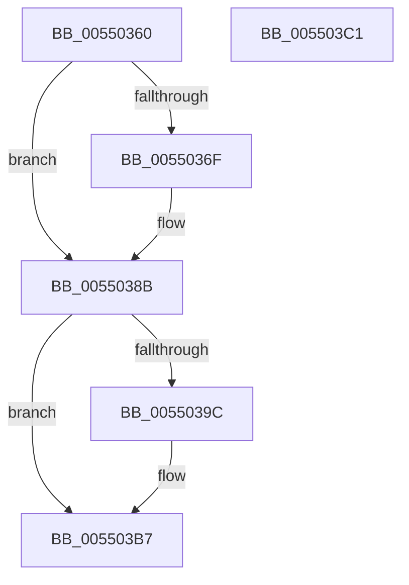

# HalFreeCommonBufferFromVector

- RVA: `0x00550360`–`0x005503C2` (길이 `98` bytes)
- VA: `0x0000000140550360`
- 실행 섹션: `.text`
- PDB 이름 있음: `예`; PDB Function 태그: `아니요`
- unwind 정보 RVA: `0x0005D2F4`
- 디코드: `28`개 명령, `98/98` bytes 표시
- 미해석 바이트: `0` (있으면 어셈블리에 `.byte`로 보존)

> 이 문서는 커널 이미지의 기계어와 PDB 기호를 분석해 생성했습니다. 4번과 5번은 함수 원형과 자료형을 바이너리 사용 방식에서 추정한 C 해석이며 원본 소스 복구 결과는 아닙니다.

## 1. Dependencies

- 직접 호출 지점: **2**; 고유 호출 대상: **1**
- 직접 호출자로 확인된 함수: **0**
- RIP 상대 이미지 참조: **0**

### Outgoing calls
- `0x00550385` → [KeBugCheckEx](../4F/KeBugCheckEx_function_004FD660.md) (function, `0x004FD660`)
- `0x005503B1` → [KeBugCheckEx](../4F/KeBugCheckEx_function_004FD660.md) (function, `0x004FD660`)

### Direct callers
- 이 함수 시작 RVA로 연결되는 직접 call은 확인되지 않았습니다. 간접 호출은 완전히 역산할 수 없습니다.

### Static image references
- 디코드된 RIP-relative 메모리 참조가 없습니다.

## 2. Other-region calls and transfers

- 다른 실행 섹션으로 향하는 call: **0**
- 별도 외부 분기/꼬리 이동을 확인하지 못했습니다.

## 3. Assembly (complete function range)

```asm
00550360  48 83 EC 38                     sub rsp, 0x38
00550364  8B 42 18                        mov eax, dword ptr [rdx + 0x18]
00550367  45 8B D0                        mov r10d, r8d
0055036A  44 3B C0                        cmp r8d, eax
0055036D  72 1C                           jb 0x14055038b
0055036F  48 83 64 24 20 00               and qword ptr [rsp + 0x20], 0
00550375  44 8B C0                        mov r8d, eax
00550378  45 8B CA                        mov r9d, r10d
0055037B  BA 03 00 00 00                  mov edx, 3
00550380  B9 DC 01 00 00                  mov ecx, 0x1dc
00550385  E8 D6 D2 FA FF                  call 0x1404fd660
0055038A  CC                              int3
0055038B  48 8B 4A 40                     mov rcx, qword ptr [rdx + 0x40]
0055038F  49 8B C2                        mov rax, r10
00550392  48 03 C0                        add rax, rax
00550395  48 83 3C C1 00                  cmp qword ptr [rcx + rax*8], 0
0055039A  75 1B                           jne 0x1405503b7
0055039C  48 83 64 24 20 00               and qword ptr [rsp + 0x20], 0
005503A2  45 33 C9                        xor r9d, r9d
005503A5  4D 8B C2                        mov r8, r10
005503A8  B9 DC 01 00 00                  mov ecx, 0x1dc
005503AD  41 8D 51 04                     lea edx, [r9 + 4]
005503B1  E8 AA D2 FA FF                  call 0x1404fd660
005503B6  CC                              int3
005503B7  48 83 24 C1 00                  and qword ptr [rcx + rax*8], 0
005503BC  48 83 C4 38                     add rsp, 0x38
005503C0  C3                              ret
005503C1  CC                              int3
```

## 4. C-style interpretation (structured pseudocode)

```c
__int64 __fastcall HalFreeCommonBufferFromVector(__int64 a1, __int64 a2, int a3)
{
    __int64 result;
    __int64 v_rsp;
    unsigned __int64 v_stack_m18;

    v_rsp = (v_rsp) - (56);
    result = (unsigned int)(*(unsigned int *)(a2 + 24));
    if (a3 >= ((unsigned int)((unsigned int)(*(unsigned int *)(a2 + 24))))) {
        a3 = (unsigned int)((unsigned int)(*(unsigned int *)(a2 + 24)));
        a4 = (unsigned int)((unsigned int)(a3));
        a2 = 3;
        a1 = 476;
        result = KeBugCheckEx(a1, a2, a3, a4);
    }
    result = ((unsigned int)(a3)) + ((unsigned int)(a3));
    if ((*(unsigned __int64 *)(*(unsigned __int64 *)(a2 + 64) + result * 8)) == 0) {
        a4 = 0;
        a3 = (unsigned int)(a3);
        a1 = 476;
        a2 = a4 + 4;
        result = KeBugCheckEx(a1, a2, a3, a4);
    }
    v_rsp = (v_rsp) + (56);
    return result;
}
```

## 5. (Beta) C Style

```c
int64_t HalFreeCommonBufferFromVector(int64_t Arg1, void *Arg2, int32_t Arg3)
{
    uint8_t *arg2 = (uint8_t *)Arg2;

    int64_t result;
    int64_t local_rsp;
    uint64_t v_stack_m18;

    local_rsp = (local_rsp) - (56);
    result = (uint32_t)(*(uint32_t *)(arg2 + 0x18));
    if (Arg3 >= ((uint32_t)((uint32_t)(*(uint32_t *)(arg2 + 0x18))))) {
        Arg3 = (uint32_t)((uint32_t)(*(uint32_t *)(arg2 + 0x18)));
        a4 = (uint32_t)((uint32_t)(Arg3));
        Arg2 = 3;
        Arg1 = 476;
        result = KeBugCheckEx(Arg1, Arg2, Arg3, a4);
    }
    result = ((uint32_t)(Arg3)) + ((uint32_t)(Arg3));
    if ((*(uint64_t *)(*(uint64_t *)(arg2 + 0x40) + result * 8)) == 0) {
        a4 = 0;
        Arg3 = (uint32_t)(Arg3);
        Arg1 = 476;
        Arg2 = a4 + 4;
        result = KeBugCheckEx(Arg1, Arg2, Arg3, a4);
    }
    local_rsp = (local_rsp) + (56);
    return result;
}
```

### 관측된 메모리 오프셋

구조체 형식이 확인되지 않은 접근은 인자 기준의 오프셋으로만 기록했습니다.

| 기준 인자 | 오프셋 표현 | 폭 (bit) | 접근 |
|---|---:|---:|---|
| `Arg2` | `+ 0x18` | `32` | `R` |

## 6. Execution-region graph

[열기: 2D/3D 그래프와 함수 탐색 컨트롤 패널](../../../control-panel.html?section=text&rva=0x00550360&view=graph)

- 2D 그래프는 위에서 아래로 흐르고, 3D 그래프는 빈 공간을 드래그해 회전합니다. Shift+드래그는 이동, 휠은 확대·축소, 함수 노드 선택은 대상 보고서 이동입니다.

### Static fallback


