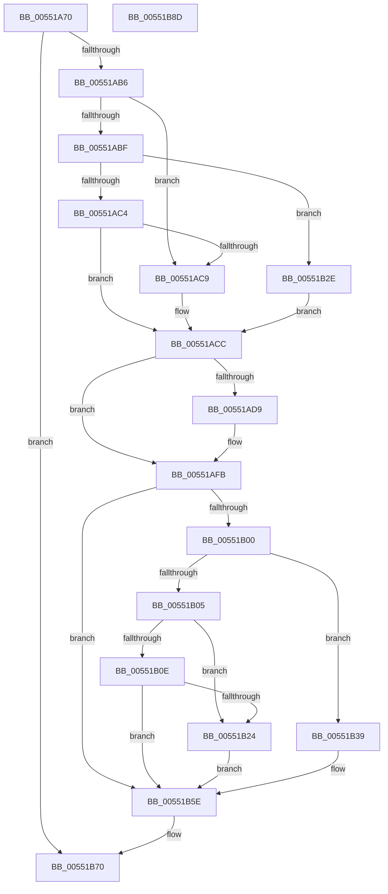

# HalFreeCommonBufferV3

- RVA: `0x00551A70`–`0x00551B8E` (길이 `286` bytes)
- VA: `0x0000000140551A70`
- 실행 섹션: `.text`
- PDB 이름 있음: `예`; PDB Function 태그: `아니요`
- unwind 정보 RVA: `0x00075C18`
- 디코드: `85`개 명령, `286/286` bytes 표시
- 미해석 바이트: `0` (있으면 어셈블리에 `.byte`로 보존)

> 이 문서는 커널 이미지의 기계어와 PDB 기호를 분석해 생성했습니다. 4번과 5번은 함수 원형과 자료형을 바이너리 사용 방식에서 추정한 C 해석이며 원본 소스 복구 결과는 아닙니다.

## 1. Dependencies

- 직접 호출 지점: **9**; 고유 호출 대상: **8**
- 직접 호출자로 확인된 함수: **0**
- RIP 상대 이미지 참조: **2**

### Outgoing calls
- `0x00551AA5` → [HalpPopCommonBufferEntry](../3F/HalpPopCommonBufferEntry_function_003F68D4.md) (function, `0x003F68D4`)
- `0x00551AF6` → [guard_dispatch_icall](../6B/guard_dispatch_icall_function_006BAAD0.md) (function, `0x006BAAD0`)
- `0x00551B14` → [HalpDmaCvmMakeContiguousVirtualBufferPrivate](../../page/70/HalpDmaCvmMakeContiguousVirtualBufferPrivate_function_00709408.md) (function, `0x00709408`)
- `0x00551B27` → [MmFreeContiguousMemory](../3F/MmFreeContiguousMemory_function_003F6F60.md) (function, `0x003F6F60`)
- `0x00551B3F` → [MmUnmapLockedPages](../24/MmUnmapLockedPages_function_00246E60.md) (function, `0x00246E60`)
- `0x00551B4F` → [MiFreePagesFromMdl](../3F/MiFreePagesFromMdl_function_003F8300.md) (function, `0x003F8300`)
- `0x00551B59` → [ExFreePoolWithTag](../../poolcode/B8/ExFreePoolWithTag_function_00B82870.md) (function, `0x00B82870`)
- `0x00551B63` → [ExFreePoolWithTag](../../poolcode/B8/ExFreePoolWithTag_function_00B82870.md) (function, `0x00B82870`)
- `0x00551B6B` → [HalpDmaDereferenceDomainObject](../3F/HalpDmaDereferenceDomainObject_function_003F69DC.md) (function, `0x003F69DC`)

### Direct callers
- 이 함수 시작 RVA로 연결되는 직접 call은 확인되지 않았습니다. 간접 호출은 완전히 역산할 수 없습니다.

### Static image references
- `0x00551AD9` → RVA `0x00FC1778` (`.data`; read)
- `0x00551B05` → RVA `0x00FC18A0` (`.data`; read)

## 2. Other-region calls and transfers

- 다른 실행 섹션으로 향하는 call: **3**
  - `0x00551B14` → [HalpDmaCvmMakeContiguousVirtualBufferPrivate](../../page/70/HalpDmaCvmMakeContiguousVirtualBufferPrivate_function_00709408.md) (`.text` → `PAGE`)
  - `0x00551B59` → [ExFreePoolWithTag](../../poolcode/B8/ExFreePoolWithTag_function_00B82870.md) (`.text` → `POOLCODE`)
  - `0x00551B63` → [ExFreePoolWithTag](../../poolcode/B8/ExFreePoolWithTag_function_00B82870.md) (`.text` → `POOLCODE`)
- 별도 외부 분기/꼬리 이동을 확인하지 못했습니다.

## 3. Assembly (complete function range)

```asm
00551A70  48 89 5C 24 08                  mov qword ptr [rsp + 8], rbx
00551A75  48 89 6C 24 10                  mov qword ptr [rsp + 0x10], rbp
00551A7A  48 89 74 24 18                  mov qword ptr [rsp + 0x18], rsi
00551A7F  57                              push rdi
00551A80  41 54                           push r12
00551A82  41 55                           push r13
00551A84  41 56                           push r14
00551A86  41 57                           push r15
00551A88  48 83 EC 20                     sub rsp, 0x20
00551A8C  4C 8B B1 00 02 00 00            mov r14, qword ptr [rcx + 0x200]
00551A93  4D 8B F9                        mov r15, r9
00551A96  44 8B EA                        mov r13d, edx
00551A99  49 8B C9                        mov rcx, r9
00551A9C  49 8B D6                        mov rdx, r14
00551A9F  49 8B D8                        mov rbx, r8
00551AA2  40 32 FF                        xor dil, dil
00551AA5  E8 2A 4E EA FF                  call 0x1403f68d4
00551AAA  48 8B F0                        mov rsi, rax
00551AAD  48 85 C0                        test rax, rax
00551AB0  0F 84 BA 00 00 00               je 0x140551b70
00551AB6  41 8B 56 30                     mov edx, dword ptr [r14 + 0x30]
00551ABA  83 EA 01                        sub edx, 1
00551ABD  74 0A                           je 0x140551ac9
00551ABF  83 EA 01                        sub edx, 1
00551AC2  74 6A                           je 0x140551b2e
00551AC4  83 FA 01                        cmp edx, 1
00551AC7  75 03                           jne 0x140551acc
00551AC9  40 B7 01                        mov dil, 1
00551ACC  48 8B 68 30                     mov rbp, qword ptr [rax + 0x30]
00551AD0  44 8A 60 40                     mov r12b, byte ptr [rax + 0x40]
00551AD4  40 84 FF                        test dil, dil
00551AD7  74 22                           je 0x140551afb
00551AD9  48 8B 05 98 FC A6 00            mov rax, qword ptr [rip + 0xa6fc98]
00551AE0  4D 8D 85 FF 0F 00 00            lea r8, [r13 + 0xfff]
00551AE7  49 8B 4E 28                     mov rcx, qword ptr [r14 + 0x28]
00551AEB  48 8B D3                        mov rdx, rbx
00551AEE  49 C1 E8 0C                     shr r8, 0xc
00551AF2  48 8B 40 40                     mov rax, qword ptr [rax + 0x40]
00551AF6  E8 D5 8F 16 00                  call 0x1406baad0
00551AFB  45 84 E4                        test r12b, r12b
00551AFE  74 5E                           je 0x140551b5e
00551B00  48 85 ED                        test rbp, rbp
00551B03  75 34                           jne 0x140551b39
00551B05  40 38 2D 94 FD A6 00            cmp byte ptr [rip + 0xa6fd94], bpl
00551B0C  74 16                           je 0x140551b24
00551B0E  49 8B D5                        mov rdx, r13
00551B11  49 8B CF                        mov rcx, r15
00551B14  E8 EF 78 1B 00                  call 0x140709408
00551B19  4C 8B 7E 20                     mov r15, qword ptr [rsi + 0x20]
00551B1D  C1 E8 1F                        shr eax, 0x1f
00551B20  84 C0                           test al, al
00551B22  75 3A                           jne 0x140551b5e
00551B24  49 8B CF                        mov rcx, r15
00551B27  E8 34 54 EA FF                  call 0x1403f6f60
00551B2C  EB 30                           jmp 0x140551b5e
00551B2E  48 83 78 30 00                  cmp qword ptr [rax + 0x30], 0
00551B33  40 0F 95 C7                     setne dil
00551B37  EB 93                           jmp 0x140551acc
00551B39  48 8B D5                        mov rdx, rbp
00551B3C  49 8B CF                        mov rcx, r15
00551B3F  E8 1C 53 CF FF                  call 0x140246e60
00551B44  45 33 C9                        xor r9d, r9d
00551B47  45 33 C0                        xor r8d, r8d
00551B4A  33 D2                           xor edx, edx
00551B4C  48 8B CD                        mov rcx, rbp
00551B4F  E8 AC 67 EA FF                  call 0x1403f8300
00551B54  33 D2                           xor edx, edx
00551B56  48 8B CD                        mov rcx, rbp
00551B59  E8 12 0D 63 00                  call 0x140b82870
00551B5E  33 D2                           xor edx, edx
00551B60  48 8B CE                        mov rcx, rsi
00551B63  E8 08 0D 63 00                  call 0x140b82870
00551B68  49 8B CE                        mov rcx, r14
00551B6B  E8 6C 4E EA FF                  call 0x1403f69dc
00551B70  48 8B 5C 24 50                  mov rbx, qword ptr [rsp + 0x50]
00551B75  48 8B 6C 24 58                  mov rbp, qword ptr [rsp + 0x58]
00551B7A  48 8B 74 24 60                  mov rsi, qword ptr [rsp + 0x60]
00551B7F  48 83 C4 20                     add rsp, 0x20
00551B83  41 5F                           pop r15
00551B85  41 5E                           pop r14
00551B87  41 5D                           pop r13
00551B89  41 5C                           pop r12
00551B8B  5F                              pop rdi
00551B8C  C3                              ret
00551B8D  CC                              int3
```

## 4. C-style interpretation (structured pseudocode)

```c
__int64 __fastcall HalFreeCommonBufferV3(__int64 a1, int a2, __int64 a3, __int64 a4)
{
    __int64 result;
    __int64 v_rdi;
    __int64 v_rsp;
    unsigned __int64 v_stack_p10;
    unsigned __int64 v_stack_p18;
    unsigned __int64 v_stack_p8;

    v_stack_p8 = v_rbx;
    v_stack_p10 = v_rbp;
    v_stack_p18 = v_rsi;
    v_rsp = (v_rsp) - (32);
    v_rdi = 0;
    result = HalpPopCommonBufferEntry(a4, *(unsigned __int64 *)(a1 + 512), a3, a4);
    if (result == 0) goto loc_00551B70;
    a2 = (unsigned int)(((unsigned int)(*(unsigned int *)(*(unsigned __int64 *)(a1 + 512) + 48))) - (1));
    if (condition_is_equal) goto loc_00551AC9;
    a2 = (unsigned int)((a2) - (1));
    if (condition_is_equal) goto loc_00551B2E;
    if (a2 == 1) {
        v_rdi = 1;
    }
    if ((unsigned __int8)(v_rdi) != 0) {
        result = *(unsigned __int64 *)(v_rip + 10943640);
        a3 = (unsigned int)(a2) + 4095;
        a1 = *(unsigned __int64 *)(*(unsigned __int64 *)(a1 + 512) + 40);
        a2 = a3;
        a3 = (a3) >> (12);
        result = *(unsigned __int64 *)(result + 64);
        result = guard_dispatch_icall(a1, a2, a3, a4);
    }
    if ((unsigned __int8)(*(unsigned __int8 *)(result + 64)) == 0) goto loc_00551B5E;
    if (*(unsigned __int64 *)(result + 48) != 0) goto loc_00551B39;
    if ((*(unsigned __int8 *)(v_rip + 10943892)) == ((unsigned __int8)(*(unsigned __int64 *)(result + 48)))) goto loc_00551B24;
    result = HalpDmaCvmMakeContiguousVirtualBufferPrivate(a4, (unsigned int)(a2), a3, a4);
    result = (unsigned int)((result) >> (31));
    if ((unsigned __int8)(result) != 0) goto loc_00551B5E;
loc_00551B24:
    result = MmFreeContiguousMemory(*(unsigned __int64 *)(result + 32), (unsigned int)(a2), a3, a4);
    goto loc_00551B5E;
loc_00551B2E:
    v_rdi = ((*(unsigned __int64 *)(result + 48)) != 0) ? 1 : 0;
    goto loc_00551ACC;
loc_00551B39:
    result = MmUnmapLockedPages(*(unsigned __int64 *)(result + 32), *(unsigned __int64 *)(result + 48), a3, a4);
    a4 = 0;
    a3 = 0;
    a2 = 0;
    result = MiFreePagesFromMdl(*(unsigned __int64 *)(result + 48), a2, a3, a4);
    a2 = 0;
    result = ExFreePoolWithTag(*(unsigned __int64 *)(result + 48), a2, a3, a4);
loc_00551B5E:
    a2 = 0;
    result = ExFreePoolWithTag(result, a2, a3, a4);
    result = HalpDmaDereferenceDomainObject(*(unsigned __int64 *)(a1 + 512), a2, a3, a4);
loc_00551B70:
    v_rsp = (v_rsp) + (32);
    return result;
}
```

## 5. (Beta) C Style

```c
int64_t HalFreeCommonBufferV3(void *Arg1, void *Arg2, int64_t Arg3, int64_t Arg4)
{
    uint8_t *arg1 = (uint8_t *)Arg1;
    uint8_t *arg2 = (uint8_t *)Arg2;

    int64_t result;
    int64_t local_rdi;
    int64_t local_rsp;
    uint64_t v_stack_p10;
    uint64_t v_stack_p18;
    uint64_t v_stack_p8;

    v_stack_p8 = local_rbx;
    v_stack_p10 = local_rbp;
    v_stack_p18 = local_rsi;
    local_rsp = (local_rsp) - (32);
    local_rdi = 0;
    result = HalpPopCommonBufferEntry(Arg4, *(uint64_t *)(arg1 + 0x200), Arg3, Arg4);
    if (result == 0) goto loc_00551B70;
    Arg2 = (uint32_t)(((uint32_t)(*(uint32_t *)(*(uint64_t *)(arg1 + 0x200) + 0x30))) - (1));
    if (condition_is_equal) goto loc_00551AC9;
    Arg2 = (uint32_t)((Arg2) - (1));
    if (condition_is_equal) goto loc_00551B2E;
    if (Arg2 == 1) {
        local_rdi = 1;
    }
    if ((uint8_t)(local_rdi) != 0) {
        result = *(uint64_t *)(v_rip + 0xA6FC98);
        Arg3 = (uint32_t)(Arg2) + 4095;
        Arg1 = *(uint64_t *)(*(uint64_t *)(arg1 + 0x200) + 0x28);
        Arg2 = Arg3;
        Arg3 = (Arg3) >> (12);
        result = *(uint64_t *)(result + 0x40);
        result = guard_dispatch_icall(Arg1, Arg2, Arg3, Arg4);
    }
    if ((uint8_t)(*(uint8_t *)(result + 0x40)) == 0) goto loc_00551B5E;
    if (*(uint64_t *)(result + 0x30) != 0) goto loc_00551B39;
    if ((*(uint8_t *)(v_rip + 0xA6FD94)) == ((uint8_t)(*(uint64_t *)(result + 0x30)))) goto loc_00551B24;
    result = HalpDmaCvmMakeContiguousVirtualBufferPrivate(Arg4, (uint32_t)(Arg2), Arg3, Arg4);
    result = (uint32_t)((result) >> (31));
    if ((uint8_t)(result) != 0) goto loc_00551B5E;
loc_00551B24:
    result = MmFreeContiguousMemory(*(uint64_t *)(result + 0x20), (uint32_t)(Arg2), Arg3, Arg4);
    goto loc_00551B5E;
loc_00551B2E:
    local_rdi = ((*(uint64_t *)(result + 0x30)) != 0) ? 1 : 0;
    goto loc_00551ACC;
loc_00551B39:
    result = MmUnmapLockedPages(*(uint64_t *)(result + 0x20), *(uint64_t *)(result + 0x30), Arg3, Arg4);
    Arg4 = 0;
    Arg3 = 0;
    Arg2 = 0;
    result = MiFreePagesFromMdl(*(uint64_t *)(result + 0x30), Arg2, Arg3, Arg4);
    Arg2 = 0;
    result = ExFreePoolWithTag(*(uint64_t *)(result + 0x30), Arg2, Arg3, Arg4);
loc_00551B5E:
    Arg2 = 0;
    result = ExFreePoolWithTag(result, Arg2, Arg3, Arg4);
    result = HalpDmaDereferenceDomainObject(*(uint64_t *)(arg1 + 0x200), Arg2, Arg3, Arg4);
loc_00551B70:
    local_rsp = (local_rsp) + (32);
    return result;
}
```

### 관측된 메모리 오프셋

구조체 형식이 확인되지 않은 접근은 인자 기준의 오프셋으로만 기록했습니다.

| 기준 인자 | 오프셋 표현 | 폭 (bit) | 접근 |
|---|---:|---:|---|
| `Arg1` | `+ 0x200` | `64` | `R` |
| `Arg2` | `+ 0xFFF` | `64` | `R` |

## 6. Execution-region graph

[열기: 2D/3D 그래프와 함수 탐색 컨트롤 패널](../../../control-panel.html?section=text&rva=0x00551A70&view=graph)

- 2D 그래프는 위에서 아래로 흐르고, 3D 그래프는 빈 공간을 드래그해 회전합니다. Shift+드래그는 이동, 휠은 확대·축소, 함수 노드 선택은 대상 보고서 이동입니다.

### Static fallback


