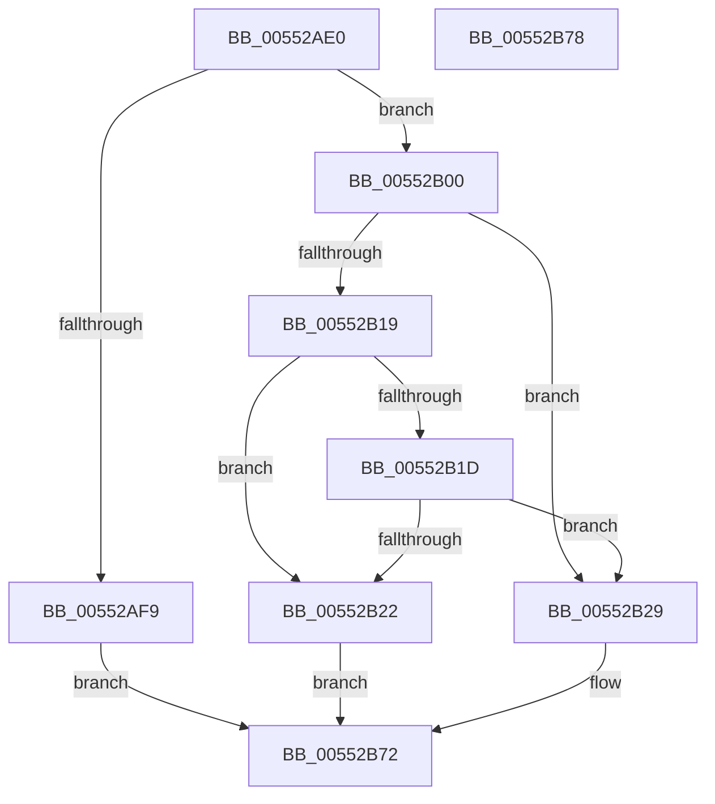

# HalGetScatterGatherListDmaThinEx

- RVA: `0x00552AE0`–`0x00552B79` (길이 `153` bytes)
- VA: `0x0000000140552AE0`
- 실행 섹션: `.text`
- PDB 이름 있음: `예`; PDB Function 태그: `아니요`
- unwind 정보 RVA: `0x0008A3E0`
- 디코드: `39`개 명령, `153/153` bytes 표시
- 미해석 바이트: `0` (있으면 어셈블리에 `.byte`로 보존)

> 이 문서는 커널 이미지의 기계어와 PDB 기호를 분석해 생성했습니다. 4번과 5번은 함수 원형과 자료형을 바이너리 사용 방식에서 추정한 C 해석이며 원본 소스 복구 결과는 아닙니다.

## 1. Dependencies

- 직접 호출 지점: **1**; 고유 호출 대상: **1**
- 직접 호출자로 확인된 함수: **0**
- RIP 상대 이미지 참조: **0**

### Outgoing calls
- `0x00552B6D` → [HalpBuildScatterGatherListDmaThin](../3E/HalpBuildScatterGatherListDmaThin_function_003EC390.md) (function, `0x003EC390`)

### Direct callers
- 이 함수 시작 RVA로 연결되는 직접 call은 확인되지 않았습니다. 간접 호출은 완전히 역산할 수 없습니다.

### Static image references
- 디코드된 RIP-relative 메모리 참조가 없습니다.

## 2. Other-region calls and transfers

- 다른 실행 섹션으로 향하는 call: **0**
- 별도 외부 분기/꼬리 이동을 확인하지 못했습니다.

## 3. Assembly (complete function range)

```asm
00552AE0  40 53                           push rbx
00552AE2  48 83 EC 70                     sub rsp, 0x70
00552AE6  4C 8B 94 24 B8 00 00 00         mov r10, qword ptr [rsp + 0xb8]
00552AEE  4C 8B DA                        mov r11, rdx
00552AF1  48 8B D9                        mov rbx, rcx
00552AF4  4D 85 C0                        test r8, r8
00552AF7  75 07                           jne 0x140552b00
00552AF9  B8 F1 00 00 C0                  mov eax, 0xc00000f1
00552AFE  EB 72                           jmp 0x140552b72
00552B00  8B 94 24 B0 00 00 00            mov edx, dword ptr [rsp + 0xb0]
00552B07  8B C2                           mov eax, edx
00552B09  48 8B 8C 24 E0 00 00 00         mov rcx, qword ptr [rsp + 0xe0]
00552B11  83 E0 01                        and eax, 1
00552B14  4D 85 D2                        test r10, r10
00552B17  75 10                           jne 0x140552b29
00552B19  85 C0                           test eax, eax
00552B1B  74 05                           je 0x140552b22
00552B1D  48 85 C9                        test rcx, rcx
00552B20  75 07                           jne 0x140552b29
00552B22  B8 0D 00 00 C0                  mov eax, 0xc000000d
00552B27  EB 49                           jmp 0x140552b72
00552B29  48 8B 84 24 C0 00 00 00         mov rax, qword ptr [rsp + 0xc0]
00552B31  48 89 4C 24 60                  mov qword ptr [rsp + 0x60], rcx
00552B36  48 8B CB                        mov rcx, rbx
00552B39  83 64 24 58 00                  and dword ptr [rsp + 0x58], 0
00552B3E  48 83 64 24 50 00               and qword ptr [rsp + 0x50], 0
00552B44  48 89 44 24 40                  mov qword ptr [rsp + 0x40], rax
00552B49  8B 84 24 A8 00 00 00            mov eax, dword ptr [rsp + 0xa8]
00552B50  4C 89 54 24 38                  mov qword ptr [rsp + 0x38], r10
00552B55  89 54 24 30                     mov dword ptr [rsp + 0x30], edx
00552B59  49 8B D3                        mov rdx, r11
00552B5C  89 44 24 28                     mov dword ptr [rsp + 0x28], eax
00552B60  48 8B 84 24 A0 00 00 00         mov rax, qword ptr [rsp + 0xa0]
00552B68  48 89 44 24 20                  mov qword ptr [rsp + 0x20], rax
00552B6D  E8 1E 98 E9 FF                  call 0x1403ec390
00552B72  48 83 C4 70                     add rsp, 0x70
00552B76  5B                              pop rbx
00552B77  C3                              ret
00552B78  CC                              int3
```

## 4. C-style interpretation (structured pseudocode)

```c
__int64 __fastcall HalGetScatterGatherListDmaThinEx(__int64 a1, __int64 a2, __int64 a3, __int64 a4, __int64 a5, unsigned int a6, unsigned int a7, __int64 a8, __int64 a9, __int64 a10, __int64 a11, __int64 a12, __int64 a13)
{
    __int64 result;
    __int64 v_rsp;
    unsigned __int64 v_stack_m18;
    unsigned int v_stack_m20;
    unsigned __int64 v_stack_m28;
    unsigned __int64 v_stack_m38;
    unsigned __int64 v_stack_m40;
    unsigned int v_stack_m48;
    unsigned int v_stack_m50;
    unsigned __int64 v_stack_m58;

    v_rsp = (v_rsp) - (112);
    if (a3 != 0) goto loc_00552B00;
    goto loc_00552B72;
loc_00552B00:
    result = (unsigned int)(((unsigned int)((unsigned int)((unsigned int)(a7)))) & (1));
    if (a8 != 0) goto loc_00552B29;
    if ((unsigned int)(result) == 0) goto loc_00552B22;
    if (a13 != 0) goto loc_00552B29;
loc_00552B22:
    goto loc_00552B72;
loc_00552B29:
    v_stack_m18 = a13;
    v_stack_m38 = a9;
    v_stack_m40 = a8;
    v_stack_m48 = (unsigned int)((unsigned int)(a7));
    v_stack_m50 = (unsigned int)((unsigned int)(a6));
    v_stack_m58 = a5;
    result = HalpBuildScatterGatherListDmaThin(a1, a2, a3, a4);
loc_00552B72:
    v_rsp = (v_rsp) + (112);
    return result;
}
```

## 5. (Beta) C Style

```c
int64_t HalGetScatterGatherListDmaThinEx(int64_t Arg1, int64_t Arg2, int64_t Arg3, int64_t Arg4, int64_t Arg5, uint32_t Arg6, uint32_t Arg7, int64_t Arg8, int64_t Arg9, uint64_t Arg10, uint64_t Arg11, uint64_t Arg12, int64_t Arg13)
{
    int64_t result;
    int64_t local_rsp;
    uint64_t v_stack_m18;
    uint32_t v_stack_m20;
    uint64_t v_stack_m28;
    uint64_t v_stack_m38;
    uint64_t v_stack_m40;
    uint32_t v_stack_m48;
    uint32_t v_stack_m50;
    uint64_t v_stack_m58;

    local_rsp = (local_rsp) - (112);
    if (Arg3 != 0) goto loc_00552B00;
    goto loc_00552B72;
loc_00552B00:
    result = (uint32_t)(((uint32_t)((uint32_t)((uint32_t)(Arg7)))) & (1));
    if (Arg8 != 0) goto loc_00552B29;
    if ((uint32_t)(result) == 0) goto loc_00552B22;
    if (Arg13 != 0) goto loc_00552B29;
loc_00552B22:
    goto loc_00552B72;
loc_00552B29:
    v_stack_m18 = Arg13;
    v_stack_m38 = Arg9;
    v_stack_m40 = Arg8;
    v_stack_m48 = (uint32_t)((uint32_t)(Arg7));
    v_stack_m50 = (uint32_t)((uint32_t)(Arg6));
    v_stack_m58 = Arg5;
    result = HalpBuildScatterGatherListDmaThin(Arg1, Arg2, Arg3, Arg4);
loc_00552B72:
    local_rsp = (local_rsp) + (112);
    return result;
}
```

## 6. Execution-region graph

[열기: 2D/3D 그래프와 함수 탐색 컨트롤 패널](../../../control-panel.html?section=text&rva=0x00552AE0&view=graph)

- 2D 그래프는 위에서 아래로 흐르고, 3D 그래프는 빈 공간을 드래그해 회전합니다. Shift+드래그는 이동, 휠은 확대·축소, 함수 노드 선택은 대상 보고서 이동입니다.

### Static fallback


