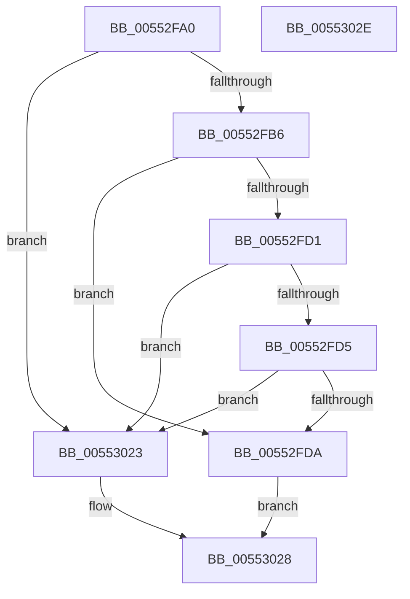

# HalGetScatterGatherListDmarThinEx

- RVA: `0x00552FA0`–`0x0055302F` (길이 `143` bytes)
- VA: `0x0000000140552FA0`
- 실행 섹션: `.text`
- PDB 이름 있음: `예`; PDB Function 태그: `아니요`
- unwind 정보 RVA: `0x0008A3E0`
- 디코드: `35`개 명령, `143/143` bytes 표시
- 미해석 바이트: `0` (있으면 어셈블리에 `.byte`로 보존)

> 이 문서는 커널 이미지의 기계어와 PDB 기호를 분석해 생성했습니다. 4번과 5번은 함수 원형과 자료형을 바이너리 사용 방식에서 추정한 C 해석이며 원본 소스 복구 결과는 아닙니다.

## 1. Dependencies

- 직접 호출 지점: **1**; 고유 호출 대상: **1**
- 직접 호출자로 확인된 함수: **0**
- RIP 상대 이미지 참조: **0**

### Outgoing calls
- `0x0055301C` → [HalpBuildScatterGatherListDmarThin](../46/HalpBuildScatterGatherListDmarThin_function_00467B28.md) (function, `0x00467B28`)

### Direct callers
- 이 함수 시작 RVA로 연결되는 직접 call은 확인되지 않았습니다. 간접 호출은 완전히 역산할 수 없습니다.

### Static image references
- 디코드된 RIP-relative 메모리 참조가 없습니다.

## 2. Other-region calls and transfers

- 다른 실행 섹션으로 향하는 call: **0**
- 별도 외부 분기/꼬리 이동을 확인하지 못했습니다.

## 3. Assembly (complete function range)

```asm
00552FA0  40 53                           push rbx
00552FA2  48 83 EC 70                     sub rsp, 0x70
00552FA6  4C 8B 94 24 B8 00 00 00         mov r10, qword ptr [rsp + 0xb8]
00552FAE  49 8B D9                        mov rbx, r9
00552FB1  4D 85 C0                        test r8, r8
00552FB4  74 6D                           je 0x140553023
00552FB6  44 8B 9C 24 B0 00 00 00         mov r11d, dword ptr [rsp + 0xb0]
00552FBE  41 8B C3                        mov eax, r11d
00552FC1  4C 8B 8C 24 E0 00 00 00         mov r9, qword ptr [rsp + 0xe0]
00552FC9  83 E0 01                        and eax, 1
00552FCC  4D 85 D2                        test r10, r10
00552FCF  75 09                           jne 0x140552fda
00552FD1  85 C0                           test eax, eax
00552FD3  74 4E                           je 0x140553023
00552FD5  4D 85 C9                        test r9, r9
00552FD8  74 49                           je 0x140553023
00552FDA  48 8B 84 24 C0 00 00 00         mov rax, qword ptr [rsp + 0xc0]
00552FE2  4C 89 4C 24 60                  mov qword ptr [rsp + 0x60], r9
00552FE7  4C 8B CB                        mov r9, rbx
00552FEA  83 64 24 58 00                  and dword ptr [rsp + 0x58], 0
00552FEF  48 83 64 24 50 00               and qword ptr [rsp + 0x50], 0
00552FF5  48 89 44 24 40                  mov qword ptr [rsp + 0x40], rax
00552FFA  8B 84 24 A8 00 00 00            mov eax, dword ptr [rsp + 0xa8]
00553001  4C 89 54 24 38                  mov qword ptr [rsp + 0x38], r10
00553006  44 89 5C 24 30                  mov dword ptr [rsp + 0x30], r11d
0055300B  89 44 24 28                     mov dword ptr [rsp + 0x28], eax
0055300F  48 8B 84 24 A0 00 00 00         mov rax, qword ptr [rsp + 0xa0]
00553017  48 89 44 24 20                  mov qword ptr [rsp + 0x20], rax
0055301C  E8 07 4B F1 FF                  call 0x140467b28
00553021  EB 05                           jmp 0x140553028
00553023  B8 0D 00 00 C0                  mov eax, 0xc000000d
00553028  48 83 C4 70                     add rsp, 0x70
0055302C  5B                              pop rbx
0055302D  C3                              ret
0055302E  CC                              int3
```

## 4. C-style interpretation (structured pseudocode)

```c
__int64 __fastcall HalGetScatterGatherListDmarThinEx(__int64 a1, __int64 a2, __int64 a3, __int64 a4, __int64 a5, unsigned int a6, unsigned int a7, __int64 a8, __int64 a9, __int64 a10, __int64 a11, __int64 a12, __int64 a13)
{
    __int64 result;
    __int64 v_rsp;
    unsigned __int64 v_stack_m18;
    unsigned int v_stack_m20;
    unsigned __int64 v_stack_m28;
    unsigned __int64 v_stack_m38;
    unsigned __int64 v_stack_m40;
    unsigned int v_stack_m48;
    unsigned int v_stack_m50;
    unsigned __int64 v_stack_m58;

    v_rsp = (v_rsp) - (112);
    if (a3 == 0) goto loc_00553023;
    result = (unsigned int)(((unsigned int)((unsigned int)((unsigned int)(a7)))) & (1));
    if (a8 != 0) goto loc_00552FDA;
    if ((unsigned int)(result) == 0) goto loc_00553023;
    if (a13 == 0) goto loc_00553023;
loc_00552FDA:
    v_stack_m18 = a13;
    v_stack_m38 = a9;
    v_stack_m40 = a8;
    v_stack_m48 = (unsigned int)((unsigned int)(a7));
    v_stack_m50 = (unsigned int)((unsigned int)(a6));
    v_stack_m58 = a5;
    result = HalpBuildScatterGatherListDmarThin(a1, a2, a3, a4);
    goto loc_00553028;
loc_00553023:
loc_00553028:
    v_rsp = (v_rsp) + (112);
    return (unsigned int)(0xC000000DULL);
}
```

## 5. (Beta) C Style

```c
int64_t HalGetScatterGatherListDmarThinEx(int64_t Arg1, int64_t Arg2, int64_t Arg3, int64_t Arg4, int64_t Arg5, uint32_t Arg6, uint32_t Arg7, int64_t Arg8, int64_t Arg9, uint64_t Arg10, uint64_t Arg11, uint64_t Arg12, int64_t Arg13)
{
    int64_t result;
    int64_t local_rsp;
    uint64_t v_stack_m18;
    uint32_t v_stack_m20;
    uint64_t v_stack_m28;
    uint64_t v_stack_m38;
    uint64_t v_stack_m40;
    uint32_t v_stack_m48;
    uint32_t v_stack_m50;
    uint64_t v_stack_m58;

    local_rsp = (local_rsp) - (112);
    if (Arg3 == 0) goto loc_00553023;
    result = (uint32_t)(((uint32_t)((uint32_t)((uint32_t)(Arg7)))) & (1));
    if (Arg8 != 0) goto loc_00552FDA;
    if ((uint32_t)(result) == 0) goto loc_00553023;
    if (Arg13 == 0) goto loc_00553023;
loc_00552FDA:
    v_stack_m18 = Arg13;
    v_stack_m38 = Arg9;
    v_stack_m40 = Arg8;
    v_stack_m48 = (uint32_t)((uint32_t)(Arg7));
    v_stack_m50 = (uint32_t)((uint32_t)(Arg6));
    v_stack_m58 = Arg5;
    result = HalpBuildScatterGatherListDmarThin(Arg1, Arg2, Arg3, Arg4);
    goto loc_00553028;
loc_00553023:
loc_00553028:
    local_rsp = (local_rsp) + (112);
    return (uint32_t)(0xC000000DULL);
}
```

## 6. Execution-region graph

[열기: 2D/3D 그래프와 함수 탐색 컨트롤 패널](../../../control-panel.html?section=text&rva=0x00552FA0&view=graph)

- 2D 그래프는 위에서 아래로 흐르고, 3D 그래프는 빈 공간을 드래그해 회전합니다. Shift+드래그는 이동, 휠은 확대·축소, 함수 노드 선택은 대상 보고서 이동입니다.

### Static fallback


