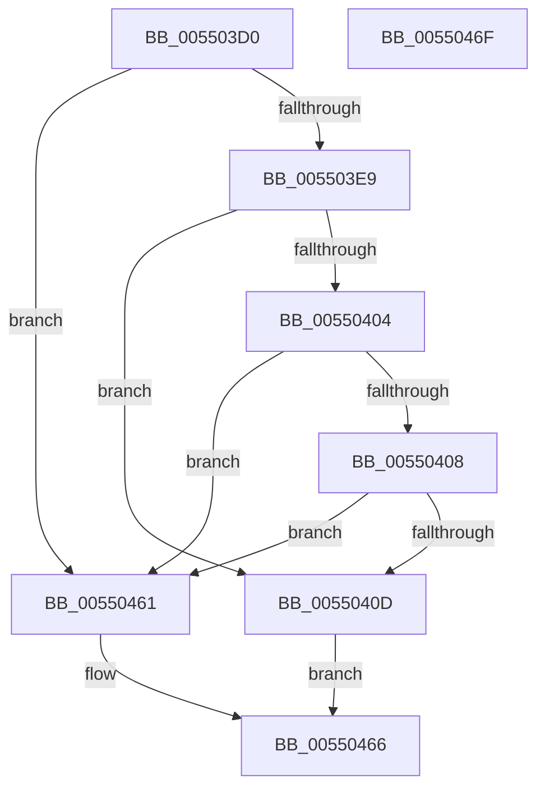

# HalGetScatterGatherListEx

- RVA: `0x005503D0`–`0x00550470` (길이 `160` bytes)
- VA: `0x00000001405503D0`
- 실행 섹션: `.text`
- PDB 이름 있음: `예`; PDB Function 태그: `아니요`
- unwind 정보 RVA: `0x000BA960`
- 디코드: `37`개 명령, `160/160` bytes 표시
- 미해석 바이트: `0` (있으면 어셈블리에 `.byte`로 보존)

> 이 문서는 커널 이미지의 기계어와 PDB 기호를 분석해 생성했습니다. 4번과 5번은 함수 원형과 자료형을 바이너리 사용 방식에서 추정한 C 해석이며 원본 소스 복구 결과는 아닙니다.

## 1. Dependencies

- 직접 호출 지점: **1**; 고유 호출 대상: **1**
- 직접 호출자로 확인된 함수: **0**
- RIP 상대 이미지 참조: **0**

### Outgoing calls
- `0x0055045A` → [HalpBuildScatterGatherList](../3D/HalpBuildScatterGatherList_function_003DBAF8.md) (function, `0x003DBAF8`)

### Direct callers
- 이 함수 시작 RVA로 연결되는 직접 call은 확인되지 않았습니다. 간접 호출은 완전히 역산할 수 없습니다.

### Static image references
- 디코드된 RIP-relative 메모리 참조가 없습니다.

## 2. Other-region calls and transfers

- 다른 실행 섹션으로 향하는 call: **0**
- 별도 외부 분기/꼬리 이동을 확인하지 못했습니다.

## 3. Assembly (complete function range)

```asm
005503D0  40 53                           push rbx
005503D2  48 81 EC 80 00 00 00            sub rsp, 0x80
005503D9  4C 8B 94 24 C8 00 00 00         mov r10, qword ptr [rsp + 0xc8]
005503E1  49 8B D9                        mov rbx, r9
005503E4  4D 85 C0                        test r8, r8
005503E7  74 78                           je 0x140550461
005503E9  44 8B 9C 24 C0 00 00 00         mov r11d, dword ptr [rsp + 0xc0]
005503F1  41 8B C3                        mov eax, r11d
005503F4  4C 8B 8C 24 F0 00 00 00         mov r9, qword ptr [rsp + 0xf0]
005503FC  83 E0 01                        and eax, 1
005503FF  4D 85 D2                        test r10, r10
00550402  75 09                           jne 0x14055040d
00550404  85 C0                           test eax, eax
00550406  74 59                           je 0x140550461
00550408  4D 85 C9                        test r9, r9
0055040B  74 54                           je 0x140550461
0055040D  8A 84 24 D8 00 00 00            mov al, byte ptr [rsp + 0xd8]
00550414  4C 89 4C 24 70                  mov qword ptr [rsp + 0x70], r9
00550419  4C 8B CB                        mov r9, rbx
0055041C  83 64 24 58 00                  and dword ptr [rsp + 0x58], 0
00550421  48 83 64 24 50 00               and qword ptr [rsp + 0x50], 0
00550427  88 44 24 48                     mov byte ptr [rsp + 0x48], al
0055042B  48 8B 84 24 D0 00 00 00         mov rax, qword ptr [rsp + 0xd0]
00550433  48 89 44 24 40                  mov qword ptr [rsp + 0x40], rax
00550438  8B 84 24 B8 00 00 00            mov eax, dword ptr [rsp + 0xb8]
0055043F  4C 89 54 24 38                  mov qword ptr [rsp + 0x38], r10
00550444  44 89 5C 24 30                  mov dword ptr [rsp + 0x30], r11d
00550449  89 44 24 28                     mov dword ptr [rsp + 0x28], eax
0055044D  48 8B 84 24 B0 00 00 00         mov rax, qword ptr [rsp + 0xb0]
00550455  48 89 44 24 20                  mov qword ptr [rsp + 0x20], rax
0055045A  E8 99 B6 E8 FF                  call 0x1403dbaf8
0055045F  EB 05                           jmp 0x140550466
00550461  B8 0D 00 00 C0                  mov eax, 0xc000000d
00550466  48 81 C4 80 00 00 00            add rsp, 0x80
0055046D  5B                              pop rbx
0055046E  C3                              ret
0055046F  CC                              int3
```

## 4. C-style interpretation (structured pseudocode)

```c
__int64 __fastcall HalGetScatterGatherListEx(__int64 a1, __int64 a2, __int64 a3, __int64 a4, __int64 a5, unsigned int a6, unsigned int a7, __int64 a8, __int64 a9, unsigned __int8 a10, __int64 a11, __int64 a12, __int64 a13)
{
    __int64 result;
    __int64 v_rsp;
    unsigned __int64 v_stack_m18;
    unsigned int v_stack_m30;
    unsigned __int64 v_stack_m38;
    unsigned __int8 v_stack_m40;
    unsigned __int64 v_stack_m48;
    unsigned __int64 v_stack_m50;
    unsigned int v_stack_m58;
    unsigned int v_stack_m60;
    unsigned __int64 v_stack_m68;

    v_rsp = (v_rsp) - (128);
    if (a3 == 0) goto loc_00550461;
    result = (unsigned int)(((unsigned int)((unsigned int)((unsigned int)(a7)))) & (1));
    if (a8 != 0) goto loc_0055040D;
    if ((unsigned int)(result) == 0) goto loc_00550461;
    if (a13 == 0) goto loc_00550461;
loc_0055040D:
    v_stack_m18 = a13;
    v_stack_m40 = a10;
    v_stack_m48 = a9;
    v_stack_m50 = a8;
    v_stack_m58 = (unsigned int)((unsigned int)(a7));
    v_stack_m60 = (unsigned int)((unsigned int)(a6));
    v_stack_m68 = a5;
    result = HalpBuildScatterGatherList(a1, a2, a3, a4);
    goto loc_00550466;
loc_00550461:
loc_00550466:
    v_rsp = (v_rsp) + (128);
    return (unsigned int)(0xC000000DULL);
}
```

## 5. (Beta) C Style

```c
int64_t HalGetScatterGatherListEx(int64_t Arg1, int64_t Arg2, int64_t Arg3, int64_t Arg4, int64_t Arg5, uint32_t Arg6, uint32_t Arg7, int64_t Arg8, int64_t Arg9, uint8_t Arg10, uint64_t Arg11, uint64_t Arg12, int64_t Arg13)
{
    int64_t result;
    int64_t local_rsp;
    uint64_t v_stack_m18;
    uint32_t v_stack_m30;
    uint64_t v_stack_m38;
    uint8_t v_stack_m40;
    uint64_t v_stack_m48;
    uint64_t v_stack_m50;
    uint32_t v_stack_m58;
    uint32_t v_stack_m60;
    uint64_t v_stack_m68;

    local_rsp = (local_rsp) - (128);
    if (Arg3 == 0) goto loc_00550461;
    result = (uint32_t)(((uint32_t)((uint32_t)((uint32_t)(Arg7)))) & (1));
    if (Arg8 != 0) goto loc_0055040D;
    if ((uint32_t)(result) == 0) goto loc_00550461;
    if (Arg13 == 0) goto loc_00550461;
loc_0055040D:
    v_stack_m18 = Arg13;
    v_stack_m40 = Arg10;
    v_stack_m48 = Arg9;
    v_stack_m50 = Arg8;
    v_stack_m58 = (uint32_t)((uint32_t)(Arg7));
    v_stack_m60 = (uint32_t)((uint32_t)(Arg6));
    v_stack_m68 = Arg5;
    result = HalpBuildScatterGatherList(Arg1, Arg2, Arg3, Arg4);
    goto loc_00550466;
loc_00550461:
loc_00550466:
    local_rsp = (local_rsp) + (128);
    return (uint32_t)(0xC000000DULL);
}
```

## 6. Execution-region graph

[열기: 2D/3D 그래프와 함수 탐색 컨트롤 패널](../../../control-panel.html?section=text&rva=0x005503D0&view=graph)

- 2D 그래프는 위에서 아래로 흐르고, 3D 그래프는 빈 공간을 드래그해 회전합니다. Shift+드래그는 이동, 휠은 확대·축소, 함수 노드 선택은 대상 보고서 이동입니다.

### Static fallback


