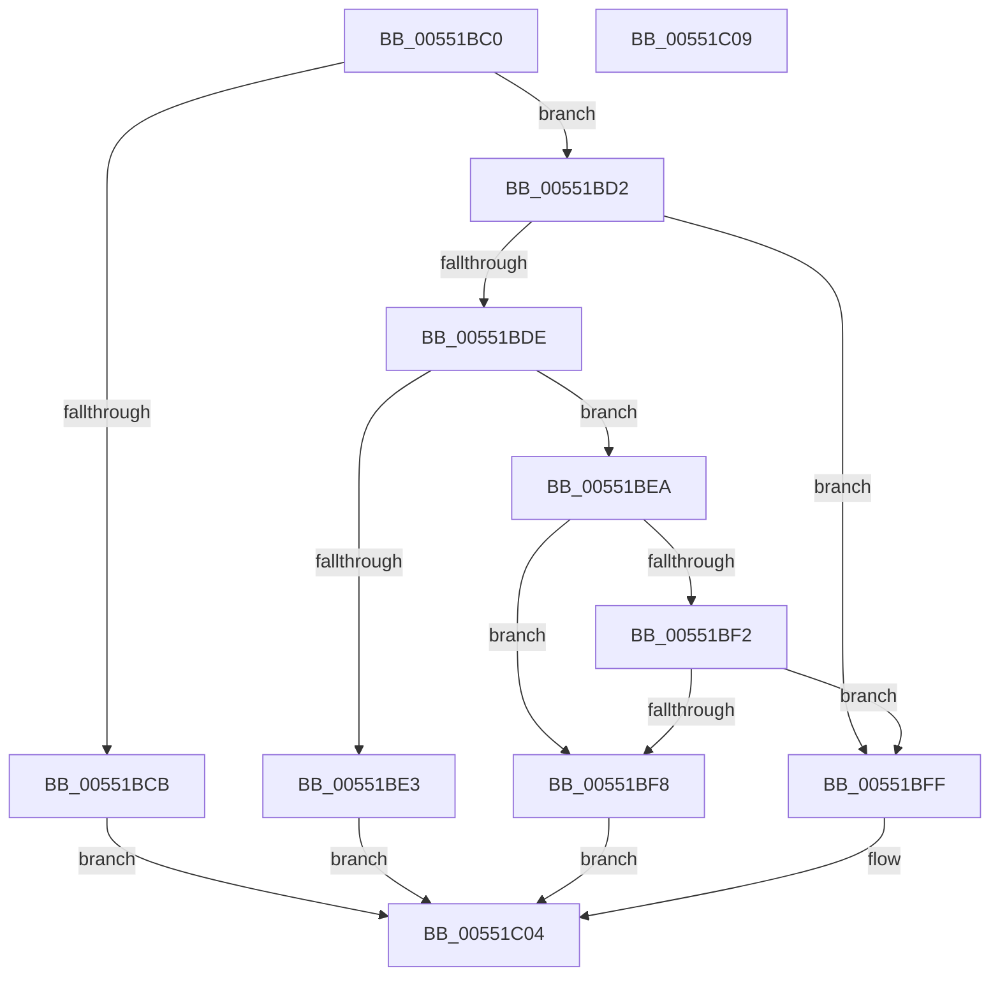

# HalLeaveDmaDomain

- RVA: `0x00551BC0`–`0x00551C0A` (길이 `74` bytes)
- VA: `0x0000000140551BC0`
- 실행 섹션: `.text`
- PDB 이름 있음: `예`; PDB Function 태그: `아니요`
- unwind 정보 RVA: `0x0005C788`
- 디코드: `23`개 명령, `74/74` bytes 표시
- 미해석 바이트: `0` (있으면 어셈블리에 `.byte`로 보존)

> 이 문서는 커널 이미지의 기계어와 PDB 기호를 분석해 생성했습니다. 4번과 5번은 함수 원형과 자료형을 바이너리 사용 방식에서 추정한 C 해석이며 원본 소스 복구 결과는 아닙니다.

## 1. Dependencies

- 직접 호출 지점: **1**; 고유 호출 대상: **1**
- 직접 호출자로 확인된 함수: **0**
- RIP 상대 이미지 참조: **0**

### Outgoing calls
- `0x00551BF8` → [HalpLeaveDmaDomain](HalpLeaveDmaDomain_function_00552600.md) (function, `0x00552600`)

### Direct callers
- 이 함수 시작 RVA로 연결되는 직접 call은 확인되지 않았습니다. 간접 호출은 완전히 역산할 수 없습니다.

### Static image references
- 디코드된 RIP-relative 메모리 참조가 없습니다.

## 2. Other-region calls and transfers

- 다른 실행 섹션으로 향하는 call: **0**
- 별도 외부 분기/꼬리 이동을 확인하지 못했습니다.

## 3. Assembly (complete function range)

```asm
00551BC0  48 83 EC 28                     sub rsp, 0x28
00551BC4  33 D2                           xor edx, edx
00551BC6  48 85 C9                        test rcx, rcx
00551BC9  75 07                           jne 0x140551bd2
00551BCB  B8 0D 00 00 C0                  mov eax, 0xc000000d
00551BD0  EB 32                           jmp 0x140551c04
00551BD2  48 8B 81 00 02 00 00            mov rax, qword ptr [rcx + 0x200]
00551BD9  48 85 C0                        test rax, rax
00551BDC  74 21                           je 0x140551bff
00551BDE  38 50 21                        cmp byte ptr [rax + 0x21], dl
00551BE1  74 07                           je 0x140551bea
00551BE3  B8 10 00 00 C0                  mov eax, 0xc0000010
00551BE8  EB 1A                           jmp 0x140551c04
00551BEA  38 91 0C 02 00 00               cmp byte ptr [rcx + 0x20c], dl
00551BF0  74 06                           je 0x140551bf8
00551BF2  48 39 50 38                     cmp qword ptr [rax + 0x38], rdx
00551BF6  75 07                           jne 0x140551bff
00551BF8  E8 03 0A 00 00                  call 0x140552600
00551BFD  EB 05                           jmp 0x140551c04
00551BFF  B8 01 00 00 C0                  mov eax, 0xc0000001
00551C04  48 83 C4 28                     add rsp, 0x28
00551C08  C3                              ret
00551C09  CC                              int3
```

## 4. C-style interpretation (structured pseudocode)

```c
__int64 __fastcall HalLeaveDmaDomain(__int64 a1, int a2)
{
    __int64 result;
    __int64 v_rsp;

    v_rsp = (v_rsp) - (40);
    a2 = 0;
    if (a1 != 0) goto loc_00551BD2;
    goto loc_00551C04;
loc_00551BD2:
    if (*(unsigned __int64 *)(a1 + 512) == 0) goto loc_00551BFF;
    if ((*(unsigned __int8 *)(*(unsigned __int64 *)(a1 + 512) + 33)) == 0) goto loc_00551BEA;
    goto loc_00551C04;
loc_00551BEA:
    if ((*(unsigned __int8 *)(a1 + 524)) == 0) goto loc_00551BF8;
    if ((*(unsigned __int64 *)((unsigned int)(0xC0000010ULL) + 56)) != 0) goto loc_00551BFF;
loc_00551BF8:
    result = HalpLeaveDmaDomain(a1, a2, a3, a4);
    goto loc_00551C04;
loc_00551BFF:
loc_00551C04:
    v_rsp = (v_rsp) + (40);
    return (unsigned int)(0xC0000001ULL);
}
```

## 5. (Beta) C Style

```c
int64_t HalLeaveDmaDomain(int64_t Arg1, int32_t Arg2)
{
    int64_t result;
    int64_t local_rsp;

    local_rsp = (local_rsp) - (40);
    Arg2 = 0;
    if (Arg1 != 0) goto loc_00551BD2;
    goto loc_00551C04;
loc_00551BD2:
    if (*(uint64_t *)(Arg1 + 0x200) == 0) goto loc_00551BFF;
    if ((*(uint8_t *)(*(uint64_t *)(Arg1 + 0x200) + 0x21)) == 0) goto loc_00551BEA;
    goto loc_00551C04;
loc_00551BEA:
    if ((*(uint8_t *)(Arg1 + 0x20C)) == 0) goto loc_00551BF8;
    if ((*(uint64_t *)((uint32_t)(0xC0000010ULL) + 0x38)) != 0) goto loc_00551BFF;
loc_00551BF8:
    result = HalpLeaveDmaDomain(Arg1, Arg2, a3, a4);
    goto loc_00551C04;
loc_00551BFF:
loc_00551C04:
    local_rsp = (local_rsp) + (40);
    return (uint32_t)(0xC0000001ULL);
}
```

## 6. Execution-region graph

[열기: 2D/3D 그래프와 함수 탐색 컨트롤 패널](../../../control-panel.html?section=text&rva=0x00551BC0&view=graph)

- 2D 그래프는 위에서 아래로 흐르고, 3D 그래프는 빈 공간을 드래그해 회전합니다. Shift+드래그는 이동, 휠은 확대·축소, 함수 노드 선택은 대상 보고서 이동입니다.

### Static fallback


