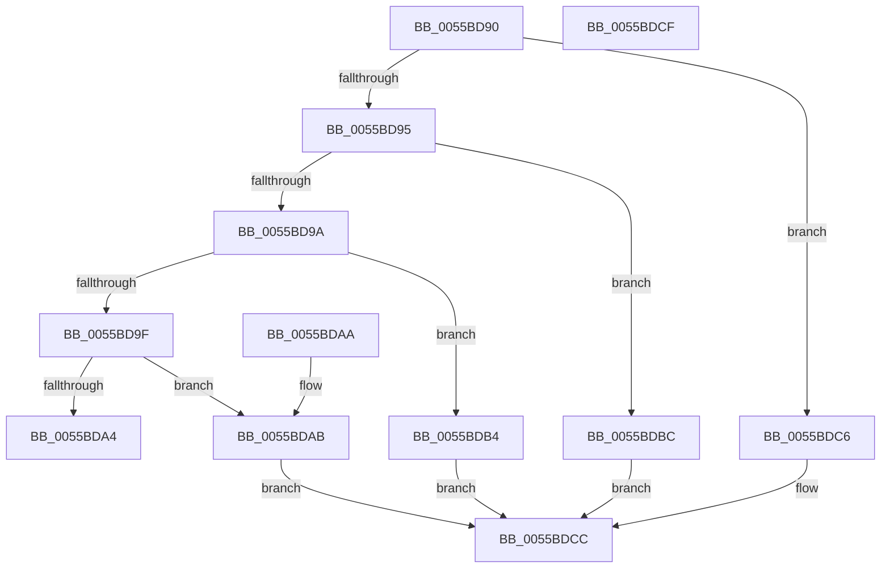

# HalpAcpiPmRegisterReadRegister

- RVA: `0x0055BD90`–`0x0055BDD0` (길이 `64` bytes)
- VA: `0x000000014055BD90`
- 실행 섹션: `.text`
- PDB 이름 있음: `예`; PDB Function 태그: `아니요`
- unwind 정보 RVA: `0x000DB714`
- 디코드: `29`개 명령, `64/64` bytes 표시
- 미해석 바이트: `0` (있으면 어셈블리에 `.byte`로 보존)

> 이 문서는 커널 이미지의 기계어와 PDB 기호를 분석해 생성했습니다. 4번과 5번은 함수 원형과 자료형을 바이너리 사용 방식에서 추정한 C 해석이며 원본 소스 복구 결과는 아닙니다.

## 1. Dependencies

- 직접 호출 지점: **0**; 고유 호출 대상: **0**
- 직접 호출자로 확인된 함수: **0**
- RIP 상대 이미지 참조: **0**

### Outgoing calls
- 직접 디코드된 call 명령이 없습니다.

### Direct callers
- 이 함수 시작 RVA로 연결되는 직접 call은 확인되지 않았습니다. 간접 호출은 완전히 역산할 수 없습니다.

### Static image references
- 디코드된 RIP-relative 메모리 참조가 없습니다.

## 2. Other-region calls and transfers

- 다른 실행 섹션으로 향하는 call: **0**
- 별도 외부 분기/꼬리 이동을 확인하지 못했습니다.

## 3. Assembly (complete function range)

```asm
0055BD90  83 EA 01                        sub edx, 1
0055BD93  74 31                           je 0x14055bdc6
0055BD95  83 EA 01                        sub edx, 1
0055BD98  74 22                           je 0x14055bdbc
0055BD9A  83 EA 02                        sub edx, 2
0055BD9D  74 15                           je 0x14055bdb4
0055BD9F  83 FA 04                        cmp edx, 4
0055BDA2  74 07                           je 0x14055bdab
0055BDA4  B8 01 00 00 C0                  mov eax, 0xc0000001
0055BDA9  C3                              ret
0055BDAA  CC                              int3
0055BDAB  90                              nop
0055BDAC  48 8B 01                        mov rax, qword ptr [rcx]
0055BDAF  49 89 00                        mov qword ptr [r8], rax
0055BDB2  EB 18                           jmp 0x14055bdcc
0055BDB4  90                              nop
0055BDB5  8B 01                           mov eax, dword ptr [rcx]
0055BDB7  41 89 00                        mov dword ptr [r8], eax
0055BDBA  EB 10                           jmp 0x14055bdcc
0055BDBC  90                              nop
0055BDBD  0F B7 01                        movzx eax, word ptr [rcx]
0055BDC0  66 41 89 00                     mov word ptr [r8], ax
0055BDC4  EB 06                           jmp 0x14055bdcc
0055BDC6  90                              nop
0055BDC7  8A 01                           mov al, byte ptr [rcx]
0055BDC9  41 88 00                        mov byte ptr [r8], al
0055BDCC  33 C0                           xor eax, eax
0055BDCE  C3                              ret
0055BDCF  CC                              int3
```

## 4. C-style interpretation (structured pseudocode)

```c
__int64 __fastcall HalpAcpiPmRegisterReadRegister(__int64 a1, int a2, __int64 a3)
{
    __int64 result;

    a2 = (unsigned int)((a2) - (1));
    if (condition_is_equal) goto loc_0055BDC6;
    a2 = (unsigned int)((a2) - (1));
    if (condition_is_equal) goto loc_0055BDBC;
    a2 = (unsigned int)((a2) - (2));
    if (condition_is_equal) goto loc_0055BDB4;
    if (a2 == 4) goto loc_0055BDAB;
    return (unsigned int)(0xC0000001ULL);
loc_0055BDAB:
    *(unsigned __int64 *)(a3) = *(unsigned __int64 *)(a1);
    goto loc_0055BDCC;
loc_0055BDB4:
    *(unsigned int *)(a3) = (unsigned int)((unsigned int)(*(unsigned int *)(a1)));
    goto loc_0055BDCC;
loc_0055BDBC:
    *(unsigned __int16 *)(a3) = (unsigned __int16)(*(unsigned __int16 *)(a1));
    goto loc_0055BDCC;
loc_0055BDC6:
    *(unsigned __int8 *)(a3) = (unsigned __int8)(*(unsigned __int8 *)(a1));
loc_0055BDCC:
    result = 0;
    return result;
}
```

## 5. (Beta) C Style

```c
int64_t HalpAcpiPmRegisterReadRegister(void *Arg1, int32_t Arg2, void *Arg3)
{
    uint8_t *arg1 = (uint8_t *)Arg1;
    uint8_t *arg3 = (uint8_t *)Arg3;

    int64_t result;

    Arg2 = (uint32_t)((Arg2) - (1));
    if (condition_is_equal) goto loc_0055BDC6;
    Arg2 = (uint32_t)((Arg2) - (1));
    if (condition_is_equal) goto loc_0055BDBC;
    Arg2 = (uint32_t)((Arg2) - (2));
    if (condition_is_equal) goto loc_0055BDB4;
    if (Arg2 == 4) goto loc_0055BDAB;
    return (uint32_t)(0xC0000001ULL);
loc_0055BDAB:
    *(uint64_t *)(arg3) = *(uint64_t *)(arg1);
    goto loc_0055BDCC;
loc_0055BDB4:
    *(uint32_t *)(arg3) = (uint32_t)((uint32_t)(*(uint32_t *)(arg1)));
    goto loc_0055BDCC;
loc_0055BDBC:
    *(uint16_t *)(arg3) = (uint16_t)(*(uint16_t *)(arg1));
    goto loc_0055BDCC;
loc_0055BDC6:
    *(uint8_t *)(arg3) = (uint8_t)(*(uint8_t *)(arg1));
loc_0055BDCC:
    result = 0;
    return result;
}
```

### 관측된 메모리 오프셋

구조체 형식이 확인되지 않은 접근은 인자 기준의 오프셋으로만 기록했습니다.

| 기준 인자 | 오프셋 표현 | 폭 (bit) | 접근 |
|---|---:|---:|---|
| `Arg1` | `+ 0x0` | `8` | `R` |
| `Arg1` | `+ 0x0` | `16` | `R` |
| `Arg1` | `+ 0x0` | `32` | `R` |
| `Arg1` | `+ 0x0` | `64` | `R` |
| `Arg3` | `+ 0x0` | `8` | `W` |
| `Arg3` | `+ 0x0` | `16` | `W` |
| `Arg3` | `+ 0x0` | `32` | `W` |
| `Arg3` | `+ 0x0` | `64` | `W` |

## 6. Execution-region graph

[열기: 2D/3D 그래프와 함수 탐색 컨트롤 패널](../../../control-panel.html?section=text&rva=0x0055BD90&view=graph)

- 2D 그래프는 위에서 아래로 흐르고, 3D 그래프는 빈 공간을 드래그해 회전합니다. Shift+드래그는 이동, 휠은 확대·축소, 함수 노드 선택은 대상 보고서 이동입니다.

### Static fallback


