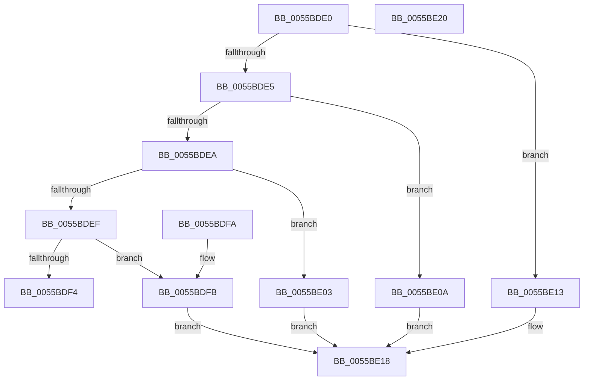

# HalpAcpiPmRegisterWriteRegister

- RVA: `0x0055BDE0`–`0x0055BE21` (길이 `65` bytes)
- VA: `0x000000014055BDE0`
- 실행 섹션: `.text`
- PDB 이름 있음: `예`; PDB Function 태그: `아니요`
- unwind 정보 RVA: `0x000DB714`
- 디코드: `26`개 명령, `65/65` bytes 표시
- 미해석 바이트: `0` (있으면 어셈블리에 `.byte`로 보존)

> 이 문서는 커널 이미지의 기계어와 PDB 기호를 분석해 생성했습니다. 4번과 5번은 함수 원형과 자료형을 바이너리 사용 방식에서 추정한 C 해석이며 원본 소스 복구 결과는 아닙니다.

## 1. Dependencies

- 직접 호출 지점: **0**; 고유 호출 대상: **0**
- 직접 호출자로 확인된 함수: **0**
- RIP 상대 이미지 참조: **0**

### Outgoing calls
- 직접 디코드된 call 명령이 없습니다.

### Direct callers
- 이 함수 시작 RVA로 연결되는 직접 call은 확인되지 않았습니다. 간접 호출은 완전히 역산할 수 없습니다.

### Static image references
- 디코드된 RIP-relative 메모리 참조가 없습니다.

## 2. Other-region calls and transfers

- 다른 실행 섹션으로 향하는 call: **0**
- 별도 외부 분기/꼬리 이동을 확인하지 못했습니다.

## 3. Assembly (complete function range)

```asm
0055BDE0  83 EA 01                        sub edx, 1
0055BDE3  74 2E                           je 0x14055be13
0055BDE5  83 EA 01                        sub edx, 1
0055BDE8  74 20                           je 0x14055be0a
0055BDEA  83 EA 02                        sub edx, 2
0055BDED  74 14                           je 0x14055be03
0055BDEF  83 FA 04                        cmp edx, 4
0055BDF2  74 07                           je 0x14055bdfb
0055BDF4  B8 01 00 00 C0                  mov eax, 0xc0000001
0055BDF9  C3                              ret
0055BDFA  CC                              int3
0055BDFB  49 8B 00                        mov rax, qword ptr [r8]
0055BDFE  48 89 01                        mov qword ptr [rcx], rax
0055BE01  EB 15                           jmp 0x14055be18
0055BE03  41 8B 00                        mov eax, dword ptr [r8]
0055BE06  89 01                           mov dword ptr [rcx], eax
0055BE08  EB 0E                           jmp 0x14055be18
0055BE0A  41 0F B7 00                     movzx eax, word ptr [r8]
0055BE0E  66 89 01                        mov word ptr [rcx], ax
0055BE11  EB 05                           jmp 0x14055be18
0055BE13  41 8A 00                        mov al, byte ptr [r8]
0055BE16  88 01                           mov byte ptr [rcx], al
0055BE18  F0 83 0C 24 00                  lock or dword ptr [rsp], 0
0055BE1D  33 C0                           xor eax, eax
0055BE1F  C3                              ret
0055BE20  CC                              int3
```

## 4. C-style interpretation (structured pseudocode)

```c
__int64 __fastcall HalpAcpiPmRegisterWriteRegister(__int64 a1, int a2, __int64 a3)
{
    __int64 result;
    unsigned int v_stack_p0;

    a2 = (unsigned int)((a2) - (1));
    if (condition_is_equal) goto loc_0055BE13;
    a2 = (unsigned int)((a2) - (1));
    if (condition_is_equal) goto loc_0055BE0A;
    a2 = (unsigned int)((a2) - (2));
    if (condition_is_equal) goto loc_0055BE03;
    if (a2 == 4) goto loc_0055BDFB;
    return (unsigned int)(0xC0000001ULL);
loc_0055BDFB:
    *(unsigned __int64 *)(a1) = *(unsigned __int64 *)(a3);
    goto loc_0055BE18;
loc_0055BE03:
    *(unsigned int *)(a1) = (unsigned int)((unsigned int)(*(unsigned int *)(a3)));
    goto loc_0055BE18;
loc_0055BE0A:
    *(unsigned __int16 *)(a1) = (unsigned __int16)(*(unsigned __int16 *)(a3));
    goto loc_0055BE18;
loc_0055BE13:
    *(unsigned __int8 *)(a1) = (unsigned __int8)(*(unsigned __int8 *)(a3));
loc_0055BE18:
    result = 0;
    return result;
}
```

## 5. (Beta) C Style

```c
int64_t HalpAcpiPmRegisterWriteRegister(void *Arg1, int32_t Arg2, void *Arg3)
{
    uint8_t *arg1 = (uint8_t *)Arg1;
    uint8_t *arg3 = (uint8_t *)Arg3;

    int64_t result;
    uint32_t v_stack_p0;

    Arg2 = (uint32_t)((Arg2) - (1));
    if (condition_is_equal) goto loc_0055BE13;
    Arg2 = (uint32_t)((Arg2) - (1));
    if (condition_is_equal) goto loc_0055BE0A;
    Arg2 = (uint32_t)((Arg2) - (2));
    if (condition_is_equal) goto loc_0055BE03;
    if (Arg2 == 4) goto loc_0055BDFB;
    return (uint32_t)(0xC0000001ULL);
loc_0055BDFB:
    *(uint64_t *)(arg1) = *(uint64_t *)(arg3);
    goto loc_0055BE18;
loc_0055BE03:
    *(uint32_t *)(arg1) = (uint32_t)((uint32_t)(*(uint32_t *)(arg3)));
    goto loc_0055BE18;
loc_0055BE0A:
    *(uint16_t *)(arg1) = (uint16_t)(*(uint16_t *)(arg3));
    goto loc_0055BE18;
loc_0055BE13:
    *(uint8_t *)(arg1) = (uint8_t)(*(uint8_t *)(arg3));
loc_0055BE18:
    result = 0;
    return result;
}
```

### 관측된 메모리 오프셋

구조체 형식이 확인되지 않은 접근은 인자 기준의 오프셋으로만 기록했습니다.

| 기준 인자 | 오프셋 표현 | 폭 (bit) | 접근 |
|---|---:|---:|---|
| `Arg1` | `+ 0x0` | `8` | `W` |
| `Arg1` | `+ 0x0` | `16` | `W` |
| `Arg1` | `+ 0x0` | `32` | `W` |
| `Arg1` | `+ 0x0` | `64` | `W` |
| `Arg3` | `+ 0x0` | `8` | `R` |
| `Arg3` | `+ 0x0` | `16` | `R` |
| `Arg3` | `+ 0x0` | `32` | `R` |
| `Arg3` | `+ 0x0` | `64` | `R` |

## 6. Execution-region graph

[열기: 2D/3D 그래프와 함수 탐색 컨트롤 패널](../../../control-panel.html?section=text&rva=0x0055BDE0&view=graph)

- 2D 그래프는 위에서 아래로 흐르고, 3D 그래프는 빈 공간을 드래그해 회전합니다. Shift+드래그는 이동, 휠은 확대·축소, 함수 노드 선택은 대상 보고서 이동입니다.

### Static fallback


