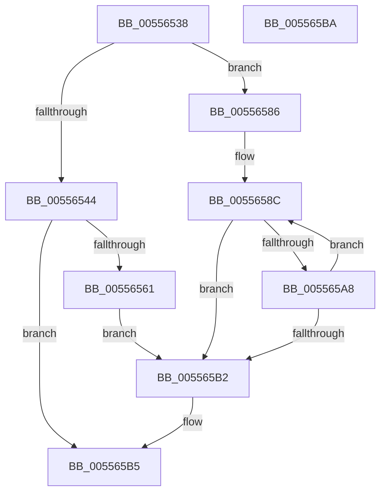

# HalpAcquireDrsPool

- RVA: `0x00556538`–`0x005565BB` (길이 `131` bytes)
- VA: `0x0000000140556538`
- 실행 섹션: `.text`
- PDB 이름 있음: `예`; PDB Function 태그: `아니요`
- unwind 정보 RVA: `0x0005C788`
- 디코드: `38`개 명령, `131/131` bytes 표시
- 미해석 바이트: `0` (있으면 어셈블리에 `.byte`로 보존)

> 이 문서는 커널 이미지의 기계어와 PDB 기호를 분석해 생성했습니다. 4번과 5번은 함수 원형과 자료형을 바이너리 사용 방식에서 추정한 C 해석이며 원본 소스 복구 결과는 아닙니다.

## 1. Dependencies

- 직접 호출 지점: **1**; 고유 호출 대상: **1**
- 직접 호출자로 확인된 함수: **2**
- RIP 상대 이미지 참조: **2**

### Outgoing calls
- `0x00556554` → [ExAllocatePool2](../../poolcode/B8/ExAllocatePool2_function_00B820F0.md) (function, `0x00B820F0`)

### Direct callers
- [HalpMemoryErrorDeferredRecovery](HalpMemoryErrorDeferredRecovery_function_00556918.md) at `0x00556940`
- [HalpPmemErrorDeferredRecovery](HalpPmemErrorDeferredRecovery_function_00556B24.md) at `0x00556B40`

### Static image references
- `0x00556572` → RVA `0x005565D0` (`HalpErrorDeferredHandler`; read)
- `0x00556595` → RVA `0x00F90A40` (`.data`; read)

## 2. Other-region calls and transfers

- 다른 실행 섹션으로 향하는 call: **1**
  - `0x00556554` → [ExAllocatePool2](../../poolcode/B8/ExAllocatePool2_function_00B820F0.md) (`.text` → `POOLCODE`)
- 별도 외부 분기/꼬리 이동을 확인하지 못했습니다.

## 3. Assembly (complete function range)

```asm
00556538  48 83 EC 28                     sub rsp, 0x28
0055653C  44 0F 20 C0                     mov rax, cr8
00556540  3C 02                           cmp al, 2
00556542  73 42                           jae 0x140556586
00556544  BA 58 18 00 00                  mov edx, 0x1858
00556549  B9 00 01 00 00                  mov ecx, 0x100
0055654E  41 B8 57 68 65 61               mov r8d, 0x61656857
00556554  E8 97 BB 62 00                  call 0x140b820f0
00556559  48 8B C8                        mov rcx, rax
0055655C  48 85 C0                        test rax, rax
0055655F  74 54                           je 0x1405565b5
00556561  33 C0                           xor eax, eax
00556563  0F 57 C0                        xorps xmm0, xmm0
00556566  0F 11 41 08                     movups xmmword ptr [rcx + 8], xmm0
0055656A  0F 11 41 18                     movups xmmword ptr [rcx + 0x18], xmm0
0055656E  48 89 41 28                     mov qword ptr [rcx + 0x28], rax
00556572  48 8D 05 57 00 00 00            lea rax, [rip + 0x57]
00556579  48 89 41 18                     mov qword ptr [rcx + 0x18], rax
0055657D  C6 41 20 00                     mov byte ptr [rcx + 0x20], 0
00556581  83 09 FF                        or dword ptr [rcx], 0xffffffff
00556584  EB 2C                           jmp 0x1405565b2
00556586  33 D2                           xor edx, edx
00556588  44 8D 42 01                     lea r8d, [rdx + 1]
0055658C  8B C2                           mov eax, edx
0055658E  48 69 C8 58 18 00 00            imul rcx, rax, 0x1858
00556595  48 8D 05 A4 A4 A3 00            lea rax, [rip + 0xa3a4a4]
0055659C  48 03 C8                        add rcx, rax
0055659F  33 C0                           xor eax, eax
005565A1  F0 44 0F B1 01                  lock cmpxchg dword ptr [rcx], r8d
005565A6  74 0A                           je 0x1405565b2
005565A8  33 C9                           xor ecx, ecx
005565AA  41 03 D0                        add edx, r8d
005565AD  83 FA 20                        cmp edx, 0x20
005565B0  72 DA                           jb 0x14055658c
005565B2  48 8B C1                        mov rax, rcx
005565B5  48 83 C4 28                     add rsp, 0x28
005565B9  C3                              ret
005565BA  CC                              int3
```

## 4. C-style interpretation (structured pseudocode)

```c
__int64 __fastcall HalpAcquireDrsPool(void)
{
    __int64 result;
    __int64 v_rsp;

    v_rsp = (v_rsp) - (40);
    if (((unsigned __int8)(v_cr8)) >= 2) goto loc_00556586;
    result = ExAllocatePool2(256, (unsigned int)(0x1858ULL), (unsigned int)(0x61656857ULL), a4);
    if (result == 0) goto loc_005565B5;
    result = 0;
    *(unsigned __int64 *)(result + 8) = v_xmm0;
    *(unsigned __int64 *)(result + 24) = v_xmm0;
    *(unsigned __int64 *)(result + 40) = 0;
    *(unsigned __int64 *)(result + 24) = v_rip + 87;
    *(unsigned __int8 *)(result + 32) = 0;
    goto loc_005565B2;
loc_00556586:
    a2 = 0;
loc_0055658C:
    a1 = (result) * (0);
    a1 = (a1) + (v_rip + 10724516);
    result = 0;
    if (condition_is_equal) goto loc_005565B2;
    a1 = 0;
    a2 = (unsigned int)((a2) + ((unsigned int)(a2 + 1)));
    if (((unsigned int)(a2)) < 32) goto loc_0055658C;
loc_005565B2:
loc_005565B5:
    v_rsp = (v_rsp) + (40);
    return 0;
}
```

## 5. (Beta) C Style

```c
void HalpAcquireDrsPool(void)
{
    int64_t result;
    int64_t local_rsp;

    local_rsp = (local_rsp) - (40);
    if (((uint8_t)(v_cr8)) >= 2) goto loc_00556586;
    result = ExAllocatePool2(256, (uint32_t)(0x1858ULL), (uint32_t)(0x61656857ULL), a4);
    if (result == 0) goto loc_005565B5;
    result = 0;
    *(uint64_t *)(result + 0x8) = v_xmm0;
    *(uint64_t *)(result + 0x18) = v_xmm0;
    *(uint64_t *)(result + 0x28) = 0;
    *(uint64_t *)(result + 0x18) = v_rip + 87;
    *(uint8_t *)(result + 0x20) = 0;
    goto loc_005565B2;
loc_00556586:
    a2 = 0;
loc_0055658C:
    a1 = (result) * (0);
    a1 = (a1) + (v_rip + 10724516);
    result = 0;
    if (condition_is_equal) goto loc_005565B2;
    a1 = 0;
    a2 = (uint32_t)((a2) + ((uint32_t)(a2 + 1)));
    if (((uint32_t)(a2)) < 32) goto loc_0055658C;
loc_005565B2:
loc_005565B5:
    local_rsp = (local_rsp) + (40);
    return 0;
}
```

## 6. Execution-region graph

[열기: 2D/3D 그래프와 함수 탐색 컨트롤 패널](../../../control-panel.html?section=text&rva=0x00556538&view=graph)

- 2D 그래프는 위에서 아래로 흐르고, 3D 그래프는 빈 공간을 드래그해 회전합니다. Shift+드래그는 이동, 휠은 확대·축소, 함수 노드 선택은 대상 보고서 이동입니다.

### Static fallback


