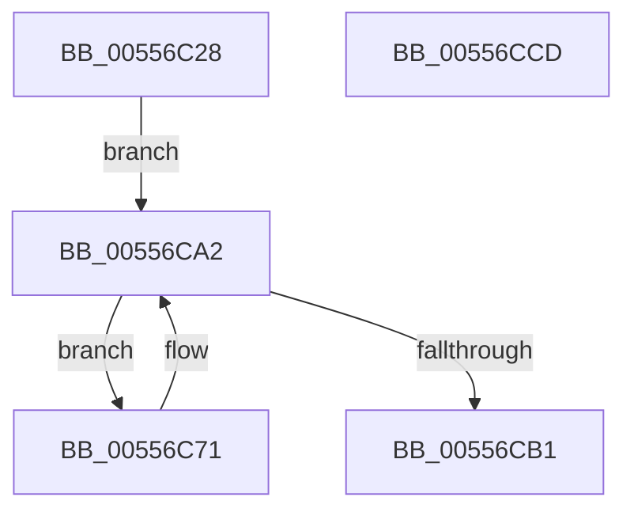

# HalpAcquireSecondaryIcEntryExclusive

- RVA: `0x00556C28`–`0x00556CCE` (길이 `166` bytes)
- VA: `0x0000000140556C28`
- 실행 섹션: `.text`
- PDB 이름 있음: `예`; PDB Function 태그: `아니요`
- unwind 정보 RVA: `0x000C45B4`
- 디코드: `43`개 명령, `166/166` bytes 표시
- 미해석 바이트: `0` (있으면 어셈블리에 `.byte`로 보존)

> 이 문서는 커널 이미지의 기계어와 PDB 기호를 분석해 생성했습니다. 4번과 5번은 함수 원형과 자료형을 바이너리 사용 방식에서 추정한 C 해석이며 원본 소스 복구 결과는 아닙니다.

## 1. Dependencies

- 직접 호출 지점: **5**; 고유 호출 대상: **3**
- 직접 호출자로 확인된 함수: **1**
- RIP 상대 이미지 참조: **1**

### Outgoing calls
- `0x00556C58` → [KeWaitForSingleObject](../20/KeWaitForSingleObject_function_0020E6B0.md) (function, `0x0020E6B0`)
- `0x00556C64` → [HalpAcquireHighLevelLock](../2D/HalpAcquireHighLevelLock_function_002D2390.md) (function, `0x002D2390`)
- `0x00556C7A` → [HalpReleaseHighLevelLock](../2D/HalpReleaseHighLevelLock_function_002D1C58.md) (function, `0x002D1C58`)
- `0x00556C91` → [KeWaitForSingleObject](../20/KeWaitForSingleObject_function_0020E6B0.md) (function, `0x0020E6B0`)
- `0x00556C9D` → [HalpAcquireHighLevelLock](../2D/HalpAcquireHighLevelLock_function_002D2390.md) (function, `0x002D2390`)

### Direct callers
- [HalpDeleteSecondaryIcEntry](HalpDeleteSecondaryIcEntry_function_00556E58.md) at `0x00556E83`

### Static image references
- `0x00556C5D` → RVA `0x00F909D0` (`.data`; read)

## 2. Other-region calls and transfers

- 다른 실행 섹션으로 향하는 call: **0**
- 별도 외부 분기/꼬리 이동을 확인하지 못했습니다.

## 3. Assembly (complete function range)

```asm
00556C28  48 8B C4                        mov rax, rsp
00556C2B  48 89 58 10                     mov qword ptr [rax + 0x10], rbx
00556C2F  48 89 70 18                     mov qword ptr [rax + 0x18], rsi
00556C33  48 89 78 20                     mov qword ptr [rax + 0x20], rdi
00556C37  41 57                           push r15
00556C39  48 83 EC 30                     sub rsp, 0x30
00556C3D  48 8B FA                        mov rdi, rdx
00556C40  48 8B D9                        mov rbx, rcx
00556C43  F0 FF 41 74                     lock inc dword ptr [rcx + 0x74]
00556C47  48 83 60 E8 00                  and qword ptr [rax - 0x18], 0
00556C4C  45 33 C9                        xor r9d, r9d
00556C4F  45 33 C0                        xor r8d, r8d
00556C52  33 D2                           xor edx, edx
00556C54  48 83 C1 78                     add rcx, 0x78
00556C58  E8 53 7A CB FF                  call 0x14020e6b0
00556C5D  48 8D 0D 6C 9D A3 00            lea rcx, [rip + 0xa39d6c]
00556C64  E8 27 B7 D7 FF                  call 0x1402d2390
00556C69  41 BF 02 00 00 00               mov r15d, 2
00556C6F  EB 31                           jmp 0x140556ca2
00556C71  8A D1                           mov dl, cl
00556C73  48 8D 0D 56 9D A3 00            lea rcx, [rip + 0xa39d56]
00556C7A  E8 D9 AF D7 FF                  call 0x1402d1c58
00556C7F  48 83 64 24 20 00               and qword ptr [rsp + 0x20], 0
00556C85  48 8D 4B 78                     lea rcx, [rbx + 0x78]
00556C89  45 33 C9                        xor r9d, r9d
00556C8C  45 33 C0                        xor r8d, r8d
00556C8F  33 D2                           xor edx, edx
00556C91  E8 1A 7A CB FF                  call 0x14020e6b0
00556C96  48 8D 0D 33 9D A3 00            lea rcx, [rip + 0xa39d33]
00556C9D  E8 EE B6 D7 FF                  call 0x1402d2390
00556CA2  8A C8                           mov cl, al
00556CA4  B8 01 00 00 00                  mov eax, 1
00556CA9  F0 44 0F B1 7B 70               lock cmpxchg dword ptr [rbx + 0x70], r15d
00556CAF  75 C0                           jne 0x140556c71
00556CB1  F0 FF 4B 74                     lock dec dword ptr [rbx + 0x74]
00556CB5  48 8B 5C 24 48                  mov rbx, qword ptr [rsp + 0x48]
00556CBA  48 8B 74 24 50                  mov rsi, qword ptr [rsp + 0x50]
00556CBF  88 0F                           mov byte ptr [rdi], cl
00556CC1  48 8B 7C 24 58                  mov rdi, qword ptr [rsp + 0x58]
00556CC6  48 83 C4 30                     add rsp, 0x30
00556CCA  41 5F                           pop r15
00556CCC  C3                              ret
00556CCD  CC                              int3
```

## 4. C-style interpretation (structured pseudocode)

```c
__int64 __fastcall HalpAcquireSecondaryIcEntryExclusive(__int64 a1, __int64 a2, int a3, int a4)
{
    __int64 result;
    __int64 v_rsp;
    unsigned __int64 v_stack_m18;
    unsigned __int64 v_stack_p10;
    unsigned __int64 v_stack_p18;
    unsigned __int64 v_stack_p20;

    *(unsigned __int64 *)(v_rsp + 16) = v_rbx;
    *(unsigned __int64 *)(v_rsp + 24) = v_rsi;
    *(unsigned __int64 *)(v_rsp + 32) = v_rdi;
    v_rsp = (v_rsp) - (48);
    a4 = 0;
    a3 = 0;
    a2 = 0;
    a1 = (a1) + (120);
    result = KeWaitForSingleObject(a1, a2, a3, a4);
    result = HalpAcquireHighLevelLock(v_rip + 10722668, a2, a3, a4);
    goto loc_00556CA2;
loc_00556C71:
    result = HalpReleaseHighLevelLock(v_rip + 10722646, (unsigned __int8)(v_rip + 10722668), a3, a4);
    a4 = 0;
    a3 = 0;
    a2 = 0;
    result = KeWaitForSingleObject(a1 + 120, a2, a3, a4);
    result = HalpAcquireHighLevelLock(v_rip + 10722611, a2, a3, a4);
loc_00556CA2:
    if (condition_is_not_equal) goto loc_00556C71;
    *(unsigned __int8 *)(a2) = (unsigned __int8)((unsigned __int8)(result));
    v_rsp = (v_rsp) + (48);
    return 1;
}
```

## 5. (Beta) C Style

```c
int64_t HalpAcquireSecondaryIcEntryExclusive(void *Arg1, void *Arg2, int32_t Arg3, int32_t Arg4)
{
    uint8_t *arg1 = (uint8_t *)Arg1;
    uint8_t *arg2 = (uint8_t *)Arg2;

    int64_t result;
    int64_t local_rsp;
    uint64_t v_stack_m18;
    uint64_t v_stack_p10;
    uint64_t v_stack_p18;
    uint64_t v_stack_p20;

    *(uint64_t *)(local_rsp + 0x10) = local_rbx;
    *(uint64_t *)(local_rsp + 0x18) = local_rsi;
    *(uint64_t *)(local_rsp + 0x20) = local_rdi;
    local_rsp = (local_rsp) - (48);
    Arg4 = 0;
    Arg3 = 0;
    Arg2 = 0;
    Arg1 = (Arg1) + (120);
    result = KeWaitForSingleObject(Arg1, Arg2, Arg3, Arg4);
    result = HalpAcquireHighLevelLock(v_rip + 10722668, Arg2, Arg3, Arg4);
    goto loc_00556CA2;
loc_00556C71:
    result = HalpReleaseHighLevelLock(v_rip + 10722646, (uint8_t)(v_rip + 10722668), Arg3, Arg4);
    Arg4 = 0;
    Arg3 = 0;
    Arg2 = 0;
    result = KeWaitForSingleObject(Arg1 + 120, Arg2, Arg3, Arg4);
    result = HalpAcquireHighLevelLock(v_rip + 10722611, Arg2, Arg3, Arg4);
loc_00556CA2:
    if (condition_is_not_equal) goto loc_00556C71;
    *(uint8_t *)(arg2) = (uint8_t)((uint8_t)(result));
    local_rsp = (local_rsp) + (48);
    return 1;
}
```

### 관측된 메모리 오프셋

구조체 형식이 확인되지 않은 접근은 인자 기준의 오프셋으로만 기록했습니다.

| 기준 인자 | 오프셋 표현 | 폭 (bit) | 접근 |
|---|---:|---:|---|
| `Arg1` | `+ 0x70` | `32` | `R` |
| `Arg1` | `+ 0x74` | `32` | `R/W` |
| `Arg1` | `+ 0x78` | `64` | `R` |
| `Arg2` | `+ 0x0` | `8` | `W` |

## 6. Execution-region graph

[열기: 2D/3D 그래프와 함수 탐색 컨트롤 패널](../../../control-panel.html?section=text&rva=0x00556C28&view=graph)

- 2D 그래프는 위에서 아래로 흐르고, 3D 그래프는 빈 공간을 드래그해 회전합니다. Shift+드래그는 이동, 휠은 확대·축소, 함수 노드 선택은 대상 보고서 이동입니다.

### Static fallback


