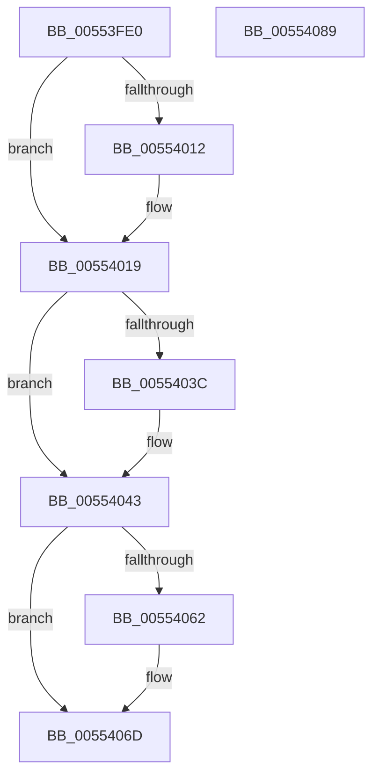

# HalpAddAdapterToSystemList

- RVA: `0x00553FE0`–`0x0055408A` (길이 `170` bytes)
- VA: `0x0000000140553FE0`
- 실행 섹션: `.text`
- PDB 이름 있음: `예`; PDB Function 태그: `아니요`
- unwind 정보 RVA: `0x0005C954`
- 디코드: `44`개 명령, `170/170` bytes 표시
- 미해석 바이트: `0` (있으면 어셈블리에 `.byte`로 보존)

> 이 문서는 커널 이미지의 기계어와 PDB 기호를 분석해 생성했습니다. 4번과 5번은 함수 원형과 자료형을 바이너리 사용 방식에서 추정한 C 해석이며 원본 소스 복구 결과는 아닙니다.

## 1. Dependencies

- 직접 호출 지점: **4**; 고유 호출 대상: **4**
- 직접 호출자로 확인된 함수: **1**
- RIP 상대 이미지 참조: **1**

### Outgoing calls
- `0x00554014` → [KiRaiseIrqlProcessIrqlFlags](../4F/KiRaiseIrqlProcessIrqlFlags_function_004F56FC.md) (function, `0x004F56FC`)
- `0x00554023` → [KeAcquireSpinLockAtDpcLevel](../20/KeAcquireSpinLockAtDpcLevel_function_00208430.md) (function, `0x00208430`)
- `0x00554054` → [KxReleaseSpinLock](../20/KxReleaseSpinLock_function_00206670.md) (function, `0x00206670`)
- `0x00554068` → [KiLowerIrqlProcessIrqlFlags](../4F/KiLowerIrqlProcessIrqlFlags_function_004F5698.md) (function, `0x004F5698`)

### Direct callers
- [HalGetAdapterV3](../../page/70/HalGetAdapterV3_function_00709838.md) at `0x00709CF6`

### Static image references
- `0x00554009` → RVA `0x00FC6D20` (`ALMOSTRO`; read)

## 2. Other-region calls and transfers

- 다른 실행 섹션으로 향하는 call: **0**
- 별도 외부 분기/꼬리 이동을 확인하지 못했습니다.

## 3. Assembly (complete function range)

```asm
00553FE0  48 89 5C 24 08                  mov qword ptr [rsp + 8], rbx
00553FE5  48 89 6C 24 10                  mov qword ptr [rsp + 0x10], rbp
00553FEA  48 89 74 24 18                  mov qword ptr [rsp + 0x18], rsi
00553FEF  57                              push rdi
00553FF0  48 83 EC 20                     sub rsp, 0x20
00553FF4  48 8B EA                        mov rbp, rdx
00553FF7  48 8B F9                        mov rdi, rcx
00553FFA  0F B6 91 B0 00 00 00            movzx edx, byte ptr [rcx + 0xb0]
00554001  44 0F 20 C3                     mov rbx, cr8
00554005  44 0F 22 C2                     mov cr8, rdx
00554009  83 3D 10 2D A7 00 00            cmp dword ptr [rip + 0xa72d10], 0
00554010  74 07                           je 0x140554019
00554012  8A CB                           mov cl, bl
00554014  E8 E3 16 FA FF                  call 0x1404f56fc
00554019  48 8D B7 A8 00 00 00            lea rsi, [rdi + 0xa8]
00554020  48 8B CE                        mov rcx, rsi
00554023  E8 08 44 CB FF                  call 0x140208430
00554028  48 8D 4F 10                     lea rcx, [rdi + 0x10]
0055402C  48 8B 51 08                     mov rdx, qword ptr [rcx + 8]
00554030  48 8D 85 D0 01 00 00            lea rax, [rbp + 0x1d0]
00554037  48 39 0A                        cmp qword ptr [rdx], rcx
0055403A  74 07                           je 0x140554043
0055403C  B9 03 00 00 00                  mov ecx, 3
00554041  CD 29                           int 0x29
00554043  48 89 08                        mov qword ptr [rax], rcx
00554046  48 89 50 08                     mov qword ptr [rax + 8], rdx
0055404A  48 89 02                        mov qword ptr [rdx], rax
0055404D  48 89 41 08                     mov qword ptr [rcx + 8], rax
00554051  48 8B CE                        mov rcx, rsi
00554054  E8 17 26 CB FF                  call 0x140206670
00554059  83 3D C0 2C A7 00 00            cmp dword ptr [rip + 0xa72cc0], 0
00554060  74 0B                           je 0x14055406d
00554062  44 0F 20 C1                     mov rcx, cr8
00554066  8A D3                           mov dl, bl
00554068  E8 2B 16 FA FF                  call 0x1404f5698
0055406D  0F B6 C3                        movzx eax, bl
00554070  44 0F 22 C0                     mov cr8, rax
00554074  48 8B 5C 24 30                  mov rbx, qword ptr [rsp + 0x30]
00554079  48 8B 6C 24 38                  mov rbp, qword ptr [rsp + 0x38]
0055407E  48 8B 74 24 40                  mov rsi, qword ptr [rsp + 0x40]
00554083  48 83 C4 20                     add rsp, 0x20
00554087  5F                              pop rdi
00554088  C3                              ret
00554089  CC                              int3
```

## 4. C-style interpretation (structured pseudocode)

```c
__int64 __fastcall HalpAddAdapterToSystemList(__int64 a1, __int64 a2)
{
    __int64 result;
    __int64 v_rsp;
    unsigned __int64 v_stack_p10;
    unsigned __int64 v_stack_p18;
    unsigned __int64 v_stack_p8;

    v_stack_p8 = v_rbx;
    v_stack_p10 = v_rbp;
    v_stack_p18 = v_rsi;
    v_rsp = (v_rsp) - (32);
    if ((*(unsigned int *)(v_rip + 10956048)) != 0) {
        a1 = (unsigned __int8)(v_cr8);
        result = KiRaiseIrqlProcessIrqlFlags(a1, *(unsigned __int8 *)(a1 + 176), a3, a4);
    }
    result = KeAcquireSpinLockAtDpcLevel(a1 + 168, *(unsigned __int8 *)(a1 + 176), a3, a4);
    if ((*(unsigned __int64 *)(*(unsigned __int64 *)(a1 + 16 + 8))) != (a1 + 16)) {
        a1 = 3;
    }
    *(unsigned __int64 *)(a2 + 464) = a1;
    *(unsigned __int64 *)(a2 + 464 + 8) = *(unsigned __int64 *)(a1 + 16 + 8);
    *(unsigned __int64 *)(*(unsigned __int64 *)(a1 + 16 + 8)) = a2 + 464;
    *(unsigned __int64 *)(a1 + 8) = a2 + 464;
    result = KxReleaseSpinLock(a1 + 168, *(unsigned __int64 *)(a1 + 16 + 8), a3, a4);
    if ((*(unsigned int *)(v_rip + 10955968)) != 0) {
        a1 = *(unsigned __int8 *)(a1 + 176);
        a2 = (unsigned __int8)(v_cr8);
        result = KiLowerIrqlProcessIrqlFlags(a1, a2, a3, a4);
    }
    v_rsp = (v_rsp) + (32);
    return (unsigned __int8)(v_cr8);
}
```

## 5. (Beta) C Style

```c
int64_t HalpAddAdapterToSystemList(void *Arg1, void *Arg2)
{
    uint8_t *arg1 = (uint8_t *)Arg1;
    uint8_t *arg2 = (uint8_t *)Arg2;

    int64_t result;
    int64_t local_rsp;
    uint64_t v_stack_p10;
    uint64_t v_stack_p18;
    uint64_t v_stack_p8;

    v_stack_p8 = local_rbx;
    v_stack_p10 = local_rbp;
    v_stack_p18 = local_rsi;
    local_rsp = (local_rsp) - (32);
    if ((*(uint32_t *)(v_rip + 0xA72D10)) != 0) {
        Arg1 = (uint8_t)(v_cr8);
        result = KiRaiseIrqlProcessIrqlFlags(Arg1, *(uint8_t *)(arg1 + 0xB0), a3, a4);
    }
    result = KeAcquireSpinLockAtDpcLevel(Arg1 + 168, *(uint8_t *)(arg1 + 0xB0), a3, a4);
    if ((*(uint64_t *)(*(uint64_t *)(arg1 + 0x10 + 0x8))) != (Arg1 + 16)) {
        Arg1 = 3;
    }
    *(void **)(arg2 + 0x1D0) = Arg1;
    *(uint64_t *)(arg2 + 0x1D0 + 0x8) = *(uint64_t *)(arg1 + 0x10 + 0x8);
    *(void **)(*(uint64_t *)(arg1 + 0x10 + 0x8)) = Arg2 + 464;
    *(void **)(arg1 + 0x8) = Arg2 + 464;
    result = KxReleaseSpinLock(Arg1 + 168, *(uint64_t *)(arg1 + 0x10 + 0x8), a3, a4);
    if ((*(uint32_t *)(v_rip + 0xA72CC0)) != 0) {
        Arg1 = *(uint8_t *)(arg1 + 0xB0);
        Arg2 = (uint8_t)(v_cr8);
        result = KiLowerIrqlProcessIrqlFlags(Arg1, Arg2, a3, a4);
    }
    local_rsp = (local_rsp) + (32);
    return (uint8_t)(v_cr8);
}
```

### 관측된 메모리 오프셋

구조체 형식이 확인되지 않은 접근은 인자 기준의 오프셋으로만 기록했습니다.

| 기준 인자 | 오프셋 표현 | 폭 (bit) | 접근 |
|---|---:|---:|---|
| `Arg1` | `+ 0x8` | `64` | `R` |
| `Arg1` | `+ 0x10` | `64` | `R` |
| `Arg1` | `+ 0xA8` | `64` | `R` |
| `Arg1` | `+ 0xB0` | `8` | `R` |
| `Arg2` | `+ 0x0` | `64` | `W` |
| `Arg2` | `+ 0x8` | `64` | `W` |
| `Arg2` | `+ 0x1D0` | `64` | `R` |

## 6. Execution-region graph

[열기: 2D/3D 그래프와 함수 탐색 컨트롤 패널](../../../control-panel.html?section=text&rva=0x00553FE0&view=graph)

- 2D 그래프는 위에서 아래로 흐르고, 3D 그래프는 빈 공간을 드래그해 회전합니다. Shift+드래그는 이동, 휠은 확대·축소, 함수 노드 선택은 대상 보고서 이동입니다.

### Static fallback


