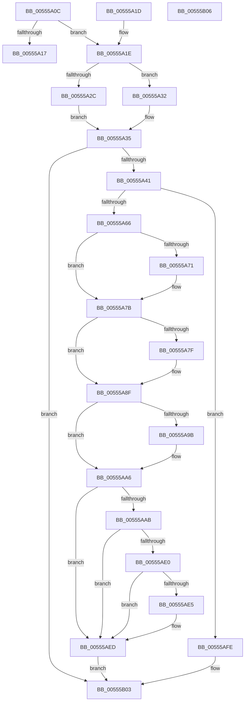

# HalpAddErrorEntryToPacket

- RVA: `0x00555A0C`–`0x00555B07` (길이 `251` bytes)
- VA: `0x0000000140555A0C`
- 실행 섹션: `.text`
- PDB 이름 있음: `예`; PDB Function 태그: `아니요`
- unwind 정보 RVA: `0x000DB714`
- 디코드: `72`개 명령, `251/251` bytes 표시
- 미해석 바이트: `0` (있으면 어셈블리에 `.byte`로 보존)

> 이 문서는 커널 이미지의 기계어와 PDB 기호를 분석해 생성했습니다. 4번과 5번은 함수 원형과 자료형을 바이너리 사용 방식에서 추정한 C 해석이며 원본 소스 복구 결과는 아닙니다.

## 1. Dependencies

- 직접 호출 지점: **0**; 고유 호출 대상: **0**
- 직접 호출자로 확인된 함수: **1**
- RIP 상대 이미지 참조: **2**

### Outgoing calls
- 직접 디코드된 call 명령이 없습니다.

### Direct callers
- [HalpCreateMcaMemoryErrorRecord](../54/HalpCreateMcaMemoryErrorRecord_function_00540C78.md) at `0x00540F72`

### Static image references
- `0x00555A92` → RVA `0x0001A738` (`.rdata`; read)
- `0x00555A9F` → RVA `0x0001A740` (`.rdata`; read)

## 2. Other-region calls and transfers

- 다른 실행 섹션으로 향하는 call: **0**
- 별도 외부 분기/꼬리 이동을 확인하지 못했습니다.

## 3. Assembly (complete function range)

```asm
00555A0C  4C 8B D2                        mov r10, rdx
00555A0F  4C 8B C9                        mov r9, rcx
00555A12  48 85 C9                        test rcx, rcx
00555A15  75 07                           jne 0x140555a1e
00555A17  B8 0D 00 00 C0                  mov eax, 0xc000000d
00555A1C  C3                              ret
00555A1D  CC                              int3
00555A1E  41 F6 00 02                     test byte ptr [r8], 2
00555A22  B9 BB 00 00 C0                  mov ecx, 0xc00000bb
00555A27  41 8B 11                        mov edx, dword ptr [r9]
00555A2A  74 06                           je 0x140555a32
00555A2C  4D 8B 58 10                     mov r11, qword ptr [r8 + 0x10]
00555A30  EB 03                           jmp 0x140555a35
00555A32  45 33 DB                        xor r11d, r11d
00555A35  F7 C2 F0 3F 00 00               test edx, 0x3ff0
00555A3B  0F 86 C2 00 00 00               jbe 0x140555b03
00555A41  49 8D 49 14                     lea rcx, [r9 + 0x14]
00555A45  B8 00 03 00 00                  mov eax, 0x300
00555A4A  66 39 41 14                     cmp word ptr [rcx + 0x14], ax
00555A4E  44 8B 49 18                     mov r9d, dword ptr [rcx + 0x18]
00555A52  1B D2                           sbb edx, edx
00555A54  83 E2 F8                        and edx, 0xfffffff8
00555A57  83 C2 48                        add edx, 0x48
00555A5A  44 03 CA                        add r9d, edx
00555A5D  44 3B CA                        cmp r9d, edx
00555A60  0F 82 98 00 00 00               jb 0x140555afe
00555A66  8A 41 16                        mov al, byte ptr [rcx + 0x16]
00555A69  41 88 42 0A                     mov byte ptr [r10 + 0xa], al
00555A6D  A8 01                           test al, 1
00555A6F  74 0A                           je 0x140555a7b
00555A71  0F 10 41 1C                     movups xmm0, xmmword ptr [rcx + 0x1c]
00555A75  F3 41 0F 7F 42 20               movdqu xmmword ptr [r10 + 0x20], xmm0
00555A7B  A8 02                           test al, 2
00555A7D  74 10                           je 0x140555a8f
00555A7F  0F 10 41 2C                     movups xmm0, xmmword ptr [rcx + 0x2c]
00555A83  41 0F 11 42 34                  movups xmmword ptr [r10 + 0x34], xmm0
00555A88  8B 41 3C                        mov eax, dword ptr [rcx + 0x3c]
00555A8B  41 89 42 44                     mov dword ptr [r10 + 0x44], eax
00555A8F  48 8B 01                        mov rax, qword ptr [rcx]
00555A92  48 2B 05 9F 4C AC FF            sub rax, qword ptr [rip - 0x53b361]
00555A99  75 0B                           jne 0x140555aa6
00555A9B  48 8B 41 08                     mov rax, qword ptr [rcx + 8]
00555A9F  48 2B 05 9A 4C AC FF            sub rax, qword ptr [rip - 0x53b366]
00555AA6  48 85 C0                        test rax, rax
00555AA9  75 42                           jne 0x140555aed
00555AAB  8B C2                           mov eax, edx
00555AAD  48 03 C1                        add rax, rcx
00555AB0  0F 10 00                        movups xmm0, xmmword ptr [rax]
00555AB3  41 0F 11 00                     movups xmmword ptr [r8], xmm0
00555AB7  0F 10 48 10                     movups xmm1, xmmword ptr [rax + 0x10]
00555ABB  41 0F 11 48 10                  movups xmmword ptr [r8 + 0x10], xmm1
00555AC0  0F 10 40 20                     movups xmm0, xmmword ptr [rax + 0x20]
00555AC4  41 0F 11 40 20                  movups xmmword ptr [r8 + 0x20], xmm0
00555AC9  0F 10 48 30                     movups xmm1, xmmword ptr [rax + 0x30]
00555ACD  41 0F 11 48 30                  movups xmmword ptr [r8 + 0x30], xmm1
00555AD2  0F 10 40 40                     movups xmm0, xmmword ptr [rax + 0x40]
00555AD6  41 0F 11 40 40                  movups xmmword ptr [r8 + 0x40], xmm0
00555ADB  4D 85 DB                        test r11, r11
00555ADE  74 0D                           je 0x140555aed
00555AE0  F6 00 02                        test byte ptr [rax], 2
00555AE3  75 08                           jne 0x140555aed
00555AE5  49 83 08 02                     or qword ptr [r8], 2
00555AE9  4D 89 58 10                     mov qword ptr [r8 + 0x10], r11
00555AED  41 8D 41 14                     lea eax, [r9 + 0x14]
00555AF1  83 F8 14                        cmp eax, 0x14
00555AF4  1B C9                           sbb ecx, ecx
00555AF6  81 E1 0D 00 00 C0               and ecx, 0xc000000d
00555AFC  EB 05                           jmp 0x140555b03
00555AFE  B9 0D 00 00 C0                  mov ecx, 0xc000000d
00555B03  8B C1                           mov eax, ecx
00555B05  C3                              ret
00555B06  CC                              int3
```

## 4. C-style interpretation (structured pseudocode)

```c
__int64 __fastcall HalpAddErrorEntryToPacket(__int64 a1, __int64 a2, __int64 a3)
{
    __int64 result;
    __int64 v_r11;

    if (a1 != 0) goto loc_00555A1E;
    return (unsigned int)(0xC000000DULL);
loc_00555A1E:
    if (((*(unsigned __int8 *)(a3)) & (2)) == 0) goto loc_00555A32;
    goto loc_00555A35;
loc_00555A32:
    v_r11 = 0;
loc_00555A35:
    if (condition_is_below_or_equal) goto loc_00555B03;
    a2 = (unsigned int)(((unsigned int)(*(unsigned int *)(a1))) & (0xFFFFFFF8ULL));
    a2 = (unsigned int)((a2) + (72));
    a4 = (unsigned int)(((unsigned int)(*(unsigned int *)(a1 + 20 + 24))) + ((unsigned int)(a2)));
    if (((unsigned int)(a4)) < ((unsigned int)(a2))) goto loc_00555AFE;
    *(unsigned __int8 *)(a2 + 10) = (unsigned __int8)(*(unsigned __int8 *)(a1 + 20 + 22));
    if ((((unsigned __int8)(*(unsigned __int8 *)(a1 + 20 + 22))) & (1)) != 0) {
        *(unsigned __int64 *)(a2 + 32) = v_xmm0;
    }
    result = *(unsigned __int8 *)(a1 + 20 + 22);
    if ((((unsigned __int8)(*(unsigned __int8 *)(a1 + 20 + 22))) & (2)) != 0) {
        *(unsigned __int64 *)(a2 + 52) = v_xmm0;
        result = *(unsigned int *)(a1 + 20 + 60);
        *(unsigned int *)(a2 + 68) = (unsigned int)(result);
    }
    result = (*(unsigned __int64 *)(a1 + 20)) - (*(unsigned __int64 *)(v_rip - 5485409));
    if (!(condition_is_not_equal)) {
        result = *(unsigned __int64 *)(a1 + 20 + 8);
        result = (result) - (*(unsigned __int64 *)(v_rip - 5485414));
    }
    if (result != 0) goto loc_00555AED;
    result = ((unsigned int)((unsigned int)(a2))) + (a1 + 20);
    *(unsigned __int64 *)(a3) = v_xmm0;
    *(unsigned __int64 *)(a3 + 16) = v_xmm1;
    *(unsigned __int64 *)(a3 + 32) = v_xmm0;
    *(unsigned __int64 *)(a3 + 48) = v_xmm1;
    *(unsigned __int64 *)(a3 + 64) = v_xmm0;
    if (0 == 0) goto loc_00555AED;
    if (((*(unsigned __int8 *)(result)) & (2)) == 0) {
        *(unsigned __int64 *)(a3 + 16) = 0;
    }
    a1 = (unsigned int)((a1 + 20) & (0xC000000DULL));
    goto loc_00555B03;
loc_00555AFE:
loc_00555B03:
    return (unsigned int)((unsigned int)((unsigned int)(0xC000000DULL)));
}
```

## 5. (Beta) C Style

```c
int64_t HalpAddErrorEntryToPacket(void *Arg1, void *Arg2, void *Arg3)
{
    uint8_t *arg1 = (uint8_t *)Arg1;
    uint8_t *arg2 = (uint8_t *)Arg2;
    uint8_t *arg3 = (uint8_t *)Arg3;

    int64_t result;
    int64_t local_r11;

    if (Arg1 != NULL) goto loc_00555A1E;
    return (uint32_t)(0xC000000DULL);
loc_00555A1E:
    if (((*(uint8_t *)(arg3)) & (2)) == 0) goto loc_00555A32;
    goto loc_00555A35;
loc_00555A32:
    local_r11 = 0;
loc_00555A35:
    if (condition_is_below_or_equal) goto loc_00555B03;
    Arg2 = (uint32_t)(((uint32_t)(*(uint32_t *)(arg1))) & (0xFFFFFFF8ULL));
    Arg2 = (uint32_t)((Arg2) + (72));
    a4 = (uint32_t)(((uint32_t)(*(uint32_t *)(arg1 + 0x14 + 0x18))) + ((uint32_t)(Arg2)));
    if (((uint32_t)(a4)) < ((uint32_t)(Arg2))) goto loc_00555AFE;
    *(uint8_t *)(arg2 + 0xA) = (uint8_t)(*(uint8_t *)(arg1 + 0x14 + 0x16));
    if ((((uint8_t)(*(uint8_t *)(arg1 + 0x14 + 0x16))) & (1)) != 0) {
        *(uint64_t *)(arg2 + 0x20) = v_xmm0;
    }
    result = *(uint8_t *)(arg1 + 0x14 + 0x16);
    if ((((uint8_t)(*(uint8_t *)(arg1 + 0x14 + 0x16))) & (2)) != 0) {
        *(uint64_t *)(arg2 + 0x34) = v_xmm0;
        result = *(uint32_t *)(arg1 + 0x14 + 0x3C);
        *(uint32_t *)(arg2 + 0x44) = (uint32_t)(result);
    }
    result = (*(uint64_t *)(arg1 + 0x14)) - (*(uint64_t *)(v_rip - 0x53B361));
    if (!(condition_is_not_equal)) {
        result = *(uint64_t *)(arg1 + 0x14 + 0x8);
        result = (result) - (*(uint64_t *)(v_rip - 0x53B366));
    }
    if (result != 0) goto loc_00555AED;
    result = ((uint32_t)((uint32_t)(Arg2))) + (Arg1 + 20);
    *(uint64_t *)(arg3) = v_xmm0;
    *(uint64_t *)(arg3 + 0x10) = v_xmm1;
    *(uint64_t *)(arg3 + 0x20) = v_xmm0;
    *(uint64_t *)(arg3 + 0x30) = v_xmm1;
    *(uint64_t *)(arg3 + 0x40) = v_xmm0;
    if (0 == 0) goto loc_00555AED;
    if (((*(uint8_t *)(result)) & (2)) == 0) {
        *(uint64_t *)(arg3 + 0x10) = 0;
    }
    Arg1 = (uint32_t)((Arg1 + 20) & (0xC000000DULL));
    goto loc_00555B03;
loc_00555AFE:
loc_00555B03:
    return (uint32_t)((uint32_t)((uint32_t)(0xC000000DULL)));
}
```

### 관측된 메모리 오프셋

구조체 형식이 확인되지 않은 접근은 인자 기준의 오프셋으로만 기록했습니다.

| 기준 인자 | 오프셋 표현 | 폭 (bit) | 접근 |
|---|---:|---:|---|
| `Arg1` | `+ 0x0` | `32` | `R` |
| `Arg1` | `+ 0x0` | `64` | `R` |
| `Arg1` | `+ 0x8` | `64` | `R` |
| `Arg1` | `+ 0x14` | `16` | `R` |
| `Arg1` | `+ 0x14` | `64` | `R` |
| `Arg1` | `+ 0x16` | `8` | `R` |
| `Arg1` | `+ 0x18` | `32` | `R` |
| `Arg1` | `+ 0x1C` | `128` | `R` |
| `Arg1` | `+ 0x2C` | `128` | `R` |
| `Arg1` | `+ 0x3C` | `32` | `R` |
| `Arg2` | `+ 0xA` | `8` | `W` |
| `Arg2` | `+ 0x20` | `128` | `W` |
| `Arg2` | `+ 0x34` | `128` | `R` |
| `Arg2` | `+ 0x44` | `32` | `W` |
| `Arg3` | `+ 0x0` | `8` | `R` |
| `Arg3` | `+ 0x0` | `64` | `R/W` |
| `Arg3` | `+ 0x0` | `128` | `R` |
| `Arg3` | `+ 0x10` | `64` | `R` |
| `Arg3` | `+ 0x10` | `64` | `W` |
| `Arg3` | `+ 0x10` | `128` | `R` |
| `Arg3` | `+ 0x20` | `128` | `R` |
| `Arg3` | `+ 0x30` | `128` | `R` |
| `Arg3` | `+ 0x40` | `128` | `R` |

## 6. Execution-region graph

[열기: 2D/3D 그래프와 함수 탐색 컨트롤 패널](../../../control-panel.html?section=text&rva=0x00555A0C&view=graph)

- 2D 그래프는 위에서 아래로 흐르고, 3D 그래프는 빈 공간을 드래그해 회전합니다. Shift+드래그는 이동, 휠은 확대·축소, 함수 노드 선택은 대상 보고서 이동입니다.

### Static fallback


