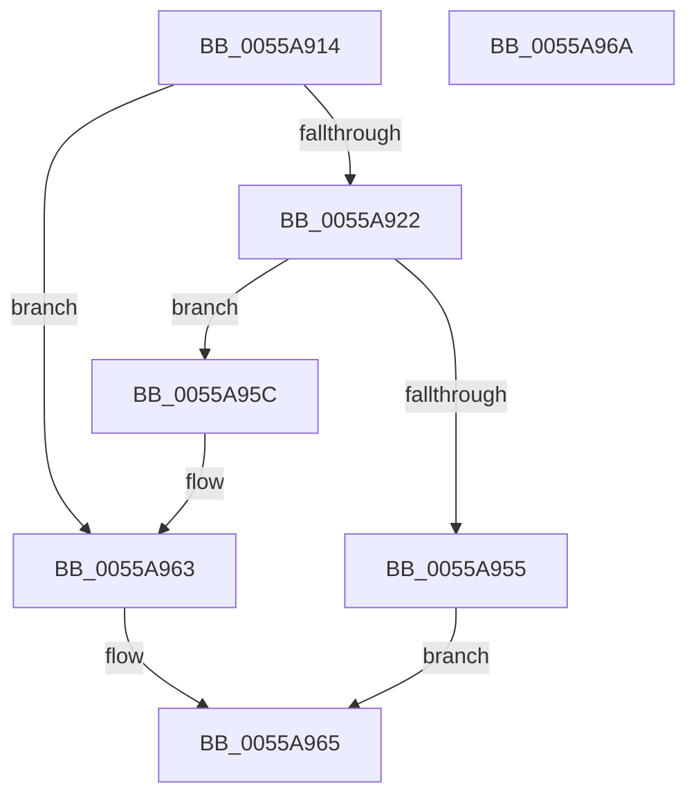

# HalpAllocateCR3Root

- RVA: `0x0055A914`–`0x0055A96B` (길이 `87` bytes)
- VA: `0x000000014055A914`
- 실행 섹션: `.text`
- PDB 이름 있음: `예`; PDB Function 태그: `아니요`
- unwind 정보 RVA: `0x0005D2F4`
- 디코드: `21`개 명령, `87/87` bytes 표시
- 미해석 바이트: `0` (있으면 어셈블리에 `.byte`로 보존)

> 이 문서는 커널 이미지의 기계어와 PDB 기호를 분석해 생성했습니다. 4번과 5번은 함수 원형과 자료형을 바이너리 사용 방식에서 추정한 C 해석이며 원본 소스 복구 결과는 아닙니다.

## 1. Dependencies

- 직접 호출 지점: **1**; 고유 호출 대상: **1**
- 직접 호출자로 확인된 함수: **1**
- RIP 상대 이미지 참조: **2**

### Outgoing calls
- `0x0055A94B` → [MmAllocateContiguousNodeMemory](../3E/MmAllocateContiguousNodeMemory_function_003E9E40.md) (function, `0x003E9E40`)

### Direct callers
- [HalpMmBuildTiledMemoryMap](../../pagelk/B5/HalpMmBuildTiledMemoryMap_function_00B5EA50.md) at `0x00B5EA5A`

### Static image references
- `0x0055A918` → RVA `0x00F905E8` (`.data`; read)
- `0x0055A95C` → RVA `0x00F905E8` (`.data`; write)

## 2. Other-region calls and transfers

- 다른 실행 섹션으로 향하는 call: **0**
- 별도 외부 분기/꼬리 이동을 확인하지 못했습니다.

## 3. Assembly (complete function range)

```asm
0055A914  48 83 EC 38                     sub rsp, 0x38
0055A918  48 83 3D C8 5C A3 00 00         cmp qword ptr [rip + 0xa35cc8], 0
0055A920  75 41                           jne 0x14055a963
0055A922  83 64 24 44 00                  and dword ptr [rsp + 0x44], 0
0055A927  45 33 C9                        xor r9d, r9d
0055A92A  83 4C 24 40 FF                  or dword ptr [rsp + 0x40], 0xffffffff
0055A92F  33 D2                           xor edx, edx
0055A931  4C 8B 44 24 40                  mov r8, qword ptr [rsp + 0x40]
0055A936  B9 00 10 00 00                  mov ecx, 0x1000
0055A93B  C7 44 24 28 00 00 00 80         mov dword ptr [rsp + 0x28], 0x80000000
0055A943  C7 44 24 20 04 00 00 00         mov dword ptr [rsp + 0x20], 4
0055A94B  E8 F0 F4 E8 FF                  call 0x1403e9e40
0055A950  48 85 C0                        test rax, rax
0055A953  75 07                           jne 0x14055a95c
0055A955  B8 9A 00 00 C0                  mov eax, 0xc000009a
0055A95A  EB 09                           jmp 0x14055a965
0055A95C  48 89 05 85 5C A3 00            mov qword ptr [rip + 0xa35c85], rax
0055A963  33 C0                           xor eax, eax
0055A965  48 83 C4 38                     add rsp, 0x38
0055A969  C3                              ret
0055A96A  CC                              int3
```

## 4. C-style interpretation (structured pseudocode)

```c
__int64 __fastcall HalpAllocateCR3Root(__int64 a1, int a2, __int64 a3, int a4)
{
    __int64 result;
    __int64 v_rsp;
    unsigned int v_stack_m10;
    unsigned int v_stack_m18;
    unsigned int v_stack_p8;
    unsigned int v_stack_pC;

    v_rsp = (v_rsp) - (56);
    if ((*(unsigned __int64 *)(v_rip + 10706120)) != 0) goto loc_0055A963;
    a4 = 0;
    a2 = 0;
    v_stack_m10 = 0x80000000ULL;
    v_stack_m18 = 4;
    result = MmAllocateContiguousNodeMemory((unsigned int)(0x1000ULL), a2, v_stack_p8, a4);
    if (result != 0) goto loc_0055A95C;
    goto loc_0055A965;
loc_0055A95C:
    *(unsigned __int64 *)(v_rip + 10706053) = (unsigned int)(0xC000009AULL);
loc_0055A963:
    result = 0;
loc_0055A965:
    v_rsp = (v_rsp) + (56);
    return result;
}
```

## 5. (Beta) C Style

```c
int64_t HalpAllocateCR3Root(int64_t Arg1, int32_t Arg2, int64_t Arg3, int32_t Arg4)
{
    int64_t result;
    int64_t local_rsp;
    uint32_t v_stack_m10;
    uint32_t v_stack_m18;
    uint32_t v_stack_p8;
    uint32_t v_stack_pC;

    local_rsp = (local_rsp) - (56);
    if ((*(uint64_t *)(v_rip + 0xA35CC8)) != 0) goto loc_0055A963;
    Arg4 = 0;
    Arg2 = 0;
    v_stack_m10 = 0x80000000ULL;
    v_stack_m18 = 4;
    result = MmAllocateContiguousNodeMemory((uint32_t)(0x1000ULL), Arg2, v_stack_p8, Arg4);
    if (result != 0) goto loc_0055A95C;
    goto loc_0055A965;
loc_0055A95C:
    *(uint64_t *)(v_rip + 0xA35C85) = (uint32_t)(0xC000009AULL);
loc_0055A963:
    result = 0;
loc_0055A965:
    local_rsp = (local_rsp) + (56);
    return result;
}
```

## 6. Execution-region graph

[열기: 2D/3D 그래프와 함수 탐색 컨트롤 패널](../../../control-panel.html?section=text&rva=0x0055A914&view=graph)

- 2D 그래프는 위에서 아래로 흐르고, 3D 그래프는 빈 공간을 드래그해 회전합니다. Shift+드래그는 이동, 휠은 확대·축소, 함수 노드 선택은 대상 보고서 이동입니다.

### Static fallback


