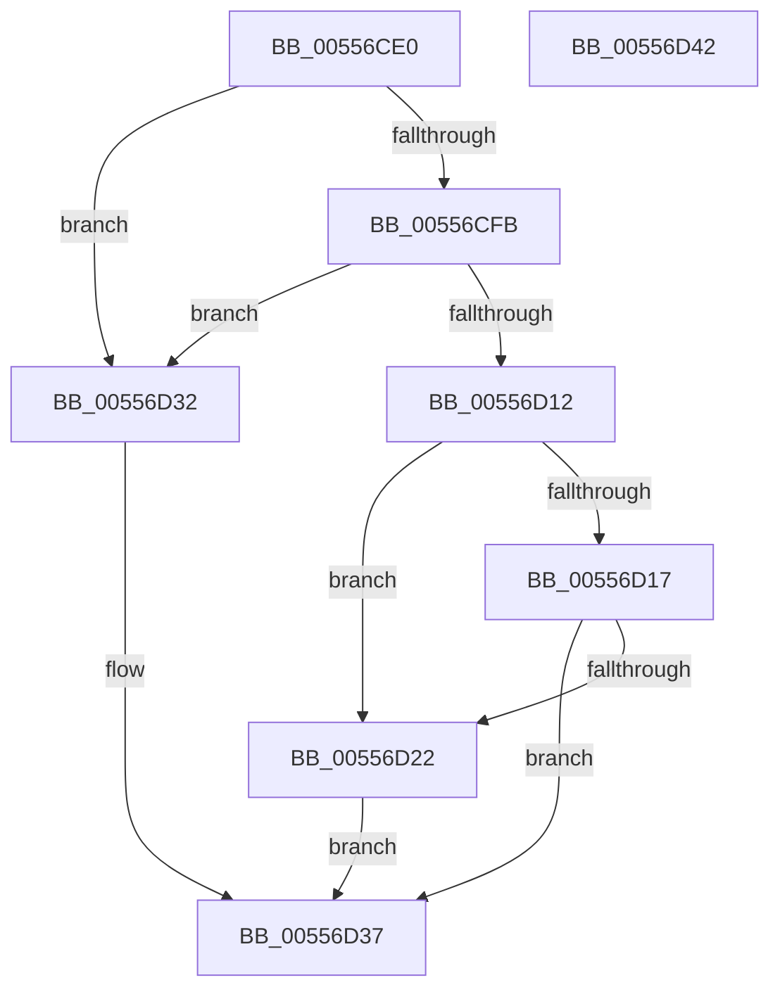

# HalpAllocateGsivForSecondaryInterrupt

- RVA: `0x00556CE0`–`0x00556D43` (길이 `99` bytes)
- VA: `0x0000000140556CE0`
- 실행 섹션: `.text`
- PDB 이름 있음: `예`; PDB Function 태그: `아니요`
- unwind 정보 RVA: `0x0005CAAC`
- 디코드: `30`개 명령, `99/99` bytes 표시
- 미해석 바이트: `0` (있으면 어셈블리에 `.byte`로 보존)

> 이 문서는 커널 이미지의 기계어와 PDB 기호를 분석해 생성했습니다. 4번과 5번은 함수 원형과 자료형을 바이너리 사용 방식에서 추정한 C 해석이며 원본 소스 복구 결과는 아닙니다.

## 1. Dependencies

- 직접 호출 지점: **1**; 고유 호출 대상: **1**
- 직접 호출자로 확인된 함수: **0**
- RIP 상대 이미지 참조: **4**

### Outgoing calls
- `0x00556D19` → [KeInitializeSecondaryInterruptServices](../../page/74/KeInitializeSecondaryInterruptServices_function_007467E0.md) (function, `0x007467E0`)

### Direct callers
- 이 함수 시작 RVA로 연결되는 직접 call은 확인되지 않았습니다. 간접 호출은 완전히 역산할 수 없습니다.

### Static image references
- `0x00556CEA` → RVA `0x00F90A30` (`.data`; read)
- `0x00556CF3` → RVA `0x00F90A34` (`.data`; read)
- `0x00556D00` → RVA `0x00F90A34` (`.data`; read/write)
- `0x00556D22` → RVA `0x00F909DC` (`.data`; read)

## 2. Other-region calls and transfers

- 다른 실행 섹션으로 향하는 call: **1**
  - `0x00556D19` → [KeInitializeSecondaryInterruptServices](../../page/74/KeInitializeSecondaryInterruptServices_function_007467E0.md) (`.text` → `PAGE`)
- 별도 외부 분기/꼬리 이동을 확인하지 못했습니다.

## 3. Assembly (complete function range)

```asm
00556CE0  48 89 5C 24 08                  mov qword ptr [rsp + 8], rbx
00556CE5  57                              push rdi
00556CE6  48 83 EC 20                     sub rsp, 0x20
00556CEA  8B 05 40 9D A3 00               mov eax, dword ptr [rip + 0xa39d40]
00556CF0  49 8B F8                        mov rdi, r8
00556CF3  39 05 3B 9D A3 00               cmp dword ptr [rip + 0xa39d3b], eax
00556CF9  73 37                           jae 0x140556d32
00556CFB  BB 01 00 00 00                  mov ebx, 1
00556D00  F0 0F C1 1D 2C 9D A3 00         lock xadd dword ptr [rip + 0xa39d2c], ebx
00556D08  FF C3                           inc ebx
00556D0A  3B 1D 20 9D A3 00               cmp ebx, dword ptr [rip + 0xa39d20]
00556D10  73 20                           jae 0x140556d32
00556D12  83 FB 01                        cmp ebx, 1
00556D15  75 0B                           jne 0x140556d22
00556D17  33 C9                           xor ecx, ecx
00556D19  E8 C2 FA 1E 00                  call 0x1407467e0
00556D1E  85 C0                           test eax, eax
00556D20  78 15                           js 0x140556d37
00556D22  8B 0D B4 9C A3 00               mov ecx, dword ptr [rip + 0xa39cb4]
00556D28  FF C9                           dec ecx
00556D2A  03 CB                           add ecx, ebx
00556D2C  89 0F                           mov dword ptr [rdi], ecx
00556D2E  33 C0                           xor eax, eax
00556D30  EB 05                           jmp 0x140556d37
00556D32  B8 9A 00 00 C0                  mov eax, 0xc000009a
00556D37  48 8B 5C 24 30                  mov rbx, qword ptr [rsp + 0x30]
00556D3C  48 83 C4 20                     add rsp, 0x20
00556D40  5F                              pop rdi
00556D41  C3                              ret
00556D42  CC                              int3
```

## 4. C-style interpretation (structured pseudocode)

```c
__int64 __fastcall HalpAllocateGsivForSecondaryInterrupt(int a1, __int64 a2, __int64 a3)
{
    __int64 result;
    __int64 v_rbx;
    __int64 v_rsp;
    unsigned __int64 v_stack_p8;

    v_stack_p8 = v_rbx;
    v_rsp = (v_rsp) - (32);
    if ((*(unsigned int *)(v_rip + 10722619)) >= ((unsigned int)((unsigned int)(*(unsigned int *)(v_rip + 10722624))))) goto loc_00556D32;
    v_rbx = (unsigned int)((1) + 1);
    if (((unsigned int)(v_rbx)) >= (*(unsigned int *)(v_rip + 10722592))) goto loc_00556D32;
    if (((unsigned int)(v_rbx)) != 1) goto loc_00556D22;
    a1 = 0;
    result = KeInitializeSecondaryInterruptServices(a1, a2, a3, a4);
    if (sign_flag) goto loc_00556D37;
loc_00556D22:
    a1 = (unsigned int)(((unsigned int)(*(unsigned int *)(v_rip + 10722484))) - 1);
    a1 = (unsigned int)((a1) + ((unsigned int)(v_rbx)));
    *(unsigned int *)(a3) = a1;
    result = 0;
    goto loc_00556D37;
loc_00556D32:
loc_00556D37:
    v_rsp = (v_rsp) + (32);
    return (unsigned int)(0xC000009AULL);
}
```

## 5. (Beta) C Style

```c
int64_t HalpAllocateGsivForSecondaryInterrupt(int32_t Arg1, int64_t Arg2, void *Arg3)
{
    uint8_t *arg3 = (uint8_t *)Arg3;

    int64_t result;
    int64_t local_rbx;
    int64_t local_rsp;
    uint64_t v_stack_p8;

    v_stack_p8 = local_rbx;
    local_rsp = (local_rsp) - (32);
    if ((*(uint32_t *)(v_rip + 0xA39D3B)) >= ((uint32_t)((uint32_t)(*(uint32_t *)(v_rip + 0xA39D40))))) goto loc_00556D32;
    local_rbx = (uint32_t)((1) + 1);
    if (((uint32_t)(local_rbx)) >= (*(uint32_t *)(v_rip + 0xA39D20))) goto loc_00556D32;
    if (((uint32_t)(local_rbx)) != 1) goto loc_00556D22;
    Arg1 = 0;
    result = KeInitializeSecondaryInterruptServices(Arg1, Arg2, Arg3, a4);
    if (sign_flag) goto loc_00556D37;
loc_00556D22:
    Arg1 = (uint32_t)(((uint32_t)(*(uint32_t *)(v_rip + 0xA39CB4))) - 1);
    Arg1 = (uint32_t)((Arg1) + ((uint32_t)(local_rbx)));
    *(uint32_t *)(arg3) = Arg1;
    result = 0;
    goto loc_00556D37;
loc_00556D32:
loc_00556D37:
    local_rsp = (local_rsp) + (32);
    return (uint32_t)(0xC000009AULL);
}
```

### 관측된 메모리 오프셋

구조체 형식이 확인되지 않은 접근은 인자 기준의 오프셋으로만 기록했습니다.

| 기준 인자 | 오프셋 표현 | 폭 (bit) | 접근 |
|---|---:|---:|---|
| `Arg3` | `+ 0x0` | `32` | `W` |

## 6. Execution-region graph

[열기: 2D/3D 그래프와 함수 탐색 컨트롤 패널](../../../control-panel.html?section=text&rva=0x00556CE0&view=graph)

- 2D 그래프는 위에서 아래로 흐르고, 3D 그래프는 빈 공간을 드래그해 회전합니다. Shift+드래그는 이동, 휠은 확대·축소, 함수 노드 선택은 대상 보고서 이동입니다.

### Static fallback


