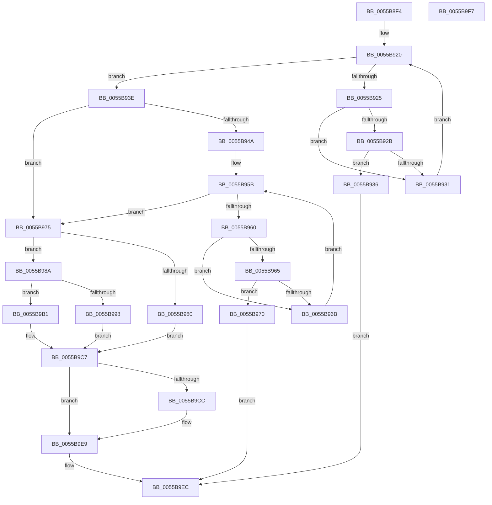

# HalpAllocateKInterrupt

- RVA: `0x0055B8F4`–`0x0055B9F8` (길이 `260` bytes)
- VA: `0x000000014055B8F4`
- 실행 섹션: `.text`
- PDB 이름 있음: `예`; PDB Function 태그: `아니요`
- unwind 정보 RVA: `0x0006E5F8`
- 디코드: `72`개 명령, `260/260` bytes 표시
- 미해석 바이트: `0` (있으면 어셈블리에 `.byte`로 보존)

> 이 문서는 커널 이미지의 기계어와 PDB 기호를 분석해 생성했습니다. 4번과 5번은 함수 원형과 자료형을 바이너리 사용 방식에서 추정한 C 해석이며 원본 소스 복구 결과는 아닙니다.

## 1. Dependencies

- 직접 호출 지점: **2**; 고유 호출 대상: **2**
- 직접 호출자로 확인된 함수: **1**
- RIP 상대 이미지 참조: **8**

### Outgoing calls
- `0x0055B9BF` → [ExAllocatePool2](../../poolcode/B8/ExAllocatePool2_function_00B820F0.md) (function, `0x00B820F0`)
- `0x0055B9E4` → [HalpInterruptSetProblemEx](../48/HalpInterruptSetProblemEx_function_0048AC8C.md) (function, `0x0048AC8C`)

### Direct callers
- [HalpCreateInterrupt](HalpCreateInterrupt_function_0055BA00.md) at `0x0055BA2E`

### Static image references
- `0x0055B8FE` → RVA `0x00E10534` (`.data`; read)
- `0x0055B904` → RVA `0x00E10540` (`.data`; read)
- `0x0055B93E` → RVA `0x00E11740` (`.data`; read)
- `0x0055B94A` → RVA `0x00E10538` (`.data`; read)
- `0x0055B982` → RVA `0x00E10534` (`.data`; write)
- `0x0055B990` → RVA `0x00E1053C` (`.data`; read)
- `0x0055B9A9` → RVA `0x00E10538` (`.data`; write)
- `0x0055B9CC` → RVA `0x000258E0` (`.rdata`; read)

## 2. Other-region calls and transfers

- 다른 실행 섹션으로 향하는 call: **1**
  - `0x0055B9BF` → [ExAllocatePool2](../../poolcode/B8/ExAllocatePool2_function_00B820F0.md) (`.text` → `POOLCODE`)
- 별도 외부 분기/꼬리 이동을 확인하지 못했습니다.

## 3. Assembly (complete function range)

```asm
0055B8F4  48 89 5C 24 08                  mov qword ptr [rsp + 8], rbx
0055B8F9  57                              push rdi
0055B8FA  48 83 EC 30                     sub rsp, 0x30
0055B8FE  8B 05 30 4C 8B 00               mov eax, dword ptr [rip + 0x8b4c30]
0055B904  4C 8D 0D 35 4C 8B 00            lea r9, [rip + 0x8b4c35]
0055B90B  44 8B DA                        mov r11d, edx
0055B90E  8B D9                           mov ebx, ecx
0055B910  BF 20 01 00 00                  mov edi, 0x120
0055B915  4C 8D 14 C0                     lea r10, [rax + rax*8]
0055B919  49 C1 E2 05                     shl r10, 5
0055B91D  4D 03 D1                        add r10, r9
0055B920  4D 3B CA                        cmp r9, r10
0055B923  73 19                           jae 0x14055b93e
0055B925  41 39 59 60                     cmp dword ptr [r9 + 0x60], ebx
0055B929  75 06                           jne 0x14055b931
0055B92B  45 39 59 58                     cmp dword ptr [r9 + 0x58], r11d
0055B92F  74 05                           je 0x14055b936
0055B931  4C 03 CF                        add r9, rdi
0055B934  EB EA                           jmp 0x14055b920
0055B936  49 8B C1                        mov rax, r9
0055B939  E9 AE 00 00 00                  jmp 0x14055b9ec
0055B93E  48 8B 0D FB 5D 8B 00            mov rcx, qword ptr [rip + 0x8b5dfb]
0055B945  48 85 C9                        test rcx, rcx
0055B948  74 2B                           je 0x14055b975
0055B94A  8B 05 E8 4B 8B 00               mov eax, dword ptr [rip + 0x8b4be8]
0055B950  48 8D 14 C0                     lea rdx, [rax + rax*8]
0055B954  48 C1 E2 05                     shl rdx, 5
0055B958  48 03 D1                        add rdx, rcx
0055B95B  48 3B CA                        cmp rcx, rdx
0055B95E  73 15                           jae 0x14055b975
0055B960  39 59 60                        cmp dword ptr [rcx + 0x60], ebx
0055B963  75 06                           jne 0x14055b96b
0055B965  44 39 59 58                     cmp dword ptr [rcx + 0x58], r11d
0055B969  74 05                           je 0x14055b970
0055B96B  48 03 CF                        add rcx, rdi
0055B96E  EB EB                           jmp 0x14055b95b
0055B970  48 8B C1                        mov rax, rcx
0055B973  EB 77                           jmp 0x14055b9ec
0055B975  8B 05 B9 4B 8B 00               mov eax, dword ptr [rip + 0x8b4bb9]
0055B97B  83 F8 10                        cmp eax, 0x10
0055B97E  73 0A                           jae 0x14055b98a
0055B980  FF C0                           inc eax
0055B982  89 05 AC 4B 8B 00               mov dword ptr [rip + 0x8b4bac], eax
0055B988  EB 3D                           jmp 0x14055b9c7
0055B98A  8B 0D A8 4B 8B 00               mov ecx, dword ptr [rip + 0x8b4ba8]
0055B990  3B 0D A6 4B 8B 00               cmp ecx, dword ptr [rip + 0x8b4ba6]
0055B996  73 19                           jae 0x14055b9b1
0055B998  4C 8D 14 C9                     lea r10, [rcx + rcx*8]
0055B99C  49 C1 E2 05                     shl r10, 5
0055B9A0  4C 03 15 99 5D 8B 00            add r10, qword ptr [rip + 0x8b5d99]
0055B9A7  FF C1                           inc ecx
0055B9A9  89 0D 89 4B 8B 00               mov dword ptr [rip + 0x8b4b89], ecx
0055B9AF  EB 16                           jmp 0x14055b9c7
0055B9B1  41 B8 48 61 6C 4B               mov r8d, 0x4b6c6148
0055B9B7  48 8B D7                        mov rdx, rdi
0055B9BA  B9 40 00 00 00                  mov ecx, 0x40
0055B9BF  E8 2C 67 62 00                  call 0x140b820f0
0055B9C4  4C 8B D0                        mov r10, rax
0055B9C7  4D 85 D2                        test r10, r10
0055B9CA  75 1D                           jne 0x14055b9e9
0055B9CC  4C 8D 0D 0D 9F AC FF            lea r9, [rip - 0x5360f3]
0055B9D3  C7 44 24 20 46 01 00 00         mov dword ptr [rsp + 0x20], 0x146
0055B9DB  45 33 C0                        xor r8d, r8d
0055B9DE  41 8D 52 1E                     lea edx, [r10 + 0x1e]
0055B9E2  33 C9                           xor ecx, ecx
0055B9E4  E8 A3 F2 F2 FF                  call 0x14048ac8c
0055B9E9  49 8B C2                        mov rax, r10
0055B9EC  48 8B 5C 24 40                  mov rbx, qword ptr [rsp + 0x40]
0055B9F1  48 83 C4 30                     add rsp, 0x30
0055B9F5  5F                              pop rdi
0055B9F6  C3                              ret
0055B9F7  CC                              int3
```

## 4. C-style interpretation (structured pseudocode)

```c
__int64 __fastcall HalpAllocateKInterrupt(int a1, int a2)
{
    __int64 result;
    __int64 v_r10;
    __int64 v_rsp;
    unsigned int v_stack_m18;
    unsigned __int64 v_stack_p8;

    v_stack_p8 = v_rbx;
    v_rsp = (v_rsp) - (48);
    v_r10 = ((unsigned int)(*(unsigned int *)(v_rip + 9129008)) + (unsigned int)(*(unsigned int *)(v_rip + 9129008)) * 8) << (5);
    v_r10 = (v_r10) + (v_rip + 9129013);
loc_0055B920:
    if ((v_rip + 9129013) >= v_r10) goto loc_0055B93E;
    if ((*(unsigned int *)(v_rip + 9129013 + 96)) != ((unsigned int)((unsigned int)(a1)))) goto loc_0055B931;
    if ((*(unsigned int *)(v_rip + 9129013 + 88)) == ((unsigned int)((unsigned int)(a2)))) goto loc_0055B936;
loc_0055B931:
    a4 = (v_rip + 9129013) + (288);
    goto loc_0055B920;
loc_0055B936:
    goto loc_0055B9EC;
loc_0055B93E:
    if (*(unsigned __int64 *)(v_rip + 9133563) == 0) goto loc_0055B975;
    a2 = ((unsigned int)(*(unsigned int *)(v_rip + 9128936)) + (unsigned int)(*(unsigned int *)(v_rip + 9128936)) * 8) << (5);
    a2 = (a2) + (*(unsigned __int64 *)(v_rip + 9133563));
loc_0055B95B:
    if ((*(unsigned __int64 *)(v_rip + 9133563)) >= a2) goto loc_0055B975;
    if ((*(unsigned int *)(*(unsigned __int64 *)(v_rip + 9133563) + 96)) != ((unsigned int)((unsigned int)(a1)))) goto loc_0055B96B;
    if ((*(unsigned int *)(*(unsigned __int64 *)(v_rip + 9133563) + 88)) == ((unsigned int)((unsigned int)(a2)))) goto loc_0055B970;
loc_0055B96B:
    a1 = (*(unsigned __int64 *)(v_rip + 9133563)) + (288);
    goto loc_0055B95B;
loc_0055B970:
    goto loc_0055B9EC;
loc_0055B975:
    if (((unsigned int)((unsigned int)(*(unsigned int *)(v_rip + 9128889)))) >= 16) goto loc_0055B98A;
    result = (unsigned int)(((unsigned int)(*(unsigned int *)(v_rip + 9128889))) + 1);
    *(unsigned int *)(v_rip + 9128876) = (unsigned int)(result);
    goto loc_0055B9C7;
loc_0055B98A:
    if (((unsigned int)((unsigned int)(*(unsigned int *)(v_rip + 9128872)))) >= (*(unsigned int *)(v_rip + 9128870))) goto loc_0055B9B1;
    v_r10 = ((unsigned int)(*(unsigned int *)(v_rip + 9128872)) + (unsigned int)(*(unsigned int *)(v_rip + 9128872)) * 8) << (5);
    v_r10 = (v_r10) + (*(unsigned __int64 *)(v_rip + 9133465));
    a1 = (unsigned int)(((unsigned int)(*(unsigned int *)(v_rip + 9128872))) + 1);
    *(unsigned int *)(v_rip + 9128841) = a1;
    goto loc_0055B9C7;
loc_0055B9B1:
    result = ExAllocatePool2(64, 288, (unsigned int)(0x4B6C6148ULL), a4);
loc_0055B9C7:
    if (result == 0) {
        a4 = v_rip - 5464307;
        v_stack_m18 = 326;
        a3 = 0;
        a2 = result + 30;
        a1 = 0;
        result = HalpInterruptSetProblemEx(a1, a2, a3, a4);
    }
loc_0055B9EC:
    v_rsp = (v_rsp) + (48);
    return result;
}
```

## 5. (Beta) C Style

```c
int64_t HalpAllocateKInterrupt(int32_t Arg1, int32_t Arg2)
{
    int64_t result;
    int64_t local_r10;
    int64_t local_rsp;
    uint32_t v_stack_m18;
    uint64_t v_stack_p8;

    v_stack_p8 = local_rbx;
    local_rsp = (local_rsp) - (48);
    local_r10 = ((uint32_t)(*(uint32_t *)(v_rip + 0x8B4C30)) + (uint32_t)(*(uint32_t *)(v_rip + 0x8B4C30)) * 8) << (5);
    local_r10 = (local_r10) + (v_rip + 9129013);
loc_0055B920:
    if ((v_rip + 9129013) >= local_r10) goto loc_0055B93E;
    if ((*(uint32_t *)(v_rip + 0x8B4C35 + 0x60)) != ((uint32_t)((uint32_t)(Arg1)))) goto loc_0055B931;
    if ((*(uint32_t *)(v_rip + 0x8B4C35 + 0x58)) == ((uint32_t)((uint32_t)(Arg2)))) goto loc_0055B936;
loc_0055B931:
    a4 = (v_rip + 9129013) + (288);
    goto loc_0055B920;
loc_0055B936:
    goto loc_0055B9EC;
loc_0055B93E:
    if (*(uint64_t *)(v_rip + 0x8B5DFB) == 0) goto loc_0055B975;
    Arg2 = ((uint32_t)(*(uint32_t *)(v_rip + 0x8B4BE8)) + (uint32_t)(*(uint32_t *)(v_rip + 0x8B4BE8)) * 8) << (5);
    Arg2 = (Arg2) + (*(uint64_t *)(v_rip + 0x8B5DFB));
loc_0055B95B:
    if ((*(uint64_t *)(v_rip + 0x8B5DFB)) >= Arg2) goto loc_0055B975;
    if ((*(uint32_t *)(*(uint64_t *)(v_rip + 0x8B5DFB) + 0x60)) != ((uint32_t)((uint32_t)(Arg1)))) goto loc_0055B96B;
    if ((*(uint32_t *)(*(uint64_t *)(v_rip + 0x8B5DFB) + 0x58)) == ((uint32_t)((uint32_t)(Arg2)))) goto loc_0055B970;
loc_0055B96B:
    Arg1 = (*(uint64_t *)(v_rip + 0x8B5DFB)) + (288);
    goto loc_0055B95B;
loc_0055B970:
    goto loc_0055B9EC;
loc_0055B975:
    if (((uint32_t)((uint32_t)(*(uint32_t *)(v_rip + 0x8B4BB9)))) >= 16) goto loc_0055B98A;
    result = (uint32_t)(((uint32_t)(*(uint32_t *)(v_rip + 0x8B4BB9))) + 1);
    *(uint32_t *)(v_rip + 0x8B4BAC) = (uint32_t)(result);
    goto loc_0055B9C7;
loc_0055B98A:
    if (((uint32_t)((uint32_t)(*(uint32_t *)(v_rip + 0x8B4BA8)))) >= (*(uint32_t *)(v_rip + 0x8B4BA6))) goto loc_0055B9B1;
    local_r10 = ((uint32_t)(*(uint32_t *)(v_rip + 0x8B4BA8)) + (uint32_t)(*(uint32_t *)(v_rip + 0x8B4BA8)) * 8) << (5);
    local_r10 = (local_r10) + (*(uint64_t *)(v_rip + 0x8B5D99));
    Arg1 = (uint32_t)(((uint32_t)(*(uint32_t *)(v_rip + 0x8B4BA8))) + 1);
    *(uint32_t *)(v_rip + 0x8B4B89) = Arg1;
    goto loc_0055B9C7;
loc_0055B9B1:
    result = ExAllocatePool2(64, 288, (uint32_t)(0x4B6C6148ULL), a4);
loc_0055B9C7:
    if (result == 0) {
        a4 = v_rip - 5464307;
        v_stack_m18 = 326;
        a3 = 0;
        Arg2 = result + 30;
        Arg1 = 0;
        result = HalpInterruptSetProblemEx(Arg1, Arg2, a3, a4);
    }
loc_0055B9EC:
    local_rsp = (local_rsp) + (48);
    return result;
}
```

## 6. Execution-region graph

[열기: 2D/3D 그래프와 함수 탐색 컨트롤 패널](../../../control-panel.html?section=text&rva=0x0055B8F4&view=graph)

- 2D 그래프는 위에서 아래로 흐르고, 3D 그래프는 빈 공간을 드래그해 회전합니다. Shift+드래그는 이동, 휠은 확대·축소, 함수 노드 선택은 대상 보고서 이동입니다.

### Static fallback


