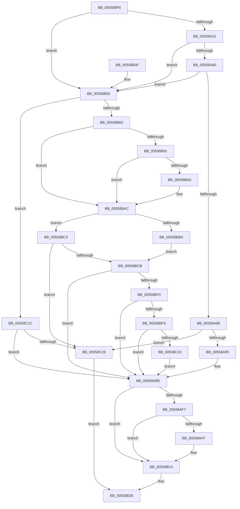

# HalpApicSetupRegisterAccess

- RVA: `0x005589F8`–`0x00558C32` (길이 `570` bytes)
- VA: `0x00000001405589F8`
- 실행 섹션: `.text`
- PDB 이름 있음: `예`; PDB Function 태그: `아니요`
- unwind 정보 RVA: `0x000C4650`
- 디코드: `138`개 명령, `570/570` bytes 표시
- 미해석 바이트: `0` (있으면 어셈블리에 `.byte`로 보존)

> 이 문서는 커널 이미지의 기계어와 PDB 기호를 분석해 생성했습니다. 4번과 5번은 함수 원형과 자료형을 바이너리 사용 방식에서 추정한 C 해석이며 원본 소스 복구 결과는 아닙니다.

## 1. Dependencies

- 직접 호출 지점: **8**; 고유 호출 대상: **3**
- 직접 호출자로 확인된 함수: **3**
- RIP 상대 이미지 참조: **23**

### Outgoing calls
- `0x00558A27` → [HalpIsXboxNanovisorPresent](../54/HalpIsXboxNanovisorPresent_function_0054C3C0.md) (function, `0x0054C3C0`)
- `0x00558A48` → [HalSocRequestConfigurationData](../56/HalSocRequestConfigurationData_function_00562ADC.md) (function, `0x00562ADC`)
- `0x00558A54` → [HalSocRequestConfigurationData](../56/HalSocRequestConfigurationData_function_00562ADC.md) (function, `0x00562ADC`)
- `0x00558AD8` → [HalSocRequestApi](../4B/HalSocRequestApi_function_004B848C.md) (function, `0x004B848C`)
- `0x00558B08` → [HalSocRequestConfigurationData](../56/HalSocRequestConfigurationData_function_00562ADC.md) (function, `0x00562ADC`)
- `0x00558BD4` → [HalSocRequestConfigurationData](../56/HalSocRequestConfigurationData_function_00562ADC.md) (function, `0x00562ADC`)
- `0x00558BE2` → [HalSocRequestConfigurationData](../56/HalSocRequestConfigurationData_function_00562ADC.md) (function, `0x00562ADC`)
- `0x00558C02` → [HalSocRequestConfigurationData](../56/HalSocRequestConfigurationData_function_00562ADC.md) (function, `0x00562ADC`)

### Direct callers
- [HalpApicHvUpdateCallback](HalpApicHvUpdateCallback_function_005589E0.md) at `0x005589E4`
- [HalpApicDiscover](../56/HalpApicDiscover_function_005699E4.md) at `0x00569A14`
- [HalpApicInitializeLocalUnit](../56/HalpApicInitializeLocalUnit_function_00569EC0.md) at `0x00569F3A`

### Static image references
- `0x00558A89` → RVA `0x00E10452` (`.data`; read)
- `0x00558A95` → RVA `0x00E10451` (`.data`; write)
- `0x00558A9B` → RVA `0x004484E0` (`HalpApic1ReadRegister`; read)
- `0x00558AA2` → RVA `0x0047B460` (`HalpApic1WriteRegister`; read)
- `0x00558AA9` → RVA `0x00434640` (`HalpApic1WriteIcr`; read)
- `0x00558AB0` → RVA `0x00444DF0` (`HalpApic1WaitForIcr`; read)
- `0x00558AB7` → RVA `0x006ACAD0` (`HalpApic1EndOfInterrupt`; read)
- `0x00558AC8` → RVA `0x005589E0` (`HalpApicHvUpdateCallback`; read)
- `0x00558AF7` → RVA `0x00E10451` (`.data`; read)
- `0x00558B13` → RVA `0x00E10450` (`.data`; write)
- `0x00558B1B` → RVA `0x00E10438` (`.data`; write)
- `0x00558B22` → RVA `0x00E10430` (`.data`; write)
- `0x00558B29` → RVA `0x00E10448` (`.data`; write)
- `0x00558B30` → RVA `0x00E10428` (`.data`; write)
- `0x00558B37` → RVA `0x00E10458` (`.data`; write)
- `0x00558B57` → RVA `0x004CA6D0` (`HalpApicX2ReadRegister`; read)
- `0x00558B5E` → RVA `0x00471C60` (`HalpApicX2WriteRegister`; read)
- `0x00558B65` → RVA `0x0041CAD0` (`HalpApicX2WriteCommand`; read)
- `0x00558B6C` → RVA `0x0049E550` (`EmpCheckErrataList`; read)
- `0x00558B73` → RVA `0x006ACAF0` (`HalpApicX2EndOfInterrupt`; read)
- `0x00558BA5` → RVA `0x00E10460` (`.data`; write)
- `0x00558BBA` → RVA `0x00E10452` (`.data`; write)
- `0x00558C10` → RVA `0x00E10461` (`.data`; write)

## 2. Other-region calls and transfers

- 다른 실행 섹션으로 향하는 call: **0**
- 별도 외부 분기/꼬리 이동을 확인하지 못했습니다.

## 3. Assembly (complete function range)

```asm
005589F8  40 55                           push rbp
005589FA  53                              push rbx
005589FB  56                              push rsi
005589FC  57                              push rdi
005589FD  41 54                           push r12
005589FF  41 55                           push r13
00558A01  41 56                           push r14
00558A03  41 57                           push r15
00558A05  48 8B EC                        mov rbp, rsp
00558A08  48 83 EC 58                     sub rsp, 0x58
00558A0C  33 DB                           xor ebx, ebx
00558A0E  0F 57 C0                        xorps xmm0, xmm0
00558A11  88 5D D8                        mov byte ptr [rbp - 0x28], bl
00558A14  44 8A D3                        mov r10b, bl
00558A17  88 5D 50                        mov byte ptr [rbp + 0x50], bl
00558A1A  88 5D 58                        mov byte ptr [rbp + 0x58], bl
00558A1D  0F 11 45 E0                     movups xmmword ptr [rbp - 0x20], xmm0
00558A21  88 5D 48                        mov byte ptr [rbp + 0x48], bl
00558A24  88 5D 60                        mov byte ptr [rbp + 0x60], bl
00558A27  E8 94 39 FF FF                  call 0x14054c3c0
00558A2C  8D 4B 1B                        lea ecx, [rbx + 0x1b]
00558A2F  41 B8 00 04 00 00               mov r8d, 0x400
00558A35  44 8D 6B 01                     lea r13d, [rbx + 1]
00558A39  84 C0                           test al, al
00558A3B  0F 85 0F 01 00 00               jne 0x140558b50
00558A41  4C 8D 45 50                     lea r8, [rbp + 0x50]
00558A45  8D 4B 04                        lea ecx, [rbx + 4]
00558A48  E8 8F A0 00 00                  call 0x140562adc
00558A4D  4C 8D 45 58                     lea r8, [rbp + 0x58]
00558A51  8D 4B 06                        lea ecx, [rbx + 6]
00558A54  E8 83 A0 00 00                  call 0x140562adc
00558A59  8D 4B 1B                        lea ecx, [rbx + 0x1b]
00558A5C  0F 32                           rdmsr
00558A5E  44 0F B6 55 50                  movzx r10d, byte ptr [rbp + 0x50]
00558A63  41 B8 00 04 00 00               mov r8d, 0x400
00558A69  48 C1 E2 20                     shl rdx, 0x20
00558A6D  48 0B C2                        or rax, rdx
00558A70  49 85 C0                        test r8, rax
00558A73  45 0F 45 D5                     cmovne r10d, r13d
00558A77  38 5D 58                        cmp byte ptr [rbp + 0x58], bl
00558A7A  0F 85 D0 00 00 00               jne 0x140558b50
00558A80  45 84 D2                        test r10b, r10b
00558A83  0F 85 C7 00 00 00               jne 0x140558b50
00558A89  38 1D C3 79 8B 00               cmp byte ptr [rip + 0x8b79c3], bl
00558A8F  0F 85 93 01 00 00               jne 0x140558c28
00558A95  88 1D B6 79 8B 00               mov byte ptr [rip + 0x8b79b6], bl
00558A9B  4C 8D 35 3E FA EE FF            lea r14, [rip - 0x1105c2]
00558AA2  4C 8D 3D B7 29 F2 FF            lea r15, [rip - 0xdd649]
00558AA9  48 8D 35 90 BB ED FF            lea rsi, [rip - 0x124470]
00558AB0  4C 8D 25 39 C3 EE FF            lea r12, [rip - 0x113cc7]
00558AB7  48 8D 3D 12 40 15 00            lea rdi, [rip + 0x154012]
00558ABE  41 B9 10 00 00 00               mov r9d, 0x10
00558AC4  48 8D 45 E0                     lea rax, [rbp - 0x20]
00558AC8  48 8D 15 11 FF FF FF            lea rdx, [rip - 0xef]
00558ACF  48 89 44 24 20                  mov qword ptr [rsp + 0x20], rax
00558AD4  45 8D 41 F5                     lea r8d, [r9 - 0xb]
00558AD8  E8 AF F9 F5 FF                  call 0x1404b848c
00558ADD  48 39 5D E0                     cmp qword ptr [rbp - 0x20], rbx
00558AE1  48 0F 45 7D E0                  cmovne rdi, qword ptr [rbp - 0x20]
00558AE6  48 39 5D E8                     cmp qword ptr [rbp - 0x18], rbx
00558AEA  48 0F 45 75 E8                  cmovne rsi, qword ptr [rbp - 0x18]
00558AEF  38 1D 5D 79 8B 00               cmp byte ptr [rip + 0x8b795d], bl
00558AF5  75 1C                           jne 0x140558b13
00558AF7  38 1D 54 79 8B 00               cmp byte ptr [rip + 0x8b7954], bl
00558AFD  75 14                           jne 0x140558b13
00558AFF  4C 8D 45 48                     lea r8, [rbp + 0x48]
00558B03  B9 07 00 00 00                  mov ecx, 7
00558B08  E8 CF 9F 00 00                  call 0x140562adc
00558B0D  38 5D 48                        cmp byte ptr [rbp + 0x48], bl
00558B10  0F 94 C3                        sete bl
00558B13  88 1D 37 79 8B 00               mov byte ptr [rip + 0x8b7937], bl
00558B19  33 C0                           xor eax, eax
00558B1B  4C 89 35 16 79 8B 00            mov qword ptr [rip + 0x8b7916], r14
00558B22  4C 89 3D 07 79 8B 00            mov qword ptr [rip + 0x8b7907], r15
00558B29  48 89 35 18 79 8B 00            mov qword ptr [rip + 0x8b7918], rsi
00558B30  4C 89 25 F1 78 8B 00            mov qword ptr [rip + 0x8b78f1], r12
00558B37  48 89 3D 1A 79 8B 00            mov qword ptr [rip + 0x8b791a], rdi
00558B3E  48 83 C4 58                     add rsp, 0x58
00558B42  41 5F                           pop r15
00558B44  41 5E                           pop r14
00558B46  41 5D                           pop r13
00558B48  41 5C                           pop r12
00558B4A  5F                              pop rdi
00558B4B  5E                              pop rsi
00558B4C  5B                              pop rbx
00558B4D  5D                              pop rbp
00558B4E  C3                              ret
00558B4F  CC                              int3
00558B50  44 88 2D FA 78 8B 00            mov byte ptr [rip + 0x8b78fa], r13b
00558B57  4C 8D 35 72 1B F7 FF            lea r14, [rip - 0x8e48e]
00558B5E  4C 8D 3D FB 90 F1 FF            lea r15, [rip - 0xe6f05]
00558B65  48 8D 35 64 3F EC FF            lea rsi, [rip - 0x13c09c]
00558B6C  4C 8D 25 DD 59 F4 FF            lea r12, [rip - 0xba623]
00558B73  48 8D 3D 76 3F 15 00            lea rdi, [rip + 0x153f76]
00558B7A  45 84 D2                        test r10b, r10b
00558B7D  0F 84 99 00 00 00               je 0x140558c1c
00558B83  0F 32                           rdmsr
00558B85  48 C1 E2 20                     shl rdx, 0x20
00558B89  48 0B C2                        or rax, rdx
00558B8C  49 85 C0                        test r8, rax
00558B8F  75 1B                           jne 0x140558bac
00558B91  49 0B C0                        or rax, r8
00558B94  48 8B D0                        mov rdx, rax
00558B97  48 C1 EA 20                     shr rdx, 0x20
00558B9B  0F 30                           wrmsr
00558B9D  38 1D AF 78 8B 00               cmp byte ptr [rip + 0x8b78af], bl
00558BA3  75 07                           jne 0x140558bac
00558BA5  44 88 2D B4 78 8B 00            mov byte ptr [rip + 0x8b78b4], r13b
00558BAC  0F 32                           rdmsr
00558BAE  48 C1 E2 20                     shl rdx, 0x20
00558BB2  48 0B C2                        or rax, rdx
00558BB5  49 85 C0                        test r8, rax
00558BB8  74 09                           je 0x140558bc3
00558BBA  44 88 2D 91 78 8B 00            mov byte ptr [rip + 0x8b7891], r13b
00558BC1  EB 08                           jmp 0x140558bcb
00558BC3  38 1D 89 78 8B 00               cmp byte ptr [rip + 0x8b7889], bl
00558BC9  75 5D                           jne 0x140558c28
00558BCB  4C 8D 45 48                     lea r8, [rbp + 0x48]
00558BCF  B9 07 00 00 00                  mov ecx, 7
00558BD4  E8 03 9F 00 00                  call 0x140562adc
00558BD9  4C 8D 45 60                     lea r8, [rbp + 0x60]
00558BDD  B9 09 00 00 00                  mov ecx, 9
00558BE2  E8 F5 9E 00 00                  call 0x140562adc
00558BE7  38 5D 48                        cmp byte ptr [rbp + 0x48], bl
00558BEA  0F 84 CE FE FF FF               je 0x140558abe
00558BF0  38 5D 60                        cmp byte ptr [rbp + 0x60], bl
00558BF3  0F 85 C5 FE FF FF               jne 0x140558abe
00558BF9  4C 8D 45 D8                     lea r8, [rbp - 0x28]
00558BFD  B9 05 00 00 00                  mov ecx, 5
00558C02  E8 D5 9E 00 00                  call 0x140562adc
00558C07  38 5D D8                        cmp byte ptr [rbp - 0x28], bl
00558C0A  0F 85 AE FE FF FF               jne 0x140558abe
00558C10  44 88 2D 4A 78 8B 00            mov byte ptr [rip + 0x8b784a], r13b
00558C17  E9 A2 FE FF FF                  jmp 0x140558abe
00558C1C  38 1D 30 78 8B 00               cmp byte ptr [rip + 0x8b7830], bl
00558C22  0F 84 96 FE FF FF               je 0x140558abe
00558C28  B8 82 01 00 C0                  mov eax, 0xc0000182
00558C2D  E9 0C FF FF FF                  jmp 0x140558b3e
```

## 4. C-style interpretation (structured pseudocode)

```c
__int64 __fastcall HalpApicSetupRegisterAccess(__int64 a1, __int64 a2)
{
    __int64 result;
    __int64 v_r10;
    __int64 v_rbx;
    __int64 v_rdi;
    __int64 v_rsi;
    __int64 v_rsp;
    unsigned __int64 v_stack_m58;
    unsigned __int64 v_stack_m60;
    unsigned __int8 v_stack_m68;
    unsigned __int64 v_stack_m78;
    unsigned __int8 v_stack_p10;
    unsigned __int8 v_stack_p18;
    unsigned __int8 v_stack_p20;
    unsigned __int8 v_stack_p8;

    v_rsp = (v_rsp) - (88);
    v_rbx = 0;
    v_stack_m68 = 0;
    v_stack_p10 = 0;
    v_stack_p18 = 0;
    v_stack_m60 = v_xmm0;
    v_stack_p8 = 0;
    v_stack_p20 = 0;
    result = HalpIsXboxNanovisorPresent(a1, a2, a3, a4);
    if ((unsigned __int8)(result) != 0) goto loc_00558B50;
    result = HalSocRequestConfigurationData(v_rbx + 4, a2, v_stack_p10, a4);
    result = HalSocRequestConfigurationData(v_rbx + 6, a2, v_stack_p18, a4);
    a2 = (a2) << (32);
    result = (result) | (a2);
    v_r10 = v_stack_p10;
    if ((((unsigned int)(0x400ULL)) & (result)) != 0) { v_r10 = (unsigned int)(v_rbx + 1); }
    if (v_stack_p18 != 0) goto loc_00558B50;
    if ((unsigned __int8)(v_r10) != 0) goto loc_00558B50;
    if ((*(unsigned __int8 *)(v_rip + 9140675)) != 0) goto loc_00558C28;
    *(unsigned __int8 *)(v_rip + 9140662) = 0;
loc_00558ABE:
    v_stack_m78 = v_stack_m60;
    result = HalSocRequestApi(v_rbx + 27, v_rip - 239, 16 - 11, 16);
    v_rdi = v_rip + 1392658;
    if (v_stack_m60 != 0) { v_rdi = v_stack_m60; }
    v_rsi = v_rip - 1197168;
    if (v_stack_m58 != 0) { v_rsi = v_stack_m58; }
    if ((*(unsigned __int8 *)(v_rip + 9140573)) != 0) goto loc_00558B13;
    if ((*(unsigned __int8 *)(v_rip + 9140564)) == 0) {
        a3 = v_stack_p8;
        a1 = 7;
        result = HalSocRequestConfigurationData(a1, v_rip - 239, a3, 16);
        v_rbx = (v_stack_p8 == 0) ? 1 : 0;
    }
    *(unsigned __int8 *)(v_rip + 9140535) = (unsigned __int8)(v_rbx);
    result = 0;
    *(unsigned __int64 *)(v_rip + 9140502) = v_rip - 1115586;
    *(unsigned __int64 *)(v_rip + 9140487) = v_rip - 906825;
    *(unsigned __int64 *)(v_rip + 9140504) = v_rsi;
    *(unsigned __int64 *)(v_rip + 9140465) = v_rip - 1129671;
    *(unsigned __int64 *)(v_rip + 9140506) = v_rdi;
loc_00558B3E:
    v_rsp = (v_rsp) + (88);
    return result;
loc_00558B50:
    *(unsigned __int8 *)(v_rip + 9140474) = (unsigned __int8)(v_rbx + 1);
    if ((unsigned __int8)(v_r10) == 0) goto loc_00558C1C;
    a2 = (v_rip - 239) << (32);
    result = (result) | (a2);
    if (((a3) & (result)) != 0) goto loc_00558BAC;
    result = (result) | (a3);
    a2 = (result) >> (32);
    if ((*(unsigned __int8 *)(v_rip + 9140399)) == ((unsigned __int8)(v_rbx))) {
        *(unsigned __int8 *)(v_rip + 9140404) = (unsigned __int8)(v_rbx + 1);
    }
    a2 = (a2) << (32);
    result = (result) | (a2);
    if (((a3) & (result)) == 0) goto loc_00558BC3;
    *(unsigned __int8 *)(v_rip + 9140369) = (unsigned __int8)(v_rbx + 1);
    goto loc_00558BCB;
loc_00558BC3:
    if ((*(unsigned __int8 *)(v_rip + 9140361)) != ((unsigned __int8)(v_rbx))) goto loc_00558C28;
loc_00558BCB:
    result = HalSocRequestConfigurationData(7, a2, v_stack_p8, 16);
    result = HalSocRequestConfigurationData(9, a2, v_stack_p20, 16);
    if (v_stack_p8 == ((unsigned __int8)(v_rbx))) goto loc_00558ABE;
    if (v_stack_p20 != ((unsigned __int8)(v_rbx))) goto loc_00558ABE;
    result = HalSocRequestConfigurationData(5, a2, v_stack_m68, 16);
    if (v_stack_m68 != ((unsigned __int8)(v_rbx))) goto loc_00558ABE;
    *(unsigned __int8 *)(v_rip + 9140298) = (unsigned __int8)(v_rbx + 1);
    goto loc_00558ABE;
loc_00558C1C:
    if ((*(unsigned __int8 *)(v_rip + 9140272)) == ((unsigned __int8)(v_rbx))) goto loc_00558ABE;
loc_00558C28:
    goto loc_00558B3E;
}
```

## 5. (Beta) C Style

```c
int64_t HalpApicSetupRegisterAccess(int64_t Arg1, int64_t Arg2)
{
    int64_t result;
    int64_t local_r10;
    int64_t local_rbx;
    int64_t local_rdi;
    int64_t local_rsi;
    int64_t local_rsp;
    uint64_t v_stack_m58;
    uint64_t v_stack_m60;
    uint8_t v_stack_m68;
    uint64_t v_stack_m78;
    uint8_t v_stack_p10;
    uint8_t v_stack_p18;
    uint8_t v_stack_p20;
    uint8_t v_stack_p8;

    local_rsp = (local_rsp) - (88);
    local_rbx = 0;
    v_stack_m68 = 0;
    v_stack_p10 = 0;
    v_stack_p18 = 0;
    v_stack_m60 = v_xmm0;
    v_stack_p8 = 0;
    v_stack_p20 = 0;
    result = HalpIsXboxNanovisorPresent(Arg1, Arg2, a3, a4);
    if ((uint8_t)(result) != 0) goto loc_00558B50;
    result = HalSocRequestConfigurationData(local_rbx + 4, Arg2, v_stack_p10, a4);
    result = HalSocRequestConfigurationData(local_rbx + 6, Arg2, v_stack_p18, a4);
    Arg2 = (Arg2) << (32);
    result = (result) | (Arg2);
    local_r10 = v_stack_p10;
    if ((((uint32_t)(0x400ULL)) & (result)) != 0) { local_r10 = (uint32_t)(local_rbx + 1); }
    if (v_stack_p18 != 0) goto loc_00558B50;
    if ((uint8_t)(local_r10) != 0) goto loc_00558B50;
    if ((*(uint8_t *)(v_rip + 0x8B79C3)) != 0) goto loc_00558C28;
    *(uint8_t *)(v_rip + 0x8B79B6) = 0;
loc_00558ABE:
    v_stack_m78 = v_stack_m60;
    result = HalSocRequestApi(local_rbx + 27, v_rip - 239, 16 - 11, 16);
    local_rdi = v_rip + 1392658;
    if (v_stack_m60 != 0) { local_rdi = v_stack_m60; }
    local_rsi = v_rip - 1197168;
    if (v_stack_m58 != 0) { local_rsi = v_stack_m58; }
    if ((*(uint8_t *)(v_rip + 0x8B795D)) != 0) goto loc_00558B13;
    if ((*(uint8_t *)(v_rip + 0x8B7954)) == 0) {
        a3 = v_stack_p8;
        Arg1 = 7;
        result = HalSocRequestConfigurationData(Arg1, v_rip - 239, a3, 16);
        local_rbx = (v_stack_p8 == 0) ? 1 : 0;
    }
    *(uint8_t *)(v_rip + 0x8B7937) = (uint8_t)(local_rbx);
    result = 0;
    *(uint64_t *)(v_rip + 0x8B7916) = v_rip - 1115586;
    *(uint64_t *)(v_rip + 0x8B7907) = v_rip - 906825;
    *(uint64_t *)(v_rip + 0x8B7918) = local_rsi;
    *(uint64_t *)(v_rip + 0x8B78F1) = v_rip - 1129671;
    *(uint64_t *)(v_rip + 0x8B791A) = local_rdi;
loc_00558B3E:
    local_rsp = (local_rsp) + (88);
    return result;
loc_00558B50:
    *(uint8_t *)(v_rip + 0x8B78FA) = (uint8_t)(local_rbx + 1);
    if ((uint8_t)(local_r10) == 0) goto loc_00558C1C;
    Arg2 = (v_rip - 239) << (32);
    result = (result) | (Arg2);
    if (((a3) & (result)) != 0) goto loc_00558BAC;
    result = (result) | (a3);
    Arg2 = (result) >> (32);
    if ((*(uint8_t *)(v_rip + 0x8B78AF)) == ((uint8_t)(local_rbx))) {
        *(uint8_t *)(v_rip + 0x8B78B4) = (uint8_t)(local_rbx + 1);
    }
    Arg2 = (Arg2) << (32);
    result = (result) | (Arg2);
    if (((a3) & (result)) == 0) goto loc_00558BC3;
    *(uint8_t *)(v_rip + 0x8B7891) = (uint8_t)(local_rbx + 1);
    goto loc_00558BCB;
loc_00558BC3:
    if ((*(uint8_t *)(v_rip + 0x8B7889)) != ((uint8_t)(local_rbx))) goto loc_00558C28;
loc_00558BCB:
    result = HalSocRequestConfigurationData(7, Arg2, v_stack_p8, 16);
    result = HalSocRequestConfigurationData(9, Arg2, v_stack_p20, 16);
    if (v_stack_p8 == ((uint8_t)(local_rbx))) goto loc_00558ABE;
    if (v_stack_p20 != ((uint8_t)(local_rbx))) goto loc_00558ABE;
    result = HalSocRequestConfigurationData(5, Arg2, v_stack_m68, 16);
    if (v_stack_m68 != ((uint8_t)(local_rbx))) goto loc_00558ABE;
    *(uint8_t *)(v_rip + 0x8B784A) = (uint8_t)(local_rbx + 1);
    goto loc_00558ABE;
loc_00558C1C:
    if ((*(uint8_t *)(v_rip + 0x8B7830)) == ((uint8_t)(local_rbx))) goto loc_00558ABE;
loc_00558C28:
    goto loc_00558B3E;
}
```

## 6. Execution-region graph

[열기: 2D/3D 그래프와 함수 탐색 컨트롤 패널](../../../control-panel.html?section=text&rva=0x005589F8&view=graph)

- 2D 그래프는 위에서 아래로 흐르고, 3D 그래프는 빈 공간을 드래그해 회전합니다. Shift+드래그는 이동, 휠은 확대·축소, 함수 노드 선택은 대상 보고서 이동입니다.

### Static fallback


