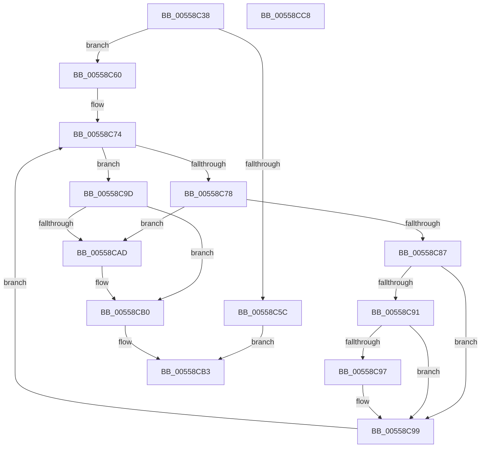

# HalpCheckNumaConfiguration

- RVA: `0x00558C38`–`0x00558CC9` (길이 `145` bytes)
- VA: `0x0000000140558C38`
- 실행 섹션: `.text`
- PDB 이름 있음: `예`; PDB Function 태그: `아니요`
- unwind 정보 RVA: `0x000A5A38`
- 디코드: `45`개 명령, `145/145` bytes 표시
- 미해석 바이트: `0` (있으면 어셈블리에 `.byte`로 보존)

> 이 문서는 커널 이미지의 기계어와 PDB 기호를 분석해 생성했습니다. 4번과 5번은 함수 원형과 자료형을 바이너리 사용 방식에서 추정한 C 해석이며 원본 소스 복구 결과는 아닙니다.

## 1. Dependencies

- 직접 호출 지점: **0**; 고유 호출 대상: **0**
- 직접 호출자로 확인된 함수: **1**
- RIP 상대 이미지 참조: **1**

### Outgoing calls
- 직접 디코드된 call 명령이 없습니다.

### Direct callers
- [HalStartDynamicProcessor](../54/HalStartDynamicProcessor_function_00543300.md) at `0x00543386`

### Static image references
- `0x00558C4B` → RVA `0x00F90658` (`.data`; read)

## 2. Other-region calls and transfers

- 다른 실행 섹션으로 향하는 call: **0**
- 별도 외부 분기/꼬리 이동을 확인하지 못했습니다.

## 3. Assembly (complete function range)

```asm
00558C38  48 8B C4                        mov rax, rsp
00558C3B  48 89 58 08                     mov qword ptr [rax + 8], rbx
00558C3F  48 89 68 10                     mov qword ptr [rax + 0x10], rbp
00558C43  48 89 70 18                     mov qword ptr [rax + 0x18], rsi
00558C47  48 89 78 20                     mov qword ptr [rax + 0x20], rdi
00558C4B  4C 8B 0D 06 7A A3 00            mov r9, qword ptr [rip + 0xa37a06]
00558C52  45 33 C0                        xor r8d, r8d
00558C55  8B F9                           mov edi, ecx
00558C57  4D 85 C9                        test r9, r9
00558C5A  75 04                           jne 0x140558c60
00558C5C  B0 01                           mov al, 1
00558C5E  EB 53                           jmp 0x140558cb3
00558C60  49 8B 41 18                     mov rax, qword ptr [r9 + 0x18]
00558C64  41 8B C8                        mov ecx, r8d
00558C67  41 8B 71 3C                     mov esi, dword ptr [r9 + 0x3c]
00558C6B  0F B7 DA                        movzx ebx, dx
00558C6E  41 8B D0                        mov edx, r8d
00558C71  8B 2C 98                        mov ebp, dword ptr [rax + rbx*4]
00558C74  3B CE                           cmp ecx, esi
00558C76  73 25                           jae 0x140558c9d
00558C78  49 8B 01                        mov rax, qword ptr [r9]
00558C7B  44 8B D9                        mov r11d, ecx
00558C7E  46 8B 14 98                     mov r10d, dword ptr [rax + r11*4]
00558C82  44 3B D7                        cmp r10d, edi
00558C85  74 26                           je 0x140558cad
00558C87  49 8B 41 10                     mov rax, qword ptr [r9 + 0x10]
00558C8B  42 39 2C 98                     cmp dword ptr [rax + r11*4], ebp
00558C8F  75 08                           jne 0x140558c99
00558C91  41 83 FA FF                     cmp r10d, -1
00558C95  74 02                           je 0x140558c99
00558C97  FF C2                           inc edx
00558C99  FF C1                           inc ecx
00558C9B  EB D7                           jmp 0x140558c74
00558C9D  48 8B 05 B4 79 A3 00            mov rax, qword ptr [rip + 0xa379b4]
00558CA4  48 8B 48 28                     mov rcx, qword ptr [rax + 0x28]
00558CA8  3B 14 99                        cmp edx, dword ptr [rcx + rbx*4]
00558CAB  73 03                           jae 0x140558cb0
00558CAD  41 B0 01                        mov r8b, 1
00558CB0  41 8A C0                        mov al, r8b
00558CB3  48 8B 5C 24 08                  mov rbx, qword ptr [rsp + 8]
00558CB8  48 8B 6C 24 10                  mov rbp, qword ptr [rsp + 0x10]
00558CBD  48 8B 74 24 18                  mov rsi, qword ptr [rsp + 0x18]
00558CC2  48 8B 7C 24 20                  mov rdi, qword ptr [rsp + 0x20]
00558CC7  C3                              ret
00558CC8  CC                              int3
```

## 4. C-style interpretation (structured pseudocode)

```c
__int64 __fastcall HalpCheckNumaConfiguration(int a1, unsigned __int16 a2, int a3)
{
    unsigned __int64 v_stack_p10;
    unsigned __int64 v_stack_p18;
    unsigned __int64 v_stack_p20;
    unsigned __int64 v_stack_p8;

    *(unsigned __int64 *)(v_rsp + 8) = v_rbx;
    *(unsigned __int64 *)(v_rsp + 16) = v_rbp;
    *(unsigned __int64 *)(v_rsp + 24) = v_rsi;
    *(unsigned __int64 *)(v_rsp + 32) = v_rdi;
    a3 = 0;
    if (*(unsigned __int64 *)(v_rip + 10713606) != 0) goto loc_00558C60;
    goto loc_00558CB3;
loc_00558C60:
loc_00558C74:
    if (0 >= ((unsigned int)((unsigned int)(*(unsigned int *)(*(unsigned __int64 *)(v_rip + 10713606) + 60))))) goto loc_00558C9D;
    if (((unsigned int)((unsigned int)(*(unsigned int *)(*(unsigned __int64 *)(*(unsigned __int64 *)(v_rip + 10713606)) + 0 * 4)))) == ((unsigned int)((unsigned int)(a1)))) goto loc_00558CAD;
    if ((*(unsigned int *)(*(unsigned __int64 *)(*(unsigned __int64 *)(v_rip + 10713606) + 16) + 0 * 4)) != ((unsigned int)((unsigned int)(*(unsigned int *)(*(unsigned __int64 *)(*(unsigned __int64 *)(v_rip + 10713606) + 24) + a2 * 4))))) goto loc_00558C99;
    if (((unsigned int)((unsigned int)(*(unsigned int *)(*(unsigned __int64 *)(*(unsigned __int64 *)(v_rip + 10713606)) + 0 * 4)))) != -1) {
        a2 = (unsigned int)((0) + 1);
    }
    a1 = (unsigned int)((0) + 1);
    goto loc_00558C74;
loc_00558C9D:
    if (a2 < (*(unsigned int *)(*(unsigned __int64 *)(*(unsigned __int64 *)(v_rip + 10713524) + 40) + a2 * 4))) {
        a3 = 1;
    }
loc_00558CB3:
    return (unsigned __int8)(a3);
}
```

## 5. (Beta) C Style

```c
int64_t HalpCheckNumaConfiguration(int32_t Arg1, uint16_t Arg2, int32_t Arg3)
{
    uint64_t v_stack_p10;
    uint64_t v_stack_p18;
    uint64_t v_stack_p20;
    uint64_t v_stack_p8;

    *(uint64_t *)(local_rsp + 0x8) = local_rbx;
    *(uint64_t *)(local_rsp + 0x10) = local_rbp;
    *(uint64_t *)(local_rsp + 0x18) = local_rsi;
    *(uint64_t *)(local_rsp + 0x20) = local_rdi;
    Arg3 = 0;
    if (*(uint64_t *)(v_rip + 0xA37A06) != 0) goto loc_00558C60;
    goto loc_00558CB3;
loc_00558C60:
loc_00558C74:
    if (0 >= ((uint32_t)((uint32_t)(*(uint32_t *)(*(uint64_t *)(v_rip + 0xA37A06) + 0x3C))))) goto loc_00558C9D;
    if (((uint32_t)((uint32_t)(*(uint32_t *)(*(uint64_t *)(*(uint64_t *)(v_rip + 0xA37A06)) + 0x0 * 4)))) == ((uint32_t)((uint32_t)(Arg1)))) goto loc_00558CAD;
    if ((*(uint32_t *)(*(uint64_t *)(*(uint64_t *)(v_rip + 0xA37A06) + 0x10) + 0x0 * 4)) != ((uint32_t)((uint32_t)(*(uint32_t *)(*(uint64_t *)(*(uint64_t *)(v_rip + 0xA37A06) + 0x18) + Arg2 * 4))))) goto loc_00558C99;
    if (((uint32_t)((uint32_t)(*(uint32_t *)(*(uint64_t *)(*(uint64_t *)(v_rip + 0xA37A06)) + 0x0 * 4)))) != -1) {
        Arg2 = (uint32_t)((0) + 1);
    }
    Arg1 = (uint32_t)((0) + 1);
    goto loc_00558C74;
loc_00558C9D:
    if (Arg2 < (*(uint32_t *)(*(uint64_t *)(*(uint64_t *)(v_rip + 0xA379B4) + 0x28) + Arg2 * 4))) {
        Arg3 = 1;
    }
loc_00558CB3:
    return (uint8_t)(Arg3);
}
```

## 6. Execution-region graph

[열기: 2D/3D 그래프와 함수 탐색 컨트롤 패널](../../../control-panel.html?section=text&rva=0x00558C38&view=graph)

- 2D 그래프는 위에서 아래로 흐르고, 3D 그래프는 빈 공간을 드래그해 회전합니다. Shift+드래그는 이동, 휠은 확대·축소, 함수 노드 선택은 대상 보고서 이동입니다.

### Static fallback


