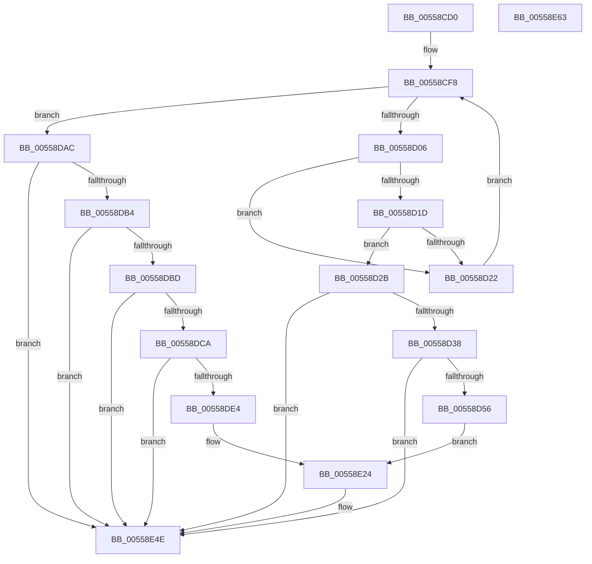

# HalpCheckSratMemoryRanges

- RVA: `0x00558CD0`–`0x00558E64` (길이 `404` bytes)
- VA: `0x0000000140558CD0`
- 실행 섹션: `.text`
- PDB 이름 있음: `예`; PDB Function 태그: `아니요`
- unwind 정보 RVA: `0x000AC058`
- 디코드: `87`개 명령, `404/404` bytes 표시
- 미해석 바이트: `0` (있으면 어셈블리에 `.byte`로 보존)

> 이 문서는 커널 이미지의 기계어와 PDB 기호를 분석해 생성했습니다. 4번과 5번은 함수 원형과 자료형을 바이너리 사용 방식에서 추정한 C 해석이며 원본 소스 복구 결과는 아닙니다.

## 1. Dependencies

- 직접 호출 지점: **4**; 고유 호출 대상: **3**
- 직접 호출자로 확인된 함수: **1**
- RIP 상대 이미지 참조: **6**

### Outgoing calls
- `0x00558D49` → [tlgKeywordOn](../42/tlgKeywordOn_function_0042EAA0.md) (function, `0x0042EAA0`)
- `0x00558DDB` → [tlgKeywordOn](../42/tlgKeywordOn_function_0042EAA0.md) (function, `0x0042EAA0`)
- `0x00558E49` → [tlgWriteTransfer_EtwWriteTransfer](../42/tlgWriteTransfer_EtwWriteTransfer_function_004260E0.md) (function, `0x004260E0`)
- `0x00558E55` → [_security_check_cookie](../6A/_security_check_cookie_function_006AC640.md) (function, `0x006AC640`)

### Direct callers
- [HalpNumaAddRangeProximity](HalpNumaAddRangeProximity_function_00558EC0.md) at `0x00558F62`

### Static image references
- `0x00558CDE` → RVA `0x00E0A740` (`.data`; read)
- `0x00558CF8` → RVA `0x00F90650` (`.data`; read)
- `0x00558D0C` → RVA `0x00F90628` (`.data`; read)
- `0x00558D2B` → RVA `0x00E03B28` (`.data`; read)
- `0x00558D83` → RVA `0x000438AC` (`.rdata`; read)
- `0x00558E0D` → RVA `0x0004384D` (`.rdata`; read)

## 2. Other-region calls and transfers

- 다른 실행 섹션으로 향하는 call: **0**
- 별도 외부 분기/꼬리 이동을 확인하지 못했습니다.

## 3. Assembly (complete function range)

```asm
00558CD0  40 55                           push rbp
00558CD2  48 8D 6C 24 A9                  lea rbp, [rsp - 0x57]
00558CD7  48 81 EC C0 00 00 00            sub rsp, 0xc0
00558CDE  48 8B 05 5B 1A 8B 00            mov rax, qword ptr [rip + 0x8b1a5b]
00558CE5  48 33 C4                        xor rax, rsp
00558CE8  48 89 45 47                     mov qword ptr [rbp + 0x47], rax
00558CEC  45 33 DB                        xor r11d, r11d
00558CEF  4C 8B C9                        mov r9, rcx
00558CF2  45 8B C3                        mov r8d, r11d
00558CF5  41 8B D3                        mov edx, r11d
00558CF8  8B 05 52 79 A3 00               mov eax, dword ptr [rip + 0xa37952]
00558CFE  3B D0                           cmp edx, eax
00558D00  0F 83 A6 00 00 00               jae 0x140558dac
00558D06  8B C2                           mov eax, edx
00558D08  48 8D 0C 40                     lea rcx, [rax + rax*2]
00558D0C  48 8B 05 15 79 A3 00            mov rax, qword ptr [rip + 0xa37915]
00558D13  4C 8B 54 C8 08                  mov r10, qword ptr [rax + rcx*8 + 8]
00558D18  4D 3B C8                        cmp r9, r8
00558D1B  76 05                           jbe 0x140558d22
00558D1D  4D 3B CA                        cmp r9, r10
00558D20  72 09                           jb 0x140558d2b
00558D22  4C 8B 44 C8 10                  mov r8, qword ptr [rax + rcx*8 + 0x10]
00558D27  FF C2                           inc edx
00558D29  EB CD                           jmp 0x140558cf8
00558D2B  83 3D F6 AD 8A 00 05            cmp dword ptr [rip + 0x8aadf6], 5
00558D32  0F 86 16 01 00 00               jbe 0x140558e4e
00558D38  48 BA 00 00 00 00 00 40 00 00   movabs rdx, 0x400000000000
00558D42  48 8D 0D DF AD 8A 00            lea rcx, [rip + 0x8aaddf]
00558D49  E8 52 5D ED FF                  call 0x14042eaa0
00558D4E  84 C0                           test al, al
00558D50  0F 84 F8 00 00 00               je 0x140558e4e
00558D56  48 8D 4D C7                     lea rcx, [rbp - 0x39]
00558D5A  4C 89 45 DF                     mov qword ptr [rbp - 0x21], r8
00558D5E  48 89 4D 17                     mov qword ptr [rbp + 0x17], rcx
00558D62  48 8D 45 DF                     lea rax, [rbp - 0x21]
00558D66  48 8D 4D CF                     lea rcx, [rbp - 0x31]
00558D6A  48 89 45 07                     mov qword ptr [rbp + 7], rax
00558D6E  48 89 4D 27                     mov qword ptr [rbp + 0x27], rcx
00558D72  48 8D 45 E7                     lea rax, [rbp - 0x19]
00558D76  48 8D 4D D7                     lea rcx, [rbp - 0x29]
00558D7A  48 89 44 24 28                  mov qword ptr [rsp + 0x28], rax
00558D7F  48 89 4D 37                     mov qword ptr [rbp + 0x37], rcx
00558D83  48 8D 15 22 AB AE FF            lea rdx, [rip - 0x5154de]
00558D8A  4C 89 4D C7                     mov qword ptr [rbp - 0x39], r9
00558D8E  4C 89 55 CF                     mov qword ptr [rbp - 0x31], r10
00558D92  48 C7 45 D7 00 00 00 01         mov qword ptr [rbp - 0x29], 0x1000000
00558D9A  48 C7 45 3F 08 00 00 00         mov qword ptr [rbp + 0x3f], 8
00558DA2  C7 44 24 20 06 00 00 00         mov dword ptr [rsp + 0x20], 6
00558DAA  EB 78                           jmp 0x140558e24
00558DAC  85 C0                           test eax, eax
00558DAE  0F 84 9A 00 00 00               je 0x140558e4e
00558DB4  4D 3B C8                        cmp r9, r8
00558DB7  0F 86 91 00 00 00               jbe 0x140558e4e
00558DBD  83 3D 64 AD 8A 00 05            cmp dword ptr [rip + 0x8aad64], 5
00558DC4  0F 86 84 00 00 00               jbe 0x140558e4e
00558DCA  48 BA 00 00 00 00 00 40 00 00   movabs rdx, 0x400000000000
00558DD4  48 8D 0D 4D AD 8A 00            lea rcx, [rip + 0x8aad4d]
00558DDB  E8 C0 5C ED FF                  call 0x14042eaa0
00558DE0  84 C0                           test al, al
00558DE2  74 6A                           je 0x140558e4e
00558DE4  48 8D 45 D7                     lea rax, [rbp - 0x29]
00558DE8  4C 89 4D D7                     mov qword ptr [rbp - 0x29], r9
00558DEC  48 8D 4D CF                     lea rcx, [rbp - 0x31]
00558DF0  48 89 45 07                     mov qword ptr [rbp + 7], rax
00558DF4  48 8D 45 E7                     lea rax, [rbp - 0x19]
00558DF8  48 89 4D 17                     mov qword ptr [rbp + 0x17], rcx
00558DFC  48 8D 4D C7                     lea rcx, [rbp - 0x39]
00558E00  48 89 44 24 28                  mov qword ptr [rsp + 0x28], rax
00558E05  C7 44 24 20 05 00 00 00         mov dword ptr [rsp + 0x20], 5
00558E0D  48 8D 15 39 AA AE FF            lea rdx, [rip - 0x5155c7]
00558E14  4C 89 45 CF                     mov qword ptr [rbp - 0x31], r8
00558E18  48 C7 45 C7 00 00 00 01         mov qword ptr [rbp - 0x39], 0x1000000
00558E20  48 89 4D 27                     mov qword ptr [rbp + 0x27], rcx
00558E24  45 33 C9                        xor r9d, r9d
00558E27  48 C7 45 0F 08 00 00 00         mov qword ptr [rbp + 0xf], 8
00558E2F  45 33 C0                        xor r8d, r8d
00558E32  48 C7 45 1F 08 00 00 00         mov qword ptr [rbp + 0x1f], 8
00558E3A  48 8D 0D E7 AC 8A 00            lea rcx, [rip + 0x8aace7]
00558E41  48 C7 45 2F 08 00 00 00         mov qword ptr [rbp + 0x2f], 8
00558E49  E8 92 D2 EC FF                  call 0x1404260e0
00558E4E  48 8B 4D 47                     mov rcx, qword ptr [rbp + 0x47]
00558E52  48 33 CC                        xor rcx, rsp
00558E55  E8 E6 37 15 00                  call 0x1406ac640
00558E5A  48 81 C4 C0 00 00 00            add rsp, 0xc0
00558E61  5D                              pop rbp
00558E62  C3                              ret
00558E63  CC                              int3
```

## 4. C-style interpretation (structured pseudocode)

```c
__int64 __fastcall HalpCheckSratMemoryRanges(__int64 a1)
{
    __int64 result;
    __int64 v_r11;
    __int64 v_rsp;
    unsigned __int64 v_stack_m18;
    unsigned __int64 v_stack_m20;
    unsigned __int64 v_stack_m28;
    unsigned __int64 v_stack_m30;
    unsigned __int64 v_stack_m38;
    unsigned __int64 v_stack_m40;
    unsigned __int64 v_stack_m48;
    unsigned __int64 v_stack_m50;
    unsigned __int64 v_stack_m58;
    unsigned __int64 v_stack_m5F;
    unsigned __int64 v_stack_m78;
    unsigned __int64 v_stack_m80;
    unsigned __int64 v_stack_m88;
    unsigned __int64 v_stack_m90;
    unsigned __int64 v_stack_m98;
    unsigned __int64 v_stack_mA0;
    unsigned int v_stack_mA8;

    v_rsp = (v_rsp) - (192);
    result = (*(unsigned __int64 *)(v_rip + 9116251)) ^ (v_rsp);
    v_stack_m18 = result;
    v_r11 = 0;
loc_00558CF8:
    if (0 >= ((unsigned int)((unsigned int)(*(unsigned int *)(v_rip + 10713426))))) goto loc_00558DAC;
    if (a1 <= 0) goto loc_00558D22;
    if (a1 < (*(unsigned __int64 *)(*(unsigned __int64 *)(v_rip + 10713365) + 0 + 0 * 2 * 8 + 8))) goto loc_00558D2B;
loc_00558D22:
    a2 = (unsigned int)((0) + 1);
    goto loc_00558CF8;
loc_00558D2B:
    if ((*(unsigned int *)(v_rip + 9088502)) <= 5) goto loc_00558E4E;
    result = tlgKeywordOn(v_rip + 9088479, a2, *(unsigned __int64 *)(*(unsigned __int64 *)(v_rip + 10713365) + 0 + 0 * 2 * 8 + 16), a1);
    if ((unsigned __int8)(result) == 0) goto loc_00558E4E;
    v_stack_m80 = *(unsigned __int64 *)(*(unsigned __int64 *)(v_rip + 10713365) + 0 + 0 * 2 * 8 + 16);
    v_stack_m48 = v_stack_m98;
    v_stack_m58 = v_stack_m80;
    v_stack_m38 = v_stack_m90;
    v_stack_mA0 = v_stack_m78;
    v_stack_m28 = v_stack_m88;
    v_stack_m98 = a1;
    v_stack_m90 = *(unsigned __int64 *)(*(unsigned __int64 *)(v_rip + 10713365) + 0 + 0 * 2 * 8 + 8);
    v_stack_m88 = 0x1000000ULL;
    v_stack_m20 = 8;
    v_stack_mA8 = 6;
    goto loc_00558E24;
loc_00558DAC:
    if ((unsigned int)(v_stack_m78) == 0) goto loc_00558E4E;
    if (a1 <= (*(unsigned __int64 *)(*(unsigned __int64 *)(v_rip + 10713365) + 0 + 0 * 2 * 8 + 16))) goto loc_00558E4E;
    if ((*(unsigned int *)(v_rip + 9088356)) <= 5) goto loc_00558E4E;
    result = tlgKeywordOn(v_rip + 9088333, v_rip - 5330142, *(unsigned __int64 *)(*(unsigned __int64 *)(v_rip + 10713365) + 0 + 0 * 2 * 8 + 16), a1);
    if ((unsigned __int8)(result) == 0) goto loc_00558E4E;
    v_stack_m88 = a1;
    v_stack_m58 = v_stack_m88;
    v_stack_m48 = v_stack_m90;
    v_stack_mA0 = v_stack_m78;
    v_stack_mA8 = 5;
    v_stack_m90 = *(unsigned __int64 *)(*(unsigned __int64 *)(v_rip + 10713365) + 0 + 0 * 2 * 8 + 16);
    v_stack_m98 = 0x1000000ULL;
    v_stack_m38 = v_stack_m98;
loc_00558E24:
    a4 = 0;
    v_stack_m50 = 8;
    a3 = 0;
    v_stack_m40 = 8;
    v_stack_m30 = 8;
    result = tlgWriteTransfer_EtwWriteTransfer(v_rip + 9088231, v_rip - 5330375, a3, a4);
loc_00558E4E:
    a1 = (v_stack_m18) ^ (v_rsp);
    result = _security_check_cookie(a1, v_rip - 5330375, a3, a4);
    v_rsp = (v_rsp) + (192);
    return result;
}
```

## 5. (Beta) C Style

```c
int64_t HalpCheckSratMemoryRanges(int64_t Arg1)
{
    int64_t result;
    int64_t local_r11;
    int64_t local_rsp;
    uint64_t v_stack_m18;
    uint64_t v_stack_m20;
    uint64_t v_stack_m28;
    uint64_t v_stack_m30;
    uint64_t v_stack_m38;
    uint64_t v_stack_m40;
    uint64_t v_stack_m48;
    uint64_t v_stack_m50;
    uint64_t v_stack_m58;
    uint64_t v_stack_m5F;
    uint64_t v_stack_m78;
    uint64_t v_stack_m80;
    uint64_t v_stack_m88;
    uint64_t v_stack_m90;
    uint64_t v_stack_m98;
    uint64_t v_stack_mA0;
    uint32_t v_stack_mA8;

    local_rsp = (local_rsp) - (192);
    result = (*(uint64_t *)(v_rip + 0x8B1A5B)) ^ (local_rsp);
    v_stack_m18 = result;
    local_r11 = 0;
loc_00558CF8:
    if (0 >= ((uint32_t)((uint32_t)(*(uint32_t *)(v_rip + 0xA37952))))) goto loc_00558DAC;
    if (Arg1 <= 0) goto loc_00558D22;
    if (Arg1 < (*(uint64_t *)(*(uint64_t *)(v_rip + 0xA37915) + 0x0 + 0x0 * 2 * 8 + 0x8))) goto loc_00558D2B;
loc_00558D22:
    a2 = (uint32_t)((0) + 1);
    goto loc_00558CF8;
loc_00558D2B:
    if ((*(uint32_t *)(v_rip + 0x8AADF6)) <= 5) goto loc_00558E4E;
    result = tlgKeywordOn(v_rip + 9088479, a2, *(uint64_t *)(*(uint64_t *)(v_rip + 0xA37915) + 0x0 + 0x0 * 2 * 8 + 0x10), Arg1);
    if ((uint8_t)(result) == 0) goto loc_00558E4E;
    v_stack_m80 = *(uint64_t *)(*(uint64_t *)(v_rip + 0xA37915) + 0x0 + 0x0 * 2 * 8 + 0x10);
    v_stack_m48 = v_stack_m98;
    v_stack_m58 = v_stack_m80;
    v_stack_m38 = v_stack_m90;
    v_stack_mA0 = v_stack_m78;
    v_stack_m28 = v_stack_m88;
    v_stack_m98 = Arg1;
    v_stack_m90 = *(uint64_t *)(*(uint64_t *)(v_rip + 0xA37915) + 0x0 + 0x0 * 2 * 8 + 0x8);
    v_stack_m88 = 0x1000000ULL;
    v_stack_m20 = 8;
    v_stack_mA8 = 6;
    goto loc_00558E24;
loc_00558DAC:
    if ((uint32_t)(v_stack_m78) == 0) goto loc_00558E4E;
    if (Arg1 <= (*(uint64_t *)(*(uint64_t *)(v_rip + 0xA37915) + 0x0 + 0x0 * 2 * 8 + 0x10))) goto loc_00558E4E;
    if ((*(uint32_t *)(v_rip + 0x8AAD64)) <= 5) goto loc_00558E4E;
    result = tlgKeywordOn(v_rip + 9088333, v_rip - 5330142, *(uint64_t *)(*(uint64_t *)(v_rip + 0xA37915) + 0x0 + 0x0 * 2 * 8 + 0x10), Arg1);
    if ((uint8_t)(result) == 0) goto loc_00558E4E;
    v_stack_m88 = Arg1;
    v_stack_m58 = v_stack_m88;
    v_stack_m48 = v_stack_m90;
    v_stack_mA0 = v_stack_m78;
    v_stack_mA8 = 5;
    v_stack_m90 = *(uint64_t *)(*(uint64_t *)(v_rip + 0xA37915) + 0x0 + 0x0 * 2 * 8 + 0x10);
    v_stack_m98 = 0x1000000ULL;
    v_stack_m38 = v_stack_m98;
loc_00558E24:
    a4 = 0;
    v_stack_m50 = 8;
    a3 = 0;
    v_stack_m40 = 8;
    v_stack_m30 = 8;
    result = tlgWriteTransfer_EtwWriteTransfer(v_rip + 9088231, v_rip - 5330375, a3, a4);
loc_00558E4E:
    Arg1 = (v_stack_m18) ^ (local_rsp);
    result = _security_check_cookie(Arg1, v_rip - 5330375, a3, a4);
    local_rsp = (local_rsp) + (192);
    return result;
}
```

## 6. Execution-region graph

[열기: 2D/3D 그래프와 함수 탐색 컨트롤 패널](../../../control-panel.html?section=text&rva=0x00558CD0&view=graph)

- 2D 그래프는 위에서 아래로 흐르고, 3D 그래프는 빈 공간을 드래그해 회전합니다. Shift+드래그는 이동, 휠은 확대·축소, 함수 노드 선택은 대상 보고서 이동입니다.

### Static fallback


