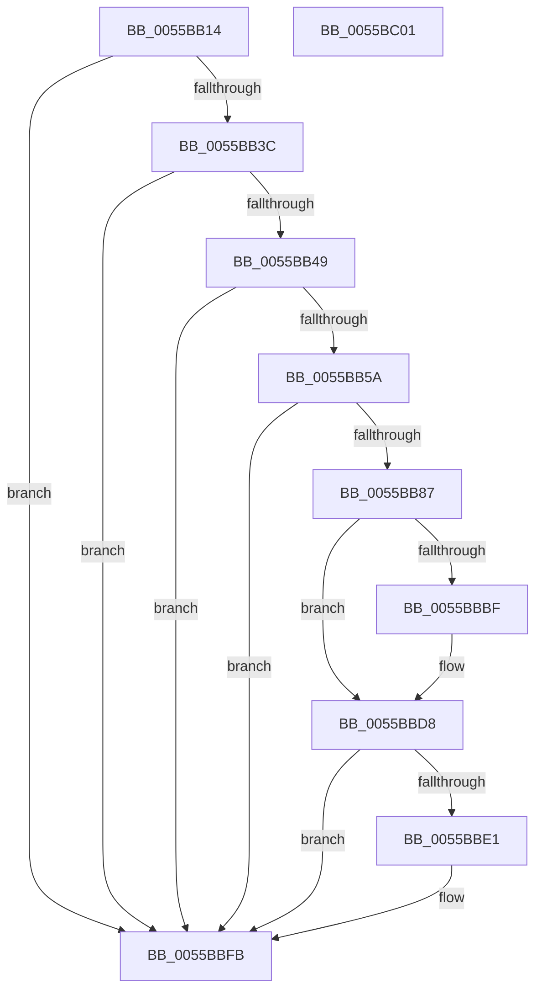

# HalpCheckWakeupTimeAndAdjust

- RVA: `0x0055BB14`–`0x0055BC02` (길이 `238` bytes)
- VA: `0x000000014055BB14`
- 실행 섹션: `.text`
- PDB 이름 있음: `예`; PDB Function 태그: `아니요`
- unwind 정보 RVA: `0x000C4850`
- 디코드: `56`개 명령, `238/238` bytes 표시
- 미해석 바이트: `0` (있으면 어셈블리에 `.byte`로 보존)

> 이 문서는 커널 이미지의 기계어와 PDB 기호를 분석해 생성했습니다. 4번과 5번은 함수 원형과 자료형을 바이너리 사용 방식에서 추정한 C 해석이며 원본 소스 복구 결과는 아닙니다.

## 1. Dependencies

- 직접 호출 지점: **7**; 고유 호출 대상: **5**
- 직접 호출자로 확인된 함수: **1**
- RIP 상대 이미지 참조: **6**

### Outgoing calls
- `0x0055BB4D` → [HalQueryRealTimeClock](../42/HalQueryRealTimeClock_function_0042D810.md) (function, `0x0042D810`)
- `0x0055BB62` → [RtlpTimeFieldsToTime](../42/RtlpTimeFieldsToTime_function_0042E6C8.md) (function, `0x0042E6C8`)
- `0x0055BB72` → [RtlpTimeFieldsToTime](../42/RtlpTimeFieldsToTime_function_0042E6C8.md) (function, `0x0042E6C8`)
- `0x0055BB93` → [RtlpTimeToTimeFields](../42/RtlpTimeToTimeFields_function_0042E110.md) (function, `0x0042E110`)
- `0x0055BBA8` → [HalpSetWakeAlarm](../42/HalpSetWakeAlarm_function_0042DAC8.md) (function, `0x0042DAC8`)
- `0x0055BBD3` → [HalpAcpiPmRegisterWrite](../41/HalpAcpiPmRegisterWrite_function_0041C760.md) (function, `0x0041C760`)
- `0x0055BBF6` → [HalpAcpiPmRegisterWrite](../41/HalpAcpiPmRegisterWrite_function_0041C760.md) (function, `0x0041C760`)

### Direct callers
- [HaliAcpiSleep](../56/HaliAcpiSleep_function_0056AD60.md) at `0x0056AF9A`

### Static image references
- `0x0055BB2A` → RVA `0x00E0A808` (`.data`; read)
- `0x0055BB3C` → RVA `0x00F90141` (`.data`; read)
- `0x0055BB6B` → RVA `0x00F90142` (`.data`; read)
- `0x0055BBA0` → RVA `0x00F90142` (`.data`; write)
- `0x0055BBAD` → RVA `0x00F8FE60` (`.data`; read)
- `0x0055BBD8` → RVA `0x00F8FEF0` (`.data`; read)

## 2. Other-region calls and transfers

- 다른 실행 섹션으로 향하는 call: **0**
- 별도 외부 분기/꼬리 이동을 확인하지 못했습니다.

## 3. Assembly (complete function range)

```asm
0055BB14  40 55                           push rbp
0055BB16  48 8B EC                        mov rbp, rsp
0055BB19  48 83 EC 40                     sub rsp, 0x40
0055BB1D  48 83 65 18 00                  and qword ptr [rbp + 0x18], 0
0055BB22  0F 57 C0                        xorps xmm0, xmm0
0055BB25  48 83 65 20 00                  and qword ptr [rbp + 0x20], 0
0055BB2A  8B 05 D8 EC 8A 00               mov eax, dword ptr [rip + 0x8aecd8]
0055BB30  0F 11 45 F0                     movups xmmword ptr [rbp - 0x10], xmm0
0055BB34  A8 04                           test al, 4
0055BB36  0F 84 BF 00 00 00               je 0x14055bbfb
0055BB3C  80 3D FE 45 A3 00 00            cmp byte ptr [rip + 0xa345fe], 0
0055BB43  0F 84 B2 00 00 00               je 0x14055bbfb
0055BB49  48 8D 4D F0                     lea rcx, [rbp - 0x10]
0055BB4D  E8 BE 1C ED FF                  call 0x14042d810
0055BB52  84 C0                           test al, al
0055BB54  0F 84 A1 00 00 00               je 0x14055bbfb
0055BB5A  48 8D 55 18                     lea rdx, [rbp + 0x18]
0055BB5E  48 8D 4D F0                     lea rcx, [rbp - 0x10]
0055BB62  E8 61 2B ED FF                  call 0x14042e6c8
0055BB67  48 8D 55 20                     lea rdx, [rbp + 0x20]
0055BB6B  48 8D 0D D0 45 A3 00            lea rcx, [rip + 0xa345d0]
0055BB72  E8 51 2B ED FF                  call 0x14042e6c8
0055BB77  48 8B 45 18                     mov rax, qword ptr [rbp + 0x18]
0055BB7B  48 05 00 A3 E1 11               add rax, 0x11e1a300
0055BB81  48 39 45 20                     cmp qword ptr [rbp + 0x20], rax
0055BB85  77 74                           ja 0x14055bbfb
0055BB87  48 8D 55 F0                     lea rdx, [rbp - 0x10]
0055BB8B  48 89 45 18                     mov qword ptr [rbp + 0x18], rax
0055BB8F  48 8D 4D 18                     lea rcx, [rbp + 0x18]
0055BB93  E8 78 25 ED FF                  call 0x14042e110
0055BB98  0F 10 4D F0                     movups xmm1, xmmword ptr [rbp - 0x10]
0055BB9C  48 8D 55 F0                     lea rdx, [rbp - 0x10]
0055BBA0  F3 0F 7F 0D 9A 45 A3 00         movdqu xmmword ptr [rip + 0xa3459a], xmm1
0055BBA8  E8 1B 1F ED FF                  call 0x14042dac8
0055BBAD  80 3D AC 42 A3 00 00            cmp byte ptr [rip + 0xa342ac], 0
0055BBB4  B8 00 04 00 00                  mov eax, 0x400
0055BBB9  66 89 45 10                     mov word ptr [rbp + 0x10], ax
0055BBBD  74 19                           je 0x14055bbd8
0055BBBF  48 83 64 24 20 00               and qword ptr [rsp + 0x20], 0
0055BBC5  4C 8D 45 10                     lea r8, [rbp + 0x10]
0055BBC9  41 B9 02 00 00 00               mov r9d, 2
0055BBCF  33 D2                           xor edx, edx
0055BBD1  33 C9                           xor ecx, ecx
0055BBD3  E8 88 0B EC FF                  call 0x14041c760
0055BBD8  80 3D 11 43 A3 00 00            cmp byte ptr [rip + 0xa34311], 0
0055BBDF  74 1A                           je 0x14055bbfb
0055BBE1  48 83 64 24 20 00               and qword ptr [rsp + 0x20], 0
0055BBE7  4C 8D 45 10                     lea r8, [rbp + 0x10]
0055BBEB  33 D2                           xor edx, edx
0055BBED  41 B9 02 00 00 00               mov r9d, 2
0055BBF3  8D 4A 03                        lea ecx, [rdx + 3]
0055BBF6  E8 65 0B EC FF                  call 0x14041c760
0055BBFB  48 83 C4 40                     add rsp, 0x40
0055BBFF  5D                              pop rbp
0055BC00  C3                              ret
0055BC01  CC                              int3
```

## 4. C-style interpretation (structured pseudocode)

```c
__int64 __fastcall HalpCheckWakeupTimeAndAdjust(void)
{
    __int64 result;
    __int64 v_rsp;
    unsigned __int64 v_stack_m18;
    unsigned __int64 v_stack_m28;
    unsigned __int64 v_stack_p10;
    unsigned __int64 v_stack_p18;
    unsigned __int16 v_stack_p8;

    v_rsp = (v_rsp) - (64);
    v_stack_m18 = v_xmm0;
    if ((((unsigned __int8)((unsigned int)(*(unsigned int *)(v_rip + 9104600)))) & (4)) == 0) goto loc_0055BBFB;
    if ((*(unsigned __int8 *)(v_rip + 10700286)) == 0) goto loc_0055BBFB;
    result = HalQueryRealTimeClock(v_stack_m18, a2, a3, a4);
    if ((unsigned __int8)(result) == 0) goto loc_0055BBFB;
    result = RtlpTimeFieldsToTime(v_stack_m18, v_stack_p10, a3, a4);
    result = RtlpTimeFieldsToTime(v_rip + 10700240, v_stack_p18, a3, a4);
    result = (v_stack_p10) + (0x11E1A300ULL);
    if (v_stack_p18 > result) goto loc_0055BBFB;
    v_stack_p10 = result;
    result = RtlpTimeToTimeFields(v_stack_p10, v_stack_m18, a3, a4);
    *(unsigned __int64 *)(v_rip + 10700186) = v_xmm1;
    result = HalpSetWakeAlarm(v_stack_p10, v_stack_m18, a3, a4);
    v_stack_p8 = (unsigned __int16)((unsigned int)(0x400ULL));
    result = (unsigned int)(0x400ULL);
    if ((*(unsigned __int8 *)(v_rip + 10699436)) != 0) {
        a3 = v_stack_p8;
        a4 = 2;
        a2 = 0;
        a1 = 0;
        result = HalpAcpiPmRegisterWrite(a1, a2, a3, a4);
    }
    if ((*(unsigned __int8 *)(v_rip + 10699537)) != 0) {
        a3 = v_stack_p8;
        a2 = 0;
        a4 = 2;
        a1 = a2 + 3;
        result = HalpAcpiPmRegisterWrite(a1, a2, a3, a4);
    }
    v_rsp = (v_rsp) + (64);
    return result;
}
```

## 5. (Beta) C Style

```c
void HalpCheckWakeupTimeAndAdjust(void)
{
    int64_t result;
    int64_t local_rsp;
    uint64_t v_stack_m18;
    uint64_t v_stack_m28;
    uint64_t v_stack_p10;
    uint64_t v_stack_p18;
    uint16_t v_stack_p8;

    local_rsp = (local_rsp) - (64);
    v_stack_m18 = v_xmm0;
    if ((((uint8_t)((uint32_t)(*(uint32_t *)(v_rip + 0x8AECD8)))) & (4)) == 0) goto loc_0055BBFB;
    if ((*(uint8_t *)(v_rip + 0xA345FE)) == 0) goto loc_0055BBFB;
    result = HalQueryRealTimeClock(v_stack_m18, a2, a3, a4);
    if ((uint8_t)(result) == 0) goto loc_0055BBFB;
    result = RtlpTimeFieldsToTime(v_stack_m18, v_stack_p10, a3, a4);
    result = RtlpTimeFieldsToTime(v_rip + 10700240, v_stack_p18, a3, a4);
    result = (v_stack_p10) + (0x11E1A300ULL);
    if (v_stack_p18 > result) goto loc_0055BBFB;
    v_stack_p10 = result;
    result = RtlpTimeToTimeFields(v_stack_p10, v_stack_m18, a3, a4);
    *(uint64_t *)(v_rip + 0xA3459A) = v_xmm1;
    result = HalpSetWakeAlarm(v_stack_p10, v_stack_m18, a3, a4);
    v_stack_p8 = (uint16_t)((uint32_t)(0x400ULL));
    result = (uint32_t)(0x400ULL);
    if ((*(uint8_t *)(v_rip + 0xA342AC)) != 0) {
        a3 = v_stack_p8;
        a4 = 2;
        a2 = 0;
        a1 = 0;
        result = HalpAcpiPmRegisterWrite(a1, a2, a3, a4);
    }
    if ((*(uint8_t *)(v_rip + 0xA34311)) != 0) {
        a3 = v_stack_p8;
        a2 = 0;
        a4 = 2;
        a1 = a2 + 3;
        result = HalpAcpiPmRegisterWrite(a1, a2, a3, a4);
    }
    local_rsp = (local_rsp) + (64);
    return result;
}
```

## 6. Execution-region graph

[열기: 2D/3D 그래프와 함수 탐색 컨트롤 패널](../../../control-panel.html?section=text&rva=0x0055BB14&view=graph)

- 2D 그래프는 위에서 아래로 흐르고, 3D 그래프는 빈 공간을 드래그해 회전합니다. Shift+드래그는 이동, 휠은 확대·축소, 함수 노드 선택은 대상 보고서 이동입니다.

### Static fallback


