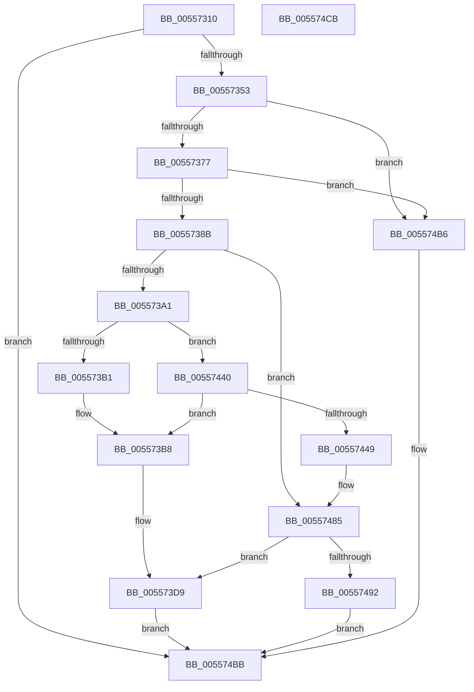

# HalpConnectThermalInterrupt

- RVA: `0x00557310`–`0x005574CC` (길이 `444` bytes)
- VA: `0x0000000140557310`
- 실행 섹션: `.text`
- PDB 이름 있음: `예`; PDB Function 태그: `아니요`
- unwind 정보 RVA: `0x000C4620`
- 디코드: `97`개 명령, `444/444` bytes 표시
- 미해석 바이트: `0` (있으면 어셈블리에 `.byte`로 보존)

> 이 문서는 커널 이미지의 기계어와 PDB 기호를 분석해 생성했습니다. 4번과 5번은 함수 원형과 자료형을 바이너리 사용 방식에서 추정한 C 해석이며 원본 소스 복구 결과는 아닙니다.

## 1. Dependencies

- 직접 호출 지점: **8**; 고유 호출 대상: **7**
- 직접 호출자로 확인된 함수: **0**
- RIP 상대 이미지 참조: **6**

### Outgoing calls
- `0x00557346` → [HalpInterruptGetIdentifiers](../4C/HalpInterruptGetIdentifiers_function_004C5DC0.md) (function, `0x004C5DC0`)
- `0x0055737D` → [HalpInterruptFindLines](../2D/HalpInterruptFindLines_function_002D2C88.md) (function, `0x002D2C88`)
- `0x005573CD` → [HalpInterruptSetIdtEntry](HalpInterruptSetIdtEntry_function_0055BAE0.md) (function, `0x0055BAE0`)
- `0x00557426` → [HalpInterruptGetPriority](../2D/HalpInterruptGetPriority_function_002D3558.md) (function, `0x002D3558`)
- `0x00557439` → [HalpInterruptSetLineStateInternal](../2D/HalpInterruptSetLineStateInternal_function_002D2104.md) (function, `0x002D2104`)
- `0x00557461` → [HalpInterruptSetProblemEx](../48/HalpInterruptSetProblemEx_function_0048AC8C.md) (function, `0x0048AC8C`)
- `0x0055747F` → [KeBugCheckEx](../4F/KeBugCheckEx_function_004FD660.md) (function, `0x004FD660`)
- `0x005574AA` → [HalpInterruptSetProblemEx](../48/HalpInterruptSetProblemEx_function_0048AC8C.md) (function, `0x0048AC8C`)

### Direct callers
- 이 함수 시작 RVA로 연결되는 직접 call은 확인되지 않았습니다. 간접 호출은 완전히 역산할 수 없습니다.

### Static image references
- `0x00557353` → RVA `0x00E101F0` (`.data`; read)
- `0x005573A1` → RVA `0x00F90520` (`.data`; read)
- `0x005573B1` → RVA `0x00F90520` (`.data`; write)
- `0x005573BE` → RVA `0x004B1EC0` (`HalpInterruptThermalService`; read)
- `0x00557454` → RVA `0x000250A0` (`.rdata`; read)
- `0x00557466` → RVA `0x00F90694` (`.data`; read)

## 2. Other-region calls and transfers

- 다른 실행 섹션으로 향하는 call: **0**
- 별도 외부 분기/꼬리 이동을 확인하지 못했습니다.

## 3. Assembly (complete function range)

```asm
00557310  48 89 5C 24 08                  mov qword ptr [rsp + 8], rbx
00557315  55                              push rbp
00557316  56                              push rsi
00557317  57                              push rdi
00557318  48 8B EC                        mov rbp, rsp
0055731B  48 83 EC 70                     sub rsp, 0x70
0055731F  83 65 C4 00                     and dword ptr [rbp - 0x3c], 0
00557323  48 8D 55 28                     lea rdx, [rbp + 0x28]
00557327  83 65 DC 00                     and dword ptr [rbp - 0x24], 0
0055732B  48 8B D9                        mov rbx, rcx
0055732E  48 83 65 E4 00                  and qword ptr [rbp - 0x1c], 0
00557333  45 33 C0                        xor r8d, r8d
00557336  83 65 EC 00                     and dword ptr [rbp - 0x14], 0
0055733A  65 8B 0C 25 A4 01 00 00         mov ecx, dword ptr gs:[0x1a4]
00557342  83 65 28 00                     and dword ptr [rbp + 0x28], 0
00557346  E8 75 EA F6 FF                  call 0x1404c5dc0
0055734B  85 C0                           test eax, eax
0055734D  0F 88 68 01 00 00               js 0x1405574bb
00557353  48 8B 3D 96 8E 8B 00            mov rdi, qword ptr [rip + 0x8b8e96]
0055735A  8B 87 00 01 00 00               mov eax, dword ptr [rdi + 0x100]
00557360  89 45 30                        mov dword ptr [rbp + 0x30], eax
00557363  C7 45 34 FE FF FF FF            mov dword ptr [rbp + 0x34], 0xfffffffe
0055736A  83 BF F0 00 00 00 02            cmp dword ptr [rdi + 0xf0], 2
00557371  0F 85 3F 01 00 00               jne 0x1405574b6
00557377  33 D2                           xor edx, edx
00557379  48 8D 4D 30                     lea rcx, [rbp + 0x30]
0055737D  E8 06 B9 D7 FF                  call 0x1402d2c88
00557382  48 85 C0                        test rax, rax
00557385  0F 84 2B 01 00 00               je 0x1405574b6
0055738B  65 48 8B 34 25 18 00 00 00      mov rsi, qword ptr gs:[0x18]
00557394  80 BE D5 00 00 00 00            cmp byte ptr [rsi + 0xd5], 0
0055739B  0F 85 E4 00 00 00               jne 0x140557485
005573A1  4C 8B 15 78 91 A3 00            mov r10, qword ptr [rip + 0xa39178]
005573A8  4D 85 D2                        test r10, r10
005573AB  0F 85 8F 00 00 00               jne 0x140557440
005573B1  48 89 1D 68 91 A3 00            mov qword ptr [rip + 0xa39168], rbx
005573B8  48 83 4C 24 20 FF               or qword ptr [rsp + 0x20], 0xffffffffffffffff
005573BE  48 8D 15 FB AA F5 FF            lea rdx, [rip - 0xa5505]
005573C5  41 B0 0C                        mov r8b, 0xc
005573C8  B9 CD 00 00 00                  mov ecx, 0xcd
005573CD  E8 0E 47 00 00                  call 0x14055bae0
005573D2  C6 86 D5 00 00 00 01            mov byte ptr [rsi + 0xd5], 1
005573D9  8B 45 28                        mov eax, dword ptr [rbp + 0x28]
005573DC  BA CD 00 00 00                  mov edx, 0xcd
005573E1  83 65 C4 00                     and dword ptr [rbp - 0x3c], 0
005573E5  48 8B CF                        mov rcx, rdi
005573E8  83 65 DC 00                     and dword ptr [rbp - 0x24], 0
005573EC  48 83 65 E4 00                  and qword ptr [rbp - 0x1c], 0
005573F1  83 65 EC 00                     and dword ptr [rbp - 0x14], 0
005573F5  83 4D D0 FF                     or dword ptr [rbp - 0x30], 0xffffffff
005573F9  89 45 E0                        mov dword ptr [rbp - 0x20], eax
005573FC  C7 45 C0 01 00 00 00            mov dword ptr [rbp - 0x40], 1
00557403  C7 45 C8 01 00 00 00            mov dword ptr [rbp - 0x38], 1
0055740A  C7 45 CC 10 00 00 00            mov dword ptr [rbp - 0x34], 0x10
00557411  C7 45 D4 01 00 00 00            mov dword ptr [rbp - 0x2c], 1
00557418  C7 45 D8 04 00 00 00            mov dword ptr [rbp - 0x28], 4
0055741F  C7 45 F0 CD 00 00 00            mov dword ptr [rbp - 0x10], 0xcd
00557426  E8 2D C1 D7 FF                  call 0x1402d3558
0055742B  4C 8D 45 C0                     lea r8, [rbp - 0x40]
0055742F  89 45 F4                        mov dword ptr [rbp - 0xc], eax
00557432  48 8D 55 30                     lea rdx, [rbp + 0x30]
00557436  48 8B CF                        mov rcx, rdi
00557439  E8 C6 AC D7 FF                  call 0x1402d2104
0055743E  EB 7B                           jmp 0x1405574bb
00557440  4C 3B D3                        cmp r10, rbx
00557443  0F 84 6F FF FF FF               je 0x1405573b8
00557449  45 33 C0                        xor r8d, r8d
0055744C  C7 44 24 20 6C 0D 00 00         mov dword ptr [rsp + 0x20], 0xd6c
00557454  4C 8D 0D 45 DC AC FF            lea r9, [rip - 0x5323bb]
0055745B  33 C9                           xor ecx, ecx
0055745D  41 8D 50 24                     lea edx, [r8 + 0x24]
00557461  E8 26 38 F3 FF                  call 0x14048ac8c
00557466  4C 63 05 27 92 A3 00            movsxd r8, dword ptr [rip + 0xa39227]
0055746D  4D 8B CA                        mov r9, r10
00557470  BA 00 02 00 00                  mov edx, 0x200
00557475  48 89 5C 24 20                  mov qword ptr [rsp + 0x20], rbx
0055747A  B9 5C 00 00 00                  mov ecx, 0x5c
0055747F  E8 DC 61 FA FF                  call 0x1404fd660
00557484  CC                              int3
00557485  48 39 1D 94 90 A3 00            cmp qword ptr [rip + 0xa39094], rbx
0055748C  0F 84 47 FF FF FF               je 0x1405573d9
00557492  45 33 C0                        xor r8d, r8d
00557495  C7 44 24 20 89 0D 00 00         mov dword ptr [rsp + 0x20], 0xd89
0055749D  4C 8D 0D FC DB AC FF            lea r9, [rip - 0x532404]
005574A4  33 C9                           xor ecx, ecx
005574A6  41 8D 50 24                     lea edx, [r8 + 0x24]
005574AA  E8 DD 37 F3 FF                  call 0x14048ac8c
005574AF  B8 25 02 00 C0                  mov eax, 0xc0000225
005574B4  EB 05                           jmp 0x1405574bb
005574B6  B8 BB 00 00 C0                  mov eax, 0xc00000bb
005574BB  48 8B 9C 24 90 00 00 00         mov rbx, qword ptr [rsp + 0x90]
005574C3  48 83 C4 70                     add rsp, 0x70
005574C7  5F                              pop rdi
005574C8  5E                              pop rsi
005574C9  5D                              pop rbp
005574CA  C3                              ret
005574CB  CC                              int3
```

## 4. C-style interpretation (structured pseudocode)

```c
__int64 __fastcall HalpConnectThermalInterrupt(__int64 a1, __int64 a2, int a3)
{
    __int64 result;
    __int64 v_rsp;
    unsigned int v_stack_m24;
    unsigned int v_stack_m28;
    unsigned int v_stack_m2C;
    unsigned __int64 v_stack_m34;
    unsigned int v_stack_m38;
    unsigned int v_stack_m3C;
    unsigned int v_stack_m40;
    unsigned int v_stack_m44;
    unsigned int v_stack_m48;
    unsigned int v_stack_m4C;
    unsigned int v_stack_m50;
    unsigned int v_stack_m54;
    unsigned int v_stack_m58;
    unsigned __int64 v_stack_m68;
    unsigned __int64 v_stack_p10;
    unsigned int v_stack_p18;
    unsigned int v_stack_p1C;
    unsigned __int64 v_stack_p8;

    v_stack_p8 = v_rbx;
    v_rsp = (v_rsp) - (112);
    a3 = 0;
    result = HalpInterruptGetIdentifiers((unsigned int)(*(unsigned int *)(gs_base + (0 + 420))), v_stack_p10, a3, a4);
    if (sign_flag) goto loc_005574BB;
    v_stack_p18 = (unsigned int)((unsigned int)(*(unsigned int *)(*(unsigned __int64 *)(v_rip + 9146006) + 256)));
    v_stack_p1C = 0xFFFFFFFEULL;
    if ((*(unsigned int *)(*(unsigned __int64 *)(v_rip + 9146006) + 240)) != 2) goto loc_005574B6;
    a2 = 0;
    result = HalpInterruptFindLines(v_stack_p18, a2, a3, a4);
    if (result == 0) goto loc_005574B6;
    if ((*(unsigned __int8 *)(*(unsigned __int64 *)(gs_base + (0 + 24)) + 213)) != 0) goto loc_00557485;
    if (*(unsigned __int64 *)(v_rip + 10719608) != 0) goto loc_00557440;
    *(unsigned __int64 *)(v_rip + 10719592) = a1;
loc_005573B8:
    result = HalpInterruptSetIdtEntry(205, v_rip - 677125, 12, a4);
    *(unsigned __int8 *)(*(unsigned __int64 *)(gs_base + (0 + 24)) + 213) = 1;
loc_005573D9:
    v_stack_m38 = (unsigned int)((unsigned int)(v_stack_p10));
    v_stack_m58 = 1;
    v_stack_m50 = 1;
    v_stack_m4C = 16;
    v_stack_m44 = 1;
    v_stack_m40 = 4;
    v_stack_m28 = 205;
    result = HalpInterruptGetPriority(*(unsigned __int64 *)(v_rip + 9146006), 205, 12, a4);
    v_stack_m24 = (unsigned int)(result);
    result = HalpInterruptSetLineStateInternal(*(unsigned __int64 *)(v_rip + 9146006), v_stack_p18, v_stack_m58, a4);
    goto loc_005574BB;
loc_00557440:
    if ((*(unsigned __int64 *)(v_rip + 10719608)) == a1) goto loc_005573B8;
    a3 = 0;
    v_stack_m68 = 0xD6CULL;
    a1 = 0;
    result = HalpInterruptSetProblemEx(a1, a3 + 36, a3, v_rip - 5448635);
    v_stack_m68 = 0;
    result = KeBugCheckEx(92, 512, (int)(*(unsigned int *)(v_rip + 10719783)), *(unsigned __int64 *)(v_rip + 10719608));
loc_00557485:
    if ((*(unsigned __int64 *)(v_rip + 10719380)) == 0) goto loc_005573D9;
    a3 = 0;
    v_stack_m68 = 0xD89ULL;
    a1 = 0;
    result = HalpInterruptSetProblemEx(a1, a3 + 36, a3, v_rip - 5448708);
    goto loc_005574BB;
loc_005574B6:
loc_005574BB:
    v_rsp = (v_rsp) + (112);
    return (unsigned int)(0xC00000BBULL);
}
```

## 5. (Beta) C Style

```c
int64_t HalpConnectThermalInterrupt(int64_t Arg1, int64_t Arg2, int32_t Arg3)
{
    int64_t result;
    int64_t local_rsp;
    uint32_t v_stack_m24;
    uint32_t v_stack_m28;
    uint32_t v_stack_m2C;
    uint64_t v_stack_m34;
    uint32_t v_stack_m38;
    uint32_t v_stack_m3C;
    uint32_t v_stack_m40;
    uint32_t v_stack_m44;
    uint32_t v_stack_m48;
    uint32_t v_stack_m4C;
    uint32_t v_stack_m50;
    uint32_t v_stack_m54;
    uint32_t v_stack_m58;
    uint64_t v_stack_m68;
    uint64_t v_stack_p10;
    uint32_t v_stack_p18;
    uint32_t v_stack_p1C;
    uint64_t v_stack_p8;

    v_stack_p8 = local_rbx;
    local_rsp = (local_rsp) - (112);
    Arg3 = 0;
    result = HalpInterruptGetIdentifiers((uint32_t)(*(uint32_t *)(gs_base + (0 + 0x1A4))), v_stack_p10, Arg3, a4);
    if (sign_flag) goto loc_005574BB;
    v_stack_p18 = (uint32_t)((uint32_t)(*(uint32_t *)(*(uint64_t *)(v_rip + 0x8B8E96) + 0x100)));
    v_stack_p1C = 0xFFFFFFFEULL;
    if ((*(uint32_t *)(*(uint64_t *)(v_rip + 0x8B8E96) + 0xF0)) != 2) goto loc_005574B6;
    Arg2 = 0;
    result = HalpInterruptFindLines(v_stack_p18, Arg2, Arg3, a4);
    if (result == 0) goto loc_005574B6;
    if ((*(uint8_t *)(*(uint64_t *)(gs_base + (0 + 0x18)) + 0xD5)) != 0) goto loc_00557485;
    if (*(uint64_t *)(v_rip + 0xA39178) != 0) goto loc_00557440;
    *(uint64_t *)(v_rip + 0xA39168) = Arg1;
loc_005573B8:
    result = HalpInterruptSetIdtEntry(205, v_rip - 677125, 12, a4);
    *(uint8_t *)(*(uint64_t *)(gs_base + (0 + 0x18)) + 0xD5) = 1;
loc_005573D9:
    v_stack_m38 = (uint32_t)((uint32_t)(v_stack_p10));
    v_stack_m58 = 1;
    v_stack_m50 = 1;
    v_stack_m4C = 16;
    v_stack_m44 = 1;
    v_stack_m40 = 4;
    v_stack_m28 = 205;
    result = HalpInterruptGetPriority(*(uint64_t *)(v_rip + 0x8B8E96), 205, 12, a4);
    v_stack_m24 = (uint32_t)(result);
    result = HalpInterruptSetLineStateInternal(*(uint64_t *)(v_rip + 0x8B8E96), v_stack_p18, v_stack_m58, a4);
    goto loc_005574BB;
loc_00557440:
    if ((*(uint64_t *)(v_rip + 0xA39178)) == Arg1) goto loc_005573B8;
    Arg3 = 0;
    v_stack_m68 = 0xD6CULL;
    Arg1 = 0;
    result = HalpInterruptSetProblemEx(Arg1, Arg3 + 36, Arg3, v_rip - 5448635);
    v_stack_m68 = 0;
    result = KeBugCheckEx(92, 512, (int32_t)(*(uint32_t *)(v_rip + 0xA39227)), *(uint64_t *)(v_rip + 0xA39178));
loc_00557485:
    if ((*(uint64_t *)(v_rip + 0xA39094)) == 0) goto loc_005573D9;
    Arg3 = 0;
    v_stack_m68 = 0xD89ULL;
    Arg1 = 0;
    result = HalpInterruptSetProblemEx(Arg1, Arg3 + 36, Arg3, v_rip - 5448708);
    goto loc_005574BB;
loc_005574B6:
loc_005574BB:
    local_rsp = (local_rsp) + (112);
    return (uint32_t)(0xC00000BBULL);
}
```

## 6. Execution-region graph

[열기: 2D/3D 그래프와 함수 탐색 컨트롤 패널](../../../control-panel.html?section=text&rva=0x00557310&view=graph)

- 2D 그래프는 위에서 아래로 흐르고, 3D 그래프는 빈 공간을 드래그해 회전합니다. Shift+드래그는 이동, 휠은 확대·축소, 함수 노드 선택은 대상 보고서 이동입니다.

### Static fallback


