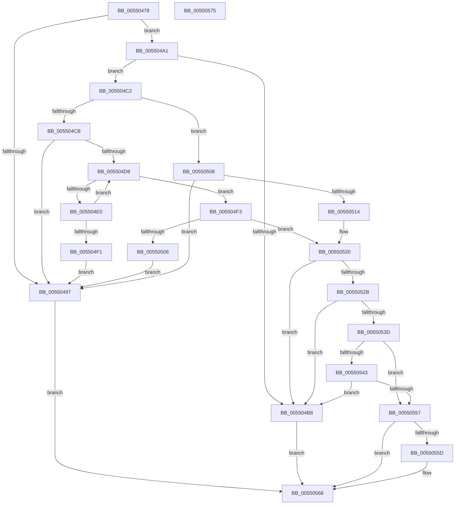

# HalpCreateCommonBufferFromMdlVerifyParams

- RVA: `0x00550478`–`0x00550576` (길이 `254` bytes)
- VA: `0x0000000140550478`
- 실행 섹션: `.text`
- PDB 이름 있음: `예`; PDB Function 태그: `아니요`
- unwind 정보 RVA: `0x0005CAAC`
- 디코드: `78`개 명령, `254/254` bytes 표시
- 미해석 바이트: `0` (있으면 어셈블리에 `.byte`로 보존)

> 이 문서는 커널 이미지의 기계어와 PDB 기호를 분석해 생성했습니다. 4번과 5번은 함수 원형과 자료형을 바이너리 사용 방식에서 추정한 C 해석이며 원본 소스 복구 결과는 아닙니다.

## 1. Dependencies

- 직접 호출 지점: **1**; 고유 호출 대상: **1**
- 직접 호출자로 확인된 함수: **3**
- RIP 상대 이미지 참조: **0**

### Outgoing calls
- `0x005504AA` → [HalpParseCommonBufferExtendedConfigurations](HalpParseCommonBufferExtendedConfigurations_function_0055057C.md) (function, `0x0055057C`)

### Direct callers
- [HalCreateCommonBufferFromMdl](HalCreateCommonBufferFromMdl_function_00551680.md) at `0x0055170A`
- [HalCreateCommonBufferFromMdlDmaThin](HalCreateCommonBufferFromMdlDmaThin_function_00552800.md) at `0x00552879`
- [HalCreateCommonBufferFromMdlDmarThin](HalCreateCommonBufferFromMdlDmarThin_function_00552DA0.md) at `0x00552E13`

### Static image references
- 디코드된 RIP-relative 메모리 참조가 없습니다.

## 2. Other-region calls and transfers

- 다른 실행 섹션으로 향하는 call: **0**
- 별도 외부 분기/꼬리 이동을 확인하지 못했습니다.

## 3. Assembly (complete function range)

```asm
00550478  48 89 5C 24 08                  mov qword ptr [rsp + 8], rbx
0055047D  57                              push rdi
0055047E  48 83 EC 20                     sub rsp, 0x20
00550482  48 8B 01                        mov rax, qword ptr [rcx]
00550485  49 8B D9                        mov rbx, r9
00550488  45 8B C8                        mov r9d, r8d
0055048B  4C 8B DA                        mov r11, rdx
0055048E  48 8B F9                        mov rdi, rcx
00550491  F6 40 0A 05                     test byte ptr [rax + 0xa], 5
00550495  75 0A                           jne 0x1405504a1
00550497  BA EF 00 00 C0                  mov edx, 0xc00000ef
0055049C  E9 C7 00 00 00                  jmp 0x140550568
005504A1  4C 8B C3                        mov r8, rbx
005504A4  41 8B D1                        mov edx, r9d
005504A7  49 8B CB                        mov rcx, r11
005504AA  E8 CD 00 00 00                  call 0x14055057c
005504AF  45 33 D2                        xor r10d, r10d
005504B2  8B D0                           mov edx, eax
005504B4  85 C0                           test eax, eax
005504B6  79 0A                           jns 0x1405504c2
005504B8  BA F0 00 00 C0                  mov edx, 0xc00000f0
005504BD  E9 A6 00 00 00                  jmp 0x140550568
005504C2  48 8B 07                        mov rax, qword ptr [rdi]
005504C5  44 38 53 25                     cmp byte ptr [rbx + 0x25], r10b
005504C9  74 3D                           je 0x140550508
005504CB  4C 8B 43 18                     mov r8, qword ptr [rbx + 0x18]
005504CF  4C 8B 4B 10                     mov r9, qword ptr [rbx + 0x10]
005504D3  48 85 C0                        test rax, rax
005504D6  74 BF                           je 0x140550497
005504D8  8B 48 28                        mov ecx, dword ptr [rax + 0x28]
005504DB  4C 3B C1                        cmp r8, rcx
005504DE  72 13                           jb 0x1405504f3
005504E0  4C 2B C1                        sub r8, rcx
005504E3  48 8B 08                        mov rcx, qword ptr [rax]
005504E6  48 89 0F                        mov qword ptr [rdi], rcx
005504E9  48 8B C1                        mov rax, rcx
005504EC  48 85 C9                        test rcx, rcx
005504EF  75 E7                           jne 0x1405504d8
005504F1  EB A4                           jmp 0x140550497
005504F3  4C 89 43 18                     mov qword ptr [rbx + 0x18], r8
005504F7  48 8B 07                        mov rax, qword ptr [rdi]
005504FA  8B 48 28                        mov ecx, dword ptr [rax + 0x28]
005504FD  4B 8D 04 08                     lea rax, [r8 + r9]
00550501  48 3B C1                        cmp rax, rcx
00550504  76 1A                           jbe 0x140550520
00550506  EB 8F                           jmp 0x140550497
00550508  4D 8B C2                        mov r8, r10
0055050B  44 8B 48 28                     mov r9d, dword ptr [rax + 0x28]
0055050F  4C 39 10                        cmp qword ptr [rax], r10
00550512  75 83                           jne 0x140550497
00550514  4C 89 53 18                     mov qword ptr [rbx + 0x18], r10
00550518  4C 89 4B 10                     mov qword ptr [rbx + 0x10], r9
0055051C  C6 43 25 01                     mov byte ptr [rbx + 0x25], 1
00550520  41 BB FF 0F 00 00               mov r11d, 0xfff
00550526  45 85 CB                        test r11d, r9d
00550529  75 8D                           jne 0x1405504b8
0055052B  48 8B 07                        mov rax, qword ptr [rdi]
0055052E  8B 48 2C                        mov ecx, dword ptr [rax + 0x2c]
00550531  41 03 C8                        add ecx, r8d
00550534  41 85 CB                        test r11d, ecx
00550537  0F 85 7B FF FF FF               jne 0x1405504b8
0055053D  44 38 53 24                     cmp byte ptr [rbx + 0x24], r10b
00550541  74 14                           je 0x140550557
00550543  48 8B 4B 08                     mov rcx, qword ptr [rbx + 8]
00550547  49 8D 41 FF                     lea rax, [r9 - 1]
0055054B  48 2B 0B                        sub rcx, qword ptr [rbx]
0055054E  48 3B C8                        cmp rcx, rax
00550551  0F 82 61 FF FF FF               jb 0x1405504b8
00550557  44 38 53 26                     cmp byte ptr [rbx + 0x26], r10b
0055055B  75 0B                           jne 0x140550568
0055055D  C7 43 20 02 00 00 00            mov dword ptr [rbx + 0x20], 2
00550564  C6 43 26 01                     mov byte ptr [rbx + 0x26], 1
00550568  48 8B 5C 24 30                  mov rbx, qword ptr [rsp + 0x30]
0055056D  8B C2                           mov eax, edx
0055056F  48 83 C4 20                     add rsp, 0x20
00550573  5F                              pop rdi
00550574  C3                              ret
00550575  CC                              int3
```

## 4. C-style interpretation (structured pseudocode)

```c
__int64 __fastcall HalpCreateCommonBufferFromMdlVerifyParams(__int64 a1, __int64 a2, int a3, __int64 a4)
{
    __int64 result;
    __int64 v_r10;
    __int64 v_rsp;
    unsigned __int64 v_stack_p8;

    v_stack_p8 = v_rbx;
    v_rsp = (v_rsp) - (32);
    if (((*(unsigned __int8 *)(*(unsigned __int64 *)(a1) + 10)) & (5)) != 0) goto loc_005504A1;
loc_00550497:
    goto loc_00550568;
loc_005504A1:
    result = HalpParseCommonBufferExtendedConfigurations(a2, (unsigned int)((unsigned int)((unsigned int)(a3))), a4, (unsigned int)(a3));
    v_r10 = 0;
    if (!sign_flag) goto loc_005504C2;
loc_005504B8:
    goto loc_00550568;
loc_005504C2:
    if ((*(unsigned __int8 *)(a4 + 37)) == 0) goto loc_00550508;
    if (*(unsigned __int64 *)(a1) == 0) goto loc_00550497;
loc_005504D8:
    if ((*(unsigned __int64 *)(a4 + 24)) < ((unsigned int)(*(unsigned int *)(*(unsigned __int64 *)(a1) + 40)))) goto loc_005504F3;
    a3 = (*(unsigned __int64 *)(a4 + 24)) - ((unsigned int)(*(unsigned int *)(*(unsigned __int64 *)(a1) + 40)));
    *(unsigned __int64 *)(a1) = *(unsigned __int64 *)(*(unsigned __int64 *)(a1));
    if (*(unsigned __int64 *)(*(unsigned __int64 *)(a1)) != 0) goto loc_005504D8;
    goto loc_00550497;
loc_005504F3:
    *(unsigned __int64 *)(a4 + 24) = a3;
    if ((a3 + *(unsigned __int64 *)(a4 + 16) * 1) <= ((unsigned int)(*(unsigned int *)(*(unsigned __int64 *)(a1) + 40)))) goto loc_00550520;
    goto loc_00550497;
loc_00550508:
    if ((*(unsigned __int64 *)(a3 + *(unsigned __int64 *)(a4 + 16) * 1)) != 0) goto loc_00550497;
    *(unsigned __int64 *)(a4 + 24) = 0;
    *(unsigned __int64 *)(a4 + 16) = (unsigned int)(*(unsigned int *)(a3 + *(unsigned __int64 *)(a4 + 16) * 1 + 40));
    *(unsigned __int8 *)(a4 + 37) = 1;
loc_00550520:
    if ((((unsigned int)((unsigned int)(0xFFFULL))) & ((unsigned int)((unsigned int)(*(unsigned int *)(a3 + *(unsigned __int64 *)(a4 + 16) * 1 + 40))))) != 0) goto loc_005504B8;
    a1 = (unsigned int)(((unsigned int)(*(unsigned int *)(*(unsigned __int64 *)(a1) + 44))) + (0));
    if ((((unsigned int)((unsigned int)(0xFFFULL))) & ((unsigned int)(a1))) != 0) goto loc_005504B8;
    if ((*(unsigned __int8 *)(a4 + 36)) == 0) goto loc_00550557;
    a1 = (*(unsigned __int64 *)(a4 + 8)) - (*(unsigned __int64 *)(a4));
    if (a1 < ((unsigned int)(*(unsigned int *)(a3 + *(unsigned __int64 *)(a4 + 16) * 1 + 40)) - 1)) goto loc_005504B8;
loc_00550557:
    if ((*(unsigned __int8 *)(a4 + 38)) == 0) {
        *(unsigned int *)(a4 + 32) = 2;
        *(unsigned __int8 *)(a4 + 38) = 1;
    }
    v_rsp = (v_rsp) + (32);
    return (unsigned int)((unsigned int)((unsigned int)(0xC00000F0ULL)));
}
```

## 5. (Beta) C Style

```c
int64_t HalpCreateCommonBufferFromMdlVerifyParams(void *Arg1, int64_t Arg2, int32_t Arg3, void *Arg4)
{
    uint8_t *arg1 = (uint8_t *)Arg1;
    uint8_t *arg4 = (uint8_t *)Arg4;

    int64_t result;
    int64_t local_r10;
    int64_t local_rsp;
    uint64_t v_stack_p8;

    v_stack_p8 = local_rbx;
    local_rsp = (local_rsp) - (32);
    if (((*(uint8_t *)(*(uint64_t *)(arg1) + 0xA)) & (5)) != 0) goto loc_005504A1;
loc_00550497:
    goto loc_00550568;
loc_005504A1:
    result = HalpParseCommonBufferExtendedConfigurations(Arg2, (uint32_t)((uint32_t)((uint32_t)(Arg3))), Arg4, (uint32_t)(Arg3));
    local_r10 = 0;
    if (!sign_flag) goto loc_005504C2;
loc_005504B8:
    goto loc_00550568;
loc_005504C2:
    if ((*(uint8_t *)(arg4 + 0x25)) == 0) goto loc_00550508;
    if (*(uint64_t *)(arg1) == 0) goto loc_00550497;
loc_005504D8:
    if ((*(uint64_t *)(arg4 + 0x18)) < ((uint32_t)(*(uint32_t *)(*(uint64_t *)(arg1) + 0x28)))) goto loc_005504F3;
    Arg3 = (*(uint64_t *)(arg4 + 0x18)) - ((uint32_t)(*(uint32_t *)(*(uint64_t *)(arg1) + 0x28)));
    *(uint64_t *)(arg1) = *(uint64_t *)(*(uint64_t *)(arg1));
    if (*(uint64_t *)(*(uint64_t *)(arg1)) != 0) goto loc_005504D8;
    goto loc_00550497;
loc_005504F3:
    *(uint64_t *)(arg4 + 0x18) = Arg3;
    if ((Arg3 + *(uint64_t *)(arg4 + 0x10) * 1) <= ((uint32_t)(*(uint32_t *)(*(uint64_t *)(arg1) + 0x28)))) goto loc_00550520;
    goto loc_00550497;
loc_00550508:
    if ((*(uint64_t *)(Arg3 + *(uint64_t *)(arg4 + 0x10) * 1)) != 0) goto loc_00550497;
    *(uint64_t *)(arg4 + 0x18) = 0;
    *(uint64_t *)(arg4 + 0x10) = (uint32_t)(*(uint32_t *)(Arg3 + *(uint64_t *)(arg4 + 0x10) * 1 + 0x28));
    *(uint8_t *)(arg4 + 0x25) = 1;
loc_00550520:
    if ((((uint32_t)((uint32_t)(0xFFFULL))) & ((uint32_t)((uint32_t)(*(uint32_t *)(Arg3 + *(uint64_t *)(arg4 + 0x10) * 1 + 0x28))))) != 0) goto loc_005504B8;
    Arg1 = (uint32_t)(((uint32_t)(*(uint32_t *)(*(uint64_t *)(arg1) + 0x2C))) + (0));
    if ((((uint32_t)((uint32_t)(0xFFFULL))) & ((uint32_t)(Arg1))) != 0) goto loc_005504B8;
    if ((*(uint8_t *)(arg4 + 0x24)) == 0) goto loc_00550557;
    Arg1 = (*(uint64_t *)(arg4 + 0x8)) - (*(uint64_t *)(arg4));
    if (Arg1 < ((uint32_t)(*(uint32_t *)(Arg3 + *(uint64_t *)(arg4 + 0x10) * 1 + 0x28)) - 1)) goto loc_005504B8;
loc_00550557:
    if ((*(uint8_t *)(arg4 + 0x26)) == 0) {
        *(uint32_t *)(arg4 + 0x20) = 2;
        *(uint8_t *)(arg4 + 0x26) = 1;
    }
    local_rsp = (local_rsp) + (32);
    return (uint32_t)((uint32_t)((uint32_t)(0xC00000F0ULL)));
}
```

### 관측된 메모리 오프셋

구조체 형식이 확인되지 않은 접근은 인자 기준의 오프셋으로만 기록했습니다.

| 기준 인자 | 오프셋 표현 | 폭 (bit) | 접근 |
|---|---:|---:|---|
| `Arg1` | `+ 0x0` | `64` | `R` |
| `Arg1` | `+ 0x0` | `64` | `W` |
| `Arg4` | `+ 0x0` | `64` | `R` |
| `Arg4` | `+ 0x8` | `64` | `R` |
| `Arg4` | `+ 0x10` | `64` | `R` |
| `Arg4` | `+ 0x10` | `64` | `W` |
| `Arg4` | `+ 0x18` | `64` | `R` |
| `Arg4` | `+ 0x18` | `64` | `W` |
| `Arg4` | `+ 0x20` | `32` | `W` |
| `Arg4` | `+ 0x24` | `8` | `R` |
| `Arg4` | `+ 0x25` | `8` | `R` |
| `Arg4` | `+ 0x25` | `8` | `W` |
| `Arg4` | `+ 0x26` | `8` | `R` |
| `Arg4` | `+ 0x26` | `8` | `W` |

## 6. Execution-region graph

[열기: 2D/3D 그래프와 함수 탐색 컨트롤 패널](../../../control-panel.html?section=text&rva=0x00550478&view=graph)

- 2D 그래프는 위에서 아래로 흐르고, 3D 그래프는 빈 공간을 드래그해 회전합니다. Shift+드래그는 이동, 휠은 확대·축소, 함수 노드 선택은 대상 보고서 이동입니다.

### Static fallback


