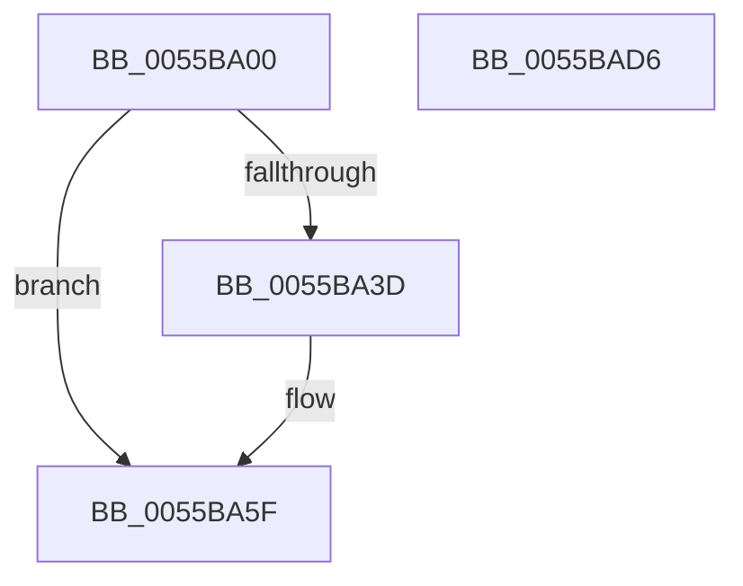

# HalpCreateInterrupt

- RVA: `0x0055BA00`–`0x0055BAD7` (길이 `215` bytes)
- VA: `0x000000014055BA00`
- 실행 섹션: `.text`
- PDB 이름 있음: `예`; PDB Function 태그: `아니요`
- unwind 정보 RVA: `0x00068E0C`
- 디코드: `53`개 명령, `215/215` bytes 표시
- 미해석 바이트: `0` (있으면 어셈블리에 `.byte`로 보존)

> 이 문서는 커널 이미지의 기계어와 PDB 기호를 분석해 생성했습니다. 4번과 5번은 함수 원형과 자료형을 바이너리 사용 방식에서 추정한 C 해석이며 원본 소스 복구 결과는 아닙니다.

## 1. Dependencies

- 직접 호출 지점: **4**; 고유 호출 대상: **4**
- 직접 호출자로 확인된 함수: **2**
- RIP 상대 이미지 참조: **1**

### Outgoing calls
- `0x0055BA2E` → [HalpAllocateKInterrupt](HalpAllocateKInterrupt_function_0055B8F4.md) (function, `0x0055B8F4`)
- `0x0055BA59` → [KeBugCheckEx](../4F/KeBugCheckEx_function_004FD660.md) (function, `0x004FD660`)
- `0x0055BAA8` → [KeInitializeInterruptEx](../48/KeInitializeInterruptEx_function_00488664.md) (function, `0x00488664`)
- `0x0055BAB0` → [KeConnectInterruptForHal](../5B/KeConnectInterruptForHal_function_005BD890.md) (function, `0x005BD890`)

### Direct callers
- [HalpTimerTestHypervisorTimer](../54/HalpTimerTestHypervisorTimer_function_0054BBC0.md) at `0x0054BCD6`
- [HalpTimerTestHypervisorTimer](../54/HalpTimerTestHypervisorTimer_function_0054BBC0.md) at `0x0054BD1C`
- [HalpInterruptSetIdtEntry](HalpInterruptSetIdtEntry_function_0055BAE0.md) at `0x0055BB02`

### Static image references
- `0x0055BA4B` → RVA `0x000258E0` (`.rdata`; read)

## 2. Other-region calls and transfers

- 다른 실행 섹션으로 향하는 call: **0**
- 별도 외부 분기/꼬리 이동을 확인하지 못했습니다.

## 3. Assembly (complete function range)

```asm
0055BA00  48 8B C4                        mov rax, rsp
0055BA03  48 89 58 08                     mov qword ptr [rax + 8], rbx
0055BA07  48 89 68 10                     mov qword ptr [rax + 0x10], rbp
0055BA0B  48 89 70 18                     mov qword ptr [rax + 0x18], rsi
0055BA0F  48 89 78 20                     mov qword ptr [rax + 0x20], rdi
0055BA13  41 56                           push r14
0055BA15  48 81 EC 80 00 00 00            sub rsp, 0x80
0055BA1C  65 8B 2C 25 A4 01 00 00         mov ebp, dword ptr gs:[0x1a4]
0055BA24  4C 8B F1                        mov r14, rcx
0055BA27  8B CD                           mov ecx, ebp
0055BA29  41 8A F8                        mov dil, r8b
0055BA2C  8B F2                           mov esi, edx
0055BA2E  E8 C1 FE FF FF                  call 0x14055b8f4
0055BA33  33 C9                           xor ecx, ecx
0055BA35  48 8B D8                        mov rbx, rax
0055BA38  48 85 C0                        test rax, rax
0055BA3B  75 22                           jne 0x14055ba5f
0055BA3D  BA 20 01 00 00                  mov edx, 0x120
0055BA42  48 C7 44 24 20 90 01 00 00      mov qword ptr [rsp + 0x20], 0x190
0055BA4B  4C 8D 0D 8E 9E AC FF            lea r9, [rip - 0x536172]
0055BA52  44 8D 40 03                     lea r8d, [rax + 3]
0055BA56  8D 4A 8C                        lea ecx, [rdx - 0x74]
0055BA59  E8 02 1C FA FF                  call 0x1404fd660
0055BA5E  CC                              int3
0055BA5F  48 8B 84 24 B0 00 00 00         mov rax, qword ptr [rsp + 0xb0]
0055BA67  45 33 C9                        xor r9d, r9d
0055BA6A  48 89 4C 24 78                  mov qword ptr [rsp + 0x78], rcx
0055BA6F  45 33 C0                        xor r8d, r8d
0055BA72  88 4C 24 70                     mov byte ptr [rsp + 0x70], cl
0055BA76  49 8B D6                        mov rdx, r14
0055BA79  89 6C 24 60                     mov dword ptr [rsp + 0x60], ebp
0055BA7D  88 4C 24 58                     mov byte ptr [rsp + 0x58], cl
0055BA81  C7 44 24 50 01 00 00 00         mov dword ptr [rsp + 0x50], 1
0055BA89  40 88 7C 24 48                  mov byte ptr [rsp + 0x48], dil
0055BA8E  40 88 7C 24 40                  mov byte ptr [rsp + 0x40], dil
0055BA93  89 74 24 38                     mov dword ptr [rsp + 0x38], esi
0055BA97  48 89 4C 24 30                  mov qword ptr [rsp + 0x30], rcx
0055BA9C  48 89 44 24 28                  mov qword ptr [rsp + 0x28], rax
0055BAA1  89 4C 24 20                     mov dword ptr [rsp + 0x20], ecx
0055BAA5  48 8B CB                        mov rcx, rbx
0055BAA8  E8 B7 CB F2 FF                  call 0x140488664
0055BAAD  48 8B CB                        mov rcx, rbx
0055BAB0  E8 DB 1D 06 00                  call 0x1405bd890
0055BAB5  4C 8D 9C 24 80 00 00 00         lea r11, [rsp + 0x80]
0055BABD  48 8B C3                        mov rax, rbx
0055BAC0  49 8B 5B 10                     mov rbx, qword ptr [r11 + 0x10]
0055BAC4  49 8B 6B 18                     mov rbp, qword ptr [r11 + 0x18]
0055BAC8  49 8B 73 20                     mov rsi, qword ptr [r11 + 0x20]
0055BACC  49 8B 7B 28                     mov rdi, qword ptr [r11 + 0x28]
0055BAD0  49 8B E3                        mov rsp, r11
0055BAD3  41 5E                           pop r14
0055BAD5  C3                              ret
0055BAD6  CC                              int3
```

## 4. C-style interpretation (structured pseudocode)

```c
__int64 __fastcall HalpCreateInterrupt(__int64 a1, int a2, unsigned __int8 a3, __int64 a4, __int64 a5)
{
    __int64 result;
    __int64 v_rsp;
    unsigned __int64 v_stack_m10;
    unsigned __int8 v_stack_m18;
    unsigned int v_stack_m28;
    unsigned __int8 v_stack_m30;
    unsigned int v_stack_m38;
    unsigned __int8 v_stack_m40;
    unsigned __int8 v_stack_m48;
    unsigned int v_stack_m50;
    unsigned __int64 v_stack_m58;
    unsigned __int64 v_stack_m60;
    unsigned __int64 v_stack_m68;
    unsigned __int64 v_stack_m8;

    *(unsigned __int64 *)(v_rsp + 8) = v_rbx;
    *(unsigned __int64 *)(v_rsp + 16) = v_rbp;
    *(unsigned __int64 *)(v_rsp + 24) = v_rsi;
    *(unsigned __int64 *)(v_rsp + 32) = v_rdi;
    v_rsp = (v_rsp) - (128);
    result = HalpAllocateKInterrupt((unsigned int)((unsigned int)((unsigned int)(*(unsigned int *)(gs_base + (0 + 420))))), a2, a3, a4);
    a1 = 0;
    if (result == 0) {
        a2 = 288;
        v_stack_m68 = 400;
        a4 = v_rip - 5464434;
        a3 = result + 3;
        a1 = a2 - 116;
        result = KeBugCheckEx(a1, a2, a3, a4);
    }
    a4 = 0;
    v_stack_m10 = a1;
    a3 = 0;
    v_stack_m18 = (unsigned __int8)(a1);
    v_stack_m28 = (unsigned int)((unsigned int)(*(unsigned int *)(gs_base + (0 + 420))));
    v_stack_m30 = (unsigned __int8)(a1);
    v_stack_m38 = 1;
    v_stack_m40 = 0;
    v_stack_m48 = 0;
    v_stack_m50 = (unsigned int)((unsigned int)(a2));
    v_stack_m58 = a1;
    v_stack_m60 = a5;
    v_stack_m68 = (unsigned int)(a1);
    result = KeInitializeInterruptEx(result, a1, a3, a4);
    result = KeConnectInterruptForHal(result, a1, a3, a4);
    return result;
}
```

## 5. (Beta) C Style

```c
int64_t HalpCreateInterrupt(int64_t Arg1, int32_t Arg2, uint8_t Arg3, int64_t Arg4, int64_t Arg5)
{
    int64_t result;
    int64_t local_rsp;
    uint64_t v_stack_m10;
    uint8_t v_stack_m18;
    uint32_t v_stack_m28;
    uint8_t v_stack_m30;
    uint32_t v_stack_m38;
    uint8_t v_stack_m40;
    uint8_t v_stack_m48;
    uint32_t v_stack_m50;
    uint64_t v_stack_m58;
    uint64_t v_stack_m60;
    uint64_t v_stack_m68;
    uint64_t v_stack_m8;

    *(uint64_t *)(local_rsp + 0x8) = local_rbx;
    *(uint64_t *)(local_rsp + 0x10) = local_rbp;
    *(uint64_t *)(local_rsp + 0x18) = local_rsi;
    *(uint64_t *)(local_rsp + 0x20) = local_rdi;
    local_rsp = (local_rsp) - (128);
    result = HalpAllocateKInterrupt((uint32_t)((uint32_t)((uint32_t)(*(uint32_t *)(gs_base + (0 + 0x1A4))))), Arg2, Arg3, Arg4);
    Arg1 = 0;
    if (result == 0) {
        Arg2 = 288;
        v_stack_m68 = 400;
        Arg4 = v_rip - 5464434;
        Arg3 = result + 3;
        Arg1 = Arg2 - 116;
        result = KeBugCheckEx(Arg1, Arg2, Arg3, Arg4);
    }
    Arg4 = 0;
    v_stack_m10 = Arg1;
    Arg3 = 0;
    v_stack_m18 = (uint8_t)(Arg1);
    v_stack_m28 = (uint32_t)((uint32_t)(*(uint32_t *)(gs_base + (0 + 0x1A4))));
    v_stack_m30 = (uint8_t)(Arg1);
    v_stack_m38 = 1;
    v_stack_m40 = 0;
    v_stack_m48 = 0;
    v_stack_m50 = (uint32_t)((uint32_t)(Arg2));
    v_stack_m58 = Arg1;
    v_stack_m60 = Arg5;
    v_stack_m68 = (uint32_t)(Arg1);
    result = KeInitializeInterruptEx(result, Arg1, Arg3, Arg4);
    result = KeConnectInterruptForHal(result, Arg1, Arg3, Arg4);
    return result;
}
```

## 6. Execution-region graph

[열기: 2D/3D 그래프와 함수 탐색 컨트롤 패널](../../../control-panel.html?section=text&rva=0x0055BA00&view=graph)

- 2D 그래프는 위에서 아래로 흐르고, 3D 그래프는 빈 공간을 드래그해 회전합니다. Shift+드래그는 이동, 휠은 확대·축소, 함수 노드 선택은 대상 보고서 이동입니다.

### Static fallback


