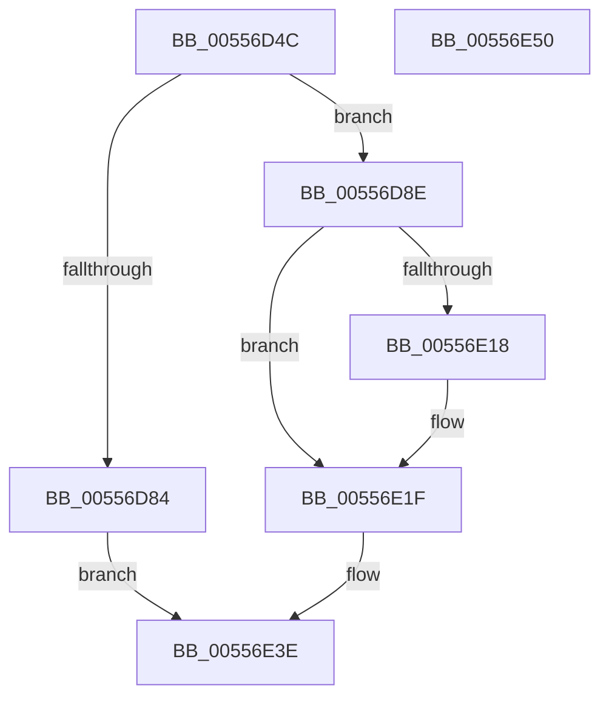

# HalpCreateSecondaryIcEntry

- RVA: `0x00556D4C`–`0x00556E51` (길이 `261` bytes)
- VA: `0x0000000140556D4C`
- 실행 섹션: `.text`
- PDB 이름 있음: `예`; PDB Function 태그: `아니요`
- unwind 정보 RVA: `0x00060BC4`
- 디코드: `64`개 명령, `261/261` bytes 표시
- 미해석 바이트: `0` (있으면 어셈블리에 `.byte`로 보존)

> 이 문서는 커널 이미지의 기계어와 PDB 기호를 분석해 생성했습니다. 4번과 5번은 함수 원형과 자료형을 바이너리 사용 방식에서 추정한 C 해석이며 원본 소스 복구 결과는 아닙니다.

## 1. Dependencies

- 직접 호출 지점: **4**; 고유 호출 대상: **4**
- 직접 호출자로 확인된 함수: **1**
- RIP 상대 이미지 참조: **4**

### Outgoing calls
- `0x00556D75` → [ExAllocatePool2](../../poolcode/B8/ExAllocatePool2_function_00B820F0.md) (function, `0x00B820F0`)
- `0x00556DD5` → [ObfReferenceObjectWithTag](../21/ObfReferenceObjectWithTag_function_00210710.md) (function, `0x00210710`)
- `0x00556E00` → [HalpAcquireHighLevelLock](../2D/HalpAcquireHighLevelLock_function_002D2390.md) (function, `0x002D2390`)
- `0x00556E39` → [HalpReleaseHighLevelLock](../2D/HalpReleaseHighLevelLock_function_002D1C58.md) (function, `0x002D1C58`)

### Direct callers
- [HalpRegisterSecondaryIcInterface](HalpRegisterSecondaryIcInterface_function_005571FC.md) at `0x00557216`

### Static image references
- `0x00556DEB` → RVA `0x00F909D0` (`.data`; read)
- `0x00556E05` → RVA `0x00F909C8` (`.data`; read)
- `0x00556E0C` → RVA `0x00F909C0` (`.data`; read)
- `0x00556E32` → RVA `0x00F909C8` (`.data`; write)

## 2. Other-region calls and transfers

- 다른 실행 섹션으로 향하는 call: **1**
  - `0x00556D75` → [ExAllocatePool2](../../poolcode/B8/ExAllocatePool2_function_00B820F0.md) (`.text` → `POOLCODE`)
- 별도 외부 분기/꼬리 이동을 확인하지 못했습니다.

## 3. Assembly (complete function range)

```asm
00556D4C  48 89 5C 24 08                  mov qword ptr [rsp + 8], rbx
00556D51  48 89 74 24 10                  mov qword ptr [rsp + 0x10], rsi
00556D56  57                              push rdi
00556D57  48 83 EC 20                     sub rsp, 0x20
00556D5B  0F B7 51 14                     movzx edx, word ptr [rcx + 0x14]
00556D5F  48 8B F1                        mov rsi, rcx
00556D62  48 83 C2 0A                     add rdx, 0xa
00556D66  B9 40 00 00 00                  mov ecx, 0x40
00556D6B  48 C1 E2 04                     shl rdx, 4
00556D6F  41 B8 48 61 6C 32               mov r8d, 0x326c6148
00556D75  E8 76 B3 62 00                  call 0x140b820f0
00556D7A  33 FF                           xor edi, edi
00556D7C  48 8B D8                        mov rbx, rax
00556D7F  48 85 C0                        test rax, rax
00556D82  75 0A                           jne 0x140556d8e
00556D84  BF 17 00 00 C0                  mov edi, 0xc0000017
00556D89  E9 B0 00 00 00                  jmp 0x140556e3e
00556D8E  8B 46 10                        mov eax, dword ptr [rsi + 0x10]
00556D91  BA 48 61 6C 32                  mov edx, 0x326c6148
00556D96  89 43 10                        mov dword ptr [rbx + 0x10], eax
00556D99  0F B7 46 14                     movzx eax, word ptr [rsi + 0x14]
00556D9D  89 43 14                        mov dword ptr [rbx + 0x14], eax
00556DA0  0F 10 06                        movups xmm0, xmmword ptr [rsi]
00556DA3  0F 11 43 18                     movups xmmword ptr [rbx + 0x18], xmm0
00556DA7  0F 10 4E 10                     movups xmm1, xmmword ptr [rsi + 0x10]
00556DAB  0F 11 4B 28                     movups xmmword ptr [rbx + 0x28], xmm1
00556DAF  0F 10 46 20                     movups xmm0, xmmword ptr [rsi + 0x20]
00556DB3  0F 11 43 38                     movups xmmword ptr [rbx + 0x38], xmm0
00556DB7  0F 10 4E 30                     movups xmm1, xmmword ptr [rsi + 0x30]
00556DBB  0F 11 4B 48                     movups xmmword ptr [rbx + 0x48], xmm1
00556DBF  0F 10 46 40                     movups xmm0, xmmword ptr [rsi + 0x40]
00556DC3  0F 11 43 58                     movups xmmword ptr [rbx + 0x58], xmm0
00556DC7  F2 0F 10 4E 50                  movsd xmm1, qword ptr [rsi + 0x50]
00556DCC  F2 0F 11 4B 68                  movsd qword ptr [rbx + 0x68], xmm1
00556DD1  48 8B 4B 30                     mov rcx, qword ptr [rbx + 0x30]
00556DD5  E8 36 99 CB FF                  call 0x140210710
00556DDA  48 8D 83 80 00 00 00            lea rax, [rbx + 0x80]
00556DE1  66 C7 43 78 01 00               mov word ptr [rbx + 0x78], 1
00556DE7  C6 43 7A 06                     mov byte ptr [rbx + 0x7a], 6
00556DEB  48 8D 0D DE 9B A3 00            lea rcx, [rip + 0xa39bde]
00556DF2  C7 43 7C 01 00 00 00            mov dword ptr [rbx + 0x7c], 1
00556DF9  48 89 40 08                     mov qword ptr [rax + 8], rax
00556DFD  48 89 00                        mov qword ptr [rax], rax
00556E00  E8 8B B5 D7 FF                  call 0x1402d2390
00556E05  48 8B 0D BC 9B A3 00            mov rcx, qword ptr [rip + 0xa39bbc]
00556E0C  48 8D 15 AD 9B A3 00            lea rdx, [rip + 0xa39bad]
00556E13  48 39 11                        cmp qword ptr [rcx], rdx
00556E16  74 07                           je 0x140556e1f
00556E18  B9 03 00 00 00                  mov ecx, 3
00556E1D  CD 29                           int 0x29
00556E1F  48 89 13                        mov qword ptr [rbx], rdx
00556E22  8A D0                           mov dl, al
00556E24  48 89 4B 08                     mov qword ptr [rbx + 8], rcx
00556E28  48 89 19                        mov qword ptr [rcx], rbx
00556E2B  48 8D 0D 9E 9B A3 00            lea rcx, [rip + 0xa39b9e]
00556E32  48 89 1D 8F 9B A3 00            mov qword ptr [rip + 0xa39b8f], rbx
00556E39  E8 1A AE D7 FF                  call 0x1402d1c58
00556E3E  48 8B 5C 24 30                  mov rbx, qword ptr [rsp + 0x30]
00556E43  8B C7                           mov eax, edi
00556E45  48 8B 74 24 38                  mov rsi, qword ptr [rsp + 0x38]
00556E4A  48 83 C4 20                     add rsp, 0x20
00556E4E  5F                              pop rdi
00556E4F  C3                              ret
00556E50  CC                              int3
```

## 4. C-style interpretation (structured pseudocode)

```c
__int64 __fastcall HalpCreateSecondaryIcEntry(__int64 a1)
{
    __int64 result;
    __int64 v_rdi;
    __int64 v_rsp;
    unsigned __int64 v_stack_p10;
    unsigned __int64 v_stack_p8;

    v_stack_p8 = v_rbx;
    v_stack_p10 = v_rsi;
    v_rsp = (v_rsp) - (32);
    a2 = (*(unsigned __int16 *)(a1 + 20)) + (10);
    a2 = (a2) << (4);
    result = ExAllocatePool2(64, a2, (unsigned int)(0x326C6148ULL), a4);
    v_rdi = 0;
    if (result != 0) goto loc_00556D8E;
    goto loc_00556E3E;
loc_00556D8E:
    *(unsigned int *)(result + 16) = (unsigned int)((unsigned int)(*(unsigned int *)(a1 + 16)));
    *(unsigned int *)(result + 20) = (unsigned int)(*(unsigned __int16 *)(a1 + 20));
    *(unsigned __int64 *)(result + 24) = v_xmm0;
    *(unsigned __int64 *)(result + 40) = v_xmm1;
    *(unsigned __int64 *)(result + 56) = v_xmm0;
    *(unsigned __int64 *)(result + 72) = v_xmm1;
    *(unsigned __int64 *)(result + 88) = v_xmm0;
    *(unsigned __int64 *)(result + 104) = v_xmm1;
    result = ObfReferenceObjectWithTag(*(unsigned __int64 *)(result + 48), (unsigned int)(0x326C6148ULL), (unsigned int)(0x326C6148ULL), a4);
    *(unsigned __int16 *)(result + 120) = 1;
    *(unsigned __int8 *)(result + 122) = 6;
    *(unsigned int *)(result + 124) = 1;
    *(unsigned __int64 *)(result + 128 + 8) = result + 128;
    *(unsigned __int64 *)(result + 128) = result + 128;
    result = HalpAcquireHighLevelLock(v_rip + 10722270, (unsigned int)(0x326C6148ULL), (unsigned int)(0x326C6148ULL), a4);
    if ((*(unsigned __int64 *)(*(unsigned __int64 *)(v_rip + 10722236))) != (v_rip + 10722221)) {
        a1 = 3;
    }
    *(unsigned __int64 *)(result) = v_rip + 10722221;
    *(unsigned __int64 *)(result + 8) = a1;
    *(unsigned __int64 *)(a1) = result;
    *(unsigned __int64 *)(v_rip + 10722191) = result;
    result = HalpReleaseHighLevelLock(v_rip + 10722206, (unsigned __int8)(result), (unsigned int)(0x326C6148ULL), a4);
loc_00556E3E:
    v_rsp = (v_rsp) + (32);
    return (unsigned int)((unsigned int)((unsigned int)(0xC0000017ULL)));
}
```

## 5. (Beta) C Style

```c
int64_t HalpCreateSecondaryIcEntry(void *Arg1)
{
    uint8_t *arg1 = (uint8_t *)Arg1;

    int64_t result;
    int64_t local_rdi;
    int64_t local_rsp;
    uint64_t v_stack_p10;
    uint64_t v_stack_p8;

    v_stack_p8 = local_rbx;
    v_stack_p10 = local_rsi;
    local_rsp = (local_rsp) - (32);
    a2 = (*(uint16_t *)(arg1 + 0x14)) + (10);
    a2 = (a2) << (4);
    result = ExAllocatePool2(64, a2, (uint32_t)(0x326C6148ULL), a4);
    local_rdi = 0;
    if (result != 0) goto loc_00556D8E;
    goto loc_00556E3E;
loc_00556D8E:
    *(uint32_t *)(result + 0x10) = (uint32_t)((uint32_t)(*(uint32_t *)(arg1 + 0x10)));
    *(uint32_t *)(result + 0x14) = (uint32_t)(*(uint16_t *)(arg1 + 0x14));
    *(uint64_t *)(result + 0x18) = v_xmm0;
    *(uint64_t *)(result + 0x28) = v_xmm1;
    *(uint64_t *)(result + 0x38) = v_xmm0;
    *(uint64_t *)(result + 0x48) = v_xmm1;
    *(uint64_t *)(result + 0x58) = v_xmm0;
    *(uint64_t *)(result + 0x68) = v_xmm1;
    result = ObfReferenceObjectWithTag(*(uint64_t *)(result + 0x30), (uint32_t)(0x326C6148ULL), (uint32_t)(0x326C6148ULL), a4);
    *(uint16_t *)(result + 0x78) = 1;
    *(uint8_t *)(result + 0x7A) = 6;
    *(uint32_t *)(result + 0x7C) = 1;
    *(uint64_t *)(result + 0x80 + 0x8) = result + 128;
    *(uint64_t *)(result + 0x80) = result + 128;
    result = HalpAcquireHighLevelLock(v_rip + 10722270, (uint32_t)(0x326C6148ULL), (uint32_t)(0x326C6148ULL), a4);
    if ((*(uint64_t *)(*(uint64_t *)(v_rip + 0xA39BBC))) != (v_rip + 10722221)) {
        Arg1 = 3;
    }
    *(uint64_t *)(result) = v_rip + 10722221;
    *(void **)(result + 0x8) = Arg1;
    *(uint64_t *)(arg1) = result;
    *(uint64_t *)(v_rip + 0xA39B8F) = result;
    result = HalpReleaseHighLevelLock(v_rip + 10722206, (uint8_t)(result), (uint32_t)(0x326C6148ULL), a4);
loc_00556E3E:
    local_rsp = (local_rsp) + (32);
    return (uint32_t)((uint32_t)((uint32_t)(0xC0000017ULL)));
}
```

### 관측된 메모리 오프셋

구조체 형식이 확인되지 않은 접근은 인자 기준의 오프셋으로만 기록했습니다.

| 기준 인자 | 오프셋 표현 | 폭 (bit) | 접근 |
|---|---:|---:|---|
| `Arg1` | `+ 0x0` | `128` | `R` |
| `Arg1` | `+ 0x10` | `32` | `R` |
| `Arg1` | `+ 0x10` | `128` | `R` |
| `Arg1` | `+ 0x14` | `16` | `R` |
| `Arg1` | `+ 0x20` | `128` | `R` |
| `Arg1` | `+ 0x30` | `128` | `R` |
| `Arg1` | `+ 0x40` | `128` | `R` |
| `Arg1` | `+ 0x50` | `64` | `R` |

## 6. Execution-region graph

[열기: 2D/3D 그래프와 함수 탐색 컨트롤 패널](../../../control-panel.html?section=text&rva=0x00556D4C&view=graph)

- 2D 그래프는 위에서 아래로 흐르고, 3D 그래프는 빈 공간을 드래그해 회전합니다. Shift+드래그는 이동, 휠은 확대·축소, 함수 노드 선택은 대상 보고서 이동입니다.

### Static fallback


