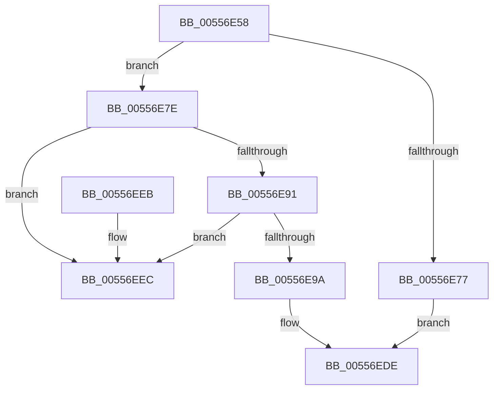

# HalpDeleteSecondaryIcEntry

- RVA: `0x00556E58`–`0x00556EF3` (길이 `155` bytes)
- VA: `0x0000000140556E58`
- 실행 섹션: `.text`
- PDB 이름 있음: `예`; PDB Function 태그: `아니요`
- unwind 정보 RVA: `0x00095058`
- 디코드: `44`개 명령, `155/155` bytes 표시
- 미해석 바이트: `0` (있으면 어셈블리에 `.byte`로 보존)

> 이 문서는 커널 이미지의 기계어와 PDB 기호를 분석해 생성했습니다. 4번과 5번은 함수 원형과 자료형을 바이너리 사용 방식에서 추정한 C 해석이며 원본 소스 복구 결과는 아닙니다.

## 1. Dependencies

- 직접 호출 지점: **5**; 고유 호출 대상: **5**
- 직접 호출자로 확인된 함수: **1**
- RIP 상대 이미지 참조: **1**

### Outgoing calls
- `0x00556E83` → [HalpAcquireSecondaryIcEntryExclusive](HalpAcquireSecondaryIcEntryExclusive_function_00556C28.md) (function, `0x00556C28`)
- `0x00556EB0` → [HalpReleaseHighLevelLock](../2D/HalpReleaseHighLevelLock_function_002D1C58.md) (function, `0x002D1C58`)
- `0x00556EBE` → [KeSetEvent](../33/KeSetEvent_function_0033F310.md) (function, `0x0033F310`)
- `0x00556ECC` → [ObfDereferenceObjectWithTag](../2F/ObfDereferenceObjectWithTag_function_002F78E0.md) (function, `0x002F78E0`)
- `0x00556ED9` → [ExFreePoolWithTag](../../poolcode/B8/ExFreePoolWithTag_function_00B82870.md) (function, `0x00B82870`)

### Direct callers
- [HalpUnregisterSecondaryIcInterface](HalpUnregisterSecondaryIcInterface_function_00557230.md) at `0x005572A8`

### Static image references
- `0x00556EA1` → RVA `0x00F909D0` (`.data`; read)

## 2. Other-region calls and transfers

- 다른 실행 섹션으로 향하는 call: **1**
  - `0x00556ED9` → [ExFreePoolWithTag](../../poolcode/B8/ExFreePoolWithTag_function_00B82870.md) (`.text` → `POOLCODE`)
- 별도 외부 분기/꼬리 이동을 확인하지 못했습니다.

## 3. Assembly (complete function range)

```asm
00556E58  48 89 5C 24 10                  mov qword ptr [rsp + 0x10], rbx
00556E5D  57                              push rdi
00556E5E  48 83 EC 20                     sub rsp, 0x20
00556E62  33 FF                           xor edi, edi
00556E64  48 8B D9                        mov rbx, rcx
00556E67  40 88 7C 24 30                  mov byte ptr [rsp + 0x30], dil
00556E6C  33 C0                           xor eax, eax
00556E6E  F0 0F B1 79 74                  lock cmpxchg dword ptr [rcx + 0x74], edi
00556E73  85 C0                           test eax, eax
00556E75  7E 07                           jle 0x140556e7e
00556E77  BF 01 00 00 C0                  mov edi, 0xc0000001
00556E7C  EB 60                           jmp 0x140556ede
00556E7E  48 8D 54 24 30                  lea rdx, [rsp + 0x30]
00556E83  E8 A0 FD FF FF                  call 0x140556c28
00556E88  48 8B 0B                        mov rcx, qword ptr [rbx]
00556E8B  48 39 59 08                     cmp qword ptr [rcx + 8], rbx
00556E8F  75 5B                           jne 0x140556eec
00556E91  48 8B 43 08                     mov rax, qword ptr [rbx + 8]
00556E95  48 39 18                        cmp qword ptr [rax], rbx
00556E98  75 52                           jne 0x140556eec
00556E9A  48 89 08                        mov qword ptr [rax], rcx
00556E9D  48 89 41 08                     mov qword ptr [rcx + 8], rax
00556EA1  48 8D 0D 28 9B A3 00            lea rcx, [rip + 0xa39b28]
00556EA8  F0 FF 4B 70                     lock dec dword ptr [rbx + 0x70]
00556EAC  8A 54 24 30                     mov dl, byte ptr [rsp + 0x30]
00556EB0  E8 A3 AD D7 FF                  call 0x1402d1c58
00556EB5  48 8D 4B 78                     lea rcx, [rbx + 0x78]
00556EB9  45 33 C0                        xor r8d, r8d
00556EBC  33 D2                           xor edx, edx
00556EBE  E8 4D 84 DE FF                  call 0x14033f310
00556EC3  48 8B 4B 30                     mov rcx, qword ptr [rbx + 0x30]
00556EC7  BA 44 66 6C 74                  mov edx, 0x746c6644
00556ECC  E8 0F 0A DA FF                  call 0x1402f78e0
00556ED1  BA 48 61 6C 32                  mov edx, 0x326c6148
00556ED6  48 8B CB                        mov rcx, rbx
00556ED9  E8 92 B9 62 00                  call 0x140b82870
00556EDE  48 8B 5C 24 38                  mov rbx, qword ptr [rsp + 0x38]
00556EE3  8B C7                           mov eax, edi
00556EE5  48 83 C4 20                     add rsp, 0x20
00556EE9  5F                              pop rdi
00556EEA  C3                              ret
00556EEB  CC                              int3
00556EEC  B9 03 00 00 00                  mov ecx, 3
00556EF1  CD 29                           int 0x29
```

## 4. C-style interpretation (structured pseudocode)

```c
__int64 __fastcall HalpDeleteSecondaryIcEntry(__int64 a1, __int64 a2, int a3)
{
    __int64 result;
    __int64 v_rdi;
    __int64 v_rsp;
    unsigned __int64 v_stack_p10;
    unsigned __int8 v_stack_p8;

    v_stack_p10 = v_rbx;
    v_rsp = (v_rsp) - (32);
    v_rdi = 0;
    v_stack_p8 = 0;
    result = 0;
    if (condition_is_less_or_equal) goto loc_00556E7E;
    goto loc_00556EDE;
loc_00556E7E:
    result = HalpAcquireSecondaryIcEntryExclusive(a1, v_stack_p8, a3, a4);
    if ((*(unsigned __int64 *)(*(unsigned __int64 *)(a1) + 8)) != a1) goto loc_00556EEC;
    if ((*(unsigned __int64 *)(*(unsigned __int64 *)(a1 + 8))) != a1) goto loc_00556EEC;
    *(unsigned __int64 *)(*(unsigned __int64 *)(a1 + 8)) = *(unsigned __int64 *)(a1);
    *(unsigned __int64 *)(*(unsigned __int64 *)(a1) + 8) = *(unsigned __int64 *)(a1 + 8);
    result = HalpReleaseHighLevelLock(v_rip + 10722088, v_stack_p8, a3, a4);
    a3 = 0;
    a2 = 0;
    result = KeSetEvent(a1 + 120, a2, a3, a4);
    result = ObfDereferenceObjectWithTag(*(unsigned __int64 *)(a1 + 48), (unsigned int)(0x746C6644ULL), a3, a4);
    result = ExFreePoolWithTag(a1, (unsigned int)(0x326C6148ULL), a3, a4);
loc_00556EDE:
    v_rsp = (v_rsp) + (32);
    return (unsigned int)((unsigned int)((unsigned int)(0xC0000001ULL)));
loc_00556EEC:
    return (unsigned int)((unsigned int)((unsigned int)(0xC0000001ULL)));
}
```

## 5. (Beta) C Style

```c
int64_t HalpDeleteSecondaryIcEntry(void *Arg1, int64_t Arg2, int32_t Arg3)
{
    uint8_t *arg1 = (uint8_t *)Arg1;

    int64_t result;
    int64_t local_rdi;
    int64_t local_rsp;
    uint64_t v_stack_p10;
    uint8_t v_stack_p8;

    v_stack_p10 = local_rbx;
    local_rsp = (local_rsp) - (32);
    local_rdi = 0;
    v_stack_p8 = 0;
    result = 0;
    if (condition_is_less_or_equal) goto loc_00556E7E;
    goto loc_00556EDE;
loc_00556E7E:
    result = HalpAcquireSecondaryIcEntryExclusive(Arg1, v_stack_p8, Arg3, a4);
    if ((*(uint64_t *)(*(uint64_t *)(arg1) + 0x8)) != Arg1) goto loc_00556EEC;
    if ((*(uint64_t *)(*(uint64_t *)(arg1 + 0x8))) != Arg1) goto loc_00556EEC;
    *(uint64_t *)(*(uint64_t *)(arg1 + 0x8)) = *(uint64_t *)(arg1);
    *(uint64_t *)(*(uint64_t *)(arg1) + 0x8) = *(uint64_t *)(arg1 + 0x8);
    result = HalpReleaseHighLevelLock(v_rip + 10722088, v_stack_p8, Arg3, a4);
    Arg3 = 0;
    Arg2 = 0;
    result = KeSetEvent(Arg1 + 120, Arg2, Arg3, a4);
    result = ObfDereferenceObjectWithTag(*(uint64_t *)(arg1 + 0x30), (uint32_t)(0x746C6644ULL), Arg3, a4);
    result = ExFreePoolWithTag(Arg1, (uint32_t)(0x326C6148ULL), Arg3, a4);
loc_00556EDE:
    local_rsp = (local_rsp) + (32);
    return (uint32_t)((uint32_t)((uint32_t)(0xC0000001ULL)));
loc_00556EEC:
    return (uint32_t)((uint32_t)((uint32_t)(0xC0000001ULL)));
}
```

### 관측된 메모리 오프셋

구조체 형식이 확인되지 않은 접근은 인자 기준의 오프셋으로만 기록했습니다.

| 기준 인자 | 오프셋 표현 | 폭 (bit) | 접근 |
|---|---:|---:|---|
| `Arg1` | `+ 0x0` | `64` | `R` |
| `Arg1` | `+ 0x8` | `64` | `R` |
| `Arg1` | `+ 0x30` | `64` | `R` |
| `Arg1` | `+ 0x70` | `32` | `R/W` |
| `Arg1` | `+ 0x74` | `32` | `R` |
| `Arg1` | `+ 0x78` | `64` | `R` |

## 6. Execution-region graph

[열기: 2D/3D 그래프와 함수 탐색 컨트롤 패널](../../../control-panel.html?section=text&rva=0x00556E58&view=graph)

- 2D 그래프는 위에서 아래로 흐르고, 3D 그래프는 빈 공간을 드래그해 회전합니다. Shift+드래그는 이동, 휠은 확대·축소, 함수 노드 선택은 대상 보고서 이동입니다.

### Static fallback


