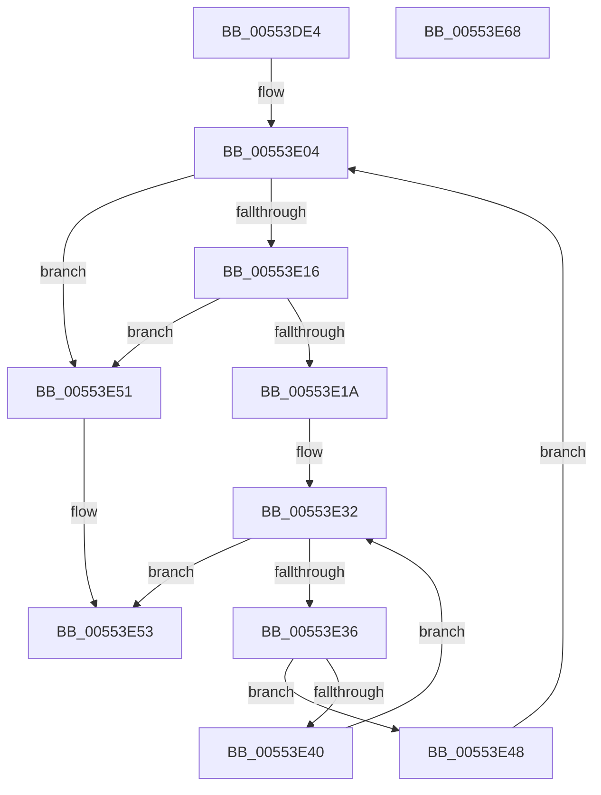

# HalpDmaAllocateContiguousPagesFromContiguousPoolAtHighLevelV2

- RVA: `0x00553DE4`–`0x00553E69` (길이 `133` bytes)
- VA: `0x0000000140553DE4`
- 실행 섹션: `.text`
- PDB 이름 있음: `예`; PDB Function 태그: `아니요`
- unwind 정보 RVA: `0x0005C954`
- 디코드: `43`개 명령, `133/133` bytes 표시
- 미해석 바이트: `0` (있으면 어셈블리에 `.byte`로 보존)

> 이 문서는 커널 이미지의 기계어와 PDB 기호를 분석해 생성했습니다. 4번과 5번은 함수 원형과 자료형을 바이너리 사용 방식에서 추정한 C 해석이며 원본 소스 복구 결과는 아닙니다.

## 1. Dependencies

- 직접 호출 지점: **2**; 고유 호출 대상: **2**
- 직접 호출자로 확인된 함수: **1**
- RIP 상대 이미지 참조: **0**

### Outgoing calls
- `0x00553E0A` → [RtlFindClearBitsAndSet](../3E/RtlFindClearBitsAndSet_function_003E0CD0.md) (function, `0x003E0CD0`)
- `0x00553E28` → [HalpDmaLinkContiguousTranslations](../3E/HalpDmaLinkContiguousTranslations_function_003E1CCC.md) (function, `0x003E1CCC`)

### Direct callers
- [HalpDmaAllocateContiguousPagesFromContiguousPoolAtHighLevel](../53/HalpDmaAllocateContiguousPagesFromContiguousPoolAtHighLevel_function_0053F460.md) at `0x0053F47B`

### Static image references
- 디코드된 RIP-relative 메모리 참조가 없습니다.

## 2. Other-region calls and transfers

- 다른 실행 섹션으로 향하는 call: **0**
- 별도 외부 분기/꼬리 이동을 확인하지 못했습니다.

## 3. Assembly (complete function range)

```asm
00553DE4  48 89 5C 24 08                  mov qword ptr [rsp + 8], rbx
00553DE9  48 89 6C 24 10                  mov qword ptr [rsp + 0x10], rbp
00553DEE  48 89 74 24 18                  mov qword ptr [rsp + 0x18], rsi
00553DF3  57                              push rdi
00553DF4  48 83 EC 20                     sub rsp, 0x20
00553DF8  83 CF FF                        or edi, 0xffffffff
00553DFB  41 8B F0                        mov esi, r8d
00553DFE  45 33 C0                        xor r8d, r8d
00553E01  48 8B EA                        mov rbp, rdx
00553E04  48 8B 4D 18                     mov rcx, qword ptr [rbp + 0x18]
00553E08  8B D6                           mov edx, esi
00553E0A  E8 C1 CE E8 FF                  call 0x1403e0cd0
00553E0F  8B D8                           mov ebx, eax
00553E11  83 F8 FF                        cmp eax, -1
00553E14  74 3B                           je 0x140553e51
00553E16  3B C7                           cmp eax, edi
00553E18  74 37                           je 0x140553e51
00553E1A  83 FF FF                        cmp edi, -1
00553E1D  44 8B C6                        mov r8d, esi
00553E20  8B D0                           mov edx, eax
00553E22  48 8B CD                        mov rcx, rbp
00553E25  0F 44 F8                        cmove edi, eax
00553E28  E8 9F DE E8 FF                  call 0x1403e1ccc
00553E2D  4C 8B C0                        mov r8, rax
00553E30  33 D2                           xor edx, edx
00553E32  3B D6                           cmp edx, esi
00553E34  73 1D                           jae 0x140553e53
00553E36  49 F7 40 30 00 F0 FF FF         test qword ptr [r8 + 0x30], -0x1000
00553E3E  74 08                           je 0x140553e48
00553E40  4D 8B 40 08                     mov r8, qword ptr [r8 + 8]
00553E44  FF C2                           inc edx
00553E46  EB EA                           jmp 0x140553e32
00553E48  44 8D 42 01                     lea r8d, [rdx + 1]
00553E4C  44 03 C3                        add r8d, ebx
00553E4F  EB B3                           jmp 0x140553e04
00553E51  33 C0                           xor eax, eax
00553E53  48 8B 5C 24 30                  mov rbx, qword ptr [rsp + 0x30]
00553E58  48 8B 6C 24 38                  mov rbp, qword ptr [rsp + 0x38]
00553E5D  48 8B 74 24 40                  mov rsi, qword ptr [rsp + 0x40]
00553E62  48 83 C4 20                     add rsp, 0x20
00553E66  5F                              pop rdi
00553E67  C3                              ret
00553E68  CC                              int3
```

## 4. C-style interpretation (structured pseudocode)

```c
__int64 __fastcall HalpDmaAllocateContiguousPagesFromContiguousPoolAtHighLevelV2(__int64 a1, __int64 a2, int a3)
{
    __int64 result;
    __int64 v_rdi;
    __int64 v_rsp;
    unsigned __int64 v_stack_p10;
    unsigned __int64 v_stack_p18;
    unsigned __int64 v_stack_p8;

    v_stack_p8 = v_rbx;
    v_stack_p10 = v_rbp;
    v_stack_p18 = v_rsi;
    v_rsp = (v_rsp) - (32);
    v_rdi = (unsigned int)((v_rdi) | (0xFFFFFFFFULL));
    a3 = 0;
loc_00553E04:
    result = RtlFindClearBitsAndSet(*(unsigned __int64 *)(a2 + 24), (unsigned int)((unsigned int)((unsigned int)(a3))), a3, a4);
    if (((unsigned int)(result)) == -1) goto loc_00553E51;
    if (((unsigned int)(result)) == ((unsigned int)(v_rdi))) goto loc_00553E51;
    if (((unsigned int)(v_rdi)) == -1) { v_rdi = (unsigned int)(result); }
    result = HalpDmaLinkContiguousTranslations(a2, (unsigned int)((unsigned int)(result)), (unsigned int)((unsigned int)((unsigned int)(a3))), a4);
    a2 = 0;
loc_00553E32:
    if (0 >= ((unsigned int)((unsigned int)(a3)))) goto loc_00553E53;
    if (((*(unsigned __int64 *)(result + 48)) & (0xFFFFFFFFFFFFF000ULL)) == 0) goto loc_00553E48;
    a2 = (unsigned int)((a2) + 1);
    goto loc_00553E32;
loc_00553E48:
    a3 = (unsigned int)((a2 + 1) + ((unsigned int)((unsigned int)((unsigned int)(result)))));
    goto loc_00553E04;
loc_00553E51:
    result = 0;
loc_00553E53:
    v_rsp = (v_rsp) + (32);
    return result;
}
```

## 5. (Beta) C Style

```c
int64_t HalpDmaAllocateContiguousPagesFromContiguousPoolAtHighLevelV2(int64_t Arg1, void *Arg2, int32_t Arg3)
{
    uint8_t *arg2 = (uint8_t *)Arg2;

    int64_t result;
    int64_t local_rdi;
    int64_t local_rsp;
    uint64_t v_stack_p10;
    uint64_t v_stack_p18;
    uint64_t v_stack_p8;

    v_stack_p8 = local_rbx;
    v_stack_p10 = local_rbp;
    v_stack_p18 = local_rsi;
    local_rsp = (local_rsp) - (32);
    local_rdi = (uint32_t)((local_rdi) | (0xFFFFFFFFULL));
    Arg3 = 0;
loc_00553E04:
    result = RtlFindClearBitsAndSet(*(uint64_t *)(arg2 + 0x18), (uint32_t)((uint32_t)((uint32_t)(Arg3))), Arg3, a4);
    if (((uint32_t)(result)) == -1) goto loc_00553E51;
    if (((uint32_t)(result)) == ((uint32_t)(local_rdi))) goto loc_00553E51;
    if (((uint32_t)(local_rdi)) == -1) { local_rdi = (uint32_t)(result); }
    result = HalpDmaLinkContiguousTranslations(Arg2, (uint32_t)((uint32_t)(result)), (uint32_t)((uint32_t)((uint32_t)(Arg3))), a4);
    Arg2 = 0;
loc_00553E32:
    if (0 >= ((uint32_t)((uint32_t)(Arg3)))) goto loc_00553E53;
    if (((*(uint64_t *)(result + 0x30)) & (0xFFFFFFFFFFFFF000ULL)) == 0) goto loc_00553E48;
    Arg2 = (uint32_t)((Arg2) + 1);
    goto loc_00553E32;
loc_00553E48:
    Arg3 = (uint32_t)((Arg2 + 1) + ((uint32_t)((uint32_t)((uint32_t)(result)))));
    goto loc_00553E04;
loc_00553E51:
    result = 0;
loc_00553E53:
    local_rsp = (local_rsp) + (32);
    return result;
}
```

### 관측된 메모리 오프셋

구조체 형식이 확인되지 않은 접근은 인자 기준의 오프셋으로만 기록했습니다.

| 기준 인자 | 오프셋 표현 | 폭 (bit) | 접근 |
|---|---:|---:|---|
| `Arg2` | `+ 0x18` | `64` | `R` |

## 6. Execution-region graph

[열기: 2D/3D 그래프와 함수 탐색 컨트롤 패널](../../../control-panel.html?section=text&rva=0x00553DE4&view=graph)

- 2D 그래프는 위에서 아래로 흐르고, 3D 그래프는 빈 공간을 드래그해 회전합니다. Shift+드래그는 이동, 휠은 확대·축소, 함수 노드 선택은 대상 보고서 이동입니다.

### Static fallback


