# HalpDmaAllocateDomain

- RVA: `0x00551C10`–`0x00551F0E` (길이 `766` bytes)
- VA: `0x0000000140551C10`
- 실행 섹션: `.text`
- PDB 이름 있음: `예`; PDB Function 태그: `아니요`
- unwind 정보 RVA: `0x000C439C`
- 디코드: `217`개 명령, `766/766` bytes 표시
- 미해석 바이트: `0` (있으면 어셈블리에 `.byte`로 보존)

> 이 문서는 커널 이미지의 기계어와 PDB 기호를 분석해 생성했습니다. 4번과 5번은 함수 원형과 자료형을 바이너리 사용 방식에서 추정한 C 해석이며 원본 소스 복구 결과는 아닙니다.

## 1. Dependencies

- 직접 호출 지점: **13**; 고유 호출 대상: **11**
- 직접 호출자로 확인된 함수: **1**
- RIP 상대 이미지 참조: **7**

### Outgoing calls
- `0x00551C4D` → [HalpMmAllocCtxAlloc](../3E/HalpMmAllocCtxAlloc_function_003E10B8.md) (function, `0x003E10B8`)
- `0x00551C68` → [memset](../6C/memset_function_006C6C40.md) (function, `0x006C6C40`)
- `0x00551C74` → [KeAcquireSpinLockRaiseToDpc](../20/KeAcquireSpinLockRaiseToDpc_function_00208470.md) (function, `0x00208470`)
- `0x00551CAD` → [KeReleaseSpinLock](../39/KeReleaseSpinLock_function_00392BA0.md) (function, `0x00392BA0`)
- `0x00551CB5` → [HalpDmaReferenceDomainObject](../3E/HalpDmaReferenceDomainObject_function_003E9B08.md) (function, `0x003E9B08`)
- `0x00551D91` → [guard_dispatch_icall](../6B/guard_dispatch_icall_function_006BAAD0.md) (function, `0x006BAAD0`)
- `0x00551DFC` → [HalpDmaGetReservedRegionsForTranslateDomain](HalpDmaGetReservedRegionsForTranslateDomain_function_0055232C.md) (function, `0x0055232C`)
- `0x00551E08` → [HalpDmaGetReservedRegionsForHybridPassthroughDomain](HalpDmaGetReservedRegionsForHybridPassthroughDomain_function_005522A4.md) (function, `0x005522A4`)
- `0x00551E19` → [HalpDmaGetReservedRegionsForDeviceResources](HalpDmaGetReservedRegionsForDeviceResources_function_00552018.md) (function, `0x00552018`)
- `0x00551E92` → [guard_dispatch_icall](../6B/guard_dispatch_icall_function_006BAAD0.md) (function, `0x006BAAD0`)
- `0x00551ED9` → [HalpDmaDereferenceDomainObject](../3F/HalpDmaDereferenceDomainObject_function_003F69DC.md) (function, `0x003F69DC`)
- `0x00551EE8` → [HalpMmAllocCtxFree](../3E/HalpMmAllocCtxFree_function_003E1904.md) (function, `0x003E1904`)
- `0x00551EF5` → [HalpMmAllocCtxFree](../3E/HalpMmAllocCtxFree_function_003E1904.md) (function, `0x003E1904`)

### Direct callers
- [HalJoinDmaDomain](../4E/HalJoinDmaDomain_function_004E3320.md) at `0x004E339A`

### Static image references
- `0x00551C6D` → RVA `0x00FC1888` (`.data`; read)
- `0x00551C79` → RVA `0x00FC1898` (`.data`; read)
- `0x00551C80` → RVA `0x00FC1890` (`.data`; read)
- `0x00551CA6` → RVA `0x00FC1898` (`.data`; write)
- `0x00551CC6` → RVA `0x00E0A80D` (`.data`; read)
- `0x00551CF4` → RVA `0x00FC3C08` (`.data`; read)
- `0x00551D76` → RVA `0x00FC1778` (`.data`; read)

## 2. Other-region calls and transfers

- 다른 실행 섹션으로 향하는 call: **0**
- 별도 외부 분기/꼬리 이동을 확인하지 못했습니다.

## 3. Assembly (complete function range)

```asm
00551C10  40 55                           push rbp
00551C12  56                              push rsi
00551C13  57                              push rdi
00551C14  41 54                           push r12
00551C16  41 55                           push r13
00551C18  41 56                           push r14
00551C1A  41 57                           push r15
00551C1C  48 8B EC                        mov rbp, rsp
00551C1F  48 83 EC 40                     sub rsp, 0x40
00551C23  83 65 48 00                     and dword ptr [rbp + 0x48], 0
00551C27  33 C0                           xor eax, eax
00551C29  48 21 45 58                     and qword ptr [rbp + 0x58], rax
00551C2D  4C 8B E9                        mov r13, rcx
00551C30  8B B1 08 02 00 00               mov esi, dword ptr [rcx + 0x208]
00551C36  45 33 E4                        xor r12d, r12d
00551C39  4C 8B B9 90 00 00 00            mov r15, qword ptr [rcx + 0x90]
00551C40  45 33 F6                        xor r14d, r14d
00551C43  8D 50 78                        lea edx, [rax + 0x78]
00551C46  66 89 45 40                     mov word ptr [rbp + 0x40], ax
00551C4A  88 45 42                        mov byte ptr [rbp + 0x42], al
00551C4D  E8 66 F4 E8 FF                  call 0x1403e10b8
00551C52  48 8B F8                        mov rdi, rax
00551C55  48 85 C0                        test rax, rax
00551C58  0F 84 9C 02 00 00               je 0x140551efa
00551C5E  33 D2                           xor edx, edx
00551C60  45 8D 44 24 78                  lea r8d, [r12 + 0x78]
00551C65  48 8B C8                        mov rcx, rax
00551C68  E8 D3 4F 17 00                  call 0x1406c6c40
00551C6D  48 8D 0D 14 FC A6 00            lea rcx, [rip + 0xa6fc14]
00551C74  E8 F7 67 CB FF                  call 0x140208470
00551C79  48 8B 0D 18 FC A6 00            mov rcx, qword ptr [rip + 0xa6fc18]
00551C80  48 8D 15 09 FC A6 00            lea rdx, [rip + 0xa6fc09]
00551C87  48 39 11                        cmp qword ptr [rcx], rdx
00551C8A  74 07                           je 0x140551c93
00551C8C  41 8D 4C 24 03                  lea ecx, [r12 + 3]
00551C91  CD 29                           int 0x29
00551C93  48 89 17                        mov qword ptr [rdi], rdx
00551C96  8A D0                           mov dl, al
00551C98  48 89 4F 08                     mov qword ptr [rdi + 8], rcx
00551C9C  48 89 39                        mov qword ptr [rcx], rdi
00551C9F  48 8D 0D E2 FB A6 00            lea rcx, [rip + 0xa6fbe2]
00551CA6  48 89 3D EB FB A6 00            mov qword ptr [rip + 0xa6fbeb], rdi
00551CAD  E8 EE 0E E4 FF                  call 0x140392ba0
00551CB2  48 8B CF                        mov rcx, rdi
00551CB5  E8 4E 7E E9 FF                  call 0x1403e9b08
00551CBA  41 8A 85 BD 01 00 00            mov al, byte ptr [r13 + 0x1bd]
00551CC1  B9 00 00 FF FF                  mov ecx, 0xffff0000
00551CC6  44 0F B6 05 3F 8B 8B 00         movzx r8d, byte ptr [rip + 0x8b8b3f]
00551CCE  88 47 20                        mov byte ptr [rdi + 0x20], al
00551CD1  41 8A 85 99 00 00 00            mov al, byte ptr [r13 + 0x99]
00551CD8  F6 D8                           neg al
00551CDA  48 1B C0                        sbb rax, rax
00551CDD  48 23 C1                        and rax, rcx
00551CE0  48 05 00 00 01 00               add rax, 0x10000
00551CE6  48 89 45 F8                     mov qword ptr [rbp - 8], rax
00551CEA  83 FE 02                        cmp esi, 2
00551CED  75 05                           jne 0x140551cf4
00551CEF  41 8A D0                        mov dl, r8b
00551CF2  EB 36                           jmp 0x140551d2a
00551CF4  48 8B 05 0D 1F A7 00            mov rax, qword ptr [rip + 0xa71f0d]
00551CFB  44 21 65 50                     and dword ptr [rbp + 0x50], r12d
00551CFF  48 0F BD D0                     bsr rdx, rax
00551D03  74 13                           je 0x140551d18
00551D05  80 FA 1E                        cmp dl, 0x1e
00551D08  73 04                           jae 0x140551d0e
00551D0A  B2 20                           mov dl, 0x20
00551D0C  EB 0C                           jmp 0x140551d1a
00551D0E  80 FA 3F                        cmp dl, 0x3f
00551D11  73 05                           jae 0x140551d18
00551D13  80 C2 02                        add dl, 2
00551D16  EB 02                           jmp 0x140551d1a
00551D18  B2 40                           mov dl, 0x40
00551D1A  85 F6                           test esi, esi
00551D1C  74 0C                           je 0x140551d2a
00551D1E  41 3A D0                        cmp dl, r8b
00551D21  0F B6 CA                        movzx ecx, dl
00551D24  41 0F 47 C8                     cmova ecx, r8d
00551D28  8A D1                           mov dl, cl
00551D2A  80 FA 40                        cmp dl, 0x40
00551D2D  72 06                           jb 0x140551d35
00551D2F  48 83 C8 FF                     or rax, 0xffffffffffffffff
00551D33  EB 0D                           jmp 0x140551d42
00551D35  8A CA                           mov cl, dl
00551D37  B8 01 00 00 00                  mov eax, 1
00551D3C  48 D3 E0                        shl rax, cl
00551D3F  48 FF C8                        dec rax
00551D42  49 3B C7                        cmp rax, r15
00551D45  B9 FF FF FF FF                  mov ecx, 0xffffffff
00551D4A  4C 0F 46 F8                     cmovbe r15, rax
00551D4E  44 21 65 50                     and dword ptr [rbp + 0x50], r12d
00551D52  49 0F BD C7                     bsr rax, r15
00551D56  4C 89 7D F0                     mov qword ptr [rbp - 0x10], r15
00551D5A  0F 45 C8                        cmovne ecx, eax
00551D5D  32 D2                           xor dl, dl
00551D5F  44 0F B6 C1                     movzx r8d, cl
00551D63  49 8B 8D 20 02 00 00            mov rcx, qword ptr [r13 + 0x220]
00551D6A  41 FF C0                        inc r8d
00551D6D  44 89 45 50                     mov dword ptr [rbp + 0x50], r8d
00551D71  48 85 C9                        test rcx, rcx
00551D74  74 2F                           je 0x140551da5
00551D76  48 8B 05 FB F9 A6 00            mov rax, qword ptr [rip + 0xa6f9fb]
00551D7D  4C 8D 4D 40                     lea r9, [rbp + 0x40]
00551D81  4C 8D 45 48                     lea r8, [rbp + 0x48]
00551D85  BA 03 00 00 00                  mov edx, 3
00551D8A  48 8B 80 D0 00 00 00            mov rax, qword ptr [rax + 0xd0]
00551D91  E8 3A 8D 16 00                  call 0x1406baad0
00551D96  85 C0                           test eax, eax
00551D98  0F 88 38 01 00 00               js 0x140551ed6
00551D9E  8A 55 40                        mov dl, byte ptr [rbp + 0x40]
00551DA1  44 8B 45 50                     mov r8d, dword ptr [rbp + 0x50]
00551DA5  8B CE                           mov ecx, esi
00551DA7  85 F6                           test esi, esi
00551DA9  0F 84 BF 00 00 00               je 0x140551e6e
00551DAF  83 E9 01                        sub ecx, 1
00551DB2  74 1D                           je 0x140551dd1
00551DB4  83 E9 01                        sub ecx, 1
00551DB7  74 18                           je 0x140551dd1
00551DB9  83 F9 01                        cmp ecx, 1
00551DBC  74 08                           je 0x140551dc6
00551DBE  41 BF 04 00 00 00               mov r15d, 4
00551DC4  EB 0E                           jmp 0x140551dd4
00551DC6  F6 DA                           neg dl
00551DC8  45 1B FF                        sbb r15d, r15d
00551DCB  41 83 E7 03                     and r15d, 3
00551DCF  EB 10                           jmp 0x140551de1
00551DD1  45 33 FF                        xor r15d, r15d
00551DD4  85 F6                           test esi, esi
00551DD6  0F 84 98 00 00 00               je 0x140551e74
00551DDC  83 FE 01                        cmp esi, 1
00551DDF  74 2F                           je 0x140551e10
00551DE1  C7 45 58 01 00 00 00            mov dword ptr [rbp + 0x58], 1
00551DE8  44 89 45 5C                     mov dword ptr [rbp + 0x5c], r8d
00551DEC  83 FE 03                        cmp esi, 3
00551DEF  75 12                           jne 0x140551e03
00551DF1  49 8B 8D 18 02 00 00            mov rcx, qword ptr [r13 + 0x218]
00551DF8  48 8D 57 21                     lea rdx, [rdi + 0x21]
00551DFC  E8 2B 05 00 00                  call 0x14055232c
00551E01  EB 0A                           jmp 0x140551e0d
00551E03  83 FE 02                        cmp esi, 2
00551E06  75 08                           jne 0x140551e10
00551E08  E8 97 04 00 00                  call 0x1405522a4
00551E0D  4C 8B F0                        mov r14, rax
00551E10  49 8B 8D 10 02 00 00            mov rcx, qword ptr [r13 + 0x210]
00551E17  8B D6                           mov edx, esi
00551E19  E8 FA 01 00 00                  call 0x140552018
00551E1E  4C 8B E0                        mov r12, rax
00551E21  4D 85 F6                        test r14, r14
00551E24  74 1E                           je 0x140551e44
00551E26  49 8B 16                        mov rdx, qword ptr [r14]
00551E29  49 8B C6                        mov rax, r14
00551E2C  48 85 D2                        test rdx, rdx
00551E2F  74 0E                           je 0x140551e3f
00551E31  48 8B 0A                        mov rcx, qword ptr [rdx]
00551E34  48 8B C2                        mov rax, rdx
00551E37  48 8B D1                        mov rdx, rcx
00551E3A  48 85 C9                        test rcx, rcx
00551E3D  75 F2                           jne 0x140551e31
00551E3F  4C 89 20                        mov qword ptr [rax], r12
00551E42  EB 06                           jmp 0x140551e4a
00551E44  4D 8B F4                        mov r14, r12
00551E47  45 33 E4                        xor r12d, r12d
00551E4A  83 FE 02                        cmp esi, 2
00551E4D  4C 8D 45 58                     lea r8, [rbp + 0x58]
00551E51  48 BA 00 00 00 00 00 00 00 80   movabs rdx, 0x8000000000000000
00551E5B  48 B8 00 00 00 00 00 00 00 C0   movabs rax, 0xc000000000000000
00551E65  48 0F 44 D0                     cmove rdx, rax
00551E69  4D 8B CE                        mov r9, r14
00551E6C  EB 0E                           jmp 0x140551e7c
00551E6E  41 BF 01 00 00 00               mov r15d, 1
00551E74  45 33 C9                        xor r9d, r9d
00551E77  45 33 C0                        xor r8d, r8d
00551E7A  33 D2                           xor edx, edx
00551E7C  48 8B 05 F5 F8 A6 00            mov rax, qword ptr [rip + 0xa6f8f5]
00551E83  4C 8D 6F 28                     lea r13, [rdi + 0x28]
00551E87  41 8B CF                        mov ecx, r15d
00551E8A  4C 89 6C 24 20                  mov qword ptr [rsp + 0x20], r13
00551E8F  48 8B 00                        mov rax, qword ptr [rax]
00551E92  E8 39 8C 16 00                  call 0x1406baad0
00551E97  85 C0                           test eax, eax
00551E99  78 3B                           js 0x140551ed6
00551E9B  49 8B 45 00                     mov rax, qword ptr [r13]
00551E9F  48 89 38                        mov qword ptr [rax], rdi
00551EA2  48 83 67 50 00                  and qword ptr [rdi + 0x50], 0
00551EA7  48 8B 45 F0                     mov rax, qword ptr [rbp - 0x10]
00551EAB  48 89 47 10                     mov qword ptr [rdi + 0x10], rax
00551EAF  48 8B 45 F8                     mov rax, qword ptr [rbp - 8]
00551EB3  48 89 47 18                     mov qword ptr [rdi + 0x18], rax
00551EB7  48 8D 47 58                     lea rax, [rdi + 0x58]
00551EBB  89 77 30                        mov dword ptr [rdi + 0x30], esi
00551EBE  48 83 67 40 00                  and qword ptr [rdi + 0x40], 0
00551EC3  48 83 67 48 00                  and qword ptr [rdi + 0x48], 0
00551EC8  48 83 67 68 00                  and qword ptr [rdi + 0x68], 0
00551ECD  48 89 40 08                     mov qword ptr [rax + 8], rax
00551ED1  48 89 00                        mov qword ptr [rax], rax
00551ED4  EB 0A                           jmp 0x140551ee0
00551ED6  48 8B CF                        mov rcx, rdi
00551ED9  E8 FE 4A EA FF                  call 0x1403f69dc
00551EDE  33 FF                           xor edi, edi
00551EE0  4D 85 F6                        test r14, r14
00551EE3  74 08                           je 0x140551eed
00551EE5  49 8B D6                        mov rdx, r14
00551EE8  E8 17 FA E8 FF                  call 0x1403e1904
00551EED  4D 85 E4                        test r12, r12
00551EF0  74 08                           je 0x140551efa
00551EF2  49 8B D4                        mov rdx, r12
00551EF5  E8 0A FA E8 FF                  call 0x1403e1904
00551EFA  48 8B C7                        mov rax, rdi
00551EFD  48 83 C4 40                     add rsp, 0x40
00551F01  41 5F                           pop r15
00551F03  41 5E                           pop r14
00551F05  41 5D                           pop r13
00551F07  41 5C                           pop r12
00551F09  5F                              pop rdi
00551F0A  5E                              pop rsi
00551F0B  5D                              pop rbp
00551F0C  C3                              ret
00551F0D  CC                              int3
```

## 4. C-style interpretation (structured pseudocode)

```c
__int64 __fastcall HalpDmaAllocateDomain(__int64 a1)
{
    __int64 result;
    __int64 v_r12;
    __int64 v_r14;
    __int64 v_r15;
    __int64 v_rdi;
    __int64 v_rsp;
    unsigned __int64 v_stack_m40;
    unsigned __int64 v_stack_m48;
    unsigned __int64 v_stack_m58;
    unsigned int v_stack_p10;
    unsigned int v_stack_p18;
    unsigned __int64 v_stack_p20;
    unsigned int v_stack_p24;
    unsigned __int16 v_stack_p8;
    unsigned __int8 v_stack_pA;

    v_rsp = (v_rsp) - (64);
    result = 0;
    v_r12 = 0;
    v_r14 = 0;
    v_stack_p8 = 0;
    v_stack_pA = 0;
    result = HalpMmAllocCtxAlloc(a1, result + 120, a3, a4);
    if (result == 0) goto loc_00551EFA;
    a2 = 0;
    result = memset(result, a2, v_r12 + 120, a4);
    result = KeAcquireSpinLockRaiseToDpc(v_rip + 10943508, a2, v_r12 + 120, a4);
    if ((*(unsigned __int64 *)(*(unsigned __int64 *)(v_rip + 10943512))) != (v_rip + 10943497)) {
        a1 = v_r12 + 3;
    }
    *(unsigned __int64 *)(result) = v_rip + 10943497;
    *(unsigned __int64 *)(result + 8) = a1;
    *(unsigned __int64 *)(a1) = result;
    *(unsigned __int64 *)(v_rip + 10943467) = result;
    result = KeReleaseSpinLock(v_rip + 10943458, (unsigned __int8)(result), v_r12 + 120, a4);
    result = HalpDmaReferenceDomainObject(result, (unsigned __int8)(result), v_r12 + 120, a4);
    *(unsigned __int8 *)(result + 32) = (unsigned __int8)(*(unsigned __int8 *)(a1 + 445));
    result = (unsigned __int8)(-(*(unsigned __int8 *)(a1 + 153)));
    result = (result) & ((unsigned int)(0xFFFF0000ULL));
    result = (result) + (0x10000ULL);
    v_stack_m40 = result;
    if (((unsigned int)((unsigned int)(*(unsigned int *)(a1 + 520)))) != 2) goto loc_00551CF4;
    goto loc_00551D2A;
loc_00551CF4:
    if (((unsigned int)((unsigned int)(*(unsigned int *)(a1 + 520)))) == 2) goto loc_00551D18;
    if (((unsigned __int8)((unsigned __int8)(*(unsigned __int8 *)(v_rip + 9145151)))) >= 30) goto loc_00551D0E;
    goto loc_00551D1A;
loc_00551D0E:
    if (32 >= 63) goto loc_00551D18;
    a2 = (unsigned __int8)((32) + (2));
    goto loc_00551D1A;
loc_00551D18:
loc_00551D1A:
    if ((unsigned int)((unsigned int)(*(unsigned int *)(a1 + 520))) != 0) {
        a1 = 64;
        if (64 > ((unsigned __int8)(*(unsigned __int8 *)(v_rip + 9145151)))) { a1 = (unsigned int)(*(unsigned __int8 *)(v_rip + 9145151)); }
        a2 = (unsigned __int8)(a1);
    }
    if (((unsigned __int8)(a2)) < 64) goto loc_00551D35;
    result = (*(unsigned __int64 *)(v_rip + 10952461)) | (-1);
    goto loc_00551D42;
loc_00551D35:
    result = (1) << ((unsigned __int8)((unsigned __int8)(a2)));
    result = (result) - 1;
loc_00551D42:
    v_r15 = *(unsigned __int64 *)(a1 + 144);
    if (result <= (*(unsigned __int64 *)(a1 + 144))) { v_r15 = result; }
    v_stack_m48 = v_r15;
    a1 = (unsigned int)(0xFFFFFFFFULL);
    if (result != (*(unsigned __int64 *)(a1 + 144))) { a1 = (unsigned int)(result); }
    a2 = 0;
    a3 = (unsigned int)(((unsigned __int8)(a1)) + 1);
    v_stack_p18 = (unsigned int)(a3);
    if (*(unsigned __int64 *)(a1 + 544) == 0) goto loc_00551DA5;
    result = guard_dispatch_icall(*(unsigned __int64 *)(a1 + 544), 3, v_stack_p10, v_stack_p8);
    if (sign_flag) goto loc_00551ED6;
loc_00551DA5:
    if ((unsigned int)((unsigned int)(*(unsigned int *)(a1 + 520))) == 0) goto loc_00551E6E;
    a1 = (unsigned int)(((unsigned int)((unsigned int)((unsigned int)(*(unsigned int *)(a1 + 520))))) - (1));
    if (condition_is_equal) goto loc_00551DD1;
    a1 = (unsigned int)((a1) - (1));
    if (condition_is_equal) goto loc_00551DD1;
    if (((unsigned int)(a1)) == 1) goto loc_00551DC6;
    goto loc_00551DD4;
loc_00551DC6:
    a2 = (unsigned __int8)(-(v_stack_p8));
    v_r15 = (unsigned int)((4) & (3));
    goto loc_00551DE1;
loc_00551DD1:
    v_r15 = 0;
loc_00551DD4:
    if ((unsigned int)((unsigned int)(*(unsigned int *)(a1 + 520))) == 0) goto loc_00551E74;
    if (((unsigned int)((unsigned int)(*(unsigned int *)(a1 + 520)))) == 1) goto loc_00551E10;
loc_00551DE1:
    v_stack_p20 = 1;
    v_stack_p24 = (unsigned int)((unsigned int)(v_stack_p18));
    if (((unsigned int)((unsigned int)(*(unsigned int *)(a1 + 520)))) != 3) goto loc_00551E03;
    result = HalpDmaGetReservedRegionsForTranslateDomain(*(unsigned __int64 *)(a1 + 536), result + 33, (unsigned int)(v_stack_p18), v_stack_p8);
    goto loc_00551E0D;
loc_00551E03:
    if (((unsigned int)((unsigned int)(*(unsigned int *)(a1 + 520)))) != 2) goto loc_00551E10;
    result = HalpDmaGetReservedRegionsForHybridPassthroughDomain(*(unsigned __int64 *)(a1 + 536), result + 33, (unsigned int)(v_stack_p18), v_stack_p8);
loc_00551E0D:
loc_00551E10:
    result = HalpDmaGetReservedRegionsForDeviceResources(*(unsigned __int64 *)(a1 + 528), (unsigned int)((unsigned int)((unsigned int)(*(unsigned int *)(a1 + 520)))), (unsigned int)(v_stack_p18), v_stack_p8);
    if (result == 0) goto loc_00551E44;
    if (*(unsigned __int64 *)(result) == 0) goto loc_00551E3F;
loc_00551E31:
    if (*(unsigned __int64 *)(*(unsigned __int64 *)(result)) != 0) goto loc_00551E31;
loc_00551E3F:
    *(unsigned __int64 *)(*(unsigned __int64 *)(result)) = result;
    goto loc_00551E4A;
loc_00551E44:
    v_r12 = 0;
loc_00551E4A:
    a2 = *(unsigned __int64 *)(*(unsigned __int64 *)(result));
    if (((unsigned int)((unsigned int)(*(unsigned int *)(a1 + 520)))) == 2) { a2 = *(unsigned __int64 *)(result); }
    goto loc_00551E7C;
loc_00551E6E:
loc_00551E74:
    a4 = 0;
    a3 = 0;
    a2 = 0;
loc_00551E7C:
    v_stack_m58 = result + 40;
    result = guard_dispatch_icall(1, a2, a3, a4);
    if (sign_flag) goto loc_00551ED6;
    *(unsigned __int64 *)(*(unsigned __int64 *)(result + 40)) = result;
    *(unsigned __int64 *)(result + 16) = v_stack_m48;
    *(unsigned __int64 *)(result + 24) = v_stack_m40;
    *(unsigned int *)(result + 48) = (unsigned int)((unsigned int)(*(unsigned int *)(a1 + 520)));
    *(unsigned __int64 *)(result + 88 + 8) = result + 88;
    *(unsigned __int64 *)(result + 88) = result + 88;
    goto loc_00551EE0;
loc_00551ED6:
    result = HalpDmaDereferenceDomainObject(result, a2, a3, a4);
    v_rdi = 0;
loc_00551EE0:
    if (result != 0) {
        a2 = result;
        result = HalpMmAllocCtxFree(result, a2, a3, a4);
    }
    if (0 != 0) {
        a2 = 0;
        result = HalpMmAllocCtxFree(result, a2, a3, a4);
    }
    v_rsp = (v_rsp) + (64);
    return 0;
}
```

## 5. (Beta) C Style

```c
int64_t HalpDmaAllocateDomain(void *Arg1)
{
    uint8_t *arg1 = (uint8_t *)Arg1;

    int64_t result;
    int64_t local_r12;
    int64_t local_r14;
    int64_t local_r15;
    int64_t local_rdi;
    int64_t local_rsp;
    uint64_t v_stack_m40;
    uint64_t v_stack_m48;
    uint64_t v_stack_m58;
    uint32_t v_stack_p10;
    uint32_t v_stack_p18;
    uint64_t v_stack_p20;
    uint32_t v_stack_p24;
    uint16_t v_stack_p8;
    uint8_t v_stack_pA;

    local_rsp = (local_rsp) - (64);
    result = 0;
    local_r12 = 0;
    local_r14 = 0;
    v_stack_p8 = 0;
    v_stack_pA = 0;
    result = HalpMmAllocCtxAlloc(Arg1, result + 120, a3, a4);
    if (result == 0) goto loc_00551EFA;
    a2 = 0;
    result = memset(result, a2, local_r12 + 120, a4);
    result = KeAcquireSpinLockRaiseToDpc(v_rip + 10943508, a2, local_r12 + 120, a4);
    if ((*(uint64_t *)(*(uint64_t *)(v_rip + 0xA6FC18))) != (v_rip + 10943497)) {
        Arg1 = local_r12 + 3;
    }
    *(uint64_t *)(result) = v_rip + 10943497;
    *(void **)(result + 0x8) = Arg1;
    *(uint64_t *)(arg1) = result;
    *(uint64_t *)(v_rip + 0xA6FBEB) = result;
    result = KeReleaseSpinLock(v_rip + 10943458, (uint8_t)(result), local_r12 + 120, a4);
    result = HalpDmaReferenceDomainObject(result, (uint8_t)(result), local_r12 + 120, a4);
    *(uint8_t *)(result + 0x20) = (uint8_t)(*(uint8_t *)(arg1 + 0x1BD));
    result = (uint8_t)(-(*(uint8_t *)(arg1 + 0x99)));
    result = (result) & ((uint32_t)(0xFFFF0000ULL));
    result = (result) + (0x10000ULL);
    v_stack_m40 = result;
    if (((uint32_t)((uint32_t)(*(uint32_t *)(arg1 + 0x208)))) != 2) goto loc_00551CF4;
    goto loc_00551D2A;
loc_00551CF4:
    if (((uint32_t)((uint32_t)(*(uint32_t *)(arg1 + 0x208)))) == 2) goto loc_00551D18;
    if (((uint8_t)((uint8_t)(*(uint8_t *)(v_rip + 0x8B8B3F)))) >= 30) goto loc_00551D0E;
    goto loc_00551D1A;
loc_00551D0E:
    if (32 >= 63) goto loc_00551D18;
    a2 = (uint8_t)((32) + (2));
    goto loc_00551D1A;
loc_00551D18:
loc_00551D1A:
    if ((uint32_t)((uint32_t)(*(uint32_t *)(arg1 + 0x208))) != 0) {
        Arg1 = 64;
        if (64 > ((uint8_t)(*(uint8_t *)(v_rip + 0x8B8B3F)))) { Arg1 = (uint32_t)(*(uint8_t *)(v_rip + 0x8B8B3F)); }
        a2 = (uint8_t)(Arg1);
    }
    if (((uint8_t)(a2)) < 64) goto loc_00551D35;
    result = (*(uint64_t *)(v_rip + 0xA71F0D)) | (-1);
    goto loc_00551D42;
loc_00551D35:
    result = (1) << ((uint8_t)((uint8_t)(a2)));
    result = (result) - 1;
loc_00551D42:
    local_r15 = *(uint64_t *)(arg1 + 0x90);
    if (result <= (*(uint64_t *)(arg1 + 0x90))) { local_r15 = result; }
    v_stack_m48 = local_r15;
    Arg1 = (uint32_t)(0xFFFFFFFFULL);
    if (result != (*(uint64_t *)(arg1 + 0x90))) { Arg1 = (uint32_t)(result); }
    a2 = 0;
    a3 = (uint32_t)(((uint8_t)(Arg1)) + 1);
    v_stack_p18 = (uint32_t)(a3);
    if (*(uint64_t *)(arg1 + 0x220) == 0) goto loc_00551DA5;
    result = guard_dispatch_icall(*(uint64_t *)(arg1 + 0x220), 3, v_stack_p10, v_stack_p8);
    if (sign_flag) goto loc_00551ED6;
loc_00551DA5:
    if ((uint32_t)((uint32_t)(*(uint32_t *)(arg1 + 0x208))) == 0) goto loc_00551E6E;
    Arg1 = (uint32_t)(((uint32_t)((uint32_t)((uint32_t)(*(uint32_t *)(arg1 + 0x208))))) - (1));
    if (condition_is_equal) goto loc_00551DD1;
    Arg1 = (uint32_t)((Arg1) - (1));
    if (condition_is_equal) goto loc_00551DD1;
    if (((uint32_t)(Arg1)) == 1) goto loc_00551DC6;
    goto loc_00551DD4;
loc_00551DC6:
    a2 = (uint8_t)(-(v_stack_p8));
    local_r15 = (uint32_t)((4) & (3));
    goto loc_00551DE1;
loc_00551DD1:
    local_r15 = 0;
loc_00551DD4:
    if ((uint32_t)((uint32_t)(*(uint32_t *)(arg1 + 0x208))) == 0) goto loc_00551E74;
    if (((uint32_t)((uint32_t)(*(uint32_t *)(arg1 + 0x208)))) == 1) goto loc_00551E10;
loc_00551DE1:
    v_stack_p20 = 1;
    v_stack_p24 = (uint32_t)((uint32_t)(v_stack_p18));
    if (((uint32_t)((uint32_t)(*(uint32_t *)(arg1 + 0x208)))) != 3) goto loc_00551E03;
    result = HalpDmaGetReservedRegionsForTranslateDomain(*(uint64_t *)(arg1 + 0x218), result + 33, (uint32_t)(v_stack_p18), v_stack_p8);
    goto loc_00551E0D;
loc_00551E03:
    if (((uint32_t)((uint32_t)(*(uint32_t *)(arg1 + 0x208)))) != 2) goto loc_00551E10;
    result = HalpDmaGetReservedRegionsForHybridPassthroughDomain(*(uint64_t *)(arg1 + 0x218), result + 33, (uint32_t)(v_stack_p18), v_stack_p8);
loc_00551E0D:
loc_00551E10:
    result = HalpDmaGetReservedRegionsForDeviceResources(*(uint64_t *)(arg1 + 0x210), (uint32_t)((uint32_t)((uint32_t)(*(uint32_t *)(arg1 + 0x208)))), (uint32_t)(v_stack_p18), v_stack_p8);
    if (result == 0) goto loc_00551E44;
    if (*(uint64_t *)(result) == 0) goto loc_00551E3F;
loc_00551E31:
    if (*(uint64_t *)(*(uint64_t *)(result)) != 0) goto loc_00551E31;
loc_00551E3F:
    *(uint64_t *)(*(uint64_t *)(result)) = result;
    goto loc_00551E4A;
loc_00551E44:
    local_r12 = 0;
loc_00551E4A:
    a2 = *(uint64_t *)(*(uint64_t *)(result));
    if (((uint32_t)((uint32_t)(*(uint32_t *)(arg1 + 0x208)))) == 2) { a2 = *(uint64_t *)(result); }
    goto loc_00551E7C;
loc_00551E6E:
loc_00551E74:
    a4 = 0;
    a3 = 0;
    a2 = 0;
loc_00551E7C:
    v_stack_m58 = result + 40;
    result = guard_dispatch_icall(1, a2, a3, a4);
    if (sign_flag) goto loc_00551ED6;
    *(uint64_t *)(*(uint64_t *)(result + 0x28)) = result;
    *(uint64_t *)(result + 0x10) = v_stack_m48;
    *(uint64_t *)(result + 0x18) = v_stack_m40;
    *(uint32_t *)(result + 0x30) = (uint32_t)((uint32_t)(*(uint32_t *)(arg1 + 0x208)));
    *(uint64_t *)(result + 0x58 + 0x8) = result + 88;
    *(uint64_t *)(result + 0x58) = result + 88;
    goto loc_00551EE0;
loc_00551ED6:
    result = HalpDmaDereferenceDomainObject(result, a2, a3, a4);
    local_rdi = 0;
loc_00551EE0:
    if (result != 0) {
        a2 = result;
        result = HalpMmAllocCtxFree(result, a2, a3, a4);
    }
    if (0 != 0) {
        a2 = 0;
        result = HalpMmAllocCtxFree(result, a2, a3, a4);
    }
    local_rsp = (local_rsp) + (64);
    return 0;
}
```

### 관측된 메모리 오프셋

구조체 형식이 확인되지 않은 접근은 인자 기준의 오프셋으로만 기록했습니다.

| 기준 인자 | 오프셋 표현 | 폭 (bit) | 접근 |
|---|---:|---:|---|
| `Arg1` | `+ 0x90` | `64` | `R` |
| `Arg1` | `+ 0x99` | `8` | `R` |
| `Arg1` | `+ 0x1BD` | `8` | `R` |
| `Arg1` | `+ 0x208` | `32` | `R` |
| `Arg1` | `+ 0x210` | `64` | `R` |
| `Arg1` | `+ 0x218` | `64` | `R` |
| `Arg1` | `+ 0x220` | `64` | `R` |

## 6. Execution-region graph

[열기: 2D/3D 그래프와 함수 탐색 컨트롤 패널](../../../control-panel.html?section=text&rva=0x00551C10&view=graph)

- 2D 그래프는 위에서 아래로 흐르고, 3D 그래프는 빈 공간을 드래그해 회전합니다. Shift+드래그는 이동, 휠은 확대·축소, 함수 노드 선택은 대상 보고서 이동입니다.

### Static fallback

```mermaid
flowchart TD
  bb_00551C10[BB_00551C10]
  bb_00551C5E[BB_00551C5E]
  bb_00551C8C[BB_00551C8C]
  bb_00551C93[BB_00551C93]
  bb_00551CEF[BB_00551CEF]
  bb_00551CF4[BB_00551CF4]
  bb_00551D05[BB_00551D05]
  bb_00551D0A[BB_00551D0A]
  bb_00551D0E[BB_00551D0E]
  bb_00551D13[BB_00551D13]
  bb_00551D18[BB_00551D18]
  bb_00551D1A[BB_00551D1A]
  bb_00551D1E[BB_00551D1E]
  bb_00551D2A[BB_00551D2A]
  bb_00551D2F[BB_00551D2F]
  bb_00551D35[BB_00551D35]
  bb_00551D42[BB_00551D42]
  bb_00551D76[BB_00551D76]
  bb_00551D9E[BB_00551D9E]
  bb_00551DA5[BB_00551DA5]
  bb_00551DAF[BB_00551DAF]
  bb_00551DB4[BB_00551DB4]
  bb_00551DB9[BB_00551DB9]
  bb_00551DBE[BB_00551DBE]
  bb_00551DC6[BB_00551DC6]
  bb_00551DD1[BB_00551DD1]
  bb_00551DD4[BB_00551DD4]
  bb_00551DDC[BB_00551DDC]
  bb_00551DE1[BB_00551DE1]
  bb_00551DF1[BB_00551DF1]
  bb_00551E03[BB_00551E03]
  bb_00551E08[BB_00551E08]
  bb_00551E0D[BB_00551E0D]
  bb_00551E10[BB_00551E10]
  bb_00551E26[BB_00551E26]
  bb_00551E31[BB_00551E31]
  bb_00551E3F[BB_00551E3F]
  bb_00551E44[BB_00551E44]
  bb_00551E4A[BB_00551E4A]
  bb_00551E6E[BB_00551E6E]
  bb_00551E74[BB_00551E74]
  bb_00551E7C[BB_00551E7C]
  bb_00551E9B[BB_00551E9B]
  bb_00551ED6[BB_00551ED6]
  bb_00551EE0[BB_00551EE0]
  bb_00551EE5[BB_00551EE5]
  bb_00551EED[BB_00551EED]
  bb_00551EF2[BB_00551EF2]
  bb_00551EFA[BB_00551EFA]
  bb_00551F0D[BB_00551F0D]
  bb_00551C10 -->|branch| bb_00551EFA
  bb_00551C10 -->|fallthrough| bb_00551C5E
  bb_00551C5E -->|branch| bb_00551C93
  bb_00551C5E -->|fallthrough| bb_00551C8C
  bb_00551C8C -->|flow| bb_00551C93
  bb_00551C93 -->|branch| bb_00551CF4
  bb_00551C93 -->|fallthrough| bb_00551CEF
  bb_00551CEF -->|branch| bb_00551D2A
  bb_00551CF4 -->|branch| bb_00551D18
  bb_00551CF4 -->|fallthrough| bb_00551D05
  bb_00551D05 -->|branch| bb_00551D0E
  bb_00551D05 -->|fallthrough| bb_00551D0A
  bb_00551D0A -->|branch| bb_00551D1A
  bb_00551D0E -->|branch| bb_00551D18
  bb_00551D0E -->|fallthrough| bb_00551D13
  bb_00551D13 -->|branch| bb_00551D1A
  bb_00551D18 -->|flow| bb_00551D1A
  bb_00551D1A -->|branch| bb_00551D2A
  bb_00551D1A -->|fallthrough| bb_00551D1E
  bb_00551D1E -->|flow| bb_00551D2A
  bb_00551D2A -->|branch| bb_00551D35
  bb_00551D2A -->|fallthrough| bb_00551D2F
  bb_00551D2F -->|branch| bb_00551D42
  bb_00551D35 -->|flow| bb_00551D42
  bb_00551D42 -->|branch| bb_00551DA5
  bb_00551D42 -->|fallthrough| bb_00551D76
  bb_00551D76 -->|branch| bb_00551ED6
  bb_00551D76 -->|fallthrough| bb_00551D9E
  bb_00551D9E -->|flow| bb_00551DA5
  bb_00551DA5 -->|branch| bb_00551E6E
  bb_00551DA5 -->|fallthrough| bb_00551DAF
  bb_00551DAF -->|branch| bb_00551DD1
  bb_00551DAF -->|fallthrough| bb_00551DB4
  bb_00551DB4 -->|branch| bb_00551DD1
  bb_00551DB4 -->|fallthrough| bb_00551DB9
  bb_00551DB9 -->|branch| bb_00551DC6
  bb_00551DB9 -->|fallthrough| bb_00551DBE
  bb_00551DBE -->|branch| bb_00551DD4
  bb_00551DC6 -->|branch| bb_00551DE1
  bb_00551DD1 -->|flow| bb_00551DD4
  bb_00551DD4 -->|branch| bb_00551E74
  bb_00551DD4 -->|fallthrough| bb_00551DDC
  bb_00551DDC -->|branch| bb_00551E10
  bb_00551DDC -->|fallthrough| bb_00551DE1
  bb_00551DE1 -->|branch| bb_00551E03
  bb_00551DE1 -->|fallthrough| bb_00551DF1
  bb_00551DF1 -->|branch| bb_00551E0D
  bb_00551E03 -->|branch| bb_00551E10
  bb_00551E03 -->|fallthrough| bb_00551E08
  bb_00551E08 -->|flow| bb_00551E0D
  bb_00551E0D -->|flow| bb_00551E10
  bb_00551E10 -->|branch| bb_00551E44
  bb_00551E10 -->|fallthrough| bb_00551E26
  bb_00551E26 -->|branch| bb_00551E3F
  bb_00551E26 -->|fallthrough| bb_00551E31
  bb_00551E31 -->|branch| bb_00551E31
  bb_00551E31 -->|fallthrough| bb_00551E3F
  bb_00551E3F -->|branch| bb_00551E4A
  bb_00551E44 -->|flow| bb_00551E4A
  bb_00551E4A -->|branch| bb_00551E7C
  bb_00551E6E -->|flow| bb_00551E74
  bb_00551E74 -->|flow| bb_00551E7C
  bb_00551E7C -->|branch| bb_00551ED6
  bb_00551E7C -->|fallthrough| bb_00551E9B
  bb_00551E9B -->|branch| bb_00551EE0
  bb_00551ED6 -->|flow| bb_00551EE0
  bb_00551EE0 -->|branch| bb_00551EED
  bb_00551EE0 -->|fallthrough| bb_00551EE5
  bb_00551EE5 -->|flow| bb_00551EED
  bb_00551EED -->|branch| bb_00551EFA
  bb_00551EED -->|fallthrough| bb_00551EF2
  bb_00551EF2 -->|flow| bb_00551EFA
```


