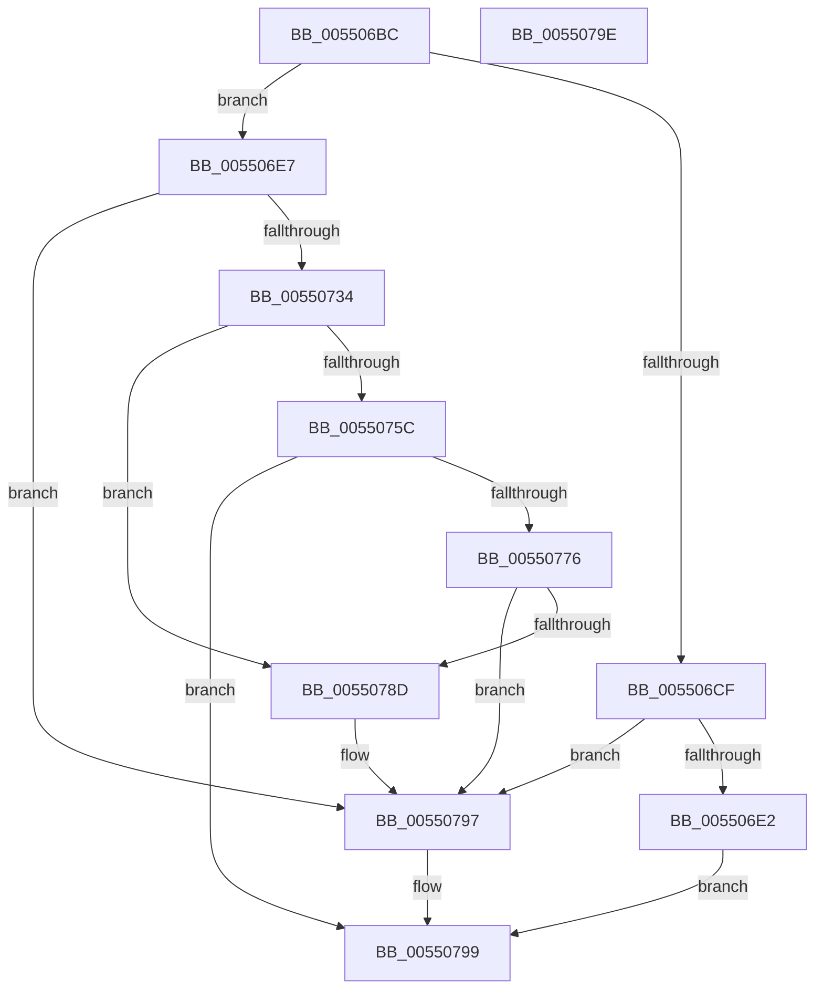

# HalpDmaAllocateMapRegisterFrame

- RVA: `0x005506BC`–`0x0055079F` (길이 `227` bytes)
- VA: `0x00000001405506BC`
- 실행 섹션: `.text`
- PDB 이름 있음: `예`; PDB Function 태그: `아니요`
- unwind 정보 RVA: `0x0006C2A4`
- 디코드: `53`개 명령, `227/227` bytes 표시
- 미해석 바이트: `0` (있으면 어셈블리에 `.byte`로 보존)

> 이 문서는 커널 이미지의 기계어와 PDB 기호를 분석해 생성했습니다. 4번과 5번은 함수 원형과 자료형을 바이너리 사용 방식에서 추정한 C 해석이며 원본 소스 복구 결과는 아닙니다.

## 1. Dependencies

- 직접 호출 지점: **7**; 고유 호출 대상: **6**
- 직접 호출자로 확인된 함수: **1**
- RIP 상대 이미지 참조: **1**

### Outgoing calls
- `0x005506D4` → [HalpMmAllocCtxAlloc](../3E/HalpMmAllocCtxAlloc_function_003E10B8.md) (function, `0x003E10B8`)
- `0x0055072B` → [MmAllocateContiguousMemoryEx](../3E/MmAllocateContiguousMemoryEx_function_003E9B80.md) (function, `0x003E9B80`)
- `0x00550739` → [MmGetPhysicalAddress](../23/MmGetPhysicalAddress_function_0023A500.md) (function, `0x0023A500`)
- `0x00550753` → [HalpDmaCvmSetPageShareability](../../page/70/HalpDmaCvmSetPageShareability_function_0070973C.md) (function, `0x0070973C`)
- `0x0055076C` → [MmMapIoSpaceEx](../32/MmMapIoSpaceEx_function_00327830.md) (function, `0x00327830`)
- `0x00550784` → [HalpDmaCvmSetPageShareability](../../page/70/HalpDmaCvmSetPageShareability_function_0070973C.md) (function, `0x0070973C`)
- `0x00550792` → [MmFreeContiguousMemory](../3F/MmFreeContiguousMemory_function_003F6F60.md) (function, `0x003F6F60`)

### Direct callers
- [HalpDmaAllocateMapRegisters](../3D/HalpDmaAllocateMapRegisters_function_003DDA0C.md) at `0x003DDD9B`

### Static image references
- `0x005506C6` → RVA `0x00FC18A0` (`.data`; read)

## 2. Other-region calls and transfers

- 다른 실행 섹션으로 향하는 call: **2**
  - `0x00550753` → [HalpDmaCvmSetPageShareability](../../page/70/HalpDmaCvmSetPageShareability_function_0070973C.md) (`.text` → `PAGE`)
  - `0x00550784` → [HalpDmaCvmSetPageShareability](../../page/70/HalpDmaCvmSetPageShareability_function_0070973C.md) (`.text` → `PAGE`)
- 별도 외부 분기/꼬리 이동을 확인하지 못했습니다.

## 3. Assembly (complete function range)

```asm
005506BC  48 83 EC 58                     sub rsp, 0x58
005506C0  48 83 64 24 60 00               and qword ptr [rsp + 0x60], 0
005506C6  80 3D D3 11 A7 00 00            cmp byte ptr [rip + 0xa711d3], 0
005506CD  75 18                           jne 0x1405506e7
005506CF  BA 00 10 00 00                  mov edx, 0x1000
005506D4  E8 DF 09 E9 FF                  call 0x1403e10b8
005506D9  48 85 C0                        test rax, rax
005506DC  0F 84 B5 00 00 00               je 0x140550797
005506E2  E9 B2 00 00 00                  jmp 0x140550799
005506E7  48 8D 44 24 60                  lea rax, [rsp + 0x60]
005506EC  48 C7 44 24 68 00 10 00 00      mov qword ptr [rsp + 0x68], 0x1000
005506F5  48 89 44 24 48                  mov qword ptr [rsp + 0x48], rax
005506FA  48 8D 4C 24 68                  lea rcx, [rsp + 0x68]
005506FF  83 64 24 40 00                  and dword ptr [rsp + 0x40], 0
00550704  45 33 C9                        xor r9d, r9d
00550707  C7 44 24 38 48 61 6C 44         mov dword ptr [rsp + 0x38], 0x446c6148
0055070F  49 83 C8 FF                     or r8, 0xffffffffffffffff
00550713  48 83 64 24 30 00               and qword ptr [rsp + 0x30], 0
00550719  33 D2                           xor edx, edx
0055071B  C7 44 24 28 04 00 00 00         mov dword ptr [rsp + 0x28], 4
00550723  C7 44 24 20 00 00 00 80         mov dword ptr [rsp + 0x20], 0x80000000
0055072B  E8 50 94 E9 FF                  call 0x1403e9b80
00550730  85 C0                           test eax, eax
00550732  78 63                           js 0x140550797
00550734  48 8B 4C 24 60                  mov rcx, qword ptr [rsp + 0x60]
00550739  E8 C2 9D CE FF                  call 0x14023a500
0055073E  4C 8D 4C 24 68                  lea r9, [rsp + 0x68]
00550743  48 89 44 24 68                  mov qword ptr [rsp + 0x68], rax
00550748  41 B0 01                        mov r8b, 1
0055074B  BA 01 00 00 00                  mov edx, 1
00550750  48 8B C8                        mov rcx, rax
00550753  E8 E4 8F 1B 00                  call 0x14070973c
00550758  85 C0                           test eax, eax
0055075A  78 31                           js 0x14055078d
0055075C  48 8B 4C 24 68                  mov rcx, qword ptr [rsp + 0x68]
00550761  BA 00 10 00 00                  mov edx, 0x1000
00550766  41 B8 04 00 00 00               mov r8d, 4
0055076C  E8 BF 70 DD FF                  call 0x140327830
00550771  48 85 C0                        test rax, rax
00550774  75 23                           jne 0x140550799
00550776  48 8B 4C 24 68                  mov rcx, qword ptr [rsp + 0x68]
0055077B  8D 50 01                        lea edx, [rax + 1]
0055077E  45 33 C9                        xor r9d, r9d
00550781  45 33 C0                        xor r8d, r8d
00550784  E8 B3 8F 1B 00                  call 0x14070973c
00550789  85 C0                           test eax, eax
0055078B  78 0A                           js 0x140550797
0055078D  48 8B 4C 24 60                  mov rcx, qword ptr [rsp + 0x60]
00550792  E8 C9 67 EA FF                  call 0x1403f6f60
00550797  33 C0                           xor eax, eax
00550799  48 83 C4 58                     add rsp, 0x58
0055079D  C3                              ret
0055079E  CC                              int3
```

## 4. C-style interpretation (structured pseudocode)

```c
__int64 __fastcall HalpDmaAllocateMapRegisterFrame(__int64 a1, __int64 a2, __int64 a3, int a4)
{
    __int64 result;
    __int64 v_rsp;
    unsigned __int64 v_stack_m10;
    unsigned int v_stack_m18;
    unsigned int v_stack_m20;
    unsigned __int64 v_stack_m28;
    unsigned int v_stack_m30;
    unsigned int v_stack_m38;
    unsigned __int64 v_stack_p10;
    unsigned __int64 v_stack_p8;

    v_rsp = (v_rsp) - (88);
    if ((*(unsigned __int8 *)(v_rip + 10949075)) != 0) goto loc_005506E7;
    result = HalpMmAllocCtxAlloc(a1, (unsigned int)(0x1000ULL), a3, a4);
    if (result == 0) goto loc_00550797;
    goto loc_00550799;
loc_005506E7:
    v_stack_p10 = 0x1000ULL;
    v_stack_m10 = v_stack_p8;
    a4 = 0;
    v_stack_m20 = 0x446C6148ULL;
    a3 = (a3) | (-1);
    a2 = 0;
    v_stack_m30 = 4;
    v_stack_m38 = 0x80000000ULL;
    result = MmAllocateContiguousMemoryEx(v_stack_p10, a2, a3, a4);
    if (sign_flag) goto loc_00550797;
    result = MmGetPhysicalAddress(v_stack_p8, a2, a3, a4);
    v_stack_p10 = result;
    result = HalpDmaCvmSetPageShareability(result, 1, 1, v_stack_p10);
    if (sign_flag) goto loc_0055078D;
    result = MmMapIoSpaceEx(v_stack_p10, (unsigned int)(0x1000ULL), 4, v_stack_p10);
    if (result != 0) goto loc_00550799;
    a4 = 0;
    a3 = 0;
    result = HalpDmaCvmSetPageShareability(v_stack_p10, result + 1, a3, a4);
    if (!(sign_flag)) {
        a1 = v_stack_p8;
        result = MmFreeContiguousMemory(a1, result + 1, a3, a4);
    }
    result = 0;
loc_00550799:
    v_rsp = (v_rsp) + (88);
    return result;
}
```

## 5. (Beta) C Style

```c
int64_t HalpDmaAllocateMapRegisterFrame(int64_t Arg1, int64_t Arg2, int64_t Arg3, int32_t Arg4)
{
    int64_t result;
    int64_t local_rsp;
    uint64_t v_stack_m10;
    uint32_t v_stack_m18;
    uint32_t v_stack_m20;
    uint64_t v_stack_m28;
    uint32_t v_stack_m30;
    uint32_t v_stack_m38;
    uint64_t v_stack_p10;
    uint64_t v_stack_p8;

    local_rsp = (local_rsp) - (88);
    if ((*(uint8_t *)(v_rip + 0xA711D3)) != 0) goto loc_005506E7;
    result = HalpMmAllocCtxAlloc(Arg1, (uint32_t)(0x1000ULL), Arg3, Arg4);
    if (result == 0) goto loc_00550797;
    goto loc_00550799;
loc_005506E7:
    v_stack_p10 = 0x1000ULL;
    v_stack_m10 = v_stack_p8;
    Arg4 = 0;
    v_stack_m20 = 0x446C6148ULL;
    Arg3 = (Arg3) | (-1);
    Arg2 = 0;
    v_stack_m30 = 4;
    v_stack_m38 = 0x80000000ULL;
    result = MmAllocateContiguousMemoryEx(v_stack_p10, Arg2, Arg3, Arg4);
    if (sign_flag) goto loc_00550797;
    result = MmGetPhysicalAddress(v_stack_p8, Arg2, Arg3, Arg4);
    v_stack_p10 = result;
    result = HalpDmaCvmSetPageShareability(result, 1, 1, v_stack_p10);
    if (sign_flag) goto loc_0055078D;
    result = MmMapIoSpaceEx(v_stack_p10, (uint32_t)(0x1000ULL), 4, v_stack_p10);
    if (result != 0) goto loc_00550799;
    Arg4 = 0;
    Arg3 = 0;
    result = HalpDmaCvmSetPageShareability(v_stack_p10, result + 1, Arg3, Arg4);
    if (!(sign_flag)) {
        Arg1 = v_stack_p8;
        result = MmFreeContiguousMemory(Arg1, result + 1, Arg3, Arg4);
    }
    result = 0;
loc_00550799:
    local_rsp = (local_rsp) + (88);
    return result;
}
```

## 6. Execution-region graph

[열기: 2D/3D 그래프와 함수 탐색 컨트롤 패널](../../../control-panel.html?section=text&rva=0x005506BC&view=graph)

- 2D 그래프는 위에서 아래로 흐르고, 3D 그래프는 빈 공간을 드래그해 회전합니다. Shift+드래그는 이동, 휠은 확대·축소, 함수 노드 선택은 대상 보고서 이동입니다.

### Static fallback


