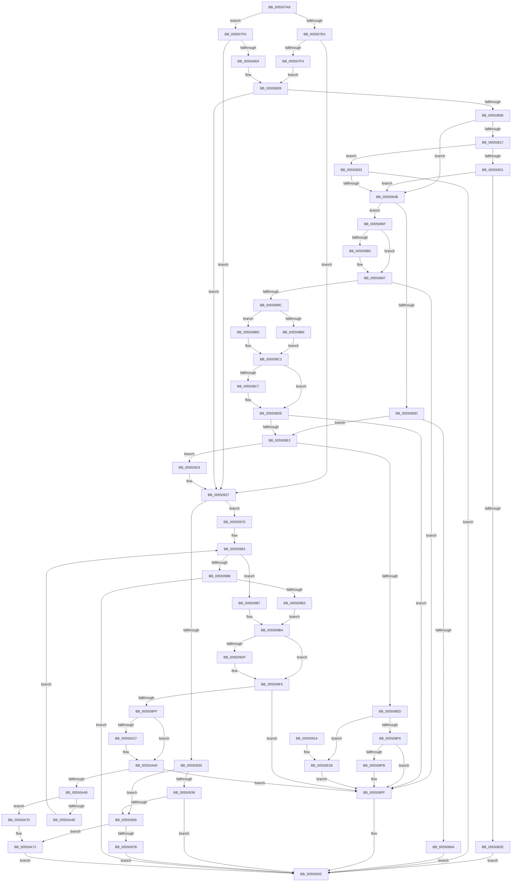

# HalpDmaAllocateMapRegistersAtHighLevel

- RVA: `0x005507A8`–`0x00550A7E` (길이 `726` bytes)
- VA: `0x00000001405507A8`
- 실행 섹션: `.text`
- PDB 이름 있음: `예`; PDB Function 태그: `아니요`
- unwind 정보 RVA: `0x000C4314`
- 디코드: `210`개 명령, `726/726` bytes 표시
- 미해석 바이트: `0` (있으면 어셈블리에 `.byte`로 보존)

> 이 문서는 커널 이미지의 기계어와 PDB 기호를 분석해 생성했습니다. 4번과 5번은 함수 원형과 자료형을 바이너리 사용 방식에서 추정한 C 해석이며 원본 소스 복구 결과는 아닙니다.

## 1. Dependencies

- 직접 호출 지점: **16**; 고유 호출 대상: **7**
- 직접 호출자로 확인된 함수: **2**
- RIP 상대 이미지 참조: **1**

### Outgoing calls
- `0x00550821` → [HalpDmaAllocateContiguousPagesFromContiguousPoolAtHighLevel](../53/HalpDmaAllocateContiguousPagesFromContiguousPoolAtHighLevel_function_0053F460.md) (function, `0x0053F460`)
- `0x00550837` → [HalpDmaAllocateScatterPagesFromScatterPoolAtHighLevel](../53/HalpDmaAllocateScatterPagesFromScatterPoolAtHighLevel_function_0053F48C.md) (function, `0x0053F48C`)
- `0x0055085D` → [HalpDmaAllocateContiguousPagesFromContiguousPoolAtHighLevel](../53/HalpDmaAllocateContiguousPagesFromContiguousPoolAtHighLevel_function_0053F460.md) (function, `0x0053F460`)
- `0x00550876` → [HalpDmaAllocateScatterPagesFromScatterPoolAtHighLevel](../53/HalpDmaAllocateScatterPagesFromScatterPoolAtHighLevel_function_0053F48C.md) (function, `0x0053F48C`)
- `0x00550889` → [HalpDmaPrependTranslations](../3D/HalpDmaPrependTranslations_function_003DC3C8.md) (function, `0x003DC3C8`)
- `0x005508A5` → [HalpDmaGetAdapterVersion](../3D/HalpDmaGetAdapterVersion_function_003DEC8C.md) (function, `0x003DEC8C`)
- `0x005508B6` → [HalpDmaAllocateScatterPagesFromContiguousPoolAtHighLevelV3](../53/HalpDmaAllocateScatterPagesFromContiguousPoolAtHighLevelV3_function_0053DF40.md) (function, `0x0053DF40`)
- `0x005508BD` → [HalpDmaAllocateScatterPagesFromContiguousPoolAtHighLevelV2](HalpDmaAllocateScatterPagesFromContiguousPoolAtHighLevelV2_function_00553E70.md) (function, `0x00553E70`)
- `0x005508D0` → [HalpDmaPrependTranslations](../3D/HalpDmaPrependTranslations_function_003DC3C8.md) (function, `0x003DC3C8`)
- `0x0055094E` → [HalpDmaForceAllocation](HalpDmaForceAllocation_function_00550CFC.md) (function, `0x00550CFC`)
- `0x0055096D` → [HalpDmaForceAllocation](HalpDmaForceAllocation_function_00550CFC.md) (function, `0x00550CFC`)
- `0x0055099F` → [HalpDmaForceAllocation](HalpDmaForceAllocation_function_00550CFC.md) (function, `0x00550CFC`)
- `0x005509D5` → [HalpDmaForceAllocation](HalpDmaForceAllocation_function_00550CFC.md) (function, `0x00550CFC`)
- `0x005509E8` → [HalpDmaPrependTranslations](../3D/HalpDmaPrependTranslations_function_003DC3C8.md) (function, `0x003DC3C8`)
- `0x00550A1B` → [HalpDmaForceAllocation](HalpDmaForceAllocation_function_00550CFC.md) (function, `0x00550CFC`)
- `0x00550A30` → [HalpDmaPrependTranslations](../3D/HalpDmaPrependTranslations_function_003DC3C8.md) (function, `0x003DC3C8`)

### Direct callers
- [HalAllocateCrashDumpRegisters](../53/HalAllocateCrashDumpRegisters_function_0053F5D0.md) at `0x0053F663`
- [HalDmaAllocateCrashDumpRegistersEx](../53/HalDmaAllocateCrashDumpRegistersEx_function_0053F6D0.md) at `0x0053F989`

### Static image references
- `0x005508E3` → RVA `0x00FC1C41` (`.data`; read)

## 2. Other-region calls and transfers

- 다른 실행 섹션으로 향하는 call: **0**
- 별도 외부 분기/꼬리 이동을 확인하지 못했습니다.

## 3. Assembly (complete function range)

```asm
005507A8  48 89 5C 24 18                  mov qword ptr [rsp + 0x18], rbx
005507AD  55                              push rbp
005507AE  56                              push rsi
005507AF  57                              push rdi
005507B0  41 54                           push r12
005507B2  41 55                           push r13
005507B4  41 56                           push r14
005507B6  41 57                           push r15
005507B8  48 8B EC                        mov rbp, rsp
005507BB  48 83 EC 30                     sub rsp, 0x30
005507BF  8A 81 BA 01 00 00               mov al, byte ptr [rcx + 0x1ba]
005507C5  45 33 ED                        xor r13d, r13d
005507C8  44 8B 32                        mov r14d, dword ptr [rdx]
005507CB  4C 8B E2                        mov r12, rdx
005507CE  4C 8B B9 A0 00 00 00            mov r15, qword ptr [rcx + 0xa0]
005507D5  48 8B D9                        mov rbx, rcx
005507D8  44 89 6D 40                     mov dword ptr [rbp + 0x40], r13d
005507DC  41 8B F5                        mov esi, r13d
005507DF  44 89 6D 48                     mov dword ptr [rbp + 0x48], r13d
005507E3  41 8B FD                        mov edi, r13d
005507E6  84 C0                           test al, al
005507E8  75 10                           jne 0x1405507fa
005507EA  4C 39 69 60                     cmp qword ptr [rcx + 0x60], r13
005507EE  0F 85 33 01 00 00               jne 0x140550927
005507F4  44 39 69 68                     cmp dword ptr [rcx + 0x68], r13d
005507F8  EB 0E                           jmp 0x140550808
005507FA  4C 39 69 70                     cmp qword ptr [rcx + 0x70], r13
005507FE  0F 85 23 01 00 00               jne 0x140550927
00550804  44 39 69 78                     cmp dword ptr [rcx + 0x78], r13d
00550808  0F 85 19 01 00 00               jne 0x140550927
0055080E  44 38 A9 59 01 00 00            cmp byte ptr [rcx + 0x159], r13b
00550815  75 34                           jne 0x14055084b
00550817  45 8B C6                        mov r8d, r14d
0055081A  48 8B D3                        mov rdx, rbx
0055081D  84 C0                           test al, al
0055081F  75 12                           jne 0x140550833
00550821  E8 3A EC FE FF                  call 0x14053f460
00550826  48 8B F8                        mov rdi, rax
00550829  48 85 C0                        test rax, rax
0055082C  74 1D                           je 0x14055084b
0055082E  E9 CF 00 00 00                  jmp 0x140550902
00550833  4C 8D 4D 48                     lea r9, [rbp + 0x48]
00550837  E8 50 EC FE FF                  call 0x14053f48c
0055083C  8B 75 48                        mov esi, dword ptr [rbp + 0x48]
0055083F  48 8B F8                        mov rdi, rax
00550842  41 3B F6                        cmp esi, r14d
00550845  0F 84 B7 00 00 00               je 0x140550902
0055084B  45 8B C6                        mov r8d, r14d
0055084E  49 8B D7                        mov rdx, r15
00550851  48 8B CB                        mov rcx, rbx
00550854  44 38 AB BA 01 00 00            cmp byte ptr [rbx + 0x1ba], r13b
0055085B  75 12                           jne 0x14055086f
0055085D  E8 FE EB FE FF                  call 0x14053f460
00550862  48 8B F8                        mov rdi, rax
00550865  48 85 C0                        test rax, rax
00550868  74 79                           je 0x1405508e3
0055086A  E9 93 00 00 00                  jmp 0x140550902
0055086F  44 2B C6                        sub r8d, esi
00550872  4C 8D 4D 40                     lea r9, [rbp + 0x40]
00550876  E8 11 EC FE FF                  call 0x14053f48c
0055087B  48 85 C0                        test rax, rax
0055087E  74 17                           je 0x140550897
00550880  8B 55 40                        mov edx, dword ptr [rbp + 0x40]
00550883  4C 8B C7                        mov r8, rdi
00550886  48 8B C8                        mov rcx, rax
00550889  E8 3A BB E8 FF                  call 0x1403dc3c8
0055088E  03 75 40                        add esi, dword ptr [rbp + 0x40]
00550891  48 8B F8                        mov rdi, rax
00550894  89 75 48                        mov dword ptr [rbp + 0x48], esi
00550897  41 3B F6                        cmp esi, r14d
0055089A  74 63                           je 0x1405508ff
0055089C  45 8B C6                        mov r8d, r14d
0055089F  48 8B CB                        mov rcx, rbx
005508A2  44 2B C6                        sub r8d, esi
005508A5  E8 E2 E3 E8 FF                  call 0x1403dec8c
005508AA  4C 8D 4D 40                     lea r9, [rbp + 0x40]
005508AE  49 8B D7                        mov rdx, r15
005508B1  83 E8 02                        sub eax, 2
005508B4  74 07                           je 0x1405508bd
005508B6  E8 85 D6 FE FF                  call 0x14053df40
005508BB  EB 05                           jmp 0x1405508c2
005508BD  E8 AE 35 00 00                  call 0x140553e70
005508C2  48 85 C0                        test rax, rax
005508C5  74 17                           je 0x1405508de
005508C7  8B 55 40                        mov edx, dword ptr [rbp + 0x40]
005508CA  4C 8B C7                        mov r8, rdi
005508CD  48 8B C8                        mov rcx, rax
005508D0  E8 F3 BA E8 FF                  call 0x1403dc3c8
005508D5  03 75 40                        add esi, dword ptr [rbp + 0x40]
005508D8  48 8B F8                        mov rdi, rax
005508DB  89 75 48                        mov dword ptr [rbp + 0x48], esi
005508DE  41 3B F6                        cmp esi, r14d
005508E1  74 1C                           je 0x1405508ff
005508E3  8A 05 58 13 A7 00               mov al, byte ptr [rip + 0xa71358]
005508E9  84 C0                           test al, al
005508EB  74 37                           je 0x140550924
005508ED  44 38 AB BA 01 00 00            cmp byte ptr [rbx + 0x1ba], r13b
005508F4  75 25                           jne 0x14055091b
005508F6  48 85 FF                        test rdi, rdi
005508F9  75 04                           jne 0x1405508ff
005508FB  45 89 2C 24                     mov dword ptr [r12], r13d
005508FF  48 8B C7                        mov rax, rdi
00550902  48 8B 9C 24 80 00 00 00         mov rbx, qword ptr [rsp + 0x80]
0055090A  48 83 C4 30                     add rsp, 0x30
0055090E  41 5F                           pop r15
00550910  41 5E                           pop r14
00550912  41 5D                           pop r13
00550914  41 5C                           pop r12
00550916  5F                              pop rdi
00550917  5E                              pop rsi
00550918  5D                              pop rbp
00550919  C3                              ret
0055091A  CC                              int3
0055091B  8B 45 48                        mov eax, dword ptr [rbp + 0x48]
0055091E  41 89 04 24                     mov dword ptr [r12], eax
00550922  EB DB                           jmp 0x1405508ff
00550924  8B 75 48                        mov esi, dword ptr [rbp + 0x48]
00550927  44 38 AB BA 01 00 00            cmp byte ptr [rbx + 0x1ba], r13b
0055092E  75 4D                           jne 0x14055097d
00550930  44 38 AB 59 01 00 00            cmp byte ptr [rbx + 0x159], r13b
00550937  75 1F                           jne 0x140550958
00550939  48 8B 53 30                     mov rdx, qword ptr [rbx + 0x30]
0055093D  4C 8D 43 60                     lea r8, [rbx + 0x60]
00550941  4C 89 6C 24 28                  mov qword ptr [rsp + 0x28], r13
00550946  45 8B CE                        mov r9d, r14d
00550949  C6 44 24 20 01                  mov byte ptr [rsp + 0x20], 1
0055094E  E8 A9 03 00 00                  call 0x140550cfc
00550953  48 85 C0                        test rax, rax
00550956  75 AA                           jne 0x140550902
00550958  49 8B 57 30                     mov rdx, qword ptr [r15 + 0x30]
0055095C  4D 8D 47 60                     lea r8, [r15 + 0x60]
00550960  4C 89 6C 24 28                  mov qword ptr [rsp + 0x28], r13
00550965  45 8B CE                        mov r9d, r14d
00550968  C6 44 24 20 01                  mov byte ptr [rsp + 0x20], 1
0055096D  E8 8A 03 00 00                  call 0x140550cfc
00550972  48 85 C0                        test rax, rax
00550975  0F 84 F8 00 00 00               je 0x140550a73
0055097B  EB 85                           jmp 0x140550902
0055097D  4C 8D 43 70                     lea r8, [rbx + 0x70]
00550981  33 C9                           xor ecx, ecx
00550983  38 8B 59 01 00 00               cmp byte ptr [rbx + 0x159], cl
00550989  75 2C                           jne 0x1405509b7
0055098B  48 8B 53 38                     mov rdx, qword ptr [rbx + 0x38]
0055098F  48 8D 45 48                     lea rax, [rbp + 0x48]
00550993  48 89 44 24 28                  mov qword ptr [rsp + 0x28], rax
00550998  45 8B CE                        mov r9d, r14d
0055099B  88 4C 24 20                     mov byte ptr [rsp + 0x20], cl
0055099F  E8 58 03 00 00                  call 0x140550cfc
005509A4  8B 75 48                        mov esi, dword ptr [rbp + 0x48]
005509A7  48 8B F8                        mov rdi, rax
005509AA  41 3B F6                        cmp esi, r14d
005509AD  0F 84 4F FF FF FF               je 0x140550902
005509B3  33 C9                           xor ecx, ecx
005509B5  EB 03                           jmp 0x1405509ba
005509B7  48 8B F9                        mov rdi, rcx
005509BA  49 8B 57 38                     mov rdx, qword ptr [r15 + 0x38]
005509BE  48 8D 45 40                     lea rax, [rbp + 0x40]
005509C2  45 8B CE                        mov r9d, r14d
005509C5  48 89 44 24 28                  mov qword ptr [rsp + 0x28], rax
005509CA  44 2B CE                        sub r9d, esi
005509CD  88 4C 24 20                     mov byte ptr [rsp + 0x20], cl
005509D1  4D 8D 47 70                     lea r8, [r15 + 0x70]
005509D5  E8 22 03 00 00                  call 0x140550cfc
005509DA  48 85 C0                        test rax, rax
005509DD  74 17                           je 0x1405509f6
005509DF  8B 55 40                        mov edx, dword ptr [rbp + 0x40]
005509E2  4C 8B C7                        mov r8, rdi
005509E5  48 8B C8                        mov rcx, rax
005509E8  E8 DB B9 E8 FF                  call 0x1403dc3c8
005509ED  03 75 40                        add esi, dword ptr [rbp + 0x40]
005509F0  48 8B F8                        mov rdi, rax
005509F3  89 75 48                        mov dword ptr [rbp + 0x48], esi
005509F6  41 3B F6                        cmp esi, r14d
005509F9  0F 84 00 FF FF FF               je 0x1405508ff
005509FF  49 8B 57 30                     mov rdx, qword ptr [r15 + 0x30]
00550A03  48 8D 4D 40                     lea rcx, [rbp + 0x40]
00550A07  45 8B CE                        mov r9d, r14d
00550A0A  48 89 4C 24 28                  mov qword ptr [rsp + 0x28], rcx
00550A0F  44 2B CE                        sub r9d, esi
00550A12  C6 44 24 20 00                  mov byte ptr [rsp + 0x20], 0
00550A17  4D 8D 47 60                     lea r8, [r15 + 0x60]
00550A1B  E8 DC 02 00 00                  call 0x140550cfc
00550A20  33 C9                           xor ecx, ecx
00550A22  48 85 C0                        test rax, rax
00550A25  74 19                           je 0x140550a40
00550A27  8B 55 40                        mov edx, dword ptr [rbp + 0x40]
00550A2A  4C 8B C7                        mov r8, rdi
00550A2D  48 8B C8                        mov rcx, rax
00550A30  E8 93 B9 E8 FF                  call 0x1403dc3c8
00550A35  03 75 40                        add esi, dword ptr [rbp + 0x40]
00550A38  48 8B F8                        mov rdi, rax
00550A3B  89 75 48                        mov dword ptr [rbp + 0x48], esi
00550A3E  33 C9                           xor ecx, ecx
00550A40  41 3B F6                        cmp esi, r14d
00550A43  0F 84 B6 FE FF FF               je 0x1405508ff
00550A49  45 84 ED                        test r13b, r13b
00550A4C  75 22                           jne 0x140550a70
00550A4E  89 4B 78                        mov dword ptr [rbx + 0x78], ecx
00550A51  4C 8D 43 70                     lea r8, [rbx + 0x70]
00550A55  49 89 08                        mov qword ptr [r8], rcx
00550A58  41 B5 01                        mov r13b, 1
00550A5B  49 89 4F 70                     mov qword ptr [r15 + 0x70], rcx
00550A5F  41 89 4F 78                     mov dword ptr [r15 + 0x78], ecx
00550A63  49 89 4F 60                     mov qword ptr [r15 + 0x60], rcx
00550A67  41 89 4F 68                     mov dword ptr [r15 + 0x68], ecx
00550A6B  E9 13 FF FF FF                  jmp 0x140550983
00550A70  45 33 ED                        xor r13d, r13d
00550A73  45 89 2C 24                     mov dword ptr [r12], r13d
00550A77  33 C0                           xor eax, eax
00550A79  E9 84 FE FF FF                  jmp 0x140550902
```

## 4. C-style interpretation (structured pseudocode)

```c
__int64 __fastcall HalpDmaAllocateMapRegistersAtHighLevel(__int64 a1, __int64 a2)
{
    __int64 result;
    __int64 v_r13;
    __int64 v_rdi;
    __int64 v_rsi;
    __int64 v_rsp;
    unsigned int v_stack_p10;
    unsigned __int64 v_stack_p18;
    unsigned __int8 v_stack_p20;
    unsigned __int64 v_stack_p28;
    unsigned int v_stack_p8;

    v_stack_p18 = v_rbx;
    v_rsp = (v_rsp) - (48);
    v_r13 = 0;
    v_stack_p8 = 0;
    v_stack_p10 = 0;
    if ((unsigned __int8)(*(unsigned __int8 *)(a1 + 442)) != 0) goto loc_005507FA;
    if ((*(unsigned __int64 *)(a1 + 96)) != 0) goto loc_00550927;
    goto loc_00550808;
loc_005507FA:
    if ((*(unsigned __int64 *)(a1 + 112)) != 0) goto loc_00550927;
loc_00550808:
    if ((*(unsigned int *)(a1 + 120)) != 0) goto loc_00550927;
    if ((*(unsigned __int8 *)(a1 + 345)) != 0) goto loc_0055084B;
    if ((unsigned __int8)(*(unsigned __int8 *)(a1 + 442)) != 0) goto loc_00550833;
    result = HalpDmaAllocateContiguousPagesFromContiguousPoolAtHighLevel(a1, a1, (unsigned int)((unsigned int)((unsigned int)(*(unsigned int *)(a2)))), a4);
    if (result == 0) goto loc_0055084B;
    goto loc_00550902;
loc_00550833:
    result = HalpDmaAllocateScatterPagesFromScatterPoolAtHighLevel(a1, a1, (unsigned int)((unsigned int)((unsigned int)(*(unsigned int *)(a2)))), v_stack_p10);
    if (((unsigned int)((unsigned int)(v_stack_p10))) == ((unsigned int)((unsigned int)(*(unsigned int *)(a2))))) goto loc_00550902;
loc_0055084B:
    if ((*(unsigned __int8 *)(a1 + 442)) != 0) goto loc_0055086F;
    result = HalpDmaAllocateContiguousPagesFromContiguousPoolAtHighLevel(a1, *(unsigned __int64 *)(a1 + 160), (unsigned int)((unsigned int)((unsigned int)(*(unsigned int *)(a2)))), v_stack_p10);
    if (result == 0) goto loc_005508E3;
    goto loc_00550902;
loc_0055086F:
    a3 = (unsigned int)(((unsigned int)((unsigned int)((unsigned int)(*(unsigned int *)(a2))))) - ((unsigned int)((unsigned int)(v_stack_p10))));
    result = HalpDmaAllocateScatterPagesFromScatterPoolAtHighLevel(a1, *(unsigned __int64 *)(a1 + 160), a3, v_stack_p8);
    v_rsi = (unsigned int)(v_stack_p10);
    v_rdi = result;
    if (result != 0) {
        a2 = v_stack_p8;
        a3 = result;
        a1 = result;
        result = HalpDmaPrependTranslations(a1, a2, a3, v_stack_p8);
        v_rsi = (unsigned int)(((unsigned int)(v_stack_p10)) + (v_stack_p8));
        v_rdi = result;
        v_stack_p10 = (unsigned int)(v_rsi);
    }
    if (((unsigned int)(v_rsi)) == ((unsigned int)((unsigned int)(*(unsigned int *)(a2))))) goto loc_005508FF;
    a3 = (unsigned int)(((unsigned int)((unsigned int)((unsigned int)(*(unsigned int *)(a2))))) - ((unsigned int)(v_rsi)));
    result = HalpDmaGetAdapterVersion(a1, a2, a3, v_stack_p8);
    result = (unsigned int)((result) - (2));
    if (condition_is_equal) goto loc_005508BD;
    result = HalpDmaAllocateScatterPagesFromContiguousPoolAtHighLevelV3(a1, *(unsigned __int64 *)(a1 + 160), a3, v_stack_p8);
    goto loc_005508C2;
loc_005508BD:
    result = HalpDmaAllocateScatterPagesFromContiguousPoolAtHighLevelV2(a1, *(unsigned __int64 *)(a1 + 160), a3, v_stack_p8);
loc_005508C2:
    if (result != 0) {
        a2 = v_stack_p8;
        a3 = v_rdi;
        a1 = result;
        result = HalpDmaPrependTranslations(a1, a2, a3, v_stack_p8);
        v_rsi = (unsigned int)((v_rsi) + (v_stack_p8));
        v_rdi = result;
        v_stack_p10 = (unsigned int)(v_rsi);
    }
    if (((unsigned int)(v_rsi)) == ((unsigned int)((unsigned int)(*(unsigned int *)(a2))))) goto loc_005508FF;
loc_005508E3:
    if ((unsigned __int8)(*(unsigned __int8 *)(v_rip + 10949464)) == 0) goto loc_00550924;
    if ((*(unsigned __int8 *)(a1 + 442)) != 0) goto loc_0055091B;
    if (v_rdi == 0) {
        *(unsigned int *)(a2) = 0;
    }
loc_00550902:
    v_rsp = (v_rsp) + (48);
    return v_rdi;
loc_0055091B:
    *(unsigned int *)(a2) = (unsigned int)((unsigned int)(v_stack_p10));
    goto loc_005508FF;
loc_00550924:
loc_00550927:
    if ((*(unsigned __int8 *)(v_stack_p18 + 442)) != 0) goto loc_0055097D;
    if ((*(unsigned __int8 *)(v_stack_p18 + 345)) != 0) goto loc_00550958;
    v_stack_p28 = 0;
    v_stack_p20 = 1;
    result = HalpDmaForceAllocation(a1, *(unsigned __int64 *)(v_stack_p18 + 48), v_stack_p18 + 96, (unsigned int)((unsigned int)((unsigned int)(*(unsigned int *)(a2)))));
    if (result != 0) goto loc_00550902;
loc_00550958:
    v_stack_p28 = 0;
    v_stack_p20 = 1;
    result = HalpDmaForceAllocation(a1, *(unsigned __int64 *)(*(unsigned __int64 *)(a1 + 160) + 48), *(unsigned __int64 *)(a1 + 160) + 96, (unsigned int)((unsigned int)((unsigned int)(*(unsigned int *)(a2)))));
    if (result == 0) goto loc_00550A73;
    goto loc_00550902;
loc_0055097D:
    a1 = 0;
loc_00550983:
    if ((*(unsigned __int8 *)(v_stack_p18 + 345)) != 0) goto loc_005509B7;
    v_stack_p28 = v_stack_p10;
    v_stack_p20 = 0;
    result = HalpDmaForceAllocation(a1, *(unsigned __int64 *)(v_stack_p18 + 56), v_stack_p18 + 112, (unsigned int)((unsigned int)((unsigned int)(*(unsigned int *)(a2)))));
    if (((unsigned int)((unsigned int)(v_stack_p10))) == ((unsigned int)((unsigned int)(*(unsigned int *)(a2))))) goto loc_00550902;
    a1 = 0;
    goto loc_005509BA;
loc_005509B7:
loc_005509BA:
    v_stack_p28 = v_stack_p8;
    a4 = (unsigned int)(((unsigned int)((unsigned int)((unsigned int)(*(unsigned int *)(a2))))) - ((unsigned int)((unsigned int)(v_stack_p10))));
    v_stack_p20 = 0;
    result = HalpDmaForceAllocation(a1, *(unsigned __int64 *)(*(unsigned __int64 *)(a1 + 160) + 56), *(unsigned __int64 *)(a1 + 160) + 112, a4);
    v_rsi = (unsigned int)(v_stack_p10);
    v_rdi = 0;
    if (result != 0) {
        a2 = v_stack_p8;
        a3 = 0;
        a1 = result;
        result = HalpDmaPrependTranslations(a1, a2, a3, a4);
        v_rsi = (unsigned int)(((unsigned int)(v_stack_p10)) + (v_stack_p8));
        v_rdi = result;
        v_stack_p10 = (unsigned int)(v_rsi);
    }
    if (((unsigned int)(v_rsi)) == ((unsigned int)((unsigned int)(*(unsigned int *)(a2))))) goto loc_005508FF;
    v_stack_p28 = v_stack_p8;
    a4 = (unsigned int)(((unsigned int)((unsigned int)((unsigned int)(*(unsigned int *)(a2))))) - ((unsigned int)(v_rsi)));
    v_stack_p20 = 0;
    result = HalpDmaForceAllocation(v_stack_p8, *(unsigned __int64 *)(*(unsigned __int64 *)(a1 + 160) + 48), *(unsigned __int64 *)(a1 + 160) + 96, a4);
    a1 = 0;
    if (result != 0) {
        a2 = v_stack_p8;
        a3 = v_rdi;
        a1 = result;
        result = HalpDmaPrependTranslations(a1, a2, a3, a4);
        v_rsi = (unsigned int)((v_rsi) + (v_stack_p8));
        v_rdi = result;
        v_stack_p10 = (unsigned int)(v_rsi);
        a1 = 0;
    }
    if (((unsigned int)(v_rsi)) == ((unsigned int)((unsigned int)(*(unsigned int *)(a2))))) goto loc_005508FF;
    if (0 != 0) goto loc_00550A70;
    *(unsigned int *)(v_stack_p18 + 120) = 0;
    *(unsigned __int64 *)(v_stack_p18 + 112) = 0;
    *(unsigned __int64 *)(*(unsigned __int64 *)(a1 + 160) + 112) = 0;
    *(unsigned int *)(*(unsigned __int64 *)(a1 + 160) + 120) = 0;
    *(unsigned __int64 *)(*(unsigned __int64 *)(a1 + 160) + 96) = 0;
    *(unsigned int *)(*(unsigned __int64 *)(a1 + 160) + 104) = 0;
    goto loc_00550983;
loc_00550A70:
    v_r13 = 0;
loc_00550A73:
    *(unsigned int *)(a2) = 0;
    result = 0;
    goto loc_00550902;
}
```

## 5. (Beta) C Style

```c
int64_t HalpDmaAllocateMapRegistersAtHighLevel(void *Arg1, void *Arg2)
{
    uint8_t *arg1 = (uint8_t *)Arg1;
    uint8_t *arg2 = (uint8_t *)Arg2;

    int64_t result;
    int64_t local_r13;
    int64_t local_rdi;
    int64_t local_rsi;
    int64_t local_rsp;
    uint32_t v_stack_p10;
    uint64_t v_stack_p18;
    uint8_t v_stack_p20;
    uint64_t v_stack_p28;
    uint32_t v_stack_p8;

    v_stack_p18 = local_rbx;
    local_rsp = (local_rsp) - (48);
    local_r13 = 0;
    v_stack_p8 = 0;
    v_stack_p10 = 0;
    if ((uint8_t)(*(uint8_t *)(arg1 + 0x1BA)) != 0) goto loc_005507FA;
    if ((*(uint64_t *)(arg1 + 0x60)) != 0) goto loc_00550927;
    goto loc_00550808;
loc_005507FA:
    if ((*(uint64_t *)(arg1 + 0x70)) != 0) goto loc_00550927;
loc_00550808:
    if ((*(uint32_t *)(arg1 + 0x78)) != 0) goto loc_00550927;
    if ((*(uint8_t *)(arg1 + 0x159)) != 0) goto loc_0055084B;
    if ((uint8_t)(*(uint8_t *)(arg1 + 0x1BA)) != 0) goto loc_00550833;
    result = HalpDmaAllocateContiguousPagesFromContiguousPoolAtHighLevel(Arg1, Arg1, (uint32_t)((uint32_t)((uint32_t)(*(uint32_t *)(arg2)))), a4);
    if (result == 0) goto loc_0055084B;
    goto loc_00550902;
loc_00550833:
    result = HalpDmaAllocateScatterPagesFromScatterPoolAtHighLevel(Arg1, Arg1, (uint32_t)((uint32_t)((uint32_t)(*(uint32_t *)(arg2)))), v_stack_p10);
    if (((uint32_t)((uint32_t)(v_stack_p10))) == ((uint32_t)((uint32_t)(*(uint32_t *)(arg2))))) goto loc_00550902;
loc_0055084B:
    if ((*(uint8_t *)(arg1 + 0x1BA)) != 0) goto loc_0055086F;
    result = HalpDmaAllocateContiguousPagesFromContiguousPoolAtHighLevel(Arg1, *(uint64_t *)(arg1 + 0xA0), (uint32_t)((uint32_t)((uint32_t)(*(uint32_t *)(arg2)))), v_stack_p10);
    if (result == 0) goto loc_005508E3;
    goto loc_00550902;
loc_0055086F:
    a3 = (uint32_t)(((uint32_t)((uint32_t)((uint32_t)(*(uint32_t *)(arg2))))) - ((uint32_t)((uint32_t)(v_stack_p10))));
    result = HalpDmaAllocateScatterPagesFromScatterPoolAtHighLevel(Arg1, *(uint64_t *)(arg1 + 0xA0), a3, v_stack_p8);
    local_rsi = (uint32_t)(v_stack_p10);
    local_rdi = result;
    if (result != 0) {
        Arg2 = v_stack_p8;
        a3 = result;
        Arg1 = result;
        result = HalpDmaPrependTranslations(Arg1, Arg2, a3, v_stack_p8);
        local_rsi = (uint32_t)(((uint32_t)(v_stack_p10)) + (v_stack_p8));
        local_rdi = result;
        v_stack_p10 = (uint32_t)(local_rsi);
    }
    if (((uint32_t)(local_rsi)) == ((uint32_t)((uint32_t)(*(uint32_t *)(arg2))))) goto loc_005508FF;
    a3 = (uint32_t)(((uint32_t)((uint32_t)((uint32_t)(*(uint32_t *)(arg2))))) - ((uint32_t)(local_rsi)));
    result = HalpDmaGetAdapterVersion(Arg1, Arg2, a3, v_stack_p8);
    result = (uint32_t)((result) - (2));
    if (condition_is_equal) goto loc_005508BD;
    result = HalpDmaAllocateScatterPagesFromContiguousPoolAtHighLevelV3(Arg1, *(uint64_t *)(arg1 + 0xA0), a3, v_stack_p8);
    goto loc_005508C2;
loc_005508BD:
    result = HalpDmaAllocateScatterPagesFromContiguousPoolAtHighLevelV2(Arg1, *(uint64_t *)(arg1 + 0xA0), a3, v_stack_p8);
loc_005508C2:
    if (result != 0) {
        Arg2 = v_stack_p8;
        a3 = local_rdi;
        Arg1 = result;
        result = HalpDmaPrependTranslations(Arg1, Arg2, a3, v_stack_p8);
        local_rsi = (uint32_t)((local_rsi) + (v_stack_p8));
        local_rdi = result;
        v_stack_p10 = (uint32_t)(local_rsi);
    }
    if (((uint32_t)(local_rsi)) == ((uint32_t)((uint32_t)(*(uint32_t *)(arg2))))) goto loc_005508FF;
loc_005508E3:
    if ((uint8_t)(*(uint8_t *)(v_rip + 0xA71358)) == 0) goto loc_00550924;
    if ((*(uint8_t *)(arg1 + 0x1BA)) != 0) goto loc_0055091B;
    if (local_rdi == 0) {
        *(uint32_t *)(arg2) = 0;
    }
loc_00550902:
    local_rsp = (local_rsp) + (48);
    return local_rdi;
loc_0055091B:
    *(uint32_t *)(arg2) = (uint32_t)((uint32_t)(v_stack_p10));
    goto loc_005508FF;
loc_00550924:
loc_00550927:
    if ((*(uint8_t *)(v_stack_p18 + 0x1BA)) != 0) goto loc_0055097D;
    if ((*(uint8_t *)(v_stack_p18 + 0x159)) != 0) goto loc_00550958;
    v_stack_p28 = 0;
    v_stack_p20 = 1;
    result = HalpDmaForceAllocation(Arg1, *(uint64_t *)(v_stack_p18 + 0x30), v_stack_p18 + 96, (uint32_t)((uint32_t)((uint32_t)(*(uint32_t *)(arg2)))));
    if (result != 0) goto loc_00550902;
loc_00550958:
    v_stack_p28 = 0;
    v_stack_p20 = 1;
    result = HalpDmaForceAllocation(Arg1, *(uint64_t *)(*(uint64_t *)(arg1 + 0xA0) + 0x30), *(uint64_t *)(arg1 + 0xA0) + 96, (uint32_t)((uint32_t)((uint32_t)(*(uint32_t *)(arg2)))));
    if (result == 0) goto loc_00550A73;
    goto loc_00550902;
loc_0055097D:
    Arg1 = 0;
loc_00550983:
    if ((*(uint8_t *)(v_stack_p18 + 0x159)) != 0) goto loc_005509B7;
    v_stack_p28 = v_stack_p10;
    v_stack_p20 = 0;
    result = HalpDmaForceAllocation(Arg1, *(uint64_t *)(v_stack_p18 + 0x38), v_stack_p18 + 112, (uint32_t)((uint32_t)((uint32_t)(*(uint32_t *)(arg2)))));
    if (((uint32_t)((uint32_t)(v_stack_p10))) == ((uint32_t)((uint32_t)(*(uint32_t *)(arg2))))) goto loc_00550902;
    Arg1 = 0;
    goto loc_005509BA;
loc_005509B7:
loc_005509BA:
    v_stack_p28 = v_stack_p8;
    a4 = (uint32_t)(((uint32_t)((uint32_t)((uint32_t)(*(uint32_t *)(arg2))))) - ((uint32_t)((uint32_t)(v_stack_p10))));
    v_stack_p20 = 0;
    result = HalpDmaForceAllocation(Arg1, *(uint64_t *)(*(uint64_t *)(arg1 + 0xA0) + 0x38), *(uint64_t *)(arg1 + 0xA0) + 112, a4);
    local_rsi = (uint32_t)(v_stack_p10);
    local_rdi = 0;
    if (result != 0) {
        Arg2 = v_stack_p8;
        a3 = 0;
        Arg1 = result;
        result = HalpDmaPrependTranslations(Arg1, Arg2, a3, a4);
        local_rsi = (uint32_t)(((uint32_t)(v_stack_p10)) + (v_stack_p8));
        local_rdi = result;
        v_stack_p10 = (uint32_t)(local_rsi);
    }
    if (((uint32_t)(local_rsi)) == ((uint32_t)((uint32_t)(*(uint32_t *)(arg2))))) goto loc_005508FF;
    v_stack_p28 = v_stack_p8;
    a4 = (uint32_t)(((uint32_t)((uint32_t)((uint32_t)(*(uint32_t *)(arg2))))) - ((uint32_t)(local_rsi)));
    v_stack_p20 = 0;
    result = HalpDmaForceAllocation(v_stack_p8, *(uint64_t *)(*(uint64_t *)(arg1 + 0xA0) + 0x30), *(uint64_t *)(arg1 + 0xA0) + 96, a4);
    Arg1 = 0;
    if (result != 0) {
        Arg2 = v_stack_p8;
        a3 = local_rdi;
        Arg1 = result;
        result = HalpDmaPrependTranslations(Arg1, Arg2, a3, a4);
        local_rsi = (uint32_t)((local_rsi) + (v_stack_p8));
        local_rdi = result;
        v_stack_p10 = (uint32_t)(local_rsi);
        Arg1 = 0;
    }
    if (((uint32_t)(local_rsi)) == ((uint32_t)((uint32_t)(*(uint32_t *)(arg2))))) goto loc_005508FF;
    if (0 != 0) goto loc_00550A70;
    *(uint32_t *)(v_stack_p18 + 0x78) = 0;
    *(uint64_t *)(v_stack_p18 + 0x70) = 0;
    *(uint64_t *)(*(uint64_t *)(arg1 + 0xA0) + 0x70) = 0;
    *(uint32_t *)(*(uint64_t *)(arg1 + 0xA0) + 0x78) = 0;
    *(uint64_t *)(*(uint64_t *)(arg1 + 0xA0) + 0x60) = 0;
    *(uint32_t *)(*(uint64_t *)(arg1 + 0xA0) + 0x68) = 0;
    goto loc_00550983;
loc_00550A70:
    local_r13 = 0;
loc_00550A73:
    *(uint32_t *)(arg2) = 0;
    result = 0;
    goto loc_00550902;
}
```

### 관측된 메모리 오프셋

구조체 형식이 확인되지 않은 접근은 인자 기준의 오프셋으로만 기록했습니다.

| 기준 인자 | 오프셋 표현 | 폭 (bit) | 접근 |
|---|---:|---:|---|
| `Arg1` | `+ 0x0` | `64` | `W` |
| `Arg1` | `+ 0x30` | `64` | `R` |
| `Arg1` | `+ 0x38` | `64` | `R` |
| `Arg1` | `+ 0x60` | `64` | `R` |
| `Arg1` | `+ 0x68` | `32` | `R` |
| `Arg1` | `+ 0x70` | `64` | `R` |
| `Arg1` | `+ 0x78` | `32` | `R` |
| `Arg1` | `+ 0x78` | `32` | `W` |
| `Arg1` | `+ 0xA0` | `64` | `R` |
| `Arg1` | `+ 0x159` | `8` | `R` |
| `Arg1` | `+ 0x1BA` | `8` | `R` |
| `Arg2` | `+ 0x0` | `32` | `R` |
| `Arg2` | `+ 0x0` | `32` | `W` |

## 6. Execution-region graph

[열기: 2D/3D 그래프와 함수 탐색 컨트롤 패널](../../../control-panel.html?section=text&rva=0x005507A8&view=graph)

- 2D 그래프는 위에서 아래로 흐르고, 3D 그래프는 빈 공간을 드래그해 회전합니다. Shift+드래그는 이동, 휠은 확대·축소, 함수 노드 선택은 대상 보고서 이동입니다.

### Static fallback


