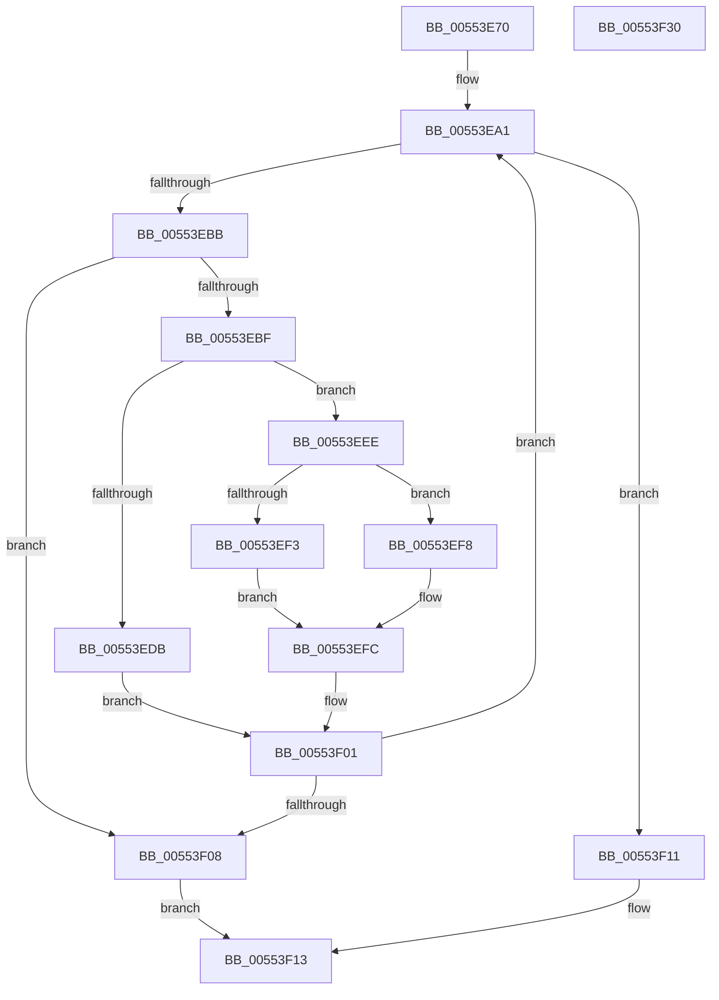

# HalpDmaAllocateScatterPagesFromContiguousPoolAtHighLevelV2

- RVA: `0x00553E70`–`0x00553F31` (길이 `193` bytes)
- VA: `0x0000000140553E70`
- 실행 섹션: `.text`
- PDB 이름 있음: `예`; PDB Function 태그: `아니요`
- unwind 정보 RVA: `0x00075C18`
- 디코드: `65`개 명령, `193/193` bytes 표시
- 미해석 바이트: `0` (있으면 어셈블리에 `.byte`로 보존)

> 이 문서는 커널 이미지의 기계어와 PDB 기호를 분석해 생성했습니다. 4번과 5번은 함수 원형과 자료형을 바이너리 사용 방식에서 추정한 C 해석이며 원본 소스 복구 결과는 아닙니다.

## 1. Dependencies

- 직접 호출 지점: **3**; 고유 호출 대상: **3**
- 직접 호출자로 확인된 함수: **1**
- RIP 상대 이미지 참조: **0**

### Outgoing calls
- `0x00553EAD` → [RtlFindClearBitsAndSet](../3E/RtlFindClearBitsAndSet_function_003E0CD0.md) (function, `0x003E0CD0`)
- `0x00553ECC` → [HalpDmaIndexToTranslationEntry](../49/HalpDmaIndexToTranslationEntry_function_00495F54.md) (function, `0x00495F54`)
- `0x00553EE7` → [RtlClearBits](../3E/RtlClearBits_function_003E1A90.md) (function, `0x003E1A90`)

### Direct callers
- [HalpDmaAllocateMapRegistersAtHighLevel](HalpDmaAllocateMapRegistersAtHighLevel_function_005507A8.md) at `0x005508BD`

### Static image references
- 디코드된 RIP-relative 메모리 참조가 없습니다.

## 2. Other-region calls and transfers

- 다른 실행 섹션으로 향하는 call: **0**
- 별도 외부 분기/꼬리 이동을 확인하지 못했습니다.

## 3. Assembly (complete function range)

```asm
00553E70  48 89 5C 24 08                  mov qword ptr [rsp + 8], rbx
00553E75  48 89 6C 24 10                  mov qword ptr [rsp + 0x10], rbp
00553E7A  48 89 74 24 18                  mov qword ptr [rsp + 0x18], rsi
00553E7F  57                              push rdi
00553E80  41 54                           push r12
00553E82  41 55                           push r13
00553E84  41 56                           push r14
00553E86  41 57                           push r15
00553E88  48 83 EC 20                     sub rsp, 0x20
00553E8C  83 CD FF                        or ebp, 0xffffffff
00553E8F  33 DB                           xor ebx, ebx
00553E91  33 FF                           xor edi, edi
00553E93  33 F6                           xor esi, esi
00553E95  45 33 F6                        xor r14d, r14d
00553E98  4D 8B E1                        mov r12, r9
00553E9B  45 8B E8                        mov r13d, r8d
00553E9E  4C 8B FA                        mov r15, rdx
00553EA1  49 8B 4F 18                     mov rcx, qword ptr [r15 + 0x18]
00553EA5  44 8B C3                        mov r8d, ebx
00553EA8  BA 01 00 00 00                  mov edx, 1
00553EAD  E8 1E CE E8 FF                  call 0x1403e0cd0
00553EB2  8B D8                           mov ebx, eax
00553EB4  83 C8 FF                        or eax, 0xffffffff
00553EB7  3B D8                           cmp ebx, eax
00553EB9  74 56                           je 0x140553f11
00553EBB  3B DD                           cmp ebx, ebp
00553EBD  74 49                           je 0x140553f08
00553EBF  3B E8                           cmp ebp, eax
00553EC1  8B D3                           mov edx, ebx
00553EC3  49 8B CF                        mov rcx, r15
00553EC6  0F 44 EB                        cmove ebp, ebx
00553EC9  45 33 C0                        xor r8d, r8d
00553ECC  E8 83 20 F4 FF                  call 0x140495f54
00553ED1  48 F7 40 30 00 F0 FF FF         test qword ptr [rax + 0x30], -0x1000
00553ED9  75 13                           jne 0x140553eee
00553EDB  49 8B 4F 18                     mov rcx, qword ptr [r15 + 0x18]
00553EDF  41 B8 01 00 00 00               mov r8d, 1
00553EE5  8B D3                           mov edx, ebx
00553EE7  E8 A4 DB E8 FF                  call 0x1403e1a90
00553EEC  EB 13                           jmp 0x140553f01
00553EEE  48 85 F6                        test rsi, rsi
00553EF1  75 05                           jne 0x140553ef8
00553EF3  48 8B F0                        mov rsi, rax
00553EF6  EB 04                           jmp 0x140553efc
00553EF8  49 89 46 08                     mov qword ptr [r14 + 8], rax
00553EFC  FF C7                           inc edi
00553EFE  4C 8B F0                        mov r14, rax
00553F01  FF C3                           inc ebx
00553F03  41 3B FD                        cmp edi, r13d
00553F06  72 99                           jb 0x140553ea1
00553F08  41 89 3C 24                     mov dword ptr [r12], edi
00553F0C  48 8B C6                        mov rax, rsi
00553F0F  EB 02                           jmp 0x140553f13
00553F11  33 C0                           xor eax, eax
00553F13  48 8B 5C 24 50                  mov rbx, qword ptr [rsp + 0x50]
00553F18  48 8B 6C 24 58                  mov rbp, qword ptr [rsp + 0x58]
00553F1D  48 8B 74 24 60                  mov rsi, qword ptr [rsp + 0x60]
00553F22  48 83 C4 20                     add rsp, 0x20
00553F26  41 5F                           pop r15
00553F28  41 5E                           pop r14
00553F2A  41 5D                           pop r13
00553F2C  41 5C                           pop r12
00553F2E  5F                              pop rdi
00553F2F  C3                              ret
00553F30  CC                              int3
```

## 4. C-style interpretation (structured pseudocode)

```c
__int64 __fastcall HalpDmaAllocateScatterPagesFromContiguousPoolAtHighLevelV2(__int64 a1, __int64 a2, int a3, __int64 a4)
{
    __int64 result;
    __int64 v_r14;
    __int64 v_rbp;
    __int64 v_rbx;
    __int64 v_rdi;
    __int64 v_rsi;
    __int64 v_rsp;
    unsigned __int64 v_stack_p10;
    unsigned __int64 v_stack_p18;
    unsigned __int64 v_stack_p8;

    v_stack_p8 = v_rbx;
    v_stack_p10 = v_rbp;
    v_stack_p18 = v_rsi;
    v_rsp = (v_rsp) - (32);
    v_rbp = (unsigned int)((v_rbp) | (0xFFFFFFFFULL));
    v_rbx = 0;
    v_rdi = 0;
    v_rsi = 0;
    v_r14 = 0;
loc_00553EA1:
    result = RtlFindClearBitsAndSet(*(unsigned __int64 *)(a2 + 24), 1, 0, a4);
    result = (unsigned int)((result) | (0xFFFFFFFFULL));
    if (((unsigned int)((unsigned int)((unsigned int)(result)))) == ((unsigned int)(result))) goto loc_00553F11;
    if (((unsigned int)((unsigned int)((unsigned int)(result)))) == ((unsigned int)(v_rbp))) goto loc_00553F08;
    if (((unsigned int)(v_rbp)) == ((unsigned int)(result))) { v_rbp = (unsigned int)((unsigned int)((unsigned int)(result))); }
    a3 = 0;
    result = HalpDmaIndexToTranslationEntry(a2, (unsigned int)((unsigned int)((unsigned int)((unsigned int)(result)))), a3, a4);
    if (((*(unsigned __int64 *)(result + 48)) & (0xFFFFFFFFFFFFF000ULL)) != 0) goto loc_00553EEE;
    result = RtlClearBits(*(unsigned __int64 *)(a2 + 24), (unsigned int)((unsigned int)((unsigned int)((unsigned int)(result)))), 1, a4);
    goto loc_00553F01;
loc_00553EEE:
    if (0 != 0) goto loc_00553EF8;
    goto loc_00553EFC;
loc_00553EF8:
    *(unsigned __int64 *)(v_r14 + 8) = result;
loc_00553EFC:
    v_rdi = (unsigned int)((v_rdi) + 1);
loc_00553F01:
    v_rbx = (unsigned int)(((unsigned int)((unsigned int)(result))) + 1);
    if (((unsigned int)(v_rdi)) < ((unsigned int)((unsigned int)(a3)))) goto loc_00553EA1;
loc_00553F08:
    *(unsigned int *)(a4) = (unsigned int)(v_rdi);
    goto loc_00553F13;
loc_00553F11:
    result = 0;
loc_00553F13:
    v_rsp = (v_rsp) + (32);
    return result;
}
```

## 5. (Beta) C Style

```c
int64_t HalpDmaAllocateScatterPagesFromContiguousPoolAtHighLevelV2(int64_t Arg1, void *Arg2, int32_t Arg3, void *Arg4)
{
    uint8_t *arg2 = (uint8_t *)Arg2;
    uint8_t *arg4 = (uint8_t *)Arg4;

    int64_t result;
    int64_t local_r14;
    int64_t local_rbp;
    int64_t local_rbx;
    int64_t local_rdi;
    int64_t local_rsi;
    int64_t local_rsp;
    uint64_t v_stack_p10;
    uint64_t v_stack_p18;
    uint64_t v_stack_p8;

    v_stack_p8 = local_rbx;
    v_stack_p10 = local_rbp;
    v_stack_p18 = local_rsi;
    local_rsp = (local_rsp) - (32);
    local_rbp = (uint32_t)((local_rbp) | (0xFFFFFFFFULL));
    local_rbx = 0;
    local_rdi = 0;
    local_rsi = 0;
    local_r14 = 0;
loc_00553EA1:
    result = RtlFindClearBitsAndSet(*(uint64_t *)(arg2 + 0x18), 1, 0, Arg4);
    result = (uint32_t)((result) | (0xFFFFFFFFULL));
    if (((uint32_t)((uint32_t)((uint32_t)(result)))) == ((uint32_t)(result))) goto loc_00553F11;
    if (((uint32_t)((uint32_t)((uint32_t)(result)))) == ((uint32_t)(local_rbp))) goto loc_00553F08;
    if (((uint32_t)(local_rbp)) == ((uint32_t)(result))) { local_rbp = (uint32_t)((uint32_t)((uint32_t)(result))); }
    Arg3 = 0;
    result = HalpDmaIndexToTranslationEntry(Arg2, (uint32_t)((uint32_t)((uint32_t)((uint32_t)(result)))), Arg3, Arg4);
    if (((*(uint64_t *)(result + 0x30)) & (0xFFFFFFFFFFFFF000ULL)) != 0) goto loc_00553EEE;
    result = RtlClearBits(*(uint64_t *)(arg2 + 0x18), (uint32_t)((uint32_t)((uint32_t)((uint32_t)(result)))), 1, Arg4);
    goto loc_00553F01;
loc_00553EEE:
    if (0 != 0) goto loc_00553EF8;
    goto loc_00553EFC;
loc_00553EF8:
    *(uint64_t *)(local_r14 + 0x8) = result;
loc_00553EFC:
    local_rdi = (uint32_t)((local_rdi) + 1);
loc_00553F01:
    local_rbx = (uint32_t)(((uint32_t)((uint32_t)(result))) + 1);
    if (((uint32_t)(local_rdi)) < ((uint32_t)((uint32_t)(Arg3)))) goto loc_00553EA1;
loc_00553F08:
    *(uint32_t *)(arg4) = (uint32_t)(local_rdi);
    goto loc_00553F13;
loc_00553F11:
    result = 0;
loc_00553F13:
    local_rsp = (local_rsp) + (32);
    return result;
}
```

### 관측된 메모리 오프셋

구조체 형식이 확인되지 않은 접근은 인자 기준의 오프셋으로만 기록했습니다.

| 기준 인자 | 오프셋 표현 | 폭 (bit) | 접근 |
|---|---:|---:|---|
| `Arg2` | `+ 0x18` | `64` | `R` |
| `Arg4` | `+ 0x0` | `32` | `W` |

## 6. Execution-region graph

[열기: 2D/3D 그래프와 함수 탐색 컨트롤 패널](../../../control-panel.html?section=text&rva=0x00553E70&view=graph)

- 2D 그래프는 위에서 아래로 흐르고, 3D 그래프는 빈 공간을 드래그해 회전합니다. Shift+드래그는 이동, 휠은 확대·축소, 함수 노드 선택은 대상 보고서 이동입니다.

### Static fallback


