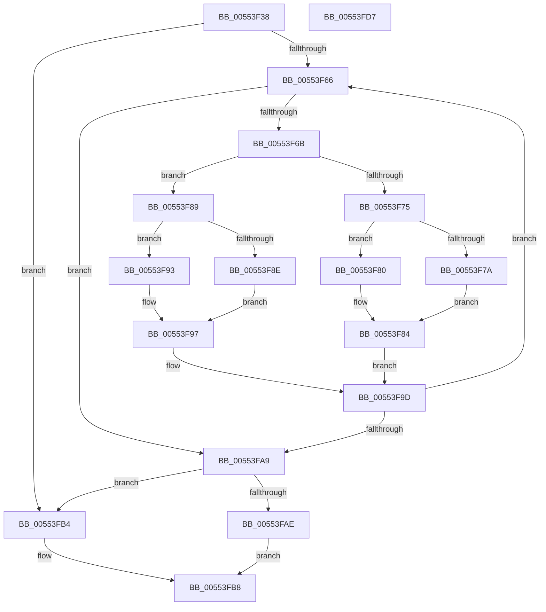

# HalpDmaAllocateScatterPagesFromScatterPoolAtHighLevelV2

- RVA: `0x00553F38`–`0x00553FD8` (길이 `160` bytes)
- VA: `0x0000000140553F38`
- 실행 섹션: `.text`
- PDB 이름 있음: `예`; PDB Function 태그: `아니요`
- unwind 정보 RVA: `0x000A5A38`
- 디코드: `51`개 명령, `160/160` bytes 표시
- 미해석 바이트: `0` (있으면 어셈블리에 `.byte`로 보존)

> 이 문서는 커널 이미지의 기계어와 PDB 기호를 분석해 생성했습니다. 4번과 5번은 함수 원형과 자료형을 바이너리 사용 방식에서 추정한 C 해석이며 원본 소스 복구 결과는 아닙니다.

## 1. Dependencies

- 직접 호출 지점: **0**; 고유 호출 대상: **0**
- 직접 호출자로 확인된 함수: **1**
- RIP 상대 이미지 참조: **0**

### Outgoing calls
- 직접 디코드된 call 명령이 없습니다.

### Direct callers
- [HalpDmaAllocateScatterPagesFromScatterPoolAtHighLevel](../53/HalpDmaAllocateScatterPagesFromScatterPoolAtHighLevel_function_0053F48C.md) at `0x0053F4A7`

### Static image references
- 디코드된 RIP-relative 메모리 참조가 없습니다.

## 2. Other-region calls and transfers

- 다른 실행 섹션으로 향하는 call: **0**
- 별도 외부 분기/꼬리 이동을 확인하지 못했습니다.

## 3. Assembly (complete function range)

```asm
00553F38  48 8B C4                        mov rax, rsp
00553F3B  48 89 58 08                     mov qword ptr [rax + 8], rbx
00553F3F  48 89 68 10                     mov qword ptr [rax + 0x10], rbp
00553F43  48 89 70 18                     mov qword ptr [rax + 0x18], rsi
00553F47  48 89 78 20                     mov qword ptr [rax + 0x20], rdi
00553F4B  8B 72 28                        mov esi, dword ptr [rdx + 0x28]
00553F4E  41 8B E8                        mov ebp, r8d
00553F51  48 8B 4A 20                     mov rcx, qword ptr [rdx + 0x20]
00553F55  45 33 C0                        xor r8d, r8d
00553F58  33 DB                           xor ebx, ebx
00553F5A  45 33 D2                        xor r10d, r10d
00553F5D  33 FF                           xor edi, edi
00553F5F  45 33 DB                        xor r11d, r11d
00553F62  85 F6                           test esi, esi
00553F64  74 4E                           je 0x140553fb4
00553F66  44 3B DD                        cmp r11d, ebp
00553F69  73 3E                           jae 0x140553fa9
00553F6B  48 F7 41 30 00 F0 FF FF         test qword ptr [rcx + 0x30], -0x1000
00553F73  75 14                           jne 0x140553f89
00553F75  4D 85 D2                        test r10, r10
00553F78  75 06                           jne 0x140553f80
00553F7A  48 89 4A 20                     mov qword ptr [rdx + 0x20], rcx
00553F7E  EB 04                           jmp 0x140553f84
00553F80  49 89 4A 08                     mov qword ptr [r10 + 8], rcx
00553F84  4C 8B D1                        mov r10, rcx
00553F87  EB 14                           jmp 0x140553f9d
00553F89  48 85 DB                        test rbx, rbx
00553F8C  75 05                           jne 0x140553f93
00553F8E  48 8B D9                        mov rbx, rcx
00553F91  EB 04                           jmp 0x140553f97
00553F93  48 89 4F 08                     mov qword ptr [rdi + 8], rcx
00553F97  41 FF C3                        inc r11d
00553F9A  48 8B F9                        mov rdi, rcx
00553F9D  48 8B 49 08                     mov rcx, qword ptr [rcx + 8]
00553FA1  41 FF C0                        inc r8d
00553FA4  44 3B C6                        cmp r8d, esi
00553FA7  72 BD                           jb 0x140553f66
00553FA9  4D 85 D2                        test r10, r10
00553FAC  74 06                           je 0x140553fb4
00553FAE  49 89 4A 08                     mov qword ptr [r10 + 8], rcx
00553FB2  EB 04                           jmp 0x140553fb8
00553FB4  48 89 4A 20                     mov qword ptr [rdx + 0x20], rcx
00553FB8  44 29 5A 28                     sub dword ptr [rdx + 0x28], r11d
00553FBC  48 8B C3                        mov rax, rbx
00553FBF  48 8B 5C 24 08                  mov rbx, qword ptr [rsp + 8]
00553FC4  48 8B 6C 24 10                  mov rbp, qword ptr [rsp + 0x10]
00553FC9  48 8B 74 24 18                  mov rsi, qword ptr [rsp + 0x18]
00553FCE  48 8B 7C 24 20                  mov rdi, qword ptr [rsp + 0x20]
00553FD3  45 89 19                        mov dword ptr [r9], r11d
00553FD6  C3                              ret
00553FD7  CC                              int3
```

## 4. C-style interpretation (structured pseudocode)

```c
__int64 __fastcall HalpDmaAllocateScatterPagesFromScatterPoolAtHighLevelV2(__int64 a1, __int64 a2, int a3, __int64 a4)
{
    __int64 v_r10;
    __int64 v_r11;
    __int64 v_rbx;
    __int64 v_rdi;
    unsigned __int64 v_stack_p10;
    unsigned __int64 v_stack_p18;
    unsigned __int64 v_stack_p20;
    unsigned __int64 v_stack_p8;

    *(unsigned __int64 *)(v_rsp + 8) = v_rbx;
    *(unsigned __int64 *)(v_rsp + 16) = v_rbp;
    *(unsigned __int64 *)(v_rsp + 24) = v_rsi;
    *(unsigned __int64 *)(v_rsp + 32) = v_rdi;
    a3 = 0;
    v_rbx = 0;
    v_r10 = 0;
    v_rdi = 0;
    v_r11 = 0;
    if ((unsigned int)((unsigned int)(*(unsigned int *)(a2 + 40))) == 0) goto loc_00553FB4;
loc_00553F66:
    if (0 >= ((unsigned int)((unsigned int)(a3)))) goto loc_00553FA9;
    if (((*(unsigned __int64 *)(*(unsigned __int64 *)(a2 + 32) + 48)) & (0xFFFFFFFFFFFFF000ULL)) != 0) goto loc_00553F89;
    if (0 != 0) goto loc_00553F80;
    *(unsigned __int64 *)(a2 + 32) = *(unsigned __int64 *)(a2 + 32);
    goto loc_00553F84;
loc_00553F80:
    *(unsigned __int64 *)(v_r10 + 8) = *(unsigned __int64 *)(a2 + 32);
loc_00553F84:
    goto loc_00553F9D;
loc_00553F89:
    if (0 != 0) goto loc_00553F93;
    goto loc_00553F97;
loc_00553F93:
    *(unsigned __int64 *)(v_rdi + 8) = *(unsigned __int64 *)(a2 + 32);
loc_00553F97:
    v_r11 = (unsigned int)((v_r11) + 1);
loc_00553F9D:
    a3 = (unsigned int)((a3) + 1);
    if (a3 < ((unsigned int)((unsigned int)(*(unsigned int *)(a2 + 40))))) goto loc_00553F66;
loc_00553FA9:
    if (*(unsigned __int64 *)(a2 + 32) == 0) goto loc_00553FB4;
    *(unsigned __int64 *)(*(unsigned __int64 *)(a2 + 32) + 8) = *(unsigned __int64 *)(*(unsigned __int64 *)(a2 + 32) + 8);
    goto loc_00553FB8;
loc_00553FB4:
    *(unsigned __int64 *)(a2 + 32) = *(unsigned __int64 *)(*(unsigned __int64 *)(a2 + 32) + 8);
loc_00553FB8:
    *(unsigned int *)(a4) = (unsigned int)(v_r11);
    return *(unsigned __int64 *)(a2 + 32);
}
```

## 5. (Beta) C Style

```c
int64_t HalpDmaAllocateScatterPagesFromScatterPoolAtHighLevelV2(int64_t Arg1, void *Arg2, int32_t Arg3, void *Arg4)
{
    uint8_t *arg2 = (uint8_t *)Arg2;
    uint8_t *arg4 = (uint8_t *)Arg4;

    int64_t local_r10;
    int64_t local_r11;
    int64_t local_rbx;
    int64_t local_rdi;
    uint64_t v_stack_p10;
    uint64_t v_stack_p18;
    uint64_t v_stack_p20;
    uint64_t v_stack_p8;

    *(uint64_t *)(local_rsp + 0x8) = local_rbx;
    *(uint64_t *)(local_rsp + 0x10) = local_rbp;
    *(uint64_t *)(local_rsp + 0x18) = local_rsi;
    *(uint64_t *)(local_rsp + 0x20) = local_rdi;
    Arg3 = 0;
    local_rbx = 0;
    local_r10 = 0;
    local_rdi = 0;
    local_r11 = 0;
    if ((uint32_t)((uint32_t)(*(uint32_t *)(arg2 + 0x28))) == 0) goto loc_00553FB4;
loc_00553F66:
    if (0 >= ((uint32_t)((uint32_t)(Arg3)))) goto loc_00553FA9;
    if (((*(uint64_t *)(*(uint64_t *)(arg2 + 0x20) + 0x30)) & (0xFFFFFFFFFFFFF000ULL)) != 0) goto loc_00553F89;
    if (0 != 0) goto loc_00553F80;
    *(uint64_t *)(arg2 + 0x20) = *(uint64_t *)(arg2 + 0x20);
    goto loc_00553F84;
loc_00553F80:
    *(uint64_t *)(local_r10 + 0x8) = *(uint64_t *)(arg2 + 0x20);
loc_00553F84:
    goto loc_00553F9D;
loc_00553F89:
    if (0 != 0) goto loc_00553F93;
    goto loc_00553F97;
loc_00553F93:
    *(uint64_t *)(local_rdi + 0x8) = *(uint64_t *)(arg2 + 0x20);
loc_00553F97:
    local_r11 = (uint32_t)((local_r11) + 1);
loc_00553F9D:
    Arg3 = (uint32_t)((Arg3) + 1);
    if (Arg3 < ((uint32_t)((uint32_t)(*(uint32_t *)(arg2 + 0x28))))) goto loc_00553F66;
loc_00553FA9:
    if (*(uint64_t *)(arg2 + 0x20) == 0) goto loc_00553FB4;
    *(uint64_t *)(*(uint64_t *)(arg2 + 0x20) + 0x8) = *(uint64_t *)(*(uint64_t *)(arg2 + 0x20) + 0x8);
    goto loc_00553FB8;
loc_00553FB4:
    *(uint64_t *)(arg2 + 0x20) = *(uint64_t *)(*(uint64_t *)(arg2 + 0x20) + 0x8);
loc_00553FB8:
    *(uint32_t *)(arg4) = (uint32_t)(local_r11);
    return *(uint64_t *)(arg2 + 0x20);
}
```

### 관측된 메모리 오프셋

구조체 형식이 확인되지 않은 접근은 인자 기준의 오프셋으로만 기록했습니다.

| 기준 인자 | 오프셋 표현 | 폭 (bit) | 접근 |
|---|---:|---:|---|
| `Arg2` | `+ 0x20` | `64` | `R` |
| `Arg2` | `+ 0x20` | `64` | `W` |
| `Arg2` | `+ 0x28` | `32` | `R` |
| `Arg2` | `+ 0x28` | `32` | `R/W` |
| `Arg4` | `+ 0x0` | `32` | `W` |

## 6. Execution-region graph

[열기: 2D/3D 그래프와 함수 탐색 컨트롤 패널](../../../control-panel.html?section=text&rva=0x00553F38&view=graph)

- 2D 그래프는 위에서 아래로 흐르고, 3D 그래프는 빈 공간을 드래그해 회전합니다. Shift+드래그는 이동, 휠은 확대·축소, 함수 노드 선택은 대상 보고서 이동입니다.

### Static fallback


