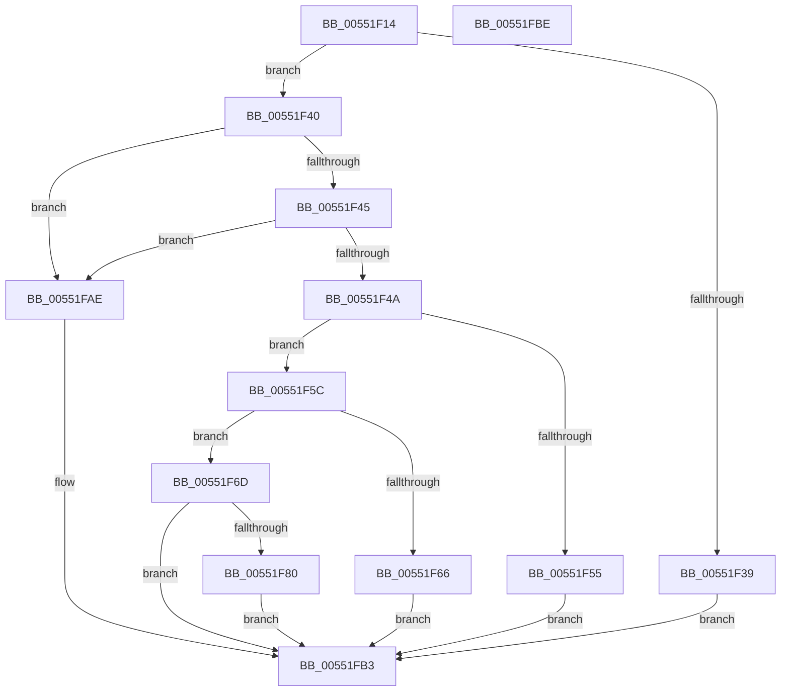

# HalpDmaAlwaysReserveLogicalAddressRangeInternal

- RVA: `0x00551F14`–`0x00551FBF` (길이 `171` bytes)
- VA: `0x0000000140551F14`
- 실행 섹션: `.text`
- PDB 이름 있음: `예`; PDB Function 태그: `아니요`
- unwind 정보 RVA: `0x00084918`
- 디코드: `47`개 명령, `171/171` bytes 표시
- 미해석 바이트: `0` (있으면 어셈블리에 `.byte`로 보존)

> 이 문서는 커널 이미지의 기계어와 PDB 기호를 분석해 생성했습니다. 4번과 5번은 함수 원형과 자료형을 바이너리 사용 방식에서 추정한 C 해석이며 원본 소스 복구 결과는 아닙니다.

## 1. Dependencies

- 직접 호출 지점: **1**; 고유 호출 대상: **1**
- 직접 호출자로 확인된 함수: **1**
- RIP 상대 이미지 참조: **4**

### Outgoing calls
- `0x00551F77` → [ExtEnvAllocateMemory](../56/ExtEnvAllocateMemory_function_005610B0.md) (function, `0x005610B0`)

### Direct callers
- [HalpDmaInitEarly](../../init/C2/HalpDmaInitEarly_function_00C20F3C.md) at `0x00C20F58`
- [HalpDmaInitEarly](../../init/C2/HalpDmaInitEarly_function_00C20F3C.md) at `0x00C20F6B`

### Static image references
- `0x00551F5C` → RVA `0x00FC1890` (`.data`; read)
- `0x00551F95` → RVA `0x00FC1780` (`.data`; read)
- `0x00551F9F` → RVA `0x00FC1788` (`.data`; read/write)
- `0x00551FA5` → RVA `0x00FC1780` (`.data`; write)

## 2. Other-region calls and transfers

- 다른 실행 섹션으로 향하는 call: **0**
- 별도 외부 분기/꼬리 이동을 확인하지 못했습니다.

## 3. Assembly (complete function range)

```asm
00551F14  48 89 5C 24 08                  mov qword ptr [rsp + 8], rbx
00551F19  4C 89 4C 24 20                  mov qword ptr [rsp + 0x20], r9
00551F1E  57                              push rdi
00551F1F  48 83 EC 20                     sub rsp, 0x20
00551F23  48 83 64 24 48 00               and qword ptr [rsp + 0x48], 0
00551F29  B8 FF 0F 00 00                  mov eax, 0xfff
00551F2E  48 8B DA                        mov rbx, rdx
00551F31  48 8B F9                        mov rdi, rcx
00551F34  48 85 C8                        test rax, rcx
00551F37  74 07                           je 0x140551f40
00551F39  B8 EF 00 00 C0                  mov eax, 0xc00000ef
00551F3E  EB 73                           jmp 0x140551fb3
00551F40  48 85 DB                        test rbx, rbx
00551F43  74 69                           je 0x140551fae
00551F45  48 85 D8                        test rax, rbx
00551F48  75 64                           jne 0x140551fae
00551F4A  48 8B C3                        mov rax, rbx
00551F4D  48 F7 D0                        not rax
00551F50  48 3B F8                        cmp rdi, rax
00551F53  76 07                           jbe 0x140551f5c
00551F55  B8 0D 00 00 C0                  mov eax, 0xc000000d
00551F5A  EB 57                           jmp 0x140551fb3
00551F5C  48 83 3D 2C F9 A6 00 00         cmp qword ptr [rip + 0xa6f92c], 0
00551F64  74 07                           je 0x140551f6d
00551F66  B8 89 01 00 C0                  mov eax, 0xc0000189
00551F6B  EB 46                           jmp 0x140551fb3
00551F6D  4C 8D 44 24 48                  lea r8, [rsp + 0x48]
00551F72  BA 20 00 00 00                  mov edx, 0x20
00551F77  E8 34 F1 00 00                  call 0x1405610b0
00551F7C  85 C0                           test eax, eax
00551F7E  78 33                           js 0x140551fb3
00551F80  48 8B 54 24 48                  mov rdx, qword ptr [rsp + 0x48]
00551F85  48 C1 EB 0C                     shr rbx, 0xc
00551F89  48 89 7A 08                     mov qword ptr [rdx + 8], rdi
00551F8D  48 89 5A 10                     mov qword ptr [rdx + 0x10], rbx
00551F91  C6 42 18 00                     mov byte ptr [rdx + 0x18], 0
00551F95  48 8B 0D E4 F7 A6 00            mov rcx, qword ptr [rip + 0xa6f7e4]
00551F9C  48 89 0A                        mov qword ptr [rdx], rcx
00551F9F  FF 05 E3 F7 A6 00               inc dword ptr [rip + 0xa6f7e3]
00551FA5  48 89 15 D4 F7 A6 00            mov qword ptr [rip + 0xa6f7d4], rdx
00551FAC  EB 05                           jmp 0x140551fb3
00551FAE  B8 F0 00 00 C0                  mov eax, 0xc00000f0
00551FB3  48 8B 5C 24 30                  mov rbx, qword ptr [rsp + 0x30]
00551FB8  48 83 C4 20                     add rsp, 0x20
00551FBC  5F                              pop rdi
00551FBD  C3                              ret
00551FBE  CC                              int3
```

## 4. C-style interpretation (structured pseudocode)

```c
__int64 __fastcall HalpDmaAlwaysReserveLogicalAddressRangeInternal(__int64 a1, __int64 a2, __int64 a3, __int64 a4)
{
    __int64 result;
    __int64 v_rbx;
    __int64 v_rsp;
    unsigned __int64 v_stack_p20;
    unsigned __int64 v_stack_p8;

    v_stack_p8 = v_rbx;
    v_stack_p20 = a4;
    v_rsp = (v_rsp) - (32);
    if ((((unsigned int)(0xFFFULL)) & (a1)) == 0) goto loc_00551F40;
    goto loc_00551FB3;
loc_00551F40:
    if (a2 == 0) goto loc_00551FAE;
    if ((((unsigned int)(0xC00000EFULL)) & (a2)) != 0) goto loc_00551FAE;
    result = ~(a2);
    if (a1 <= result) goto loc_00551F5C;
    goto loc_00551FB3;
loc_00551F5C:
    if ((*(unsigned __int64 *)(v_rip + 10942764)) == 0) goto loc_00551F6D;
    goto loc_00551FB3;
loc_00551F6D:
    result = ExtEnvAllocateMemory(a1, 32, v_stack_p20, a4);
    if (sign_flag) goto loc_00551FB3;
    v_rbx = (a2) >> (12);
    *(unsigned __int64 *)(v_stack_p20 + 8) = a1;
    *(unsigned __int64 *)(v_stack_p20 + 16) = v_rbx;
    *(unsigned __int8 *)(v_stack_p20 + 24) = 0;
    *(unsigned __int64 *)(v_stack_p20) = *(unsigned __int64 *)(v_rip + 10942436);
    *(unsigned __int64 *)(v_rip + 10942420) = v_stack_p20;
    goto loc_00551FB3;
loc_00551FAE:
loc_00551FB3:
    v_rsp = (v_rsp) + (32);
    return (unsigned int)(0xC00000F0ULL);
}
```

## 5. (Beta) C Style

```c
int64_t HalpDmaAlwaysReserveLogicalAddressRangeInternal(int64_t Arg1, int64_t Arg2, int64_t Arg3, int64_t Arg4)
{
    int64_t result;
    int64_t local_rbx;
    int64_t local_rsp;
    uint64_t v_stack_p20;
    uint64_t v_stack_p8;

    v_stack_p8 = local_rbx;
    v_stack_p20 = Arg4;
    local_rsp = (local_rsp) - (32);
    if ((((uint32_t)(0xFFFULL)) & (Arg1)) == 0) goto loc_00551F40;
    goto loc_00551FB3;
loc_00551F40:
    if (Arg2 == 0) goto loc_00551FAE;
    if ((((uint32_t)(0xC00000EFULL)) & (Arg2)) != 0) goto loc_00551FAE;
    result = ~(Arg2);
    if (Arg1 <= result) goto loc_00551F5C;
    goto loc_00551FB3;
loc_00551F5C:
    if ((*(uint64_t *)(v_rip + 0xA6F92C)) == 0) goto loc_00551F6D;
    goto loc_00551FB3;
loc_00551F6D:
    result = ExtEnvAllocateMemory(Arg1, 32, v_stack_p20, Arg4);
    if (sign_flag) goto loc_00551FB3;
    local_rbx = (Arg2) >> (12);
    *(uint64_t *)(v_stack_p20 + 0x8) = Arg1;
    *(uint64_t *)(v_stack_p20 + 0x10) = local_rbx;
    *(uint8_t *)(v_stack_p20 + 0x18) = 0;
    *(uint64_t *)(v_stack_p20) = *(uint64_t *)(v_rip + 0xA6F7E4);
    *(uint64_t *)(v_rip + 0xA6F7D4) = v_stack_p20;
    goto loc_00551FB3;
loc_00551FAE:
loc_00551FB3:
    local_rsp = (local_rsp) + (32);
    return (uint32_t)(0xC00000F0ULL);
}
```

## 6. Execution-region graph

[열기: 2D/3D 그래프와 함수 탐색 컨트롤 패널](../../../control-panel.html?section=text&rva=0x00551F14&view=graph)

- 2D 그래프는 위에서 아래로 흐르고, 3D 그래프는 빈 공간을 드래그해 회전합니다. Shift+드래그는 이동, 휠은 확대·축소, 함수 노드 선택은 대상 보고서 이동입니다.

### Static fallback


