# HalpDmaCommitContiguousMapBuffers

- RVA: `0x00550A84`–`0x00550CE5` (길이 `609` bytes)
- VA: `0x0000000140550A84`
- 실행 섹션: `.text`
- PDB 이름 있음: `예`; PDB Function 태그: `아니요`
- unwind 정보 RVA: `0x000C4258`
- 디코드: `170`개 명령, `609/609` bytes 표시
- 미해석 바이트: `0` (있으면 어셈블리에 `.byte`로 보존)

> 이 문서는 커널 이미지의 기계어와 PDB 기호를 분석해 생성했습니다. 4번과 5번은 함수 원형과 자료형을 바이너리 사용 방식에서 추정한 C 해석이며 원본 소스 복구 결과는 아닙니다.

## 1. Dependencies

- 직접 호출 지점: **6**; 고유 호출 대상: **6**
- 직접 호출자로 확인된 함수: **4**
- RIP 상대 이미지 참조: **0**

### Outgoing calls
- `0x00550B16` → [HalpDmaGetTranslationEntries](../49/HalpDmaGetTranslationEntries_function_0049AB3C.md) (function, `0x0049AB3C`)
- `0x00550B37` → [HalpDmaTranslationEntryToIndex](../48/HalpDmaTranslationEntryToIndex_function_004865F0.md) (function, `0x004865F0`)
- `0x00550BC6` → [KeAcquireInStackQueuedSpinLock](../27/KeAcquireInStackQueuedSpinLock_function_002757A0.md) (function, `0x002757A0`)
- `0x00550C5F` → [RtlClearBits](../3E/RtlClearBits_function_003E1A90.md) (function, `0x003E1A90`)
- `0x00550CAF` → [memset](../6C/memset_function_006C6C40.md) (function, `0x006C6C40`)
- `0x00550CC4` → [KeReleaseInStackQueuedSpinLock](../34/KeReleaseInStackQueuedSpinLock_function_00342CE0.md) (function, `0x00342CE0`)

### Direct callers
- [sub_006EA22C](../6E/Unknown_function_006EA22C.md) at `0x006EA241`
- [HalpDmaAllocateLocalContiguousPool](../../page/70/HalpDmaAllocateLocalContiguousPool_function_00708EE4.md) at `0x00709023`
- [HalpDmaGrowContiguousMapBuffers](../../page/AD/HalpDmaGrowContiguousMapBuffers_function_00AD6D14.md) at `0x00AD6D8A`
- [HalpDmaInitializeMasterAdapter](../../init/C2/HalpDmaInitializeMasterAdapter_function_00C21278.md) at `0x00C21384`

### Static image references
- 디코드된 RIP-relative 메모리 참조가 없습니다.

## 2. Other-region calls and transfers

- 다른 실행 섹션으로 향하는 call: **0**
- 별도 외부 분기/꼬리 이동을 확인하지 못했습니다.

## 3. Assembly (complete function range)

```asm
00550A84  4C 8B DC                        mov r11, rsp
00550A87  49 89 5B 10                     mov qword ptr [r11 + 0x10], rbx
00550A8B  45 89 4B 20                     mov dword ptr [r11 + 0x20], r9d
00550A8F  55                              push rbp
00550A90  56                              push rsi
00550A91  57                              push rdi
00550A92  41 54                           push r12
00550A94  41 55                           push r13
00550A96  41 56                           push r14
00550A98  41 57                           push r15
00550A9A  48 83 EC 50                     sub rsp, 0x50
00550A9E  33 C0                           xor eax, eax
00550AA0  41 8B F1                        mov esi, r9d
00550AA3  33 FF                           xor edi, edi
00550AA5  0F 57 C0                        xorps xmm0, xmm0
00550AA8  0F 11 44 24 38                  movups xmmword ptr [rsp + 0x38], xmm0
00550AAD  49 89 43 C0                     mov qword ptr [r11 - 0x40], rax
00550AB1  4D 8B F8                        mov r15, r8
00550AB4  48 8B 41 30                     mov rax, qword ptr [rcx + 0x30]
00550AB8  4C 8B EA                        mov r13, rdx
00550ABB  49 89 7B A0                     mov qword ptr [r11 - 0x60], rdi
00550ABF  48 8B D9                        mov rbx, rcx
00550AC2  45 8B C1                        mov r8d, r9d
00550AC5  48 85 C0                        test rax, rax
00550AC8  74 19                           je 0x140550ae3
00550ACA  48 39 41 40                     cmp qword ptr [rcx + 0x40], rax
00550ACE  75 05                           jne 0x140550ad5
00550AD0  39 79 48                        cmp dword ptr [rcx + 0x48], edi
00550AD3  74 0E                           je 0x140550ae3
00550AD5  44 8D 46 01                     lea r8d, [rsi + 1]
00550AD9  C6 84 24 90 00 00 00 01         mov byte ptr [rsp + 0x90], 1
00550AE1  EB 08                           jmp 0x140550aeb
00550AE3  40 88 BC 24 90 00 00 00         mov byte ptr [rsp + 0x90], dil
00550AEB  40 38 B9 99 00 00 00            cmp byte ptr [rcx + 0x99], dil
00550AF2  75 1D                           jne 0x140550b11
00550AF4  48 8B CE                        mov rcx, rsi
00550AF7  49 8B C7                        mov rax, r15
00550AFA  48 C1 E1 0C                     shl rcx, 0xc
00550AFE  48 FF C9                        dec rcx
00550B01  48 C1 E8 10                     shr rax, 0x10
00550B05  49 03 CF                        add rcx, r15
00550B08  48 C1 E9 10                     shr rcx, 0x10
00550B0C  2B C8                           sub ecx, eax
00550B0E  44 03 C1                        add r8d, ecx
00550B11  33 D2                           xor edx, edx
00550B13  48 8B CB                        mov rcx, rbx
00550B16  E8 21 A0 F4 FF                  call 0x14049ab3c
00550B1B  48 89 44 24 30                  mov qword ptr [rsp + 0x30], rax
00550B20  48 8B E8                        mov rbp, rax
00550B23  48 85 C0                        test rax, rax
00550B26  0F 84 A0 01 00 00               je 0x140550ccc
00550B2C  4C 8D 44 24 28                  lea r8, [rsp + 0x28]
00550B31  48 8B D5                        mov rdx, rbp
00550B34  48 8B CB                        mov rcx, rbx
00550B37  E8 B4 5A F3 FF                  call 0x1404865f0
00550B3C  4C 8B 44 24 28                  mov r8, qword ptr [rsp + 0x28]
00550B41  48 8B CD                        mov rcx, rbp
00550B44  89 44 24 24                     mov dword ptr [rsp + 0x24], eax
00550B48  48 B8 39 8E E3 38 8E E3 38 0E   movabs rax, 0xe38e38e38e38e39
00550B52  49 2B 48 10                     sub rcx, qword ptr [r8 + 0x10]
00550B56  48 F7 E9                        imul rcx
00550B59  48 C1 FA 02                     sar rdx, 2
00550B5D  48 8B CA                        mov rcx, rdx
00550B60  48 C1 E9 3F                     shr rcx, 0x3f
00550B64  48 03 D1                        add rdx, rcx
00550B67  85 D2                           test edx, edx
00550B69  75 36                           jne 0x140550ba1
00550B6B  48 8B 53 30                     mov rdx, qword ptr [rbx + 0x30]
00550B6F  49 3B D0                        cmp rdx, r8
00550B72  75 05                           jne 0x140550b79
00550B74  4C 8B F7                        mov r14, rdi
00550B77  EB 2C                           jmp 0x140550ba5
00550B79  48 85 D2                        test rdx, rdx
00550B7C  74 10                           je 0x140550b8e
00550B7E  48 8B 02                        mov rax, qword ptr [rdx]
00550B81  49 3B C0                        cmp rax, r8
00550B84  74 08                           je 0x140550b8e
00550B86  48 8B D0                        mov rdx, rax
00550B89  48 85 C0                        test rax, rax
00550B8C  75 F0                           jne 0x140550b7e
00550B8E  8B 42 08                        mov eax, dword ptr [rdx + 8]
00550B91  FF C8                           dec eax
00550B93  48 8D 0C C0                     lea rcx, [rax + rax*8]
00550B97  48 8B 42 10                     mov rax, qword ptr [rdx + 0x10]
00550B9B  4C 8D 34 C8                     lea r14, [rax + rcx*8]
00550B9F  EB 04                           jmp 0x140550ba5
00550BA1  4C 8D 75 B8                     lea r14, [rbp - 0x48]
00550BA5  8A 83 99 00 00 00               mov al, byte ptr [rbx + 0x99]
00550BAB  48 8D 8B 80 00 00 00            lea rcx, [rbx + 0x80]
00550BB2  44 0F B6 A3 98 00 00 00         movzx r12d, byte ptr [rbx + 0x98]
00550BBA  48 8D 54 24 38                  lea rdx, [rsp + 0x38]
00550BBF  88 44 24 20                     mov byte ptr [rsp + 0x20], al
00550BC3  48 8B FD                        mov rdi, rbp
00550BC6  E8 D5 4B D2 FF                  call 0x1402757a0
00550BCB  85 F6                           test esi, esi
00550BCD  0F 84 C1 00 00 00               je 0x140550c94
00550BD3  8B 6C 24 24                     mov ebp, dword ptr [rsp + 0x24]
00550BD7  4A 8D 14 A5 00 00 00 00         lea rdx, [r12*4]
00550BDF  48 89 74 24 28                  mov qword ptr [rsp + 0x28], rsi
00550BE4  4D 85 F6                        test r14, r14
00550BE7  74 28                           je 0x140550c11
00550BE9  49 8B 0E                        mov rcx, qword ptr [r14]
00550BEC  48 8D 81 00 10 00 00            lea rax, [rcx + 0x1000]
00550BF3  49 3B C7                        cmp rax, r15
00550BF6  75 13                           jne 0x140550c0b
00550BF8  80 7C 24 20 00                  cmp byte ptr [rsp + 0x20], 0
00550BFD  75 12                           jne 0x140550c11
00550BFF  49 33 CF                        xor rcx, r15
00550C02  48 F7 C1 00 00 FF FF            test rcx, -0x10000
00550C09  74 06                           je 0x140550c11
00550C0B  48 8B 7F 08                     mov rdi, qword ptr [rdi + 8]
00550C0F  FF C5                           inc ebp
00550C11  4C 89 3F                        mov qword ptr [rdi], r15
00550C14  48 8D 4F 30                     lea rcx, [rdi + 0x30]
00550C18  4D 85 ED                        test r13, r13
00550C1B  74 14                           je 0x140550c31
00550C1D  8B 01                           mov eax, dword ptr [rcx]
00550C1F  25 FF 0F 00 00                  and eax, 0xfff
00550C24  49 0B C5                        or rax, r13
00550C27  48 89 01                        mov qword ptr [rcx], rax
00550C2A  49 81 C5 00 10 00 00            add r13, 0x1000
00550C31  49 8B C4                        mov rax, r12
00550C34  41 B8 01 00 00 00               mov r8d, 1
00550C3A  48 33 01                        xor rax, qword ptr [rcx]
00550C3D  48 83 E0 FE                     and rax, 0xfffffffffffffffe
00550C41  49 33 C4                        xor rax, r12
00550C44  48 83 E0 FD                     and rax, 0xfffffffffffffffd
00550C48  48 33 C2                        xor rax, rdx
00550C4B  48 83 E0 FB                     and rax, 0xfffffffffffffffb
00550C4F  48 33 C2                        xor rax, rdx
00550C52  8B D5                           mov edx, ebp
00550C54  48 83 E0 F7                     and rax, 0xfffffffffffffff7
00550C58  48 89 01                        mov qword ptr [rcx], rax
00550C5B  48 8B 4B 18                     mov rcx, qword ptr [rbx + 0x18]
00550C5F  E8 2C 0E E9 FF                  call 0x1403e1a90
00550C64  49 81 C7 00 10 00 00            add r15, 0x1000
00550C6B  4A 8D 14 A5 00 00 00 00         lea rdx, [r12*4]
00550C73  FF C5                           inc ebp
00550C75  4C 8B F7                        mov r14, rdi
00550C78  48 83 6C 24 28 01               sub qword ptr [rsp + 0x28], 1
00550C7E  48 8B 7F 08                     mov rdi, qword ptr [rdi + 8]
00550C82  0F 85 5C FF FF FF               jne 0x140550be4
00550C88  8B B4 24 A8 00 00 00            mov esi, dword ptr [rsp + 0xa8]
00550C8F  48 8B 6C 24 30                  mov rbp, qword ptr [rsp + 0x30]
00550C94  80 BC 24 90 00 00 00 00         cmp byte ptr [rsp + 0x90], 0
00550C9C  74 16                           je 0x140550cb4
00550C9E  48 85 FF                        test rdi, rdi
00550CA1  74 11                           je 0x140550cb4
00550CA3  FF 4B 48                        dec dword ptr [rbx + 0x48]
00550CA6  33 D2                           xor edx, edx
00550CA8  48 8B CF                        mov rcx, rdi
00550CAB  44 8D 42 48                     lea r8d, [rdx + 0x48]
00550CAF  E8 8C 5F 17 00                  call 0x1406c6c40
00550CB4  45 84 E4                        test r12b, r12b
00550CB7  74 06                           je 0x140550cbf
00550CB9  01 B3 D8 00 00 00               add dword ptr [rbx + 0xd8], esi
00550CBF  48 8D 4C 24 38                  lea rcx, [rsp + 0x38]
00550CC4  E8 17 20 DF FF                  call 0x140342ce0
00550CC9  48 8B C5                        mov rax, rbp
00550CCC  48 8B 9C 24 98 00 00 00         mov rbx, qword ptr [rsp + 0x98]
00550CD4  48 83 C4 50                     add rsp, 0x50
00550CD8  41 5F                           pop r15
00550CDA  41 5E                           pop r14
00550CDC  41 5D                           pop r13
00550CDE  41 5C                           pop r12
00550CE0  5F                              pop rdi
00550CE1  5E                              pop rsi
00550CE2  5D                              pop rbp
00550CE3  C3                              ret
00550CE4  CC                              int3
```

## 4. C-style interpretation (structured pseudocode)

```c
__int64 __fastcall HalpDmaCommitContiguousMapBuffers(__int64 a1, __int64 a2, __int64 a3, int a4)
{
    __int64 result;
    __int64 v_r13;
    __int64 v_r15;
    __int64 v_rbp;
    __int64 v_rdi;
    __int64 v_rsp;
    unsigned __int64 v_stack_m50;
    unsigned __int64 v_stack_m58;
    unsigned __int64 v_stack_m60;
    unsigned int v_stack_m64;
    unsigned __int8 v_stack_m68;
    unsigned __int64 v_stack_p10;
    unsigned int v_stack_p20;
    unsigned __int8 v_stack_p8;

    *(unsigned __int64 *)(v_rsp + 16) = v_rbx;
    *(unsigned int *)(v_rsp + 32) = a4;
    v_rsp = (v_rsp) - (80);
    result = 0;
    v_rdi = 0;
    v_stack_m50 = v_xmm0;
    *(unsigned __int64 *)(v_rsp - 64) = 0;
    *(unsigned __int64 *)(v_rsp - 96) = 0;
    if (*(unsigned __int64 *)(a1 + 48) == 0) goto loc_00550AE3;
    if ((*(unsigned __int64 *)(a1 + 64)) != (*(unsigned __int64 *)(a1 + 48))) goto loc_00550AD5;
    if ((*(unsigned int *)(a1 + 72)) == 0) goto loc_00550AE3;
loc_00550AD5:
    v_stack_p8 = 1;
    goto loc_00550AEB;
loc_00550AE3:
    v_stack_p8 = 0;
loc_00550AEB:
    result = *(unsigned __int64 *)(a1 + 48);
    if ((*(unsigned __int8 *)(a1 + 153)) == 0) {
        a1 = (unsigned int)(a4);
        result = a3;
        a1 = (a1) << (12);
        a1 = (a1) - 1;
        result = (result) >> (16);
        a1 = (a1) + (a3);
        a1 = (a1) >> (16);
        a1 = (unsigned int)((a1) - ((unsigned int)(result)));
        a3 = (unsigned int)(((unsigned int)(a4) + 1) + ((unsigned int)(a1)));
    }
    a2 = 0;
    result = HalpDmaGetTranslationEntries(a1, a2, a3, a4);
    v_stack_m58 = result;
    if (result == 0) goto loc_00550CCC;
    result = HalpDmaTranslationEntryToIndex(a1, result, v_stack_m60, a4);
    v_stack_m64 = (unsigned int)(result);
    a1 = (result) - (*(unsigned __int64 *)(v_stack_m60 + 16));
    a2 = (result) >> (2);
    a1 = (a2) >> (63);
    a2 = (a2) + (a1);
    if ((unsigned int)(a2) != 0) goto loc_00550BA1;
    if ((*(unsigned __int64 *)(a1 + 48)) != v_stack_m60) goto loc_00550B79;
    goto loc_00550BA5;
loc_00550B79:
    if (*(unsigned __int64 *)(a1 + 48) == 0) goto loc_00550B8E;
loc_00550B7E:
    if ((*(unsigned __int64 *)(*(unsigned __int64 *)(a1 + 48))) == v_stack_m60) goto loc_00550B8E;
    if (*(unsigned __int64 *)(*(unsigned __int64 *)(a1 + 48)) != 0) goto loc_00550B7E;
loc_00550B8E:
    result = (unsigned int)(((unsigned int)(*(unsigned int *)(*(unsigned __int64 *)(*(unsigned __int64 *)(a1 + 48)) + 8))) - 1);
    goto loc_00550BA5;
loc_00550BA1:
loc_00550BA5:
    v_stack_m68 = (unsigned __int8)(*(unsigned __int8 *)(a1 + 153));
    result = KeAcquireInStackQueuedSpinLock(a1 + 128, v_stack_m50, v_stack_m60, a4);
    if ((unsigned int)((unsigned int)(a4)) == 0) goto loc_00550C94;
    v_stack_m60 = (unsigned int)(a4);
loc_00550BE4:
    if (result - 72 == 0) goto loc_00550C11;
    if ((*(unsigned __int64 *)(result - 72) + 4096) != a3) goto loc_00550C0B;
    if (v_stack_m68 != 0) goto loc_00550C11;
    a1 = (*(unsigned __int64 *)(result - 72)) ^ (a3);
    v_rdi = result;
    v_rbp = (unsigned int)(v_stack_m64);
    if (((a1) & (0xFFFFFFFFFFFF0000ULL)) != 0) {
        v_rdi = *(unsigned __int64 *)(result + 8);
        v_rbp = (unsigned int)(((unsigned int)(v_stack_m64)) + 1);
    }
    *(unsigned __int64 *)(v_rdi) = a3;
    result = *(unsigned __int64 *)(result - 72) + 4096;
    v_r13 = a2;
    if (a2 != 0) {
        result = *(unsigned int *)(v_rdi + 48);
        result = (unsigned int)((result) & (0xFFFULL));
        result = (result) | (a2);
        *(unsigned __int64 *)(v_rdi + 48) = result;
        v_r13 = (a2) + (0x1000ULL);
    }
    result = (*(unsigned __int8 *)(a1 + 152)) ^ (*(unsigned __int64 *)(v_rdi + 48));
    result = (result) & (-2);
    result = (result) ^ (*(unsigned __int8 *)(a1 + 152));
    result = (result) & (-3);
    result = (result) ^ (*(unsigned __int8 *)(a1 + 152) * 4);
    result = (result) & (-5);
    result = (result) ^ (*(unsigned __int8 *)(a1 + 152) * 4);
    result = (result) & (-9);
    *(unsigned __int64 *)(v_rdi + 48) = result;
    result = RtlClearBits(*(unsigned __int64 *)(a1 + 24), (unsigned int)((unsigned int)(v_rbp)), 1, a4);
    v_r15 = (a3) + (0x1000ULL);
    v_rbp = (unsigned int)((v_rbp) + 1);
    if (condition_is_not_equal) goto loc_00550BE4;
loc_00550C94:
    if (v_stack_p8 == 0) goto loc_00550CB4;
    if (*(unsigned __int64 *)(v_rdi + 8) != 0) {
        a2 = 0;
        a1 = *(unsigned __int64 *)(v_rdi + 8);
        a3 = a2 + 72;
        result = memset(a1, a2, a3, a4);
    }
    if ((unsigned __int8)(*(unsigned __int8 *)(a1 + 152)) != 0) {
    }
    result = KeReleaseInStackQueuedSpinLock(v_stack_m50, a2, a3, a4);
loc_00550CCC:
    v_rsp = (v_rsp) + (80);
    return v_stack_m58;
}
```

## 5. (Beta) C Style

```c
int64_t HalpDmaCommitContiguousMapBuffers(void *Arg1, int64_t Arg2, int64_t Arg3, void *Arg4)
{
    uint8_t *arg1 = (uint8_t *)Arg1;
    uint8_t *arg4 = (uint8_t *)Arg4;

    int64_t result;
    int64_t local_r13;
    int64_t local_r15;
    int64_t local_rbp;
    int64_t local_rdi;
    int64_t local_rsp;
    uint64_t v_stack_m50;
    uint64_t v_stack_m58;
    uint64_t v_stack_m60;
    uint32_t v_stack_m64;
    uint8_t v_stack_m68;
    uint64_t v_stack_p10;
    uint32_t v_stack_p20;
    uint8_t v_stack_p8;

    *(uint64_t *)(local_rsp + 0x10) = local_rbx;
    *(uint32_t *)(local_rsp + 0x20) = Arg4;
    local_rsp = (local_rsp) - (80);
    result = 0;
    local_rdi = 0;
    v_stack_m50 = v_xmm0;
    *(uint64_t *)(local_rsp - 0x40) = 0;
    *(uint64_t *)(local_rsp - 0x60) = 0;
    if (*(uint64_t *)(arg1 + 0x30) == 0) goto loc_00550AE3;
    if ((*(uint64_t *)(arg1 + 0x40)) != (*(uint64_t *)(arg1 + 0x30))) goto loc_00550AD5;
    if ((*(uint32_t *)(arg1 + 0x48)) == 0) goto loc_00550AE3;
loc_00550AD5:
    v_stack_p8 = 1;
    goto loc_00550AEB;
loc_00550AE3:
    v_stack_p8 = 0;
loc_00550AEB:
    result = *(uint64_t *)(arg1 + 0x30);
    if ((*(uint8_t *)(arg1 + 0x99)) == 0) {
        Arg1 = (uint32_t)(Arg4);
        result = Arg3;
        Arg1 = (Arg1) << (12);
        Arg1 = (Arg1) - 1;
        result = (result) >> (16);
        Arg1 = (Arg1) + (Arg3);
        Arg1 = (Arg1) >> (16);
        Arg1 = (uint32_t)((Arg1) - ((uint32_t)(result)));
        Arg3 = (uint32_t)(((uint32_t)(Arg4) + 1) + ((uint32_t)(Arg1)));
    }
    Arg2 = 0;
    result = HalpDmaGetTranslationEntries(Arg1, Arg2, Arg3, Arg4);
    v_stack_m58 = result;
    if (result == 0) goto loc_00550CCC;
    result = HalpDmaTranslationEntryToIndex(Arg1, result, v_stack_m60, Arg4);
    v_stack_m64 = (uint32_t)(result);
    Arg1 = (result) - (*(uint64_t *)(v_stack_m60 + 0x10));
    Arg2 = (result) >> (2);
    Arg1 = (Arg2) >> (63);
    Arg2 = (Arg2) + (Arg1);
    if ((uint32_t)(Arg2) != 0) goto loc_00550BA1;
    if ((*(uint64_t *)(arg1 + 0x30)) != v_stack_m60) goto loc_00550B79;
    goto loc_00550BA5;
loc_00550B79:
    if (*(uint64_t *)(arg1 + 0x30) == 0) goto loc_00550B8E;
loc_00550B7E:
    if ((*(uint64_t *)(*(uint64_t *)(arg1 + 0x30))) == v_stack_m60) goto loc_00550B8E;
    if (*(uint64_t *)(*(uint64_t *)(arg1 + 0x30)) != 0) goto loc_00550B7E;
loc_00550B8E:
    result = (uint32_t)(((uint32_t)(*(uint32_t *)(*(uint64_t *)(*(uint64_t *)(arg1 + 0x30)) + 0x8))) - 1);
    goto loc_00550BA5;
loc_00550BA1:
loc_00550BA5:
    v_stack_m68 = (uint8_t)(*(uint8_t *)(arg1 + 0x99));
    result = KeAcquireInStackQueuedSpinLock(Arg1 + 128, v_stack_m50, v_stack_m60, Arg4);
    if ((uint32_t)((uint32_t)(Arg4)) == 0) goto loc_00550C94;
    v_stack_m60 = (uint32_t)(Arg4);
loc_00550BE4:
    if (result - 72 == 0) goto loc_00550C11;
    if ((*(uint64_t *)(result - 0x48) + 4096) != Arg3) goto loc_00550C0B;
    if (v_stack_m68 != 0) goto loc_00550C11;
    Arg1 = (*(uint64_t *)(result - 0x48)) ^ (Arg3);
    local_rdi = result;
    local_rbp = (uint32_t)(v_stack_m64);
    if (((Arg1) & (0xFFFFFFFFFFFF0000ULL)) != 0) {
        local_rdi = *(uint64_t *)(result + 0x8);
        local_rbp = (uint32_t)(((uint32_t)(v_stack_m64)) + 1);
    }
    *(uint64_t *)(local_rdi) = Arg3;
    result = *(uint64_t *)(result - 0x48) + 4096;
    local_r13 = Arg2;
    if (Arg2 != 0) {
        result = *(uint32_t *)(local_rdi + 0x30);
        result = (uint32_t)((result) & (0xFFFULL));
        result = (result) | (Arg2);
        *(uint64_t *)(local_rdi + 0x30) = result;
        local_r13 = (Arg2) + (0x1000ULL);
    }
    result = (*(uint8_t *)(arg1 + 0x98)) ^ (*(uint64_t *)(local_rdi + 0x30));
    result = (result) & (-2);
    result = (result) ^ (*(uint8_t *)(arg1 + 0x98));
    result = (result) & (-3);
    result = (result) ^ (*(uint8_t *)(arg1 + 0x98) * 4);
    result = (result) & (-5);
    result = (result) ^ (*(uint8_t *)(arg1 + 0x98) * 4);
    result = (result) & (-9);
    *(uint64_t *)(local_rdi + 0x30) = result;
    result = RtlClearBits(*(uint64_t *)(arg1 + 0x18), (uint32_t)((uint32_t)(local_rbp)), 1, Arg4);
    local_r15 = (Arg3) + (0x1000ULL);
    local_rbp = (uint32_t)((local_rbp) + 1);
    if (condition_is_not_equal) goto loc_00550BE4;
loc_00550C94:
    if (v_stack_p8 == 0) goto loc_00550CB4;
    if (*(uint64_t *)(local_rdi + 0x8) != 0) {
        Arg2 = 0;
        Arg1 = *(uint64_t *)(local_rdi + 0x8);
        Arg3 = Arg2 + 72;
        result = memset(Arg1, Arg2, Arg3, Arg4);
    }
    if ((uint8_t)(*(uint8_t *)(arg1 + 0x98)) != 0) {
    }
    result = KeReleaseInStackQueuedSpinLock(v_stack_m50, Arg2, Arg3, Arg4);
loc_00550CCC:
    local_rsp = (local_rsp) + (80);
    return v_stack_m58;
}
```

### 관측된 메모리 오프셋

구조체 형식이 확인되지 않은 접근은 인자 기준의 오프셋으로만 기록했습니다.

| 기준 인자 | 오프셋 표현 | 폭 (bit) | 접근 |
|---|---:|---:|---|
| `Arg1` | `+ 0x18` | `64` | `R` |
| `Arg1` | `+ 0x30` | `64` | `R` |
| `Arg1` | `+ 0x40` | `64` | `R` |
| `Arg1` | `+ 0x48` | `32` | `R` |
| `Arg1` | `+ 0x48` | `32` | `R/W` |
| `Arg1` | `+ 0x80` | `64` | `R` |
| `Arg1` | `+ 0x98` | `8` | `R` |
| `Arg1` | `+ 0x99` | `8` | `R` |
| `Arg1` | `+ 0xD8` | `32` | `R/W` |
| `Arg4` | `+ 0x1` | `32` | `R` |

## 6. Execution-region graph

[열기: 2D/3D 그래프와 함수 탐색 컨트롤 패널](../../../control-panel.html?section=text&rva=0x00550A84&view=graph)

- 2D 그래프는 위에서 아래로 흐르고, 3D 그래프는 빈 공간을 드래그해 회전합니다. Shift+드래그는 이동, 휠은 확대·축소, 함수 노드 선택은 대상 보고서 이동입니다.

### Static fallback

```mermaid
flowchart TD
  bb_00550A84[BB_00550A84]
  bb_00550ACA[BB_00550ACA]
  bb_00550AD0[BB_00550AD0]
  bb_00550AD5[BB_00550AD5]
  bb_00550AE3[BB_00550AE3]
  bb_00550AEB[BB_00550AEB]
  bb_00550AF4[BB_00550AF4]
  bb_00550B11[BB_00550B11]
  bb_00550B2C[BB_00550B2C]
  bb_00550B6B[BB_00550B6B]
  bb_00550B74[BB_00550B74]
  bb_00550B79[BB_00550B79]
  bb_00550B7E[BB_00550B7E]
  bb_00550B86[BB_00550B86]
  bb_00550B8E[BB_00550B8E]
  bb_00550BA1[BB_00550BA1]
  bb_00550BA5[BB_00550BA5]
  bb_00550BD3[BB_00550BD3]
  bb_00550BE4[BB_00550BE4]
  bb_00550BE9[BB_00550BE9]
  bb_00550BF8[BB_00550BF8]
  bb_00550BFF[BB_00550BFF]
  bb_00550C0B[BB_00550C0B]
  bb_00550C11[BB_00550C11]
  bb_00550C1D[BB_00550C1D]
  bb_00550C31[BB_00550C31]
  bb_00550C88[BB_00550C88]
  bb_00550C94[BB_00550C94]
  bb_00550C9E[BB_00550C9E]
  bb_00550CA3[BB_00550CA3]
  bb_00550CB4[BB_00550CB4]
  bb_00550CB9[BB_00550CB9]
  bb_00550CBF[BB_00550CBF]
  bb_00550CCC[BB_00550CCC]
  bb_00550CE4[BB_00550CE4]
  bb_00550A84 -->|branch| bb_00550AE3
  bb_00550A84 -->|fallthrough| bb_00550ACA
  bb_00550ACA -->|branch| bb_00550AD5
  bb_00550ACA -->|fallthrough| bb_00550AD0
  bb_00550AD0 -->|branch| bb_00550AE3
  bb_00550AD0 -->|fallthrough| bb_00550AD5
  bb_00550AD5 -->|branch| bb_00550AEB
  bb_00550AE3 -->|flow| bb_00550AEB
  bb_00550AEB -->|branch| bb_00550B11
  bb_00550AEB -->|fallthrough| bb_00550AF4
  bb_00550AF4 -->|flow| bb_00550B11
  bb_00550B11 -->|branch| bb_00550CCC
  bb_00550B11 -->|fallthrough| bb_00550B2C
  bb_00550B2C -->|branch| bb_00550BA1
  bb_00550B2C -->|fallthrough| bb_00550B6B
  bb_00550B6B -->|branch| bb_00550B79
  bb_00550B6B -->|fallthrough| bb_00550B74
  bb_00550B74 -->|branch| bb_00550BA5
  bb_00550B79 -->|branch| bb_00550B8E
  bb_00550B79 -->|fallthrough| bb_00550B7E
  bb_00550B7E -->|branch| bb_00550B8E
  bb_00550B7E -->|fallthrough| bb_00550B86
  bb_00550B86 -->|branch| bb_00550B7E
  bb_00550B86 -->|fallthrough| bb_00550B8E
  bb_00550B8E -->|branch| bb_00550BA5
  bb_00550BA1 -->|flow| bb_00550BA5
  bb_00550BA5 -->|branch| bb_00550C94
  bb_00550BA5 -->|fallthrough| bb_00550BD3
  bb_00550BD3 -->|flow| bb_00550BE4
  bb_00550BE4 -->|branch| bb_00550C11
  bb_00550BE4 -->|fallthrough| bb_00550BE9
  bb_00550BE9 -->|branch| bb_00550C0B
  bb_00550BE9 -->|fallthrough| bb_00550BF8
  bb_00550BF8 -->|branch| bb_00550C11
  bb_00550BF8 -->|fallthrough| bb_00550BFF
  bb_00550BFF -->|branch| bb_00550C11
  bb_00550BFF -->|fallthrough| bb_00550C0B
  bb_00550C0B -->|flow| bb_00550C11
  bb_00550C11 -->|branch| bb_00550C31
  bb_00550C11 -->|fallthrough| bb_00550C1D
  bb_00550C1D -->|flow| bb_00550C31
  bb_00550C31 -->|branch| bb_00550BE4
  bb_00550C31 -->|fallthrough| bb_00550C88
  bb_00550C88 -->|flow| bb_00550C94
  bb_00550C94 -->|branch| bb_00550CB4
  bb_00550C94 -->|fallthrough| bb_00550C9E
  bb_00550C9E -->|branch| bb_00550CB4
  bb_00550C9E -->|fallthrough| bb_00550CA3
  bb_00550CA3 -->|flow| bb_00550CB4
  bb_00550CB4 -->|branch| bb_00550CBF
  bb_00550CB4 -->|fallthrough| bb_00550CB9
  bb_00550CB9 -->|flow| bb_00550CBF
  bb_00550CBF -->|flow| bb_00550CCC
```


