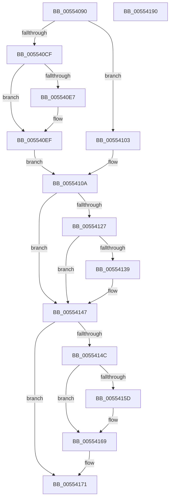

# HalpDmaControllerCancelTransfer

- RVA: `0x00554090`–`0x00554191` (길이 `257` bytes)
- VA: `0x0000000140554090`
- 실행 섹션: `.text`
- PDB 이름 있음: `예`; PDB Function 태그: `아니요`
- unwind 정보 RVA: `0x0005FEF8`
- 디코드: `68`개 명령, `257/257` bytes 표시
- 미해석 바이트: `0` (있으면 어셈블리에 `.byte`로 보존)

> 이 문서는 커널 이미지의 기계어와 PDB 기호를 분석해 생성했습니다. 4번과 5번은 함수 원형과 자료형을 바이너리 사용 방식에서 추정한 C 해석이며 원본 소스 복구 결과는 아닙니다.

## 1. Dependencies

- 직접 호출 지점: **6**; 고유 호출 대상: **6**
- 직접 호출자로 확인된 함수: **1**
- RIP 상대 이미지 참조: **1**

### Outgoing calls
- `0x005540EA` → [KiRaiseIrqlProcessIrqlFlags](../4F/KiRaiseIrqlProcessIrqlFlags_function_004F56FC.md) (function, `0x004F56FC`)
- `0x005540F9` → [KeAcquireSpinLockAtDpcLevel](../20/KeAcquireSpinLockAtDpcLevel_function_00208430.md) (function, `0x00208430`)
- `0x0055411E` → [guard_dispatch_icall](../6B/guard_dispatch_icall_function_006BAAD0.md) (function, `0x006BAAD0`)
- `0x00554142` → [KeInsertQueueDpc](../20/KeInsertQueueDpc_function_00207C50.md) (function, `0x00207C50`)
- `0x0055414F` → [KxReleaseSpinLock](../20/KxReleaseSpinLock_function_00206670.md) (function, `0x00206670`)
- `0x00554164` → [KiLowerIrqlProcessIrqlFlags](../4F/KiLowerIrqlProcessIrqlFlags_function_004F5698.md) (function, `0x004F5698`)

### Direct callers
- [HalCancelMappedTransfer](HalCancelMappedTransfer_function_00553040.md) at `0x00553072`

### Static image references
- `0x005540DE` → RVA `0x00FC6D20` (`ALMOSTRO`; read)

## 2. Other-region calls and transfers

- 다른 실행 섹션으로 향하는 call: **0**
- 별도 외부 분기/꼬리 이동을 확인하지 못했습니다.

## 3. Assembly (complete function range)

```asm
00554090  48 8B C4                        mov rax, rsp
00554093  48 89 58 08                     mov qword ptr [rax + 8], rbx
00554097  48 89 68 10                     mov qword ptr [rax + 0x10], rbp
0055409B  48 89 70 18                     mov qword ptr [rax + 0x18], rsi
0055409F  48 89 78 20                     mov qword ptr [rax + 0x20], rdi
005540A3  41 54                           push r12
005540A5  41 56                           push r14
005540A7  41 57                           push r15
005540A9  48 83 EC 20                     sub rsp, 0x20
005540AD  44 8B FA                        mov r15d, edx
005540B0  4D 8B E0                        mov r12, r8
005540B3  48 8B F1                        mov rsi, rcx
005540B6  4B 8D 1C BF                     lea rbx, [r15 + r15*4]
005540BA  48 C1 E3 05                     shl rbx, 5
005540BE  48 03 59 38                     add rbx, qword ptr [rcx + 0x38]
005540C2  44 0F 20 C7                     mov rdi, cr8
005540C6  45 32 F6                        xor r14b, r14b
005540C9  40 80 FF 0F                     cmp dil, 0xf
005540CD  74 34                           je 0x140554103
005540CF  0F B6 91 B0 00 00 00            movzx edx, byte ptr [rcx + 0xb0]
005540D6  44 0F 20 C7                     mov rdi, cr8
005540DA  44 0F 22 C2                     mov cr8, rdx
005540DE  83 3D 3B 2C A7 00 00            cmp dword ptr [rip + 0xa72c3b], 0
005540E5  74 08                           je 0x1405540ef
005540E7  40 8A CF                        mov cl, dil
005540EA  E8 0D 16 FA FF                  call 0x1404f56fc
005540EF  48 8D AE A8 00 00 00            lea rbp, [rsi + 0xa8]
005540F6  48 8B CD                        mov rcx, rbp
005540F9  E8 32 43 CB FF                  call 0x140208430
005540FE  41 B6 01                        mov r14b, 1
00554101  EB 07                           jmp 0x14055410a
00554103  48 8D A9 A8 00 00 00            lea rbp, [rcx + 0xa8]
0055410A  41 83 4C 24 0C 01               or dword ptr [r12 + 0xc], 1
00554110  41 8B D7                        mov edx, r15d
00554113  48 8B 86 98 00 00 00            mov rax, qword ptr [rsi + 0x98]
0055411A  48 8B 4E 40                     mov rcx, qword ptr [rsi + 0x40]
0055411E  E8 AD 69 16 00                  call 0x1406baad0
00554123  84 C0                           test al, al
00554125  74 20                           je 0x140554147
00554127  48 83 7B 08 00                  cmp qword ptr [rbx + 8], 0
0055412C  C6 43 06 01                     mov byte ptr [rbx + 6], 1
00554130  C7 43 20 02 00 00 00            mov dword ptr [rbx + 0x20], 2
00554137  74 0E                           je 0x140554147
00554139  48 8D 4B 28                     lea rcx, [rbx + 0x28]
0055413D  45 33 C0                        xor r8d, r8d
00554140  33 D2                           xor edx, edx
00554142  E8 09 3B CB FF                  call 0x140207c50
00554147  45 84 F6                        test r14b, r14b
0055414A  74 25                           je 0x140554171
0055414C  48 8B CD                        mov rcx, rbp
0055414F  E8 1C 25 CB FF                  call 0x140206670
00554154  83 3D C5 2B A7 00 00            cmp dword ptr [rip + 0xa72bc5], 0
0055415B  74 0C                           je 0x140554169
0055415D  44 0F 20 C1                     mov rcx, cr8
00554161  40 8A D7                        mov dl, dil
00554164  E8 2F 15 FA FF                  call 0x1404f5698
00554169  40 0F B6 C7                     movzx eax, dil
0055416D  44 0F 22 C0                     mov cr8, rax
00554171  48 8B 5C 24 40                  mov rbx, qword ptr [rsp + 0x40]
00554176  48 8B 6C 24 48                  mov rbp, qword ptr [rsp + 0x48]
0055417B  48 8B 74 24 50                  mov rsi, qword ptr [rsp + 0x50]
00554180  48 8B 7C 24 58                  mov rdi, qword ptr [rsp + 0x58]
00554185  48 83 C4 20                     add rsp, 0x20
00554189  41 5F                           pop r15
0055418B  41 5E                           pop r14
0055418D  41 5C                           pop r12
0055418F  C3                              ret
00554190  CC                              int3
```

## 4. C-style interpretation (structured pseudocode)

```c
__int64 __fastcall HalpDmaControllerCancelTransfer(__int64 a1, int a2, __int64 a3)
{
    __int64 result;
    __int64 v_r14;
    __int64 v_rbx;
    __int64 v_rsp;
    unsigned __int64 v_stack_p10;
    unsigned __int64 v_stack_p18;
    unsigned __int64 v_stack_p20;
    unsigned __int64 v_stack_p8;

    *(unsigned __int64 *)(v_rsp + 8) = v_rbx;
    *(unsigned __int64 *)(v_rsp + 16) = v_rbp;
    *(unsigned __int64 *)(v_rsp + 24) = v_rsi;
    *(unsigned __int64 *)(v_rsp + 32) = v_rdi;
    v_rsp = (v_rsp) - (32);
    v_rbx = ((unsigned int)(a2) + (unsigned int)(a2) * 4) << (5);
    v_rbx = (v_rbx) + (*(unsigned __int64 *)(a1 + 56));
    v_r14 = 0;
    if (((unsigned __int8)(v_cr8)) == 15) goto loc_00554103;
    result = v_rsp;
    if ((*(unsigned int *)(v_rip + 10955835)) != 0) {
        a1 = (unsigned __int8)(v_cr8);
        result = KiRaiseIrqlProcessIrqlFlags(a1, *(unsigned __int8 *)(a1 + 176), a3, a4);
    }
    result = KeAcquireSpinLockAtDpcLevel(a1 + 168, *(unsigned __int8 *)(a1 + 176), a3, a4);
    goto loc_0055410A;
loc_00554103:
loc_0055410A:
    result = guard_dispatch_icall(*(unsigned __int64 *)(a1 + 64), (unsigned int)((unsigned int)((unsigned int)(a2))), a3, a4);
    if ((unsigned __int8)(result) == 0) goto loc_00554147;
    *(unsigned __int8 *)(v_rbx + 6) = 1;
    *(unsigned int *)(v_rbx + 32) = 2;
    if ((*(unsigned __int64 *)(v_rbx + 8)) != 0) {
        a1 = v_rbx + 40;
        a3 = 0;
        a2 = 0;
        result = KeInsertQueueDpc(a1, a2, a3, a4);
    }
    if (1 == 0) goto loc_00554171;
    result = KxReleaseSpinLock(a1 + 168 + 168, a2, a3, a4);
    if ((*(unsigned int *)(v_rip + 10955717)) != 0) {
        a1 = *(unsigned __int8 *)(a1 + 176);
        a2 = (unsigned __int8)(v_cr8);
        result = KiLowerIrqlProcessIrqlFlags(a1, a2, a3, a4);
    }
loc_00554171:
    v_rsp = (v_rsp) + (32);
    return (unsigned __int8)(v_cr8);
}
```

## 5. (Beta) C Style

```c
int64_t HalpDmaControllerCancelTransfer(void *Arg1, void *Arg2, void *Arg3)
{
    uint8_t *arg1 = (uint8_t *)Arg1;
    uint8_t *arg2 = (uint8_t *)Arg2;
    uint8_t *arg3 = (uint8_t *)Arg3;

    int64_t result;
    int64_t local_r14;
    int64_t local_rbx;
    int64_t local_rsp;
    uint64_t v_stack_p10;
    uint64_t v_stack_p18;
    uint64_t v_stack_p20;
    uint64_t v_stack_p8;

    *(uint64_t *)(local_rsp + 0x8) = local_rbx;
    *(uint64_t *)(local_rsp + 0x10) = local_rbp;
    *(uint64_t *)(local_rsp + 0x18) = local_rsi;
    *(uint64_t *)(local_rsp + 0x20) = local_rdi;
    local_rsp = (local_rsp) - (32);
    local_rbx = ((uint32_t)(Arg2) + (uint32_t)(Arg2) * 4) << (5);
    local_rbx = (local_rbx) + (*(uint64_t *)(arg1 + 0x38));
    local_r14 = 0;
    if (((uint8_t)(v_cr8)) == 15) goto loc_00554103;
    result = local_rsp;
    if ((*(uint32_t *)(v_rip + 0xA72C3B)) != 0) {
        Arg1 = (uint8_t)(v_cr8);
        result = KiRaiseIrqlProcessIrqlFlags(Arg1, *(uint8_t *)(arg1 + 0xB0), Arg3, a4);
    }
    result = KeAcquireSpinLockAtDpcLevel(Arg1 + 168, *(uint8_t *)(arg1 + 0xB0), Arg3, a4);
    goto loc_0055410A;
loc_00554103:
loc_0055410A:
    result = guard_dispatch_icall(*(uint64_t *)(arg1 + 0x40), (uint32_t)((uint32_t)((uint32_t)(Arg2))), Arg3, a4);
    if ((uint8_t)(result) == 0) goto loc_00554147;
    *(uint8_t *)(local_rbx + 0x6) = 1;
    *(uint32_t *)(local_rbx + 0x20) = 2;
    if ((*(uint64_t *)(local_rbx + 0x8)) != 0) {
        Arg1 = local_rbx + 40;
        Arg3 = 0;
        Arg2 = 0;
        result = KeInsertQueueDpc(Arg1, Arg2, Arg3, a4);
    }
    if (1 == 0) goto loc_00554171;
    result = KxReleaseSpinLock(Arg1 + 168 + 168, Arg2, Arg3, a4);
    if ((*(uint32_t *)(v_rip + 0xA72BC5)) != 0) {
        Arg1 = *(uint8_t *)(arg1 + 0xB0);
        Arg2 = (uint8_t)(v_cr8);
        result = KiLowerIrqlProcessIrqlFlags(Arg1, Arg2, Arg3, a4);
    }
loc_00554171:
    local_rsp = (local_rsp) + (32);
    return (uint8_t)(v_cr8);
}
```

### 관측된 메모리 오프셋

구조체 형식이 확인되지 않은 접근은 인자 기준의 오프셋으로만 기록했습니다.

| 기준 인자 | 오프셋 표현 | 폭 (bit) | 접근 |
|---|---:|---:|---|
| `Arg1` | `+ 0x38` | `64` | `R` |
| `Arg1` | `+ 0x40` | `64` | `R` |
| `Arg1` | `+ 0x98` | `64` | `R` |
| `Arg1` | `+ 0xA8` | `64` | `R` |
| `Arg1` | `+ 0xB0` | `8` | `R` |
| `Arg2` | `+ 0x0 + r15*4` | `64` | `R` |
| `Arg3` | `+ 0xC` | `32` | `R/W` |

## 6. Execution-region graph

[열기: 2D/3D 그래프와 함수 탐색 컨트롤 패널](../../../control-panel.html?section=text&rva=0x00554090&view=graph)

- 2D 그래프는 위에서 아래로 흐르고, 3D 그래프는 빈 공간을 드래그해 회전합니다. Shift+드래그는 이동, 휠은 확대·축소, 함수 노드 선택은 대상 보고서 이동입니다.

### Static fallback


