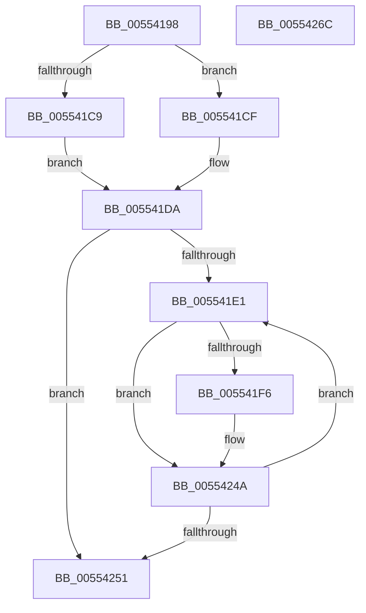

# HalpDmaControllerInitializeController

- RVA: `0x00554198`–`0x0055426D` (길이 `213` bytes)
- VA: `0x0000000140554198`
- 실행 섹션: `.text`
- PDB 이름 있음: `예`; PDB Function 태그: `아니요`
- unwind 정보 RVA: `0x0005D7BC`
- 디코드: `56`개 명령, `213/213` bytes 표시
- 미해석 바이트: `0` (있으면 어셈블리에 `.byte`로 보존)

> 이 문서는 커널 이미지의 기계어와 PDB 기호를 분석해 생성했습니다. 4번과 5번은 함수 원형과 자료형을 바이너리 사용 방식에서 추정한 C 해석이며 원본 소스 복구 결과는 아닙니다.

## 1. Dependencies

- 직접 호출 지점: **4**; 고유 호출 대상: **3**
- 직접 호출자로 확인된 함수: **1**
- RIP 상대 이미지 참조: **0**

### Outgoing calls
- `0x005541BC` → [guard_dispatch_icall](../6B/guard_dispatch_icall_function_006BAAD0.md) (function, `0x006BAAD0`)
- `0x00554210` → [MmAllocateContiguousNodeMemory](../3E/MmAllocateContiguousNodeMemory_function_003E9E40.md) (function, `0x003E9E40`)
- `0x00554220` → [MmGetPhysicalAddress](../23/MmGetPhysicalAddress_function_0023A500.md) (function, `0x0023A500`)
- `0x00554245` → [guard_dispatch_icall](../6B/guard_dispatch_icall_function_006BAAD0.md) (function, `0x006BAAD0`)

### Direct callers
- [HalpDmaInitializeControllers](HalpDmaInitializeControllers_function_005531E8.md) at `0x00553229`

### Static image references
- 디코드된 RIP-relative 메모리 참조가 없습니다.

## 2. Other-region calls and transfers

- 다른 실행 섹션으로 향하는 call: **0**
- 별도 외부 분기/꼬리 이동을 확인하지 못했습니다.

## 3. Assembly (complete function range)

```asm
00554198  48 8B C4                        mov rax, rsp
0055419B  48 89 58 08                     mov qword ptr [rax + 8], rbx
0055419F  48 89 68 10                     mov qword ptr [rax + 0x10], rbp
005541A3  48 89 70 18                     mov qword ptr [rax + 0x18], rsi
005541A7  48 89 78 20                     mov qword ptr [rax + 0x20], rdi
005541AB  41 56                           push r14
005541AD  48 83 EC 30                     sub rsp, 0x30
005541B1  48 8B 41 50                     mov rax, qword ptr [rcx + 0x50]
005541B5  48 8B F9                        mov rdi, rcx
005541B8  48 8B 49 40                     mov rcx, qword ptr [rcx + 0x40]
005541BC  E8 0F 69 16 00                  call 0x1406baad0
005541C1  8B 4F 4C                        mov ecx, dword ptr [rdi + 0x4c]
005541C4  83 F9 40                        cmp ecx, 0x40
005541C7  72 06                           jb 0x1405541cf
005541C9  48 83 CB FF                     or rbx, 0xffffffffffffffff
005541CD  EB 0B                           jmp 0x1405541da
005541CF  BB 01 00 00 00                  mov ebx, 1
005541D4  48 D3 E3                        shl rbx, cl
005541D7  48 FF CB                        dec rbx
005541DA  33 F6                           xor esi, esi
005541DC  39 77 2C                        cmp dword ptr [rdi + 0x2c], esi
005541DF  76 70                           jbe 0x140554251
005541E1  4C 8B 77 38                     mov r14, qword ptr [rdi + 0x38]
005541E5  48 8D 2C B6                     lea rbp, [rsi + rsi*4]
005541E9  48 C1 E5 05                     shl rbp, 5
005541ED  41 8B 44 2E 78                  mov eax, dword ptr [r14 + rbp + 0x78]
005541F2  85 C0                           test eax, eax
005541F4  74 54                           je 0x14055424a
005541F6  8B C8                           mov ecx, eax
005541F8  C7 44 24 28 00 00 00 80         mov dword ptr [rsp + 0x28], 0x80000000
00554200  45 33 C9                        xor r9d, r9d
00554203  C7 44 24 20 04 02 00 00         mov dword ptr [rsp + 0x20], 0x204
0055420B  4C 8B C3                        mov r8, rbx
0055420E  33 D2                           xor edx, edx
00554210  E8 2B 5C E9 FF                  call 0x1403e9e40
00554215  48 8B C8                        mov rcx, rax
00554218  49 89 84 2E 80 00 00 00         mov qword ptr [r14 + rbp + 0x80], rax
00554220  E8 DB 62 CE FF                  call 0x14023a500
00554225  4D 8B 84 2E 80 00 00 00         mov r8, qword ptr [r14 + rbp + 0x80]
0055422D  4C 8B C8                        mov r9, rax
00554230  49 89 84 2E 88 00 00 00         mov qword ptr [r14 + rbp + 0x88], rax
00554238  8B D6                           mov edx, esi
0055423A  48 8B 4F 40                     mov rcx, qword ptr [rdi + 0x40]
0055423E  48 8B 87 90 00 00 00            mov rax, qword ptr [rdi + 0x90]
00554245  E8 86 68 16 00                  call 0x1406baad0
0055424A  FF C6                           inc esi
0055424C  3B 77 2C                        cmp esi, dword ptr [rdi + 0x2c]
0055424F  72 90                           jb 0x1405541e1
00554251  48 8B 5C 24 40                  mov rbx, qword ptr [rsp + 0x40]
00554256  48 8B 6C 24 48                  mov rbp, qword ptr [rsp + 0x48]
0055425B  48 8B 74 24 50                  mov rsi, qword ptr [rsp + 0x50]
00554260  48 8B 7C 24 58                  mov rdi, qword ptr [rsp + 0x58]
00554265  48 83 C4 30                     add rsp, 0x30
00554269  41 5E                           pop r14
0055426B  C3                              ret
0055426C  CC                              int3
```

## 4. C-style interpretation (structured pseudocode)

```c
__int64 __fastcall HalpDmaControllerInitializeController(__int64 a1, int a2, __int64 a3, int a4)
{
    __int64 result;
    __int64 v_rbp;
    __int64 v_rbx;
    __int64 v_rsi;
    __int64 v_rsp;
    unsigned int v_stack_m10;
    unsigned int v_stack_m18;
    unsigned __int64 v_stack_p10;
    unsigned __int64 v_stack_p18;
    unsigned __int64 v_stack_p20;
    unsigned __int64 v_stack_p8;

    *(unsigned __int64 *)(v_rsp + 8) = v_rbx;
    *(unsigned __int64 *)(v_rsp + 16) = v_rbp;
    *(unsigned __int64 *)(v_rsp + 24) = v_rsi;
    *(unsigned __int64 *)(v_rsp + 32) = v_rdi;
    v_rsp = (v_rsp) - (48);
    result = guard_dispatch_icall(*(unsigned __int64 *)(a1 + 64), a2, a3, a4);
    if (((unsigned int)((unsigned int)(*(unsigned int *)(a1 + 76)))) < 64) goto loc_005541CF;
    v_rbx = (v_rbx) | (-1);
    goto loc_005541DA;
loc_005541CF:
    v_rbx = (1) << ((unsigned __int8)((unsigned int)(*(unsigned int *)(a1 + 76))));
    v_rbx = (v_rbx) - 1;
loc_005541DA:
    v_rsi = 0;
    if ((*(unsigned int *)(a1 + 44)) <= 0) goto loc_00554251;
loc_005541E1:
    v_rbp = (v_rsi + v_rsi * 4) << (5);
    result = (unsigned int)(*(unsigned int *)(*(unsigned __int64 *)(a1 + 56) + v_rbp * 1 + 120));
    if ((unsigned int)((unsigned int)(*(unsigned int *)(*(unsigned __int64 *)(a1 + 56) + v_rbp * 1 + 120))) != 0) {
        a1 = (unsigned int)((unsigned int)(*(unsigned int *)(*(unsigned __int64 *)(a1 + 56) + v_rbp * 1 + 120)));
        v_stack_m10 = 0x80000000ULL;
        a4 = 0;
        v_stack_m18 = 516;
        a3 = v_rbx;
        a2 = 0;
        result = MmAllocateContiguousNodeMemory(a1, a2, a3, a4);
        a1 = result;
        *(unsigned __int64 *)(*(unsigned __int64 *)(a1 + 56) + v_rbp * 1 + 128) = result;
        result = MmGetPhysicalAddress(a1, a2, a3, a4);
        a3 = *(unsigned __int64 *)(*(unsigned __int64 *)(a1 + 56) + v_rbp * 1 + 128);
        a4 = result;
        *(unsigned __int64 *)(*(unsigned __int64 *)(a1 + 56) + v_rbp * 1 + 136) = result;
        a2 = 0;
        a1 = *(unsigned __int64 *)(a1 + 64);
        result = *(unsigned __int64 *)(a1 + 144);
        result = guard_dispatch_icall(a1, a2, a3, a4);
    }
    v_rsi = (unsigned int)((v_rsi) + 1);
    if (((unsigned int)(v_rsi)) < (*(unsigned int *)(a1 + 44))) goto loc_005541E1;
loc_00554251:
    v_rsp = (v_rsp) + (48);
    return result;
}
```

## 5. (Beta) C Style

```c
int64_t HalpDmaControllerInitializeController(void *Arg1, int32_t Arg2, int64_t Arg3, int32_t Arg4)
{
    uint8_t *arg1 = (uint8_t *)Arg1;

    int64_t result;
    int64_t local_rbp;
    int64_t local_rbx;
    int64_t local_rsi;
    int64_t local_rsp;
    uint32_t v_stack_m10;
    uint32_t v_stack_m18;
    uint64_t v_stack_p10;
    uint64_t v_stack_p18;
    uint64_t v_stack_p20;
    uint64_t v_stack_p8;

    *(uint64_t *)(local_rsp + 0x8) = local_rbx;
    *(uint64_t *)(local_rsp + 0x10) = local_rbp;
    *(uint64_t *)(local_rsp + 0x18) = local_rsi;
    *(uint64_t *)(local_rsp + 0x20) = local_rdi;
    local_rsp = (local_rsp) - (48);
    result = guard_dispatch_icall(*(uint64_t *)(arg1 + 0x40), Arg2, Arg3, Arg4);
    if (((uint32_t)((uint32_t)(*(uint32_t *)(arg1 + 0x4C)))) < 64) goto loc_005541CF;
    local_rbx = (local_rbx) | (-1);
    goto loc_005541DA;
loc_005541CF:
    local_rbx = (1) << ((uint8_t)((uint32_t)(*(uint32_t *)(arg1 + 0x4C))));
    local_rbx = (local_rbx) - 1;
loc_005541DA:
    local_rsi = 0;
    if ((*(uint32_t *)(arg1 + 0x2C)) <= 0) goto loc_00554251;
loc_005541E1:
    local_rbp = (local_rsi + local_rsi * 4) << (5);
    result = (uint32_t)(*(uint32_t *)(*(uint64_t *)(arg1 + 0x38) + local_rbp * 1 + 0x78));
    if ((uint32_t)((uint32_t)(*(uint32_t *)(*(uint64_t *)(arg1 + 0x38) + local_rbp * 1 + 0x78))) != 0) {
        Arg1 = (uint32_t)((uint32_t)(*(uint32_t *)(*(uint64_t *)(arg1 + 0x38) + local_rbp * 1 + 0x78)));
        v_stack_m10 = 0x80000000ULL;
        Arg4 = 0;
        v_stack_m18 = 516;
        Arg3 = local_rbx;
        Arg2 = 0;
        result = MmAllocateContiguousNodeMemory(Arg1, Arg2, Arg3, Arg4);
        Arg1 = result;
        *(uint64_t *)(*(uint64_t *)(arg1 + 0x38) + local_rbp * 1 + 0x80) = result;
        result = MmGetPhysicalAddress(Arg1, Arg2, Arg3, Arg4);
        Arg3 = *(uint64_t *)(*(uint64_t *)(arg1 + 0x38) + local_rbp * 1 + 0x80);
        Arg4 = result;
        *(uint64_t *)(*(uint64_t *)(arg1 + 0x38) + local_rbp * 1 + 0x88) = result;
        Arg2 = 0;
        Arg1 = *(uint64_t *)(arg1 + 0x40);
        result = *(uint64_t *)(arg1 + 0x90);
        result = guard_dispatch_icall(Arg1, Arg2, Arg3, Arg4);
    }
    local_rsi = (uint32_t)((local_rsi) + 1);
    if (((uint32_t)(local_rsi)) < (*(uint32_t *)(arg1 + 0x2C))) goto loc_005541E1;
loc_00554251:
    local_rsp = (local_rsp) + (48);
    return result;
}
```

### 관측된 메모리 오프셋

구조체 형식이 확인되지 않은 접근은 인자 기준의 오프셋으로만 기록했습니다.

| 기준 인자 | 오프셋 표현 | 폭 (bit) | 접근 |
|---|---:|---:|---|
| `Arg1` | `+ 0x2C` | `32` | `R` |
| `Arg1` | `+ 0x38` | `64` | `R` |
| `Arg1` | `+ 0x40` | `64` | `R` |
| `Arg1` | `+ 0x4C` | `32` | `R` |
| `Arg1` | `+ 0x50` | `64` | `R` |
| `Arg1` | `+ 0x90` | `64` | `R` |

## 6. Execution-region graph

[열기: 2D/3D 그래프와 함수 탐색 컨트롤 패널](../../../control-panel.html?section=text&rva=0x00554198&view=graph)

- 2D 그래프는 위에서 아래로 흐르고, 3D 그래프는 빈 공간을 드래그해 회전합니다. Shift+드래그는 이동, 휠은 확대·축소, 함수 노드 선택은 대상 보고서 이동입니다.

### Static fallback


