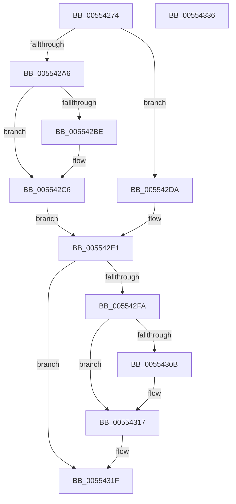

# HalpDmaControllerValidateRequestLineBinding

- RVA: `0x00554274`–`0x00554337` (길이 `195` bytes)
- VA: `0x0000000140554274`
- 실행 섹션: `.text`
- PDB 이름 있음: `예`; PDB Function 태그: `아니요`
- unwind 정보 RVA: `0x0006C8E8`
- 디코드: `51`개 명령, `195/195` bytes 표시
- 미해석 바이트: `0` (있으면 어셈블리에 `.byte`로 보존)

> 이 문서는 커널 이미지의 기계어와 PDB 기호를 분석해 생성했습니다. 4번과 5번은 함수 원형과 자료형을 바이너리 사용 방식에서 추정한 C 해석이며 원본 소스 복구 결과는 아닙니다.

## 1. Dependencies

- 직접 호출 지점: **5**; 고유 호출 대상: **5**
- 직접 호출자로 확인된 함수: **1**
- RIP 상대 이미지 참조: **1**

### Outgoing calls
- `0x005542C1` → [KiRaiseIrqlProcessIrqlFlags](../4F/KiRaiseIrqlProcessIrqlFlags_function_004F56FC.md) (function, `0x004F56FC`)
- `0x005542D0` → [KeAcquireSpinLockAtDpcLevel](../20/KeAcquireSpinLockAtDpcLevel_function_00208430.md) (function, `0x00208430`)
- `0x005542EE` → [guard_dispatch_icall](../6B/guard_dispatch_icall_function_006BAAD0.md) (function, `0x006BAAD0`)
- `0x005542FD` → [KxReleaseSpinLock](../20/KxReleaseSpinLock_function_00206670.md) (function, `0x00206670`)
- `0x00554312` → [KiLowerIrqlProcessIrqlFlags](../4F/KiLowerIrqlProcessIrqlFlags_function_004F5698.md) (function, `0x004F5698`)

### Direct callers
- [HalGetAdapterV3](../../page/70/HalGetAdapterV3_function_00709838.md) at `0x00709931`

### Static image references
- `0x005542B5` → RVA `0x00FC6D20` (`ALMOSTRO`; read)

## 2. Other-region calls and transfers

- 다른 실행 섹션으로 향하는 call: **0**
- 별도 외부 분기/꼬리 이동을 확인하지 못했습니다.

## 3. Assembly (complete function range)

```asm
00554274  48 89 5C 24 10                  mov qword ptr [rsp + 0x10], rbx
00554279  48 89 6C 24 18                  mov qword ptr [rsp + 0x18], rbp
0055427E  48 89 74 24 20                  mov qword ptr [rsp + 0x20], rsi
00554283  57                              push rdi
00554284  48 83 EC 20                     sub rsp, 0x20
00554288  8B 42 30                        mov eax, dword ptr [rdx + 0x30]
0055428B  48 8B D9                        mov rbx, rcx
0055428E  89 44 24 30                     mov dword ptr [rsp + 0x30], eax
00554292  40 32 ED                        xor bpl, bpl
00554295  8B 42 10                        mov eax, dword ptr [rdx + 0x10]
00554298  89 44 24 34                     mov dword ptr [rsp + 0x34], eax
0055429C  44 0F 20 C7                     mov rdi, cr8
005542A0  40 80 FF 0F                     cmp dil, 0xf
005542A4  74 34                           je 0x1405542da
005542A6  0F B6 91 B0 00 00 00            movzx edx, byte ptr [rcx + 0xb0]
005542AD  44 0F 20 C7                     mov rdi, cr8
005542B1  44 0F 22 C2                     mov cr8, rdx
005542B5  83 3D 64 2A A7 00 00            cmp dword ptr [rip + 0xa72a64], 0
005542BC  74 08                           je 0x1405542c6
005542BE  40 8A CF                        mov cl, dil
005542C1  E8 36 14 FA FF                  call 0x1404f56fc
005542C6  48 8D B3 A8 00 00 00            lea rsi, [rbx + 0xa8]
005542CD  48 8B CE                        mov rcx, rsi
005542D0  E8 5B 41 CB FF                  call 0x140208430
005542D5  40 B5 01                        mov bpl, 1
005542D8  EB 07                           jmp 0x1405542e1
005542DA  48 8D B1 A8 00 00 00            lea rsi, [rcx + 0xa8]
005542E1  48 8B 43 58                     mov rax, qword ptr [rbx + 0x58]
005542E5  48 8D 54 24 30                  lea rdx, [rsp + 0x30]
005542EA  48 8B 4B 40                     mov rcx, qword ptr [rbx + 0x40]
005542EE  E8 DD 67 16 00                  call 0x1406baad0
005542F3  8A D8                           mov bl, al
005542F5  40 84 ED                        test bpl, bpl
005542F8  74 25                           je 0x14055431f
005542FA  48 8B CE                        mov rcx, rsi
005542FD  E8 6E 23 CB FF                  call 0x140206670
00554302  83 3D 17 2A A7 00 00            cmp dword ptr [rip + 0xa72a17], 0
00554309  74 0C                           je 0x140554317
0055430B  44 0F 20 C1                     mov rcx, cr8
0055430F  40 8A D7                        mov dl, dil
00554312  E8 81 13 FA FF                  call 0x1404f5698
00554317  40 0F B6 C7                     movzx eax, dil
0055431B  44 0F 22 C0                     mov cr8, rax
0055431F  48 8B 6C 24 40                  mov rbp, qword ptr [rsp + 0x40]
00554324  8A C3                           mov al, bl
00554326  48 8B 5C 24 38                  mov rbx, qword ptr [rsp + 0x38]
0055432B  48 8B 74 24 48                  mov rsi, qword ptr [rsp + 0x48]
00554330  48 83 C4 20                     add rsp, 0x20
00554334  5F                              pop rdi
00554335  C3                              ret
00554336  CC                              int3
```

## 4. C-style interpretation (structured pseudocode)

```c
__int64 __fastcall HalpDmaControllerValidateRequestLineBinding(__int64 a1, __int64 a2)
{
    __int64 result;
    __int64 v_rbp;
    __int64 v_rsp;
    unsigned __int64 v_stack_p10;
    unsigned __int64 v_stack_p18;
    unsigned __int64 v_stack_p20;
    unsigned int v_stack_p8;
    unsigned int v_stack_pC;

    v_stack_p10 = v_rbx;
    v_stack_p18 = v_rbp;
    v_stack_p20 = v_rsi;
    v_rsp = (v_rsp) - (32);
    v_stack_p8 = (unsigned int)((unsigned int)(*(unsigned int *)(a2 + 48)));
    v_rbp = 0;
    v_stack_pC = (unsigned int)((unsigned int)(*(unsigned int *)(a2 + 16)));
    if (((unsigned __int8)(v_cr8)) == 15) goto loc_005542DA;
    result = (unsigned int)(*(unsigned int *)(a2 + 16));
    if ((*(unsigned int *)(v_rip + 10955364)) != 0) {
        a1 = (unsigned __int8)(v_cr8);
        result = KiRaiseIrqlProcessIrqlFlags(a1, *(unsigned __int8 *)(a1 + 176), a3, a4);
    }
    result = KeAcquireSpinLockAtDpcLevel(a1 + 168, *(unsigned __int8 *)(a1 + 176), a3, a4);
    goto loc_005542E1;
loc_005542DA:
loc_005542E1:
    result = guard_dispatch_icall(*(unsigned __int64 *)(a1 + 64), v_stack_p8, a3, a4);
    if (1 == 0) goto loc_0055431F;
    result = KxReleaseSpinLock(a1 + 168 + 168, v_stack_p8, a3, a4);
    if ((*(unsigned int *)(v_rip + 10955287)) != 0) {
        a1 = *(unsigned __int8 *)(a1 + 176);
        a2 = (unsigned __int8)(v_cr8);
        result = KiLowerIrqlProcessIrqlFlags(a1, a2, a3, a4);
    }
loc_0055431F:
    v_rsp = (v_rsp) + (32);
    return (unsigned __int8)((unsigned __int8)(result));
}
```

## 5. (Beta) C Style

```c
int64_t HalpDmaControllerValidateRequestLineBinding(void *Arg1, void *Arg2)
{
    uint8_t *arg1 = (uint8_t *)Arg1;
    uint8_t *arg2 = (uint8_t *)Arg2;

    int64_t result;
    int64_t local_rbp;
    int64_t local_rsp;
    uint64_t v_stack_p10;
    uint64_t v_stack_p18;
    uint64_t v_stack_p20;
    uint32_t v_stack_p8;
    uint32_t v_stack_pC;

    v_stack_p10 = local_rbx;
    v_stack_p18 = local_rbp;
    v_stack_p20 = local_rsi;
    local_rsp = (local_rsp) - (32);
    v_stack_p8 = (uint32_t)((uint32_t)(*(uint32_t *)(arg2 + 0x30)));
    local_rbp = 0;
    v_stack_pC = (uint32_t)((uint32_t)(*(uint32_t *)(arg2 + 0x10)));
    if (((uint8_t)(v_cr8)) == 15) goto loc_005542DA;
    result = (uint32_t)(*(uint32_t *)(arg2 + 0x10));
    if ((*(uint32_t *)(v_rip + 0xA72A64)) != 0) {
        Arg1 = (uint8_t)(v_cr8);
        result = KiRaiseIrqlProcessIrqlFlags(Arg1, *(uint8_t *)(arg1 + 0xB0), a3, a4);
    }
    result = KeAcquireSpinLockAtDpcLevel(Arg1 + 168, *(uint8_t *)(arg1 + 0xB0), a3, a4);
    goto loc_005542E1;
loc_005542DA:
loc_005542E1:
    result = guard_dispatch_icall(*(uint64_t *)(arg1 + 0x40), v_stack_p8, a3, a4);
    if (1 == 0) goto loc_0055431F;
    result = KxReleaseSpinLock(Arg1 + 168 + 168, v_stack_p8, a3, a4);
    if ((*(uint32_t *)(v_rip + 0xA72A17)) != 0) {
        Arg1 = *(uint8_t *)(arg1 + 0xB0);
        Arg2 = (uint8_t)(v_cr8);
        result = KiLowerIrqlProcessIrqlFlags(Arg1, Arg2, a3, a4);
    }
loc_0055431F:
    local_rsp = (local_rsp) + (32);
    return (uint8_t)((uint8_t)(result));
}
```

### 관측된 메모리 오프셋

구조체 형식이 확인되지 않은 접근은 인자 기준의 오프셋으로만 기록했습니다.

| 기준 인자 | 오프셋 표현 | 폭 (bit) | 접근 |
|---|---:|---:|---|
| `Arg1` | `+ 0x40` | `64` | `R` |
| `Arg1` | `+ 0x58` | `64` | `R` |
| `Arg1` | `+ 0xA8` | `64` | `R` |
| `Arg1` | `+ 0xB0` | `8` | `R` |
| `Arg2` | `+ 0x10` | `32` | `R` |
| `Arg2` | `+ 0x30` | `32` | `R` |

## 6. Execution-region graph

[열기: 2D/3D 그래프와 함수 탐색 컨트롤 패널](../../../control-panel.html?section=text&rva=0x00554274&view=graph)

- 2D 그래프는 위에서 아래로 흐르고, 3D 그래프는 빈 공간을 드래그해 회전합니다. Shift+드래그는 이동, 휠은 확대·축소, 함수 노드 선택은 대상 보고서 이동입니다.

### Static fallback


