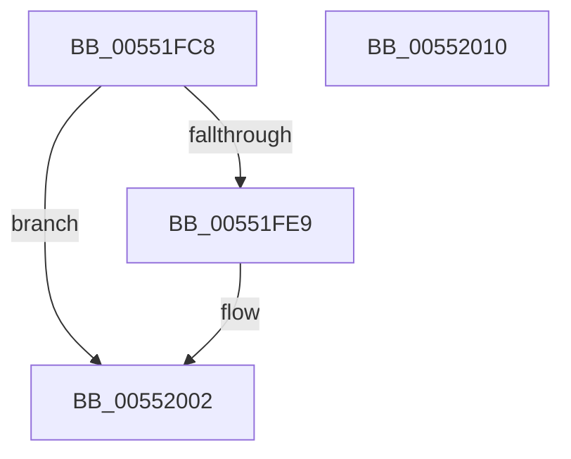

# HalpDmaDeleteDomain

- RVA: `0x00551FC8`–`0x00552011` (길이 `73` bytes)
- VA: `0x0000000140551FC8`
- 실행 섹션: `.text`
- PDB 이름 있음: `예`; PDB Function 태그: `아니요`
- unwind 정보 RVA: `0x00064C80`
- 디코드: `22`개 명령, `73/73` bytes 표시
- 미해석 바이트: `0` (있으면 어셈블리에 `.byte`로 보존)

> 이 문서는 커널 이미지의 기계어와 PDB 기호를 분석해 생성했습니다. 4번과 5번은 함수 원형과 자료형을 바이너리 사용 방식에서 추정한 C 해석이며 원본 소스 복구 결과는 아닙니다.

## 1. Dependencies

- 직접 호출 지점: **3**; 고유 호출 대상: **3**
- 직접 호출자로 확인된 함수: **1**
- RIP 상대 이미지 참조: **1**

### Outgoing calls
- `0x00551FE0` → [guard_dispatch_icall](../6B/guard_dispatch_icall_function_006BAAD0.md) (function, `0x006BAAD0`)
- `0x00551FFC` → [KeBugCheckEx](../4F/KeBugCheckEx_function_004FD660.md) (function, `0x004FD660`)
- `0x00552005` → [HalpMmAllocCtxFree](../3E/HalpMmAllocCtxFree_function_003E1904.md) (function, `0x003E1904`)

### Direct callers
- [HalpDmaDereferenceDomainObject](../3F/HalpDmaDereferenceDomainObject_function_003F69DC.md) at `0x003F6A7F`

### Static image references
- `0x00551FCE` → RVA `0x00FC1778` (`.data`; read)

## 2. Other-region calls and transfers

- 다른 실행 섹션으로 향하는 call: **0**
- 별도 외부 분기/꼬리 이동을 확인하지 못했습니다.

## 3. Assembly (complete function range)

```asm
00551FC8  40 53                           push rbx
00551FCA  48 83 EC 30                     sub rsp, 0x30
00551FCE  48 8B 05 A3 F7 A6 00            mov rax, qword ptr [rip + 0xa6f7a3]
00551FD5  48 8B D9                        mov rbx, rcx
00551FD8  48 8B 49 28                     mov rcx, qword ptr [rcx + 0x28]
00551FDC  48 8B 40 08                     mov rax, qword ptr [rax + 8]
00551FE0  E8 EB 8A 16 00                  call 0x1406baad0
00551FE5  85 C0                           test eax, eax
00551FE7  79 19                           jns 0x140552002
00551FE9  48 83 64 24 20 00               and qword ptr [rsp + 0x20], 0
00551FEF  4C 8B CB                        mov r9, rbx
00551FF2  4C 63 C0                        movsxd r8, eax
00551FF5  33 D2                           xor edx, edx
00551FF7  B9 D9 01 00 00                  mov ecx, 0x1d9
00551FFC  E8 5F B6 FA FF                  call 0x1404fd660
00552001  CC                              int3
00552002  48 8B D3                        mov rdx, rbx
00552005  E8 FA F8 E8 FF                  call 0x1403e1904
0055200A  48 83 C4 30                     add rsp, 0x30
0055200E  5B                              pop rbx
0055200F  C3                              ret
00552010  CC                              int3
```

## 4. C-style interpretation (structured pseudocode)

```c
__int64 __fastcall HalpDmaDeleteDomain(__int64 a1, int a2)
{
    __int64 result;
    __int64 v_rsp;
    unsigned __int64 v_stack_m18;

    v_rsp = (v_rsp) - (48);
    result = guard_dispatch_icall(*(unsigned __int64 *)(a1 + 40), a2, a3, a4);
    if (sign_flag) {
        a4 = a1;
        a3 = (int)((unsigned int)(result));
        a2 = 0;
        a1 = 473;
        result = KeBugCheckEx(a1, a2, a3, a4);
    }
    result = HalpMmAllocCtxFree(a1, a1, a3, a4);
    v_rsp = (v_rsp) + (48);
    return result;
}
```

## 5. (Beta) C Style

```c
int64_t HalpDmaDeleteDomain(void *Arg1, int32_t Arg2)
{
    uint8_t *arg1 = (uint8_t *)Arg1;

    int64_t result;
    int64_t local_rsp;
    uint64_t v_stack_m18;

    local_rsp = (local_rsp) - (48);
    result = guard_dispatch_icall(*(uint64_t *)(arg1 + 0x28), Arg2, a3, a4);
    if (sign_flag) {
        a4 = Arg1;
        a3 = (int32_t)((uint32_t)(result));
        Arg2 = 0;
        Arg1 = 473;
        result = KeBugCheckEx(Arg1, Arg2, a3, a4);
    }
    result = HalpMmAllocCtxFree(Arg1, Arg1, a3, a4);
    local_rsp = (local_rsp) + (48);
    return result;
}
```

### 관측된 메모리 오프셋

구조체 형식이 확인되지 않은 접근은 인자 기준의 오프셋으로만 기록했습니다.

| 기준 인자 | 오프셋 표현 | 폭 (bit) | 접근 |
|---|---:|---:|---|
| `Arg1` | `+ 0x28` | `64` | `R` |

## 6. Execution-region graph

[열기: 2D/3D 그래프와 함수 탐색 컨트롤 패널](../../../control-panel.html?section=text&rva=0x00551FC8&view=graph)

- 2D 그래프는 위에서 아래로 흐르고, 3D 그래프는 빈 공간을 드래그해 회전합니다. Shift+드래그는 이동, 휠은 확대·축소, 함수 노드 선택은 대상 보고서 이동입니다.

### Static fallback


