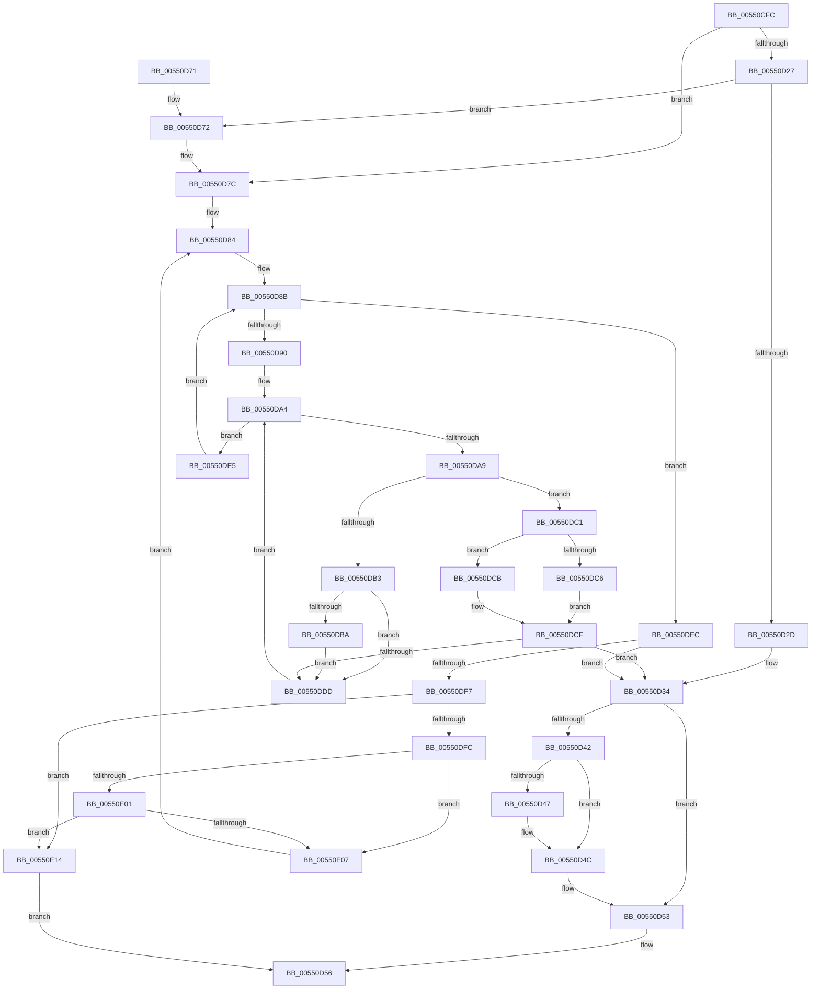

# HalpDmaForceAllocation

- RVA: `0x00550CFC`–`0x00550E23` (길이 `295` bytes)
- VA: `0x0000000140550CFC`
- 실행 섹션: `.text`
- PDB 이름 있음: `예`; PDB Function 태그: `아니요`
- unwind 정보 RVA: `0x000C4274`
- 디코드: `95`개 명령, `295/295` bytes 표시
- 미해석 바이트: `0` (있으면 어셈블리에 `.byte`로 보존)

> 이 문서는 커널 이미지의 기계어와 PDB 기호를 분석해 생성했습니다. 4번과 5번은 함수 원형과 자료형을 바이너리 사용 방식에서 추정한 C 해석이며 원본 소스 복구 결과는 아닙니다.

## 1. Dependencies

- 직접 호출 지점: **0**; 고유 호출 대상: **0**
- 직접 호출자로 확인된 함수: **1**
- RIP 상대 이미지 참조: **0**

### Outgoing calls
- 직접 디코드된 call 명령이 없습니다.

### Direct callers
- [HalpDmaAllocateMapRegistersAtHighLevel](HalpDmaAllocateMapRegistersAtHighLevel_function_005507A8.md) at `0x0055094E`
- [HalpDmaAllocateMapRegistersAtHighLevel](HalpDmaAllocateMapRegistersAtHighLevel_function_005507A8.md) at `0x0055096D`
- [HalpDmaAllocateMapRegistersAtHighLevel](HalpDmaAllocateMapRegistersAtHighLevel_function_005507A8.md) at `0x0055099F`
- [HalpDmaAllocateMapRegistersAtHighLevel](HalpDmaAllocateMapRegistersAtHighLevel_function_005507A8.md) at `0x005509D5`
- [HalpDmaAllocateMapRegistersAtHighLevel](HalpDmaAllocateMapRegistersAtHighLevel_function_005507A8.md) at `0x00550A1B`

### Static image references
- 디코드된 RIP-relative 메모리 참조가 없습니다.

## 2. Other-region calls and transfers

- 다른 실행 섹션으로 향하는 call: **0**
- 별도 외부 분기/꼬리 이동을 확인하지 못했습니다.

## 3. Assembly (complete function range)

```asm
00550CFC  48 8B C4                        mov rax, rsp
00550CFF  48 89 58 08                     mov qword ptr [rax + 8], rbx
00550D03  48 89 68 10                     mov qword ptr [rax + 0x10], rbp
00550D07  48 89 70 18                     mov qword ptr [rax + 0x18], rsi
00550D0B  48 89 78 20                     mov qword ptr [rax + 0x20], rdi
00550D0F  41 54                           push r12
00550D11  41 55                           push r13
00550D13  41 56                           push r14
00550D15  4D 8B 10                        mov r10, qword ptr [r8]
00550D18  4D 8D 58 08                     lea r11, [r8 + 8]
00550D1C  45 8B E9                        mov r13d, r9d
00550D1F  48 8B DA                        mov rbx, rdx
00550D22  4D 85 D2                        test r10, r10
00550D25  75 55                           jne 0x140550d7c
00550D27  41 83 3B FF                     cmp dword ptr [r11], -1
00550D2B  75 45                           jne 0x140550d72
00550D2D  45 33 C9                        xor r9d, r9d
00550D30  33 D2                           xor edx, edx
00550D32  33 FF                           xor edi, edi
00550D34  80 7C 24 40 00                  cmp byte ptr [rsp + 0x40], 0
00550D39  4D 89 10                        mov qword ptr [r8], r10
00550D3C  41 89 78 08                     mov dword ptr [r8 + 8], edi
00550D40  75 11                           jne 0x140550d53
00550D42  4D 85 D2                        test r10, r10
00550D45  75 05                           jne 0x140550d4c
00550D47  41 83 48 08 FF                  or dword ptr [r8 + 8], 0xffffffff
00550D4C  48 8B 4C 24 48                  mov rcx, qword ptr [rsp + 0x48]
00550D51  89 11                           mov dword ptr [rcx], edx
00550D53  49 8B C1                        mov rax, r9
00550D56  48 8B 5C 24 20                  mov rbx, qword ptr [rsp + 0x20]
00550D5B  48 8B 6C 24 28                  mov rbp, qword ptr [rsp + 0x28]
00550D60  48 8B 74 24 30                  mov rsi, qword ptr [rsp + 0x30]
00550D65  48 8B 7C 24 38                  mov rdi, qword ptr [rsp + 0x38]
00550D6A  41 5E                           pop r14
00550D6C  41 5D                           pop r13
00550D6E  41 5C                           pop r12
00550D70  C3                              ret
00550D71  CC                              int3
00550D72  41 83 23 00                     and dword ptr [r11], 0
00550D76  4C 8B D3                        mov r10, rbx
00550D79  49 89 18                        mov qword ptr [r8], rbx
00550D7C  41 8B 33                        mov esi, dword ptr [r11]
00550D7F  33 FF                           xor edi, edi
00550D81  41 B6 01                        mov r14b, 1
00550D84  33 ED                           xor ebp, ebp
00550D86  45 33 C9                        xor r9d, r9d
00550D89  33 D2                           xor edx, edx
00550D8B  4D 85 D2                        test r10, r10
00550D8E  74 5C                           je 0x140550dec
00550D90  45 8B 62 08                     mov r12d, dword ptr [r10 + 8]
00550D94  8B FE                           mov edi, esi
00550D96  8B C6                           mov eax, esi
00550D98  48 8D 0C C0                     lea rcx, [rax + rax*8]
00550D9C  49 8B 42 10                     mov rax, qword ptr [r10 + 0x10]
00550DA0  48 8D 0C C8                     lea rcx, [rax + rcx*8]
00550DA4  41 3B FC                        cmp edi, r12d
00550DA7  73 3C                           jae 0x140550de5
00550DA9  48 F7 41 30 00 F0 FF FF         test qword ptr [rcx + 0x30], -0x1000
00550DB1  75 0E                           jne 0x140550dc1
00550DB3  80 7C 24 40 00                  cmp byte ptr [rsp + 0x40], 0
00550DB8  74 23                           je 0x140550ddd
00550DBA  45 33 C9                        xor r9d, r9d
00550DBD  33 D2                           xor edx, edx
00550DBF  EB 1C                           jmp 0x140550ddd
00550DC1  4D 85 C9                        test r9, r9
00550DC4  75 05                           jne 0x140550dcb
00550DC6  4C 8B C9                        mov r9, rcx
00550DC9  EB 04                           jmp 0x140550dcf
00550DCB  48 89 4D 08                     mov qword ptr [rbp + 8], rcx
00550DCF  FF C2                           inc edx
00550DD1  48 8B E9                        mov rbp, rcx
00550DD4  41 3B D5                        cmp edx, r13d
00550DD7  0F 84 57 FF FF FF               je 0x140550d34
00550DDD  48 83 C1 48                     add rcx, 0x48
00550DE1  FF C7                           inc edi
00550DE3  EB BF                           jmp 0x140550da4
00550DE5  4D 8B 12                        mov r10, qword ptr [r10]
00550DE8  33 F6                           xor esi, esi
00550DEA  EB 9F                           jmp 0x140550d8b
00550DEC  80 7C 24 40 00                  cmp byte ptr [rsp + 0x40], 0
00550DF1  0F 84 3D FF FF FF               je 0x140550d34
00550DF7  45 84 F6                        test r14b, r14b
00550DFA  74 18                           je 0x140550e14
00550DFC  49 39 18                        cmp qword ptr [r8], rbx
00550DFF  75 06                           jne 0x140550e07
00550E01  41 83 3B 00                     cmp dword ptr [r11], 0
00550E05  74 0D                           je 0x140550e14
00550E07  33 F6                           xor esi, esi
00550E09  4C 8B D3                        mov r10, rbx
00550E0C  45 32 F6                        xor r14b, r14b
00550E0F  E9 70 FF FF FF                  jmp 0x140550d84
00550E14  41 83 60 08 00                  and dword ptr [r8 + 8], 0
00550E19  33 C0                           xor eax, eax
00550E1B  49 89 18                        mov qword ptr [r8], rbx
00550E1E  E9 33 FF FF FF                  jmp 0x140550d56
```

## 4. C-style interpretation (structured pseudocode)

```c
__int64 __fastcall HalpDmaForceAllocation(__int64 a1, __int64 a2, __int64 a3, int a4, unsigned __int8 a5, __int64 a6)
{
    __int64 result;
    __int64 v_r14;
    __int64 v_rbp;
    __int64 v_rdi;
    __int64 v_rsi;
    unsigned __int64 v_stack_p10;
    unsigned __int64 v_stack_p18;
    unsigned __int64 v_stack_p20;
    unsigned __int64 v_stack_p8;

    *(unsigned __int64 *)(v_rsp + 8) = v_rbx;
    *(unsigned __int64 *)(v_rsp + 16) = v_rbp;
    *(unsigned __int64 *)(v_rsp + 24) = v_rsi;
    *(unsigned __int64 *)(v_rsp + 32) = v_rdi;
    if (*(unsigned __int64 *)(a3) != 0) goto loc_00550D7C;
    if ((*(unsigned int *)(a3 + 8)) != -1) goto loc_00550D72;
    a4 = 0;
    a2 = 0;
    v_rdi = 0;
loc_00550D34:
    *(unsigned __int64 *)(a3) = *(unsigned __int64 *)(a3);
    *(unsigned int *)(a3 + 8) = 0;
    if (a5 != 0) goto loc_00550D53;
    if (*(unsigned __int64 *)(a3) == 0) {
    }
    *(unsigned int *)(a6) = 0;
loc_00550D53:
loc_00550D56:
    return 0;
loc_00550D72:
    *(unsigned __int64 *)(a3) = v_stack_p8;
loc_00550D7C:
    v_rdi = 0;
loc_00550D84:
    v_rbp = 0;
    a4 = 0;
    a2 = 0;
loc_00550D8B:
    if (v_stack_p8 == 0) goto loc_00550DEC;
loc_00550DA4:
    if (((unsigned int)((unsigned int)((unsigned int)((unsigned int)(*(unsigned int *)(a3 + 8)))))) >= ((unsigned int)((unsigned int)(*(unsigned int *)(v_stack_p8 + 8))))) goto loc_00550DE5;
    if (((*(unsigned __int64 *)(*(unsigned __int64 *)(v_stack_p8 + 16) + (unsigned int)((unsigned int)((unsigned int)(*(unsigned int *)(a3 + 8)))) + (unsigned int)((unsigned int)((unsigned int)(*(unsigned int *)(a3 + 8)))) * 8 * 8 + 48)) & (0xFFFFFFFFFFFFF000ULL)) != 0) goto loc_00550DC1;
    if (a5 == 0) goto loc_00550DDD;
    a4 = 0;
    a2 = 0;
    goto loc_00550DDD;
loc_00550DC1:
    if (0 != 0) goto loc_00550DCB;
    goto loc_00550DCF;
loc_00550DCB:
    *(unsigned __int64 *)(v_rbp + 8) = *(unsigned __int64 *)(v_stack_p8 + 16) + (unsigned int)((unsigned int)((unsigned int)(*(unsigned int *)(a3 + 8)))) + (unsigned int)((unsigned int)((unsigned int)(*(unsigned int *)(a3 + 8)))) * 8 * 8;
loc_00550DCF:
    a2 = (unsigned int)((a2) + 1);
    if (((unsigned int)(a2)) == ((unsigned int)((unsigned int)(a4)))) goto loc_00550D34;
loc_00550DDD:
    a1 = (*(unsigned __int64 *)(v_stack_p8 + 16) + (unsigned int)((unsigned int)((unsigned int)(*(unsigned int *)(a3 + 8)))) + (unsigned int)((unsigned int)((unsigned int)(*(unsigned int *)(a3 + 8)))) * 8 * 8) + (72);
    v_rdi = (unsigned int)(((unsigned int)((unsigned int)((unsigned int)(*(unsigned int *)(a3 + 8))))) + 1);
    goto loc_00550DA4;
loc_00550DE5:
    v_rsi = 0;
    goto loc_00550D8B;
loc_00550DEC:
    if (a5 == 0) goto loc_00550D34;
    if (1 == 0) goto loc_00550E14;
    if ((*(unsigned __int64 *)(a3)) != v_stack_p8) goto loc_00550E07;
    if ((*(unsigned int *)(a3 + 8)) == 0) goto loc_00550E14;
loc_00550E07:
    v_rsi = 0;
    v_r14 = 0;
    goto loc_00550D84;
loc_00550E14:
    result = 0;
    *(unsigned __int64 *)(a3) = v_stack_p8;
    goto loc_00550D56;
}
```

## 5. (Beta) C Style

```c
int64_t HalpDmaForceAllocation(int64_t Arg1, int64_t Arg2, void *Arg3, int32_t Arg4, uint8_t Arg5, void *Arg6)
{
    uint8_t *arg3 = (uint8_t *)Arg3;
    uint8_t *arg6 = (uint8_t *)Arg6;

    int64_t result;
    int64_t local_r14;
    int64_t local_rbp;
    int64_t local_rdi;
    int64_t local_rsi;
    uint64_t v_stack_p10;
    uint64_t v_stack_p18;
    uint64_t v_stack_p20;
    uint64_t v_stack_p8;

    *(uint64_t *)(local_rsp + 0x8) = local_rbx;
    *(uint64_t *)(local_rsp + 0x10) = local_rbp;
    *(uint64_t *)(local_rsp + 0x18) = local_rsi;
    *(uint64_t *)(local_rsp + 0x20) = local_rdi;
    if (*(uint64_t *)(arg3) != 0) goto loc_00550D7C;
    if ((*(uint32_t *)(arg3 + 0x8)) != -1) goto loc_00550D72;
    Arg4 = 0;
    Arg2 = 0;
    local_rdi = 0;
loc_00550D34:
    *(uint64_t *)(arg3) = *(uint64_t *)(arg3);
    *(uint32_t *)(arg3 + 0x8) = 0;
    if (Arg5 != 0) goto loc_00550D53;
    if (*(uint64_t *)(arg3) == 0) {
    }
    *(uint32_t *)(arg6) = 0;
loc_00550D53:
loc_00550D56:
    return 0;
loc_00550D72:
    *(uint64_t *)(arg3) = v_stack_p8;
loc_00550D7C:
    local_rdi = 0;
loc_00550D84:
    local_rbp = 0;
    Arg4 = 0;
    Arg2 = 0;
loc_00550D8B:
    if (v_stack_p8 == 0) goto loc_00550DEC;
loc_00550DA4:
    if (((uint32_t)((uint32_t)((uint32_t)((uint32_t)(*(uint32_t *)(arg3 + 0x8)))))) >= ((uint32_t)((uint32_t)(*(uint32_t *)(v_stack_p8 + 0x8))))) goto loc_00550DE5;
    if (((*(uint64_t *)(*(uint64_t *)(v_stack_p8 + 0x10) + (uint32_t)((uint32_t)((uint32_t)(*(uint32_t *)(arg3 + 0x8)))) + (uint32_t)((uint32_t)((uint32_t)(*(uint32_t *)(arg3 + 0x8)))) * 8 * 8 + 0x30)) & (0xFFFFFFFFFFFFF000ULL)) != 0) goto loc_00550DC1;
    if (Arg5 == 0) goto loc_00550DDD;
    Arg4 = 0;
    Arg2 = 0;
    goto loc_00550DDD;
loc_00550DC1:
    if (0 != 0) goto loc_00550DCB;
    goto loc_00550DCF;
loc_00550DCB:
    *(uint64_t *)(local_rbp + 0x8) = *(uint64_t *)(v_stack_p8 + 0x10) + (uint32_t)((uint32_t)((uint32_t)(*(uint32_t *)(arg3 + 0x8)))) + (uint32_t)((uint32_t)((uint32_t)(*(uint32_t *)(arg3 + 0x8)))) * 8 * 8;
loc_00550DCF:
    Arg2 = (uint32_t)((Arg2) + 1);
    if (((uint32_t)(Arg2)) == ((uint32_t)((uint32_t)(Arg4)))) goto loc_00550D34;
loc_00550DDD:
    Arg1 = (*(uint64_t *)(v_stack_p8 + 0x10) + (uint32_t)((uint32_t)((uint32_t)(*(uint32_t *)(arg3 + 0x8)))) + (uint32_t)((uint32_t)((uint32_t)(*(uint32_t *)(arg3 + 0x8)))) * 8 * 8) + (72);
    local_rdi = (uint32_t)(((uint32_t)((uint32_t)((uint32_t)(*(uint32_t *)(arg3 + 0x8))))) + 1);
    goto loc_00550DA4;
loc_00550DE5:
    local_rsi = 0;
    goto loc_00550D8B;
loc_00550DEC:
    if (Arg5 == 0) goto loc_00550D34;
    if (1 == 0) goto loc_00550E14;
    if ((*(uint64_t *)(arg3)) != v_stack_p8) goto loc_00550E07;
    if ((*(uint32_t *)(arg3 + 0x8)) == 0) goto loc_00550E14;
loc_00550E07:
    local_rsi = 0;
    local_r14 = 0;
    goto loc_00550D84;
loc_00550E14:
    result = 0;
    *(uint64_t *)(arg3) = v_stack_p8;
    goto loc_00550D56;
}
```

### 관측된 메모리 오프셋

구조체 형식이 확인되지 않은 접근은 인자 기준의 오프셋으로만 기록했습니다.

| 기준 인자 | 오프셋 표현 | 폭 (bit) | 접근 |
|---|---:|---:|---|
| `Arg3` | `+ 0x0` | `32` | `R` |
| `Arg3` | `+ 0x0` | `32` | `R/W` |
| `Arg3` | `+ 0x0` | `64` | `R` |
| `Arg3` | `+ 0x0` | `64` | `W` |
| `Arg3` | `+ 0x8` | `32` | `R/W` |
| `Arg3` | `+ 0x8` | `32` | `W` |
| `Arg3` | `+ 0x8` | `64` | `R` |
| `Arg6` | `+ 0x0` | `32` | `W` |

## 6. Execution-region graph

[열기: 2D/3D 그래프와 함수 탐색 컨트롤 패널](../../../control-panel.html?section=text&rva=0x00550CFC&view=graph)

- 2D 그래프는 위에서 아래로 흐르고, 3D 그래프는 빈 공간을 드래그해 회전합니다. Shift+드래그는 이동, 휠은 확대·축소, 함수 노드 선택은 대상 보고서 이동입니다.

### Static fallback


