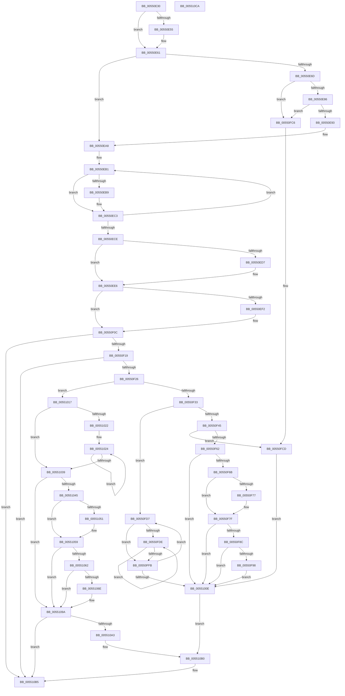

# HalpDmaFreeChildAdapter

- RVA: `0x00550E30`–`0x005510CB` (길이 `667` bytes)
- VA: `0x0000000140550E30`
- 실행 섹션: `.text`
- PDB 이름 있음: `예`; PDB Function 태그: `아니요`
- unwind 정보 RVA: `0x0005C954`
- 디코드: `170`개 명령, `667/667` bytes 표시
- 미해석 바이트: `0` (있으면 어셈블리에 `.byte`로 보존)

> 이 문서는 커널 이미지의 기계어와 PDB 기호를 분석해 생성했습니다. 4번과 5번은 함수 원형과 자료형을 바이너리 사용 방식에서 추정한 C 해석이며 원본 소스 복구 결과는 아닙니다.

## 1. Dependencies

- 직접 호출 지점: **24**; 고유 호출 대상: **14**
- 직접 호출자로 확인된 함수: **0**
- RIP 상대 이미지 참조: **4**

### Outgoing calls
- `0x00550E55` → [IoFreeMdl](../29/IoFreeMdl_function_0029EA80.md) (function, `0x0029EA80`)
- `0x00550E74` → [KeAcquireSpinLockRaiseToDpc](../20/KeAcquireSpinLockRaiseToDpc_function_00208470.md) (function, `0x00208470`)
- `0x00550EA3` → [KeReleaseSpinLock](../39/KeReleaseSpinLock_function_00392BA0.md) (function, `0x00392BA0`)
- `0x00550EBE` → [HalpDmaFreeCrashdumpRegistersInternal](../4B/HalpDmaFreeCrashdumpRegistersInternal_function_004B8D04.md) (function, `0x004B8D04`)
- `0x00550EE1` → [HalpLeaveDmaDomain](HalpLeaveDmaDomain_function_00552600.md) (function, `0x00552600`)
- `0x00550F00` → [guard_dispatch_icall](../6B/guard_dispatch_icall_function_006BAAD0.md) (function, `0x006BAAD0`)
- `0x00550F45` → [HalpMmAllocCtxFree](../3E/HalpMmAllocCtxFree_function_003E1904.md) (function, `0x003E1904`)
- `0x00550F4D` → [HalpMmAllocCtxFree](../3E/HalpMmAllocCtxFree_function_003E1904.md) (function, `0x003E1904`)
- `0x00550F7A` → [MmUnmapLockedPages](../24/MmUnmapLockedPages_function_00246E60.md) (function, `0x00246E60`)
- `0x00550F8F` → [HalpDmaCvmMakeMdlDevicePrivate](../../page/70/HalpDmaCvmMakeMdlDevicePrivate_function_007095A8.md) (function, `0x007095A8`)
- `0x00550FA5` → [CvmDebugLog](../4F/CvmDebugLog_function_004FD2C8.md) (function, `0x004FD2C8`)
- `0x00550FB5` → [MiFreePagesFromMdl](../3F/MiFreePagesFromMdl_function_003F8300.md) (function, `0x003F8300`)
- `0x00550FBF` → [ExFreePoolWithTag](../../poolcode/B8/ExFreePoolWithTag_function_00B82870.md) (function, `0x00B82870`)
- `0x00550FD0` → [MmFreeContiguousMemory](../3F/MmFreeContiguousMemory_function_003F6F60.md) (function, `0x003F6F60`)
- `0x00550FEF` → [HalpDmaReturnPageToSource](HalpDmaReturnPageToSource_function_0055119C.md) (function, `0x0055119C`)
- `0x00551001` → [HalpMmAllocCtxFree](../3E/HalpMmAllocCtxFree_function_003E1904.md) (function, `0x003E1904`)
- `0x0055102B` → [HalpDmaReturnPageToSource](HalpDmaReturnPageToSource_function_0055119C.md) (function, `0x0055119C`)
- `0x00551054` → [MmUnmapLockedPages](../24/MmUnmapLockedPages_function_00246E60.md) (function, `0x00246E60`)
- `0x00551065` → [HalpDmaCvmMakeMdlDevicePrivate](../../page/70/HalpDmaCvmMakeMdlDevicePrivate_function_007095A8.md) (function, `0x007095A8`)
- `0x0055107B` → [CvmDebugLog](../4F/CvmDebugLog_function_004FD2C8.md) (function, `0x004FD2C8`)
- `0x0055108B` → [MiFreePagesFromMdl](../3F/MiFreePagesFromMdl_function_003F8300.md) (function, `0x003F8300`)
- `0x00551095` → [ExFreePoolWithTag](../../poolcode/B8/ExFreePoolWithTag_function_00B82870.md) (function, `0x00B82870`)
- `0x005510A7` → [HalpMmAllocCtxFree](../3E/HalpMmAllocCtxFree_function_003E1904.md) (function, `0x003E1904`)
- `0x005510B0` → [HalpMmAllocCtxFree](../3E/HalpMmAllocCtxFree_function_003E1904.md) (function, `0x003E1904`)

### Direct callers
- 이 함수 시작 RVA로 연결되는 직접 call은 확인되지 않았습니다. 간접 호출은 완전히 역산할 수 없습니다.

### Static image references
- `0x00550E6D` → RVA `0x00FC3F30` (`.data`; read)
- `0x00550EF2` → RVA `0x00FC1778` (`.data`; read)
- `0x00550F7F` → RVA `0x00FC18A0` (`.data`; read)
- `0x00550F9B` → RVA `0x00024E20` (`.rdata`; read)

## 2. Other-region calls and transfers

- 다른 실행 섹션으로 향하는 call: **4**
  - `0x00550F8F` → [HalpDmaCvmMakeMdlDevicePrivate](../../page/70/HalpDmaCvmMakeMdlDevicePrivate_function_007095A8.md) (`.text` → `PAGE`)
  - `0x00550FBF` → [ExFreePoolWithTag](../../poolcode/B8/ExFreePoolWithTag_function_00B82870.md) (`.text` → `POOLCODE`)
  - `0x00551065` → [HalpDmaCvmMakeMdlDevicePrivate](../../page/70/HalpDmaCvmMakeMdlDevicePrivate_function_007095A8.md) (`.text` → `PAGE`)
  - `0x00551095` → [ExFreePoolWithTag](../../poolcode/B8/ExFreePoolWithTag_function_00B82870.md) (`.text` → `POOLCODE`)
- 별도 외부 분기/꼬리 이동을 확인하지 못했습니다.

## 3. Assembly (complete function range)

```asm
00550E30  48 89 5C 24 08                  mov qword ptr [rsp + 8], rbx
00550E35  48 89 6C 24 10                  mov qword ptr [rsp + 0x10], rbp
00550E3A  48 89 74 24 18                  mov qword ptr [rsp + 0x18], rsi
00550E3F  57                              push rdi
00550E40  48 83 EC 20                     sub rsp, 0x20
00550E44  48 8B F9                        mov rdi, rcx
00550E47  33 ED                           xor ebp, ebp
00550E49  48 8B 89 30 01 00 00            mov rcx, qword ptr [rcx + 0x130]
00550E50  48 85 C9                        test rcx, rcx
00550E53  74 0C                           je 0x140550e61
00550E55  E8 26 DC D4 FF                  call 0x14029ea80
00550E5A  48 89 AF 30 01 00 00            mov qword ptr [rdi + 0x130], rbp
00550E61  48 8D 9F D0 01 00 00            lea rbx, [rdi + 0x1d0]
00550E68  48 39 2B                        cmp qword ptr [rbx], rbp
00550E6B  74 3B                           je 0x140550ea8
00550E6D  48 8D 0D BC 30 A7 00            lea rcx, [rip + 0xa730bc]
00550E74  E8 F7 75 CB FF                  call 0x140208470
00550E79  4C 8B 03                        mov r8, qword ptr [rbx]
00550E7C  49 39 58 08                     cmp qword ptr [r8 + 8], rbx
00550E80  0F 85 40 01 00 00               jne 0x140550fc6
00550E86  48 8B 53 08                     mov rdx, qword ptr [rbx + 8]
00550E8A  48 39 1A                        cmp qword ptr [rdx], rbx
00550E8D  0F 85 33 01 00 00               jne 0x140550fc6
00550E93  4C 89 02                        mov qword ptr [rdx], r8
00550E96  48 8D 0D 93 30 A7 00            lea rcx, [rip + 0xa73093]
00550E9D  49 89 50 08                     mov qword ptr [r8 + 8], rdx
00550EA1  8A D0                           mov dl, al
00550EA3  E8 F8 1C E4 FF                  call 0x140392ba0
00550EA8  8B DD                           mov ebx, ebp
00550EAA  48 8D B7 18 01 00 00            lea rsi, [rdi + 0x118]
00550EB1  44 8B 06                        mov r8d, dword ptr [rsi]
00550EB4  45 85 C0                        test r8d, r8d
00550EB7  74 0A                           je 0x140550ec3
00550EB9  8B D3                           mov edx, ebx
00550EBB  48 8B CF                        mov rcx, rdi
00550EBE  E8 41 7E F6 FF                  call 0x1404b8d04
00550EC3  FF C3                           inc ebx
00550EC5  48 83 C6 04                     add rsi, 4
00550EC9  83 FB 02                        cmp ebx, 2
00550ECC  72 E3                           jb 0x140550eb1
00550ECE  48 39 AF 00 02 00 00            cmp qword ptr [rdi + 0x200], rbp
00550ED5  74 0F                           je 0x140550ee6
00550ED7  48 8B CF                        mov rcx, rdi
00550EDA  40 88 AF 0C 02 00 00            mov byte ptr [rdi + 0x20c], bpl
00550EE1  E8 1A 17 00 00                  call 0x140552600
00550EE6  48 8B 8F 20 02 00 00            mov rcx, qword ptr [rdi + 0x220]
00550EED  48 85 C9                        test rcx, rcx
00550EF0  74 1A                           je 0x140550f0c
00550EF2  48 8B 05 7F 08 A7 00            mov rax, qword ptr [rip + 0xa7087f]
00550EF9  48 8B 80 A8 00 00 00            mov rax, qword ptr [rax + 0xa8]
00550F00  E8 CB 9B 16 00                  call 0x1406baad0
00550F05  48 89 AF 20 02 00 00            mov qword ptr [rdi + 0x220], rbp
00550F0C  40 38 AF B8 01 00 00            cmp byte ptr [rdi + 0x1b8], bpl
00550F13  0F 84 9C 01 00 00               je 0x1405510b5
00550F19  40 38 AF 59 01 00 00            cmp byte ptr [rdi + 0x159], bpl
00550F20  0F 85 8F 01 00 00               jne 0x1405510b5
00550F26  40 38 AF BA 01 00 00            cmp byte ptr [rdi + 0x1ba], bpl
00550F2D  0F 85 E4 00 00 00               jne 0x140551017
00550F33  48 8B 77 30                     mov rsi, qword ptr [rdi + 0x30]
00550F37  48 8B 56 10                     mov rdx, qword ptr [rsi + 0x10]
00550F3B  F6 42 30 01                     test byte ptr [rdx + 0x30], 1
00550F3F  0F 85 92 00 00 00               jne 0x140550fd7
00550F45  E8 BA 09 E9 FF                  call 0x1403e1904
00550F4A  48 8B D6                        mov rdx, rsi
00550F4D  E8 B2 09 E9 FF                  call 0x1403e1904
00550F52  48 8B 9F 48 01 00 00            mov rbx, qword ptr [rdi + 0x148]
00550F59  40 38 AF 58 01 00 00            cmp byte ptr [rdi + 0x158], bpl
00550F60  74 6B                           je 0x140550fcd
00550F62  48 85 DB                        test rbx, rbx
00550F65  0F 84 A3 00 00 00               je 0x14055100e
00550F6B  48 8B 8F 50 01 00 00            mov rcx, qword ptr [rdi + 0x150]
00550F72  48 85 C9                        test rcx, rcx
00550F75  74 08                           je 0x140550f7f
00550F77  48 8B D3                        mov rdx, rbx
00550F7A  E8 E1 5E CF FF                  call 0x140246e60
00550F7F  40 38 2D 1A 09 A7 00            cmp byte ptr [rip + 0xa7091a], bpl
00550F86  0F 84 82 00 00 00               je 0x14055100e
00550F8C  48 8B CB                        mov rcx, rbx
00550F8F  E8 14 86 1B 00                  call 0x1407095a8
00550F94  85 C0                           test eax, eax
00550F96  79 76                           jns 0x14055100e
00550F98  44 8B C0                        mov r8d, eax
00550F9B  48 8D 0D 7E 3E AD FF            lea rcx, [rip - 0x52c182]
00550FA2  48 8B D3                        mov rdx, rbx
00550FA5  E8 1E C3 FA FF                  call 0x1404fd2c8
00550FAA  45 33 C9                        xor r9d, r9d
00550FAD  45 33 C0                        xor r8d, r8d
00550FB0  33 D2                           xor edx, edx
00550FB2  48 8B CB                        mov rcx, rbx
00550FB5  E8 46 73 EA FF                  call 0x1403f8300
00550FBA  33 D2                           xor edx, edx
00550FBC  48 8B CB                        mov rcx, rbx
00550FBF  E8 AC 18 63 00                  call 0x140b82870
00550FC4  EB 48                           jmp 0x14055100e
00550FC6  B9 03 00 00 00                  mov ecx, 3
00550FCB  CD 29                           int 0x29
00550FCD  48 8B CB                        mov rcx, rbx
00550FD0  E8 8B 5F EA FF                  call 0x1403f6f60
00550FD5  EB 37                           jmp 0x14055100e
00550FD7  8B DD                           mov ebx, ebp
00550FD9  39 6E 08                        cmp dword ptr [rsi + 8], ebp
00550FDC  76 1D                           jbe 0x140550ffb
00550FDE  8B C3                           mov eax, ebx
00550FE0  48 8D 0C C0                     lea rcx, [rax + rax*8]
00550FE4  48 8B 46 10                     mov rax, qword ptr [rsi + 0x10]
00550FE8  48 8D 14 C8                     lea rdx, [rax + rcx*8]
00550FEC  48 8B CF                        mov rcx, rdi
00550FEF  E8 A8 01 00 00                  call 0x14055119c
00550FF4  FF C3                           inc ebx
00550FF6  3B 5E 08                        cmp ebx, dword ptr [rsi + 8]
00550FF9  72 E3                           jb 0x140550fde
00550FFB  48 8B 1E                        mov rbx, qword ptr [rsi]
00550FFE  48 8B D6                        mov rdx, rsi
00551001  E8 FE 08 E9 FF                  call 0x1403e1904
00551006  48 8B F3                        mov rsi, rbx
00551009  48 85 DB                        test rbx, rbx
0055100C  75 C9                           jne 0x140550fd7
0055100E  48 8B 57 18                     mov rdx, qword ptr [rdi + 0x18]
00551012  E9 99 00 00 00                  jmp 0x1405510b0
00551017  8B 47 28                        mov eax, dword ptr [rdi + 0x28]
0055101A  48 8B 57 20                     mov rdx, qword ptr [rdi + 0x20]
0055101E  85 C0                           test eax, eax
00551020  74 17                           je 0x140551039
00551022  8B F0                           mov esi, eax
00551024  48 8B 5A 08                     mov rbx, qword ptr [rdx + 8]
00551028  48 8B CF                        mov rcx, rdi
0055102B  E8 6C 01 00 00                  call 0x14055119c
00551030  48 8B D3                        mov rdx, rbx
00551033  48 83 EE 01                     sub rsi, 1
00551037  75 EB                           jne 0x140551024
00551039  48 8B 9F 48 01 00 00            mov rbx, qword ptr [rdi + 0x148]
00551040  48 85 DB                        test rbx, rbx
00551043  74 55                           je 0x14055109a
00551045  48 8B 8F 50 01 00 00            mov rcx, qword ptr [rdi + 0x150]
0055104C  48 85 C9                        test rcx, rcx
0055104F  74 08                           je 0x140551059
00551051  48 8B D3                        mov rdx, rbx
00551054  E8 07 5E CF FF                  call 0x140246e60
00551059  40 38 2D 40 08 A7 00            cmp byte ptr [rip + 0xa70840], bpl
00551060  74 38                           je 0x14055109a
00551062  48 8B CB                        mov rcx, rbx
00551065  E8 3E 85 1B 00                  call 0x1407095a8
0055106A  85 C0                           test eax, eax
0055106C  79 2C                           jns 0x14055109a
0055106E  44 8B C0                        mov r8d, eax
00551071  48 8D 0D A8 3D AD FF            lea rcx, [rip - 0x52c258]
00551078  48 8B D3                        mov rdx, rbx
0055107B  E8 48 C2 FA FF                  call 0x1404fd2c8
00551080  45 33 C9                        xor r9d, r9d
00551083  45 33 C0                        xor r8d, r8d
00551086  33 D2                           xor edx, edx
00551088  48 8B CB                        mov rcx, rbx
0055108B  E8 70 72 EA FF                  call 0x1403f8300
00551090  33 D2                           xor edx, edx
00551092  48 8B CB                        mov rcx, rbx
00551095  E8 D6 17 63 00                  call 0x140b82870
0055109A  48 8B 57 38                     mov rdx, qword ptr [rdi + 0x38]
0055109E  48 85 D2                        test rdx, rdx
005510A1  74 12                           je 0x1405510b5
005510A3  48 8B 52 10                     mov rdx, qword ptr [rdx + 0x10]
005510A7  E8 58 08 E9 FF                  call 0x1403e1904
005510AC  48 8B 57 38                     mov rdx, qword ptr [rdi + 0x38]
005510B0  E8 4F 08 E9 FF                  call 0x1403e1904
005510B5  48 8B 5C 24 30                  mov rbx, qword ptr [rsp + 0x30]
005510BA  48 8B 6C 24 38                  mov rbp, qword ptr [rsp + 0x38]
005510BF  48 8B 74 24 40                  mov rsi, qword ptr [rsp + 0x40]
005510C4  48 83 C4 20                     add rsp, 0x20
005510C8  5F                              pop rdi
005510C9  C3                              ret
005510CA  CC                              int3
```

## 4. C-style interpretation (structured pseudocode)

```c
__int64 __fastcall HalpDmaFreeChildAdapter(__int64 a1, __int64 a2, __int64 a3, int a4)
{
    __int64 result;
    __int64 v_rbp;
    __int64 v_rbx;
    __int64 v_rsi;
    __int64 v_rsp;
    unsigned __int64 v_stack_p10;
    unsigned __int64 v_stack_p18;
    unsigned __int64 v_stack_p8;

    v_stack_p8 = v_rbx;
    v_stack_p10 = v_rbp;
    v_stack_p18 = v_rsi;
    v_rsp = (v_rsp) - (32);
    v_rbp = 0;
    if (*(unsigned __int64 *)(a1 + 304) != 0) {
        result = IoFreeMdl(*(unsigned __int64 *)(a1 + 304), a2, a3, a4);
        *(unsigned __int64 *)(a1 + 304) = 0;
    }
    if ((*(unsigned __int64 *)(a1 + 464)) == 0) goto loc_00550EA8;
    result = KeAcquireSpinLockRaiseToDpc(v_rip + 10956988, a2, a3, a4);
    if ((*(unsigned __int64 *)(*(unsigned __int64 *)(a1 + 464) + 8)) != (a1 + 464)) goto loc_00550FC6;
    if ((*(unsigned __int64 *)(*(unsigned __int64 *)(a1 + 464 + 8))) != (a1 + 464)) goto loc_00550FC6;
    *(unsigned __int64 *)(*(unsigned __int64 *)(a1 + 464 + 8)) = *(unsigned __int64 *)(a1 + 464);
    *(unsigned __int64 *)(*(unsigned __int64 *)(a1 + 464) + 8) = *(unsigned __int64 *)(a1 + 464 + 8);
    result = KeReleaseSpinLock(v_rip + 10956947, (unsigned __int8)(result), *(unsigned __int64 *)(a1 + 464), a4);
loc_00550EA8:
loc_00550EB1:
    if ((unsigned int)((unsigned int)(*(unsigned int *)(a1 + 280))) != 0) {
        a2 = 0;
        a1 = a1;
        result = HalpDmaFreeCrashdumpRegistersInternal(a1, a2, (unsigned int)(*(unsigned int *)(a1 + 280)), a4);
    }
    v_rbx = (unsigned int)((0) + 1);
    v_rsi = (a1 + 280) + (4);
    if (((unsigned int)(v_rbx)) < 2) goto loc_00550EB1;
    if ((*(unsigned __int64 *)(a1 + 512)) != 0) {
        a1 = a1;
        *(unsigned __int8 *)(a1 + 524) = 0;
        result = HalpLeaveDmaDomain(a1, a2, (unsigned int)(*(unsigned int *)(a1 + 280)), a4);
    }
    if (*(unsigned __int64 *)(a1 + 544) != 0) {
        result = *(unsigned __int64 *)(v_rip + 10946687);
        result = *(unsigned __int64 *)(result + 168);
        result = guard_dispatch_icall(*(unsigned __int64 *)(a1 + 544), a2, (unsigned int)(*(unsigned int *)(a1 + 280)), a4);
        *(unsigned __int64 *)(a1 + 544) = 0;
    }
    if ((*(unsigned __int8 *)(a1 + 440)) == 0) goto loc_005510B5;
    if ((*(unsigned __int8 *)(a1 + 345)) != 0) goto loc_005510B5;
    if ((*(unsigned __int8 *)(a1 + 442)) != 0) goto loc_00551017;
    if (((*(unsigned __int8 *)(*(unsigned __int64 *)(*(unsigned __int64 *)(a1 + 48) + 16) + 48)) & (1)) != 0) goto loc_00550FD7;
    result = HalpMmAllocCtxFree(*(unsigned __int64 *)(a1 + 544), *(unsigned __int64 *)(*(unsigned __int64 *)(a1 + 48) + 16), (unsigned int)(*(unsigned int *)(a1 + 280)), a4);
    result = HalpMmAllocCtxFree(*(unsigned __int64 *)(a1 + 544), *(unsigned __int64 *)(a1 + 48), (unsigned int)(*(unsigned int *)(a1 + 280)), a4);
    if ((*(unsigned __int8 *)(a1 + 344)) == 0) goto loc_00550FCD;
    if (*(unsigned __int64 *)(a1 + 328) == 0) goto loc_0055100E;
    if (*(unsigned __int64 *)(a1 + 336) != 0) {
        a2 = *(unsigned __int64 *)(a1 + 328);
        result = MmUnmapLockedPages(*(unsigned __int64 *)(a1 + 336), a2, (unsigned int)(*(unsigned int *)(a1 + 280)), a4);
    }
    if ((*(unsigned __int8 *)(v_rip + 10946842)) == 0) goto loc_0055100E;
    result = HalpDmaCvmMakeMdlDevicePrivate(*(unsigned __int64 *)(a1 + 328), a2, (unsigned int)(*(unsigned int *)(a1 + 280)), a4);
    if (!sign_flag) goto loc_0055100E;
    result = CvmDebugLog(v_rip - 5423490, *(unsigned __int64 *)(a1 + 328), (unsigned int)((unsigned int)(result)), a4);
    a4 = 0;
    a3 = 0;
    a2 = 0;
    result = MiFreePagesFromMdl(*(unsigned __int64 *)(a1 + 328), a2, a3, a4);
    a2 = 0;
    result = ExFreePoolWithTag(*(unsigned __int64 *)(a1 + 328), a2, a3, a4);
    goto loc_0055100E;
loc_00550FC6:
loc_00550FCD:
    result = MmFreeContiguousMemory(*(unsigned __int64 *)(a1 + 328), a2, a3, a4);
    goto loc_0055100E;
loc_00550FD7:
    if ((*(unsigned int *)(*(unsigned __int64 *)(a1 + 48) + 8)) <= 0) goto loc_00550FFB;
loc_00550FDE:
    result = HalpDmaReturnPageToSource(a1, *(unsigned __int64 *)(*(unsigned __int64 *)(a1 + 48) + 16) + 0 + 0 * 8 * 8, a3, a4);
    v_rbx = (unsigned int)((0) + 1);
    if (((unsigned int)(v_rbx)) < (*(unsigned int *)(*(unsigned __int64 *)(a1 + 48) + 8))) goto loc_00550FDE;
loc_00550FFB:
    result = HalpMmAllocCtxFree(a1, *(unsigned __int64 *)(a1 + 48), a3, a4);
    if (*(unsigned __int64 *)(*(unsigned __int64 *)(a1 + 48)) != 0) goto loc_00550FD7;
loc_0055100E:
    goto loc_005510B0;
loc_00551017:
    if ((unsigned int)((unsigned int)(*(unsigned int *)(a1 + 40))) == 0) goto loc_00551039;
loc_00551024:
    result = HalpDmaReturnPageToSource(a1, *(unsigned __int64 *)(a1 + 32), a3, a4);
    v_rsi = ((unsigned int)((unsigned int)((unsigned int)(*(unsigned int *)(a1 + 40))))) - (1);
    if (condition_is_not_equal) goto loc_00551024;
loc_00551039:
    if (*(unsigned __int64 *)(a1 + 328) == 0) goto loc_0055109A;
    if (*(unsigned __int64 *)(a1 + 336) != 0) {
        a2 = *(unsigned __int64 *)(a1 + 328);
        result = MmUnmapLockedPages(*(unsigned __int64 *)(a1 + 336), a2, a3, a4);
    }
    if ((*(unsigned __int8 *)(v_rip + 10946624)) == 0) goto loc_0055109A;
    result = HalpDmaCvmMakeMdlDevicePrivate(*(unsigned __int64 *)(a1 + 328), a2, a3, a4);
    if (sign_flag) {
        a3 = (unsigned int)(result);
        a1 = v_rip - 5423704;
        a2 = *(unsigned __int64 *)(a1 + 328);
        result = CvmDebugLog(a1, a2, a3, a4);
        a4 = 0;
        a3 = 0;
        a2 = 0;
        a1 = *(unsigned __int64 *)(a1 + 328);
        result = MiFreePagesFromMdl(a1, a2, a3, a4);
        a2 = 0;
        a1 = *(unsigned __int64 *)(a1 + 328);
        result = ExFreePoolWithTag(a1, a2, a3, a4);
    }
    if (*(unsigned __int64 *)(a1 + 56) == 0) goto loc_005510B5;
    result = HalpMmAllocCtxFree(a1, *(unsigned __int64 *)(*(unsigned __int64 *)(a1 + 56) + 16), a3, a4);
loc_005510B0:
    result = HalpMmAllocCtxFree(a1, *(unsigned __int64 *)(a1 + 56), a3, a4);
loc_005510B5:
    v_rsp = (v_rsp) + (32);
    return result;
}
```

## 5. (Beta) C Style

```c
int64_t HalpDmaFreeChildAdapter(void *Arg1, int64_t Arg2, int64_t Arg3, int32_t Arg4)
{
    uint8_t *arg1 = (uint8_t *)Arg1;

    int64_t result;
    int64_t local_rbp;
    int64_t local_rbx;
    int64_t local_rsi;
    int64_t local_rsp;
    uint64_t v_stack_p10;
    uint64_t v_stack_p18;
    uint64_t v_stack_p8;

    v_stack_p8 = local_rbx;
    v_stack_p10 = local_rbp;
    v_stack_p18 = local_rsi;
    local_rsp = (local_rsp) - (32);
    local_rbp = 0;
    if (*(uint64_t *)(arg1 + 0x130) != 0) {
        result = IoFreeMdl(*(uint64_t *)(arg1 + 0x130), Arg2, Arg3, Arg4);
        *(uint64_t *)(arg1 + 0x130) = 0;
    }
    if ((*(uint64_t *)(arg1 + 0x1D0)) == 0) goto loc_00550EA8;
    result = KeAcquireSpinLockRaiseToDpc(v_rip + 10956988, Arg2, Arg3, Arg4);
    if ((*(uint64_t *)(*(uint64_t *)(arg1 + 0x1D0) + 0x8)) != (Arg1 + 464)) goto loc_00550FC6;
    if ((*(uint64_t *)(*(uint64_t *)(arg1 + 0x1D0 + 0x8))) != (Arg1 + 464)) goto loc_00550FC6;
    *(uint64_t *)(*(uint64_t *)(arg1 + 0x1D0 + 0x8)) = *(uint64_t *)(arg1 + 0x1D0);
    *(uint64_t *)(*(uint64_t *)(arg1 + 0x1D0) + 0x8) = *(uint64_t *)(arg1 + 0x1D0 + 0x8);
    result = KeReleaseSpinLock(v_rip + 10956947, (uint8_t)(result), *(uint64_t *)(arg1 + 0x1D0), Arg4);
loc_00550EA8:
loc_00550EB1:
    if ((uint32_t)((uint32_t)(*(uint32_t *)(arg1 + 0x118))) != 0) {
        Arg2 = 0;
        Arg1 = Arg1;
        result = HalpDmaFreeCrashdumpRegistersInternal(Arg1, Arg2, (uint32_t)(*(uint32_t *)(arg1 + 0x118)), Arg4);
    }
    local_rbx = (uint32_t)((0) + 1);
    local_rsi = (Arg1 + 280) + (4);
    if (((uint32_t)(local_rbx)) < 2) goto loc_00550EB1;
    if ((*(uint64_t *)(arg1 + 0x200)) != 0) {
        Arg1 = Arg1;
        *(uint8_t *)(arg1 + 0x20C) = 0;
        result = HalpLeaveDmaDomain(Arg1, Arg2, (uint32_t)(*(uint32_t *)(arg1 + 0x118)), Arg4);
    }
    if (*(uint64_t *)(arg1 + 0x220) != 0) {
        result = *(uint64_t *)(v_rip + 0xA7087F);
        result = *(uint64_t *)(result + 0xA8);
        result = guard_dispatch_icall(*(uint64_t *)(arg1 + 0x220), Arg2, (uint32_t)(*(uint32_t *)(arg1 + 0x118)), Arg4);
        *(uint64_t *)(arg1 + 0x220) = 0;
    }
    if ((*(uint8_t *)(arg1 + 0x1B8)) == 0) goto loc_005510B5;
    if ((*(uint8_t *)(arg1 + 0x159)) != 0) goto loc_005510B5;
    if ((*(uint8_t *)(arg1 + 0x1BA)) != 0) goto loc_00551017;
    if (((*(uint8_t *)(*(uint64_t *)(*(uint64_t *)(arg1 + 0x30) + 0x10) + 0x30)) & (1)) != 0) goto loc_00550FD7;
    result = HalpMmAllocCtxFree(*(uint64_t *)(arg1 + 0x220), *(uint64_t *)(*(uint64_t *)(arg1 + 0x30) + 0x10), (uint32_t)(*(uint32_t *)(arg1 + 0x118)), Arg4);
    result = HalpMmAllocCtxFree(*(uint64_t *)(arg1 + 0x220), *(uint64_t *)(arg1 + 0x30), (uint32_t)(*(uint32_t *)(arg1 + 0x118)), Arg4);
    if ((*(uint8_t *)(arg1 + 0x158)) == 0) goto loc_00550FCD;
    if (*(uint64_t *)(arg1 + 0x148) == 0) goto loc_0055100E;
    if (*(uint64_t *)(arg1 + 0x150) != 0) {
        Arg2 = *(uint64_t *)(arg1 + 0x148);
        result = MmUnmapLockedPages(*(uint64_t *)(arg1 + 0x150), Arg2, (uint32_t)(*(uint32_t *)(arg1 + 0x118)), Arg4);
    }
    if ((*(uint8_t *)(v_rip + 0xA7091A)) == 0) goto loc_0055100E;
    result = HalpDmaCvmMakeMdlDevicePrivate(*(uint64_t *)(arg1 + 0x148), Arg2, (uint32_t)(*(uint32_t *)(arg1 + 0x118)), Arg4);
    if (!sign_flag) goto loc_0055100E;
    result = CvmDebugLog(v_rip - 5423490, *(uint64_t *)(arg1 + 0x148), (uint32_t)((uint32_t)(result)), Arg4);
    Arg4 = 0;
    Arg3 = 0;
    Arg2 = 0;
    result = MiFreePagesFromMdl(*(uint64_t *)(arg1 + 0x148), Arg2, Arg3, Arg4);
    Arg2 = 0;
    result = ExFreePoolWithTag(*(uint64_t *)(arg1 + 0x148), Arg2, Arg3, Arg4);
    goto loc_0055100E;
loc_00550FC6:
loc_00550FCD:
    result = MmFreeContiguousMemory(*(uint64_t *)(arg1 + 0x148), Arg2, Arg3, Arg4);
    goto loc_0055100E;
loc_00550FD7:
    if ((*(uint32_t *)(*(uint64_t *)(arg1 + 0x30) + 0x8)) <= 0) goto loc_00550FFB;
loc_00550FDE:
    result = HalpDmaReturnPageToSource(Arg1, *(uint64_t *)(*(uint64_t *)(arg1 + 0x30) + 0x10) + 0 + 0 * 8 * 8, Arg3, Arg4);
    local_rbx = (uint32_t)((0) + 1);
    if (((uint32_t)(local_rbx)) < (*(uint32_t *)(*(uint64_t *)(arg1 + 0x30) + 0x8))) goto loc_00550FDE;
loc_00550FFB:
    result = HalpMmAllocCtxFree(Arg1, *(uint64_t *)(arg1 + 0x30), Arg3, Arg4);
    if (*(uint64_t *)(*(uint64_t *)(arg1 + 0x30)) != 0) goto loc_00550FD7;
loc_0055100E:
    goto loc_005510B0;
loc_00551017:
    if ((uint32_t)((uint32_t)(*(uint32_t *)(arg1 + 0x28))) == 0) goto loc_00551039;
loc_00551024:
    result = HalpDmaReturnPageToSource(Arg1, *(uint64_t *)(arg1 + 0x20), Arg3, Arg4);
    local_rsi = ((uint32_t)((uint32_t)((uint32_t)(*(uint32_t *)(arg1 + 0x28))))) - (1);
    if (condition_is_not_equal) goto loc_00551024;
loc_00551039:
    if (*(uint64_t *)(arg1 + 0x148) == 0) goto loc_0055109A;
    if (*(uint64_t *)(arg1 + 0x150) != 0) {
        Arg2 = *(uint64_t *)(arg1 + 0x148);
        result = MmUnmapLockedPages(*(uint64_t *)(arg1 + 0x150), Arg2, Arg3, Arg4);
    }
    if ((*(uint8_t *)(v_rip + 0xA70840)) == 0) goto loc_0055109A;
    result = HalpDmaCvmMakeMdlDevicePrivate(*(uint64_t *)(arg1 + 0x148), Arg2, Arg3, Arg4);
    if (sign_flag) {
        Arg3 = (uint32_t)(result);
        Arg1 = v_rip - 5423704;
        Arg2 = *(uint64_t *)(arg1 + 0x148);
        result = CvmDebugLog(Arg1, Arg2, Arg3, Arg4);
        Arg4 = 0;
        Arg3 = 0;
        Arg2 = 0;
        Arg1 = *(uint64_t *)(arg1 + 0x148);
        result = MiFreePagesFromMdl(Arg1, Arg2, Arg3, Arg4);
        Arg2 = 0;
        Arg1 = *(uint64_t *)(arg1 + 0x148);
        result = ExFreePoolWithTag(Arg1, Arg2, Arg3, Arg4);
    }
    if (*(uint64_t *)(arg1 + 0x38) == 0) goto loc_005510B5;
    result = HalpMmAllocCtxFree(Arg1, *(uint64_t *)(*(uint64_t *)(arg1 + 0x38) + 0x10), Arg3, Arg4);
loc_005510B0:
    result = HalpMmAllocCtxFree(Arg1, *(uint64_t *)(arg1 + 0x38), Arg3, Arg4);
loc_005510B5:
    local_rsp = (local_rsp) + (32);
    return result;
}
```

### 관측된 메모리 오프셋

구조체 형식이 확인되지 않은 접근은 인자 기준의 오프셋으로만 기록했습니다.

| 기준 인자 | 오프셋 표현 | 폭 (bit) | 접근 |
|---|---:|---:|---|
| `Arg1` | `+ 0x0` | `32` | `R` |
| `Arg1` | `+ 0x0` | `64` | `R` |
| `Arg1` | `+ 0x8` | `64` | `R` |
| `Arg1` | `+ 0x18` | `64` | `R` |
| `Arg1` | `+ 0x20` | `64` | `R` |
| `Arg1` | `+ 0x28` | `32` | `R` |
| `Arg1` | `+ 0x30` | `64` | `R` |
| `Arg1` | `+ 0x38` | `64` | `R` |
| `Arg1` | `+ 0x118` | `64` | `R` |
| `Arg1` | `+ 0x130` | `64` | `R` |
| `Arg1` | `+ 0x130` | `64` | `W` |
| `Arg1` | `+ 0x148` | `64` | `R` |
| `Arg1` | `+ 0x150` | `64` | `R` |
| `Arg1` | `+ 0x158` | `8` | `R` |
| `Arg1` | `+ 0x159` | `8` | `R` |
| `Arg1` | `+ 0x1B8` | `8` | `R` |
| `Arg1` | `+ 0x1BA` | `8` | `R` |
| `Arg1` | `+ 0x1D0` | `64` | `R` |
| `Arg1` | `+ 0x200` | `64` | `R` |
| `Arg1` | `+ 0x20C` | `8` | `W` |
| `Arg1` | `+ 0x220` | `64` | `R` |
| `Arg1` | `+ 0x220` | `64` | `W` |

## 6. Execution-region graph

[열기: 2D/3D 그래프와 함수 탐색 컨트롤 패널](../../../control-panel.html?section=text&rva=0x00550E30&view=graph)

- 2D 그래프는 위에서 아래로 흐르고, 3D 그래프는 빈 공간을 드래그해 회전합니다. Shift+드래그는 이동, 휠은 확대·축소, 함수 노드 선택은 대상 보고서 이동입니다.

### Static fallback


