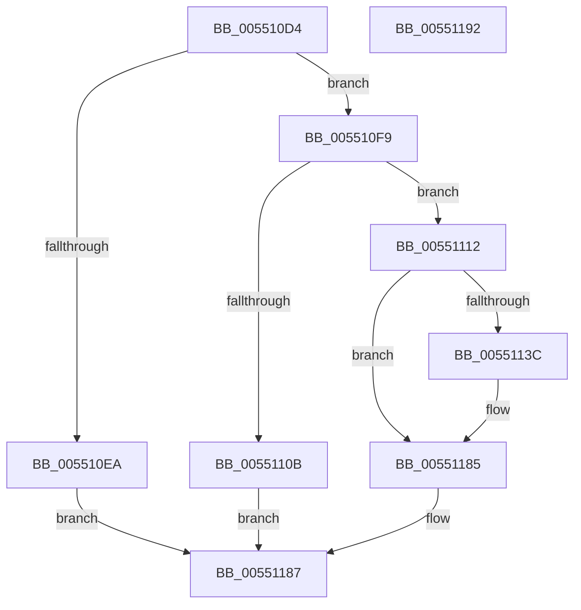

# HalpDmaFreeMapRegisterFrame

- RVA: `0x005510D4`–`0x00551193` (길이 `191` bytes)
- VA: `0x00000001405510D4`
- 실행 섹션: `.text`
- PDB 이름 있음: `예`; PDB Function 태그: `아니요`
- unwind 정보 RVA: `0x0005CAAC`
- 디코드: `50`개 명령, `191/191` bytes 표시
- 미해석 바이트: `0` (있으면 어셈블리에 `.byte`로 보존)

> 이 문서는 커널 이미지의 기계어와 PDB 기호를 분석해 생성했습니다. 4번과 5번은 함수 원형과 자료형을 바이너리 사용 방식에서 추정한 C 해석이며 원본 소스 복구 결과는 아닙니다.

## 1. Dependencies

- 직접 호출 지점: **5**; 고유 호출 대상: **5**
- 직접 호출자로 확인된 함수: **1**
- RIP 상대 이미지 참조: **1**

### Outgoing calls
- `0x005510ED` → [HalpMmAllocCtxFree](../3E/HalpMmAllocCtxFree_function_003E1904.md) (function, `0x003E1904`)
- `0x005510F9` → [MmGetPhysicalAddress](../23/MmGetPhysicalAddress_function_0023A500.md) (function, `0x0023A500`)
- `0x0055111D` → [MiUnmapContiguousMemory](../3F/MiUnmapContiguousMemory_function_003F7908.md) (function, `0x003F7908`)
- `0x00551131` → [HalpDmaCvmSetPageShareability](../../page/70/HalpDmaCvmSetPageShareability_function_0070973C.md) (function, `0x0070973C`)
- `0x00551180` → [MmFreeContiguousMemory](../3F/MmFreeContiguousMemory_function_003F6F60.md) (function, `0x003F6F60`)

### Direct callers
- [sub_006EA22C](../6E/Unknown_function_006EA22C.md) at `0x006EA2E7`

### Static image references
- `0x005510DE` → RVA `0x00FC18A0` (`.data`; read)

## 2. Other-region calls and transfers

- 다른 실행 섹션으로 향하는 call: **1**
  - `0x00551131` → [HalpDmaCvmSetPageShareability](../../page/70/HalpDmaCvmSetPageShareability_function_0070973C.md) (`.text` → `PAGE`)
- 별도 외부 분기/꼬리 이동을 확인하지 못했습니다.

## 3. Assembly (complete function range)

```asm
005510D4  48 89 5C 24 08                  mov qword ptr [rsp + 8], rbx
005510D9  57                              push rdi
005510DA  48 83 EC 20                     sub rsp, 0x20
005510DE  80 3D BB 07 A7 00 00            cmp byte ptr [rip + 0xa707bb], 0
005510E5  48 8B F9                        mov rdi, rcx
005510E8  75 0F                           jne 0x1405510f9
005510EA  48 8B D1                        mov rdx, rcx
005510ED  E8 12 08 E9 FF                  call 0x1403e1904
005510F2  33 C0                           xor eax, eax
005510F4  E9 8E 00 00 00                  jmp 0x140551187
005510F9  E8 02 94 CE FF                  call 0x14023a500
005510FE  48 89 44 24 38                  mov qword ptr [rsp + 0x38], rax
00551103  48 8B D8                        mov rbx, rax
00551106  48 85 C0                        test rax, rax
00551109  75 07                           jne 0x140551112
0055110B  B8 EF 00 00 C0                  mov eax, 0xc00000ef
00551110  EB 75                           jmp 0x140551187
00551112  41 B0 01                        mov r8b, 1
00551115  BA 00 10 00 00                  mov edx, 0x1000
0055111A  48 8B CF                        mov rcx, rdi
0055111D  E8 E6 67 EA FF                  call 0x1403f7908
00551122  45 33 C0                        xor r8d, r8d
00551125  4C 8D 4C 24 38                  lea r9, [rsp + 0x38]
0055112A  48 8B CB                        mov rcx, rbx
0055112D  41 8D 50 01                     lea edx, [r8 + 1]
00551131  E8 06 86 1B 00                  call 0x14070973c
00551136  8B D8                           mov ebx, eax
00551138  85 C0                           test eax, eax
0055113A  78 49                           js 0x140551185
0055113C  48 8B 4C 24 38                  mov rcx, qword ptr [rsp + 0x38]
00551141  48 C1 E9 0C                     shr rcx, 0xc
00551145  48 8D 14 49                     lea rdx, [rcx + rcx*2]
00551149  48 03 D2                        add rdx, rdx
0055114C  48 B8 08 00 00 00 00 DE FF FF   movabs rax, 0xffffde0000000008
00551156  48 8B 0C D0                     mov rcx, qword ptr [rax + rdx*8]
0055115A  48 C1 E1 19                     shl rcx, 0x19
0055115E  48 B8 00 00 00 00 80 F6 FF FF   movabs rax, 0xfffff68000000000
00551168  48 C1 E0 19                     shl rax, 0x19
0055116C  48 2B C8                        sub rcx, rax
0055116F  48 8B 44 24 38                  mov rax, qword ptr [rsp + 0x38]
00551174  25 FF 0F 00 00                  and eax, 0xfff
00551179  48 C1 F9 10                     sar rcx, 0x10
0055117D  48 03 C8                        add rcx, rax
00551180  E8 DB 5D EA FF                  call 0x1403f6f60
00551185  8B C3                           mov eax, ebx
00551187  48 8B 5C 24 30                  mov rbx, qword ptr [rsp + 0x30]
0055118C  48 83 C4 20                     add rsp, 0x20
00551190  5F                              pop rdi
00551191  C3                              ret
00551192  CC                              int3
```

## 4. C-style interpretation (structured pseudocode)

```c
__int64 __fastcall HalpDmaFreeMapRegisterFrame(__int64 a1)
{
    __int64 result;
    __int64 v_rsp;
    unsigned __int64 v_stack_p10;
    unsigned __int64 v_stack_p8;

    v_stack_p8 = v_rbx;
    v_rsp = (v_rsp) - (32);
    if ((*(unsigned __int8 *)(v_rip + 10946491)) != 0) goto loc_005510F9;
    result = HalpMmAllocCtxFree(a1, a1, a3, a4);
    result = 0;
    goto loc_00551187;
loc_005510F9:
    result = MmGetPhysicalAddress(a1, a1, a3, a4);
    v_stack_p10 = result;
    if (result != 0) goto loc_00551112;
    goto loc_00551187;
loc_00551112:
    result = MiUnmapContiguousMemory(a1, (unsigned int)(0x1000ULL), 1, a4);
    a3 = 0;
    result = HalpDmaCvmSetPageShareability(result, a3 + 1, a3, v_stack_p10);
    if (!(sign_flag)) {
        a1 = v_stack_p10;
        a1 = (a1) >> (12);
        a2 = a1 + a1 * 2;
        a2 = (a2) + (a2);
        a1 = *(unsigned __int64 *)(result + a2 * 8);
        a1 = (a1) << (25);
        result = (result) << (25);
        a1 = (a1) - (result);
        result = v_stack_p10;
        result = (unsigned int)((result) & (0xFFFULL));
        a1 = (a1) >> (16);
        a1 = (a1) + (result);
        result = MmFreeContiguousMemory(a1, a2, a3, v_stack_p10);
    }
loc_00551187:
    v_rsp = (v_rsp) + (32);
    return (unsigned int)((unsigned int)((unsigned int)((unsigned int)(result))));
}
```

## 5. (Beta) C Style

```c
int64_t HalpDmaFreeMapRegisterFrame(int64_t Arg1)
{
    int64_t result;
    int64_t local_rsp;
    uint64_t v_stack_p10;
    uint64_t v_stack_p8;

    v_stack_p8 = local_rbx;
    local_rsp = (local_rsp) - (32);
    if ((*(uint8_t *)(v_rip + 0xA707BB)) != 0) goto loc_005510F9;
    result = HalpMmAllocCtxFree(Arg1, Arg1, a3, a4);
    result = 0;
    goto loc_00551187;
loc_005510F9:
    result = MmGetPhysicalAddress(Arg1, Arg1, a3, a4);
    v_stack_p10 = result;
    if (result != 0) goto loc_00551112;
    goto loc_00551187;
loc_00551112:
    result = MiUnmapContiguousMemory(Arg1, (uint32_t)(0x1000ULL), 1, a4);
    a3 = 0;
    result = HalpDmaCvmSetPageShareability(result, a3 + 1, a3, v_stack_p10);
    if (!(sign_flag)) {
        Arg1 = v_stack_p10;
        Arg1 = (Arg1) >> (12);
        a2 = Arg1 + Arg1 * 2;
        a2 = (a2) + (a2);
        Arg1 = *(uint64_t *)(result + a2 * 8);
        Arg1 = (Arg1) << (25);
        result = (result) << (25);
        Arg1 = (Arg1) - (result);
        result = v_stack_p10;
        result = (uint32_t)((result) & (0xFFFULL));
        Arg1 = (Arg1) >> (16);
        Arg1 = (Arg1) + (result);
        result = MmFreeContiguousMemory(Arg1, a2, a3, v_stack_p10);
    }
loc_00551187:
    local_rsp = (local_rsp) + (32);
    return (uint32_t)((uint32_t)((uint32_t)((uint32_t)(result))));
}
```

## 6. Execution-region graph

[열기: 2D/3D 그래프와 함수 탐색 컨트롤 패널](../../../control-panel.html?section=text&rva=0x005510D4&view=graph)

- 2D 그래프는 위에서 아래로 흐르고, 3D 그래프는 빈 공간을 드래그해 회전합니다. Shift+드래그는 이동, 휠은 확대·축소, 함수 노드 선택은 대상 보고서 이동입니다.

### Static fallback


