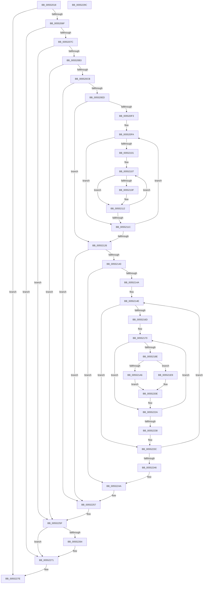

# HalpDmaGetReservedRegionsForDeviceResources

- RVA: `0x00552018`–`0x0055229D` (길이 `645` bytes)
- VA: `0x0000000140552018`
- 실행 섹션: `.text`
- PDB 이름 있음: `예`; PDB Function 태그: `아니요`
- unwind 정보 RVA: `0x000C437C`
- 디코드: `175`개 명령, `645/645` bytes 표시
- 미해석 바이트: `0` (있으면 어셈블리에 `.byte`로 보존)

> 이 문서는 커널 이미지의 기계어와 PDB 기호를 분석해 생성했습니다. 4번과 5번은 함수 원형과 자료형을 바이너리 사용 방식에서 추정한 C 해석이며 원본 소스 복구 결과는 아닙니다.

## 1. Dependencies

- 직접 호출 지점: **11**; 고유 호출 대상: **8**
- 직접 호출자로 확인된 함수: **1**
- RIP 상대 이미지 참조: **0**

### Outgoing calls
- `0x0055204E` → [memset](../6C/memset_function_006C6C40.md) (function, `0x006C6C40`)
- `0x00552062` → [HalpDmaGetIommuInterface](../53/HalpDmaGetIommuInterface_function_0053E2A0.md) (function, `0x0053E2A0`)
- `0x00552080` → [guard_dispatch_icall](../6B/guard_dispatch_icall_function_006BAAD0.md) (function, `0x006BAAD0`)
- `0x005520A3` → [IoGetDeviceProperty](../../page/8F/IoGetDeviceProperty_function_008FA720.md) (function, `0x008FA720`)
- `0x005520B6` → [HalpMmAllocCtxAlloc](../3E/HalpMmAllocCtxAlloc_function_003E10B8.md) (function, `0x003E10B8`)
- `0x005520E0` → [IoGetDeviceProperty](../../page/8F/IoGetDeviceProperty_function_008FA720.md) (function, `0x008FA720`)
- `0x0055212F` → [HalpMmAllocCtxAlloc](../3E/HalpMmAllocCtxAlloc_function_003E10B8.md) (function, `0x003E10B8`)
- `0x00552192` → [RtlCmDecodeMemIoResource](../4A/RtlCmDecodeMemIoResource_function_004A0120.md) (function, `0x004A0120`)
- `0x0055225A` → [HalpMmAllocCtxFree](../3E/HalpMmAllocCtxFree_function_003E1904.md) (function, `0x003E1904`)
- `0x0055226C` → [ObfDereferenceObjectWithTag](../2F/ObfDereferenceObjectWithTag_function_002F78E0.md) (function, `0x002F78E0`)
- `0x00552279` → [guard_dispatch_icall](../6B/guard_dispatch_icall_function_006BAAD0.md) (function, `0x006BAAD0`)

### Direct callers
- [HalpDmaAllocateDomain](HalpDmaAllocateDomain_function_00551C10.md) at `0x00551E19`

### Static image references
- 디코드된 RIP-relative 메모리 참조가 없습니다.

## 2. Other-region calls and transfers

- 다른 실행 섹션으로 향하는 call: **2**
  - `0x005520A3` → [IoGetDeviceProperty](../../page/8F/IoGetDeviceProperty_function_008FA720.md) (`.text` → `PAGE`)
  - `0x005520E0` → [IoGetDeviceProperty](../../page/8F/IoGetDeviceProperty_function_008FA720.md) (`.text` → `PAGE`)
- 별도 외부 분기/꼬리 이동을 확인하지 못했습니다.

## 3. Assembly (complete function range)

```asm
00552018  48 89 5C 24 08                  mov qword ptr [rsp + 8], rbx
0055201D  89 54 24 10                     mov dword ptr [rsp + 0x10], edx
00552021  55                              push rbp
00552022  56                              push rsi
00552023  57                              push rdi
00552024  41 54                           push r12
00552026  41 55                           push r13
00552028  41 56                           push r14
0055202A  41 57                           push r15
0055202C  48 8D 6C 24 D9                  lea rbp, [rsp - 0x27]
00552031  48 81 EC A0 00 00 00            sub rsp, 0xa0
00552038  48 83 65 B7 00                  and qword ptr [rbp - 0x49], 0
0055203D  33 D2                           xor edx, edx
0055203F  83 65 77 00                     and dword ptr [rbp + 0x77], 0
00552043  48 8B D9                        mov rbx, rcx
00552046  48 8D 4D D7                     lea rcx, [rbp - 0x29]
0055204A  44 8D 42 50                     lea r8d, [rdx + 0x50]
0055204E  E8 ED 4B 17 00                  call 0x1406c6c40
00552053  33 FF                           xor edi, edi
00552055  48 8D 55 D7                     lea rdx, [rbp - 0x29]
00552059  21 7D 7F                        and dword ptr [rbp + 0x7f], edi
0055205C  48 8B CB                        mov rcx, rbx
0055205F  45 33 ED                        xor r13d, r13d
00552062  E8 39 C2 FE FF                  call 0x14053e2a0
00552067  85 C0                           test eax, eax
00552069  0F 88 0F 02 00 00               js 0x14055227e
0055206F  48 8B 45 1F                     mov rax, qword ptr [rbp + 0x1f]
00552073  48 85 C0                        test rax, rax
00552076  0F 84 F5 01 00 00               je 0x140552271
0055207C  48 8B 4D DF                     mov rcx, qword ptr [rbp - 0x21]
00552080  E8 4B 8A 16 00                  call 0x1406baad0
00552085  4C 8B F8                        mov r15, rax
00552088  48 89 45 C7                     mov qword ptr [rbp - 0x39], rax
0055208C  48 8D 45 77                     lea rax, [rbp + 0x77]
00552090  49 8B CF                        mov rcx, r15
00552093  8D 77 15                        lea esi, [rdi + 0x15]
00552096  48 89 44 24 20                  mov qword ptr [rsp + 0x20], rax
0055209B  45 33 C9                        xor r9d, r9d
0055209E  45 33 C0                        xor r8d, r8d
005520A1  8B D6                           mov edx, esi
005520A3  E8 78 86 3A 00                  call 0x1408fa720
005520A8  3D 23 00 00 C0                  cmp eax, 0xc0000023
005520AD  0F 85 AC 01 00 00               jne 0x14055225f
005520B3  8B 55 77                        mov edx, dword ptr [rbp + 0x77]
005520B6  E8 FD EF E8 FF                  call 0x1403e10b8
005520BB  48 89 45 BF                     mov qword ptr [rbp - 0x41], rax
005520BF  48 8B D8                        mov rbx, rax
005520C2  48 85 C0                        test rax, rax
005520C5  0F 84 94 01 00 00               je 0x14055225f
005520CB  44 8B 45 77                     mov r8d, dword ptr [rbp + 0x77]
005520CF  48 8D 45 77                     lea rax, [rbp + 0x77]
005520D3  4C 8B CB                        mov r9, rbx
005520D6  48 89 44 24 20                  mov qword ptr [rsp + 0x20], rax
005520DB  8B D6                           mov edx, esi
005520DD  49 8B CF                        mov rcx, r15
005520E0  E8 3B 86 3A 00                  call 0x1408fa720
005520E5  85 C0                           test eax, eax
005520E7  0F 88 6A 01 00 00               js 0x140552257
005520ED  8B 03                           mov eax, dword ptr [rbx]
005520EF  85 C0                           test eax, eax
005520F1  74 33                           je 0x140552126
005520F3  48 8D 4B 14                     lea rcx, [rbx + 0x14]
005520F7  44 8B C8                        mov r9d, eax
005520FA  8B 41 FC                        mov eax, dword ptr [rcx - 4]
005520FD  85 C0                           test eax, eax
005520FF  74 1B                           je 0x14055211c
00552101  48 8B D1                        mov rdx, rcx
00552104  44 8B C0                        mov r8d, eax
00552107  8A 02                           mov al, byte ptr [rdx]
00552109  2C 03                           sub al, 3
0055210B  A8 FB                           test al, 0xfb
0055210D  75 03                           jne 0x140552112
0055210F  41 FF C5                        inc r13d
00552112  48 83 C2 14                     add rdx, 0x14
00552116  49 83 E8 01                     sub r8, 1
0055211A  75 EB                           jne 0x140552107
0055211C  48 83 C1 24                     add rcx, 0x24
00552120  49 83 E9 01                     sub r9, 1
00552124  75 D4                           jne 0x1405520fa
00552126  41 8B D5                        mov edx, r13d
00552129  C1 E2 05                        shl edx, 5
0055212C  89 55 77                        mov dword ptr [rbp + 0x77], edx
0055212F  E8 84 EF E8 FF                  call 0x1403e10b8
00552134  48 8B F8                        mov rdi, rax
00552137  48 85 C0                        test rax, rax
0055213A  0F 84 17 01 00 00               je 0x140552257
00552140  33 F6                           xor esi, esi
00552142  39 33                           cmp dword ptr [rbx], esi
00552144  0F 86 00 01 00 00               jbe 0x14055224a
0055214A  44 8B 7D 7F                     mov r15d, dword ptr [rbp + 0x7f]
0055214E  8B CE                           mov ecx, esi
00552150  4C 8D 24 F5 03 00 00 00         lea r12, [rsi*8 + 3]
00552158  4C 03 E1                        add r12, rcx
0055215B  45 33 F6                        xor r14d, r14d
0055215E  4E 8D 24 A3                     lea r12, [rbx + r12*4]
00552162  45 39 74 24 04                  cmp dword ptr [r12 + 4], r14d
00552167  0F 86 CF 00 00 00               jbe 0x14055223c
0055216D  8B 5D 6F                        mov ebx, dword ptr [rbp + 0x6f]
00552170  41 8B C6                        mov eax, r14d
00552173  4A 8D 0C B5 02 00 00 00         lea rcx, [r14*4 + 2]
0055217B  48 03 C8                        add rcx, rax
0055217E  49 8D 0C 8C                     lea rcx, [r12 + rcx*4]
00552182  8A 01                           mov al, byte ptr [rcx]
00552184  2C 03                           sub al, 3
00552186  A8 FB                           test al, 0xfb
00552188  0F 85 9C 00 00 00               jne 0x14055222a
0055218E  48 8D 55 B7                     lea rdx, [rbp - 0x49]
00552192  E8 89 DF F4 FF                  call 0x1404a0120
00552197  45 8B C7                        mov r8d, r15d
0055219A  4C 8B C8                        mov r9, rax
0055219D  49 C1 E0 05                     shl r8, 5
005521A1  83 FB 02                        cmp ebx, 2
005521A4  75 43                           jne 0x1405521e9
005521A6  48 8B 4D B7                     mov rcx, qword ptr [rbp - 0x49]
005521AA  48 B8 00 00 00 00 80 FF FF FF   movabs rax, 0xffffff8000000000
005521B4  48 8B D1                        mov rdx, rcx
005521B7  48 23 D0                        and rdx, rax
005521BA  48 B8 FF FF FF FF 7F 00 00 00   movabs rax, 0x7fffffffff
005521C4  48 2B CA                        sub rcx, rdx
005521C7  48 89 55 B7                     mov qword ptr [rbp - 0x49], rdx
005521CB  4C 03 C9                        add r9, rcx
005521CE  49 89 54 38 08                  mov qword ptr [r8 + rdi + 8], rdx
005521D3  49 03 C1                        add rax, r9
005521D6  48 B9 00 00 00 F8 FF FF 0F 00   movabs rcx, 0xffffff8000000
005521E0  48 C1 E8 0C                     shr rax, 0xc
005521E4  48 23 C1                        and rax, rcx
005521E7  EB 25                           jmp 0x14055220e
005521E9  48 8B 45 B7                     mov rax, qword ptr [rbp - 0x49]
005521ED  48 25 00 F0 FF FF               and rax, 0xfffffffffffff000
005521F3  49 89 44 38 08                  mov qword ptr [r8 + rdi + 8], rax
005521F8  49 F7 C1 FF 0F 00 00            test r9, 0xfff
005521FF  B8 00 00 00 00                  mov eax, 0
00552204  0F 95 C0                        setne al
00552207  49 C1 E9 0C                     shr r9, 0xc
0055220B  49 03 C1                        add rax, r9
0055220E  49 89 44 38 10                  mov qword ptr [r8 + rdi + 0x10], rax
00552213  41 FF C7                        inc r15d
00552216  41 8B C7                        mov eax, r15d
00552219  48 C1 E0 05                     shl rax, 5
0055221D  48 03 C7                        add rax, rdi
00552220  41 C6 44 38 18 00               mov byte ptr [r8 + rdi + 0x18], 0
00552226  49 89 04 38                     mov qword ptr [r8 + rdi], rax
0055222A  41 FF C6                        inc r14d
0055222D  45 3B 74 24 04                  cmp r14d, dword ptr [r12 + 4]
00552232  0F 82 38 FF FF FF               jb 0x140552170
00552238  48 8B 5D BF                     mov rbx, qword ptr [rbp - 0x41]
0055223C  FF C6                           inc esi
0055223E  3B 33                           cmp esi, dword ptr [rbx]
00552240  0F 82 08 FF FF FF               jb 0x14055214e
00552246  4C 8B 7D C7                     mov r15, qword ptr [rbp - 0x39]
0055224A  41 8D 4D FF                     lea ecx, [r13 - 1]
0055224E  48 C1 E1 05                     shl rcx, 5
00552252  48 83 24 39 00                  and qword ptr [rcx + rdi], 0
00552257  48 8B D3                        mov rdx, rbx
0055225A  E8 A5 F6 E8 FF                  call 0x1403e1904
0055225F  4D 85 FF                        test r15, r15
00552262  74 0D                           je 0x140552271
00552264  BA 44 66 6C 74                  mov edx, 0x746c6644
00552269  49 8B CF                        mov rcx, r15
0055226C  E8 6F 56 DA FF                  call 0x1402f78e0
00552271  48 8B 4D DF                     mov rcx, qword ptr [rbp - 0x21]
00552275  48 8B 45 EF                     mov rax, qword ptr [rbp - 0x11]
00552279  E8 52 88 16 00                  call 0x1406baad0
0055227E  48 8B 9C 24 E0 00 00 00         mov rbx, qword ptr [rsp + 0xe0]
00552286  48 8B C7                        mov rax, rdi
00552289  48 81 C4 A0 00 00 00            add rsp, 0xa0
00552290  41 5F                           pop r15
00552292  41 5E                           pop r14
00552294  41 5D                           pop r13
00552296  41 5C                           pop r12
00552298  5F                              pop rdi
00552299  5E                              pop rsi
0055229A  5D                              pop rbp
0055229B  C3                              ret
0055229C  CC                              int3
```

## 4. C-style interpretation (structured pseudocode)

```c
__int64 __fastcall HalpDmaGetReservedRegionsForDeviceResources(__int64 a1, int a2, __int64 a3, int a4)
{
    __int64 result;
    __int64 v_r12;
    __int64 v_r13;
    __int64 v_r14;
    __int64 v_r15;
    __int64 v_rdi;
    __int64 v_rsi;
    __int64 v_rsp;
    unsigned __int64 v_stack_m40;
    unsigned __int64 v_stack_m5F;
    unsigned __int64 v_stack_m70;
    unsigned __int64 v_stack_m80;
    unsigned __int64 v_stack_m88;
    unsigned __int64 v_stack_m98;
    unsigned __int64 v_stack_mA0;
    unsigned __int64 v_stack_mA8;
    unsigned __int64 v_stack_mB8;
    unsigned int v_stack_p10;
    unsigned int v_stack_p18;
    unsigned int v_stack_p20;
    unsigned __int64 v_stack_p8;

    v_stack_p8 = v_rbx;
    v_stack_p10 = a2;
    v_rsp = (v_rsp) - (160);
    a2 = 0;
    result = memset(v_stack_m88, a2, a2 + 80, a4);
    v_rdi = 0;
    v_r13 = 0;
    result = HalpDmaGetIommuInterface(a1, v_stack_m88, a2 + 80, a4);
    if (sign_flag) goto loc_0055227E;
    if (v_stack_m40 == 0) goto loc_00552271;
    result = guard_dispatch_icall(v_stack_m80, v_stack_m88, a2 + 80, a4);
    v_stack_m98 = result;
    v_stack_mB8 = v_stack_p18;
    a4 = 0;
    a3 = 0;
    result = IoGetDeviceProperty(result, (unsigned int)((unsigned int)(v_rdi + 21)), a3, a4);
    if (((unsigned int)(result)) != 0xC0000023ULL) goto loc_0055225F;
    result = HalpMmAllocCtxAlloc(result, (unsigned int)(v_stack_p18), a3, a4);
    v_stack_mA0 = result;
    if (result == 0) goto loc_0055225F;
    v_stack_mB8 = v_stack_p18;
    result = IoGetDeviceProperty(result, (unsigned int)((unsigned int)(v_rdi + 21)), (unsigned int)(v_stack_p18), result);
    if (sign_flag) goto loc_00552257;
    if ((unsigned int)((unsigned int)(*(unsigned int *)(result))) == 0) goto loc_00552126;
loc_005520FA:
    if ((unsigned int)((unsigned int)(*(unsigned int *)(result + 20 - 4))) == 0) goto loc_0055211C;
loc_00552107:
    result = (unsigned __int8)((*(unsigned __int8 *)(result + 20)) - (3));
    if ((((unsigned __int8)(result)) & (251)) == 0) {
        v_r13 = (unsigned int)((v_r13) + 1);
    }
    a2 = (result + 20) + (20);
    a3 = ((unsigned int)((unsigned int)((unsigned int)(*(unsigned int *)(result + 20 - 4))))) - (1);
    if (condition_is_not_equal) goto loc_00552107;
loc_0055211C:
    a1 = (result + 20) + (36);
    a4 = ((unsigned int)((unsigned int)((unsigned int)(*(unsigned int *)(result))))) - (1);
    if (condition_is_not_equal) goto loc_005520FA;
loc_00552126:
    a2 = (unsigned int)(((unsigned int)((unsigned int)(v_r13))) << (5));
    v_stack_p18 = a2;
    result = HalpMmAllocCtxAlloc(a1, a2, a3, a4);
    if (result == 0) goto loc_00552257;
    v_rsi = 0;
    if ((*(unsigned int *)(result)) <= 0) goto loc_0055224A;
loc_0055214E:
    v_r12 = (v_rsi * 8 + 3) + (0);
    v_r14 = 0;
    if ((*(unsigned int *)(result + v_r12 * 4 + 4)) <= 0) goto loc_0055223C;
loc_00552170:
    a1 = (v_r14 * 4 + 2) + (0);
    result = (unsigned __int8)((*(unsigned __int8 *)(result + v_r12 * 4 + a1 * 4)) - (3));
    if ((((unsigned __int8)(result)) & (251)) != 0) goto loc_0055222A;
    result = RtlCmDecodeMemIoResource(result + v_r12 * 4 + a1 * 4, v_stack_mA8, a3, a4);
    a3 = ((unsigned int)((unsigned int)((unsigned int)(v_stack_p20)))) << (5);
    if (((unsigned int)((unsigned int)(v_stack_p10))) != 2) goto loc_005521E9;
    a2 = (v_stack_mA8) & (result);
    a1 = (v_stack_mA8) - (a2);
    v_stack_mA8 = a2;
    a4 = (result) + (a1);
    *(unsigned __int64 *)(a3 + result * 1 + 8) = a2;
    result = (result) + (a4);
    result = (result) >> (12);
    result = (result) & (a1);
    goto loc_0055220E;
loc_005521E9:
    result = (v_stack_mA8) & (0xFFFFFFFFFFFFF000ULL);
    *(unsigned __int64 *)(a3 + result * 1 + 8) = result;
    result = (((a4) & (0xFFFULL)) != 0) ? 1 : 0;
    a4 = (a4) >> (12);
    result = (result) + (a4);
loc_0055220E:
    *(unsigned __int64 *)(a3 + result * 1 + 16) = result;
    v_r15 = (unsigned int)(((unsigned int)(v_stack_p20)) + 1);
    result = ((unsigned int)((unsigned int)(v_r15))) << (5);
    result = (result) + (result);
    *(unsigned __int8 *)(a3 + result * 1 + 24) = 0;
    *(unsigned __int64 *)(a3 + result * 1) = result;
loc_0055222A:
    v_r14 = (unsigned int)((v_r14) + 1);
    if (((unsigned int)(v_r14)) < (*(unsigned int *)(result + v_r12 * 4 + 4))) goto loc_00552170;
loc_0055223C:
    v_rsi = (unsigned int)((v_rsi) + 1);
    if (((unsigned int)(v_rsi)) < (*(unsigned int *)(v_stack_mA0))) goto loc_0055214E;
loc_0055224A:
    a1 = (v_r13 - 1) << (5);
loc_00552257:
    result = HalpMmAllocCtxFree(a1, v_stack_mA0, a3, a4);
loc_0055225F:
    if (v_stack_m98 != 0) {
        a2 = 0x746C6644ULL;
        a1 = v_stack_m98;
        result = ObfDereferenceObjectWithTag(a1, a2, a3, a4);
    }
    result = guard_dispatch_icall(v_stack_m80, a2, a3, a4);
loc_0055227E:
    v_rsp = (v_rsp) + (160);
    return result;
}
```

## 5. (Beta) C Style

```c
int64_t HalpDmaGetReservedRegionsForDeviceResources(int64_t Arg1, int32_t Arg2, int64_t Arg3, int32_t Arg4)
{
    int64_t result;
    int64_t local_r12;
    int64_t local_r13;
    int64_t local_r14;
    int64_t local_r15;
    int64_t local_rdi;
    int64_t local_rsi;
    int64_t local_rsp;
    uint64_t v_stack_m40;
    uint64_t v_stack_m5F;
    uint64_t v_stack_m70;
    uint64_t v_stack_m80;
    uint64_t v_stack_m88;
    uint64_t v_stack_m98;
    uint64_t v_stack_mA0;
    uint64_t v_stack_mA8;
    uint64_t v_stack_mB8;
    uint32_t v_stack_p10;
    uint32_t v_stack_p18;
    uint32_t v_stack_p20;
    uint64_t v_stack_p8;

    v_stack_p8 = local_rbx;
    v_stack_p10 = Arg2;
    local_rsp = (local_rsp) - (160);
    Arg2 = 0;
    result = memset(v_stack_m88, Arg2, Arg2 + 80, Arg4);
    local_rdi = 0;
    local_r13 = 0;
    result = HalpDmaGetIommuInterface(Arg1, v_stack_m88, Arg2 + 80, Arg4);
    if (sign_flag) goto loc_0055227E;
    if (v_stack_m40 == 0) goto loc_00552271;
    result = guard_dispatch_icall(v_stack_m80, v_stack_m88, Arg2 + 80, Arg4);
    v_stack_m98 = result;
    v_stack_mB8 = v_stack_p18;
    Arg4 = 0;
    Arg3 = 0;
    result = IoGetDeviceProperty(result, (uint32_t)((uint32_t)(local_rdi + 21)), Arg3, Arg4);
    if (((uint32_t)(result)) != 0xC0000023ULL) goto loc_0055225F;
    result = HalpMmAllocCtxAlloc(result, (uint32_t)(v_stack_p18), Arg3, Arg4);
    v_stack_mA0 = result;
    if (result == 0) goto loc_0055225F;
    v_stack_mB8 = v_stack_p18;
    result = IoGetDeviceProperty(result, (uint32_t)((uint32_t)(local_rdi + 21)), (uint32_t)(v_stack_p18), result);
    if (sign_flag) goto loc_00552257;
    if ((uint32_t)((uint32_t)(*(uint32_t *)(result))) == 0) goto loc_00552126;
loc_005520FA:
    if ((uint32_t)((uint32_t)(*(uint32_t *)(result + 0x14 - 0x4))) == 0) goto loc_0055211C;
loc_00552107:
    result = (uint8_t)((*(uint8_t *)(result + 0x14)) - (3));
    if ((((uint8_t)(result)) & (251)) == 0) {
        local_r13 = (uint32_t)((local_r13) + 1);
    }
    Arg2 = (result + 20) + (20);
    Arg3 = ((uint32_t)((uint32_t)((uint32_t)(*(uint32_t *)(result + 0x14 - 0x4))))) - (1);
    if (condition_is_not_equal) goto loc_00552107;
loc_0055211C:
    Arg1 = (result + 20) + (36);
    Arg4 = ((uint32_t)((uint32_t)((uint32_t)(*(uint32_t *)(result))))) - (1);
    if (condition_is_not_equal) goto loc_005520FA;
loc_00552126:
    Arg2 = (uint32_t)(((uint32_t)((uint32_t)(local_r13))) << (5));
    v_stack_p18 = Arg2;
    result = HalpMmAllocCtxAlloc(Arg1, Arg2, Arg3, Arg4);
    if (result == 0) goto loc_00552257;
    local_rsi = 0;
    if ((*(uint32_t *)(result)) <= 0) goto loc_0055224A;
loc_0055214E:
    local_r12 = (local_rsi * 8 + 3) + (0);
    local_r14 = 0;
    if ((*(uint32_t *)(result + local_r12 * 4 + 0x4)) <= 0) goto loc_0055223C;
loc_00552170:
    Arg1 = (local_r14 * 4 + 2) + (0);
    result = (uint8_t)((*(uint8_t *)(result + local_r12 * 4 + Arg1 * 4)) - (3));
    if ((((uint8_t)(result)) & (251)) != 0) goto loc_0055222A;
    result = RtlCmDecodeMemIoResource(result + local_r12 * 4 + Arg1 * 4, v_stack_mA8, Arg3, Arg4);
    Arg3 = ((uint32_t)((uint32_t)((uint32_t)(v_stack_p20)))) << (5);
    if (((uint32_t)((uint32_t)(v_stack_p10))) != 2) goto loc_005521E9;
    Arg2 = (v_stack_mA8) & (result);
    Arg1 = (v_stack_mA8) - (Arg2);
    v_stack_mA8 = Arg2;
    Arg4 = (result) + (Arg1);
    *(uint64_t *)(Arg3 + result * 1 + 0x8) = Arg2;
    result = (result) + (Arg4);
    result = (result) >> (12);
    result = (result) & (Arg1);
    goto loc_0055220E;
loc_005521E9:
    result = (v_stack_mA8) & (0xFFFFFFFFFFFFF000ULL);
    *(uint64_t *)(Arg3 + result * 1 + 0x8) = result;
    result = (((Arg4) & (0xFFFULL)) != 0) ? 1 : 0;
    Arg4 = (Arg4) >> (12);
    result = (result) + (Arg4);
loc_0055220E:
    *(uint64_t *)(Arg3 + result * 1 + 0x10) = result;
    local_r15 = (uint32_t)(((uint32_t)(v_stack_p20)) + 1);
    result = ((uint32_t)((uint32_t)(local_r15))) << (5);
    result = (result) + (result);
    *(uint8_t *)(Arg3 + result * 1 + 0x18) = 0;
    *(uint64_t *)(Arg3 + result * 1) = result;
loc_0055222A:
    local_r14 = (uint32_t)((local_r14) + 1);
    if (((uint32_t)(local_r14)) < (*(uint32_t *)(result + local_r12 * 4 + 0x4))) goto loc_00552170;
loc_0055223C:
    local_rsi = (uint32_t)((local_rsi) + 1);
    if (((uint32_t)(local_rsi)) < (*(uint32_t *)(v_stack_mA0))) goto loc_0055214E;
loc_0055224A:
    Arg1 = (local_r13 - 1) << (5);
loc_00552257:
    result = HalpMmAllocCtxFree(Arg1, v_stack_mA0, Arg3, Arg4);
loc_0055225F:
    if (v_stack_m98 != 0) {
        Arg2 = 0x746C6644ULL;
        Arg1 = v_stack_m98;
        result = ObfDereferenceObjectWithTag(Arg1, Arg2, Arg3, Arg4);
    }
    result = guard_dispatch_icall(v_stack_m80, Arg2, Arg3, Arg4);
loc_0055227E:
    local_rsp = (local_rsp) + (160);
    return result;
}
```

## 6. Execution-region graph

[열기: 2D/3D 그래프와 함수 탐색 컨트롤 패널](../../../control-panel.html?section=text&rva=0x00552018&view=graph)

- 2D 그래프는 위에서 아래로 흐르고, 3D 그래프는 빈 공간을 드래그해 회전합니다. Shift+드래그는 이동, 휠은 확대·축소, 함수 노드 선택은 대상 보고서 이동입니다.

### Static fallback


