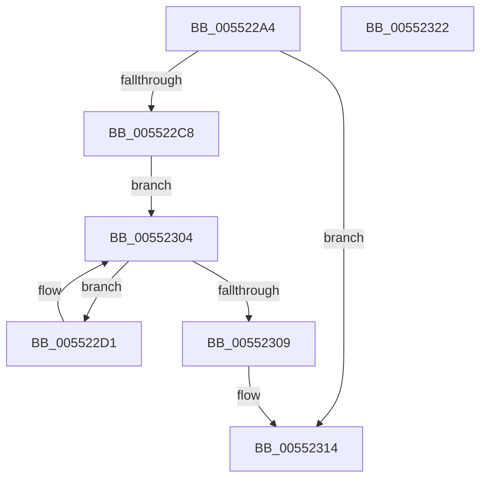

# HalpDmaGetReservedRegionsForHybridPassthroughDomain

- RVA: `0x005522A4`–`0x00552323` (길이 `127` bytes)
- VA: `0x00000001405522A4`
- 실행 섹션: `.text`
- PDB 이름 있음: `예`; PDB Function 태그: `아니요`
- unwind 정보 RVA: `0x0005CAAC`
- 디코드: `38`개 명령, `127/127` bytes 표시
- 미해석 바이트: `0` (있으면 어셈블리에 `.byte`로 보존)

> 이 문서는 커널 이미지의 기계어와 PDB 기호를 분석해 생성했습니다. 4번과 5번은 함수 원형과 자료형을 바이너리 사용 방식에서 추정한 C 해석이며 원본 소스 복구 결과는 아닙니다.

## 1. Dependencies

- 직접 호출 지점: **1**; 고유 호출 대상: **1**
- 직접 호출자로 확인된 함수: **1**
- RIP 상대 이미지 참조: **2**

### Outgoing calls
- `0x005522BB` → [HalpMmAllocCtxAlloc](../3E/HalpMmAllocCtxAlloc_function_003E10B8.md) (function, `0x003E10B8`)

### Direct callers
- [HalpDmaAllocateDomain](HalpDmaAllocateDomain_function_00551C10.md) at `0x00551E08`

### Static image references
- `0x005522AE` → RVA `0x00FC178C` (`.data`; read)
- `0x005522C8` → RVA `0x00FC1798` (`.data`; read)

## 2. Other-region calls and transfers

- 다른 실행 섹션으로 향하는 call: **0**
- 별도 외부 분기/꼬리 이동을 확인하지 못했습니다.

## 3. Assembly (complete function range)

```asm
005522A4  48 89 5C 24 08                  mov qword ptr [rsp + 8], rbx
005522A9  57                              push rdi
005522AA  48 83 EC 20                     sub rsp, 0x20
005522AE  8B 1D D8 F4 A6 00               mov ebx, dword ptr [rip + 0xa6f4d8]
005522B4  33 FF                           xor edi, edi
005522B6  8B D3                           mov edx, ebx
005522B8  C1 E2 05                        shl edx, 5
005522BB  E8 F8 ED E8 FF                  call 0x1403e10b8
005522C0  4C 8B C0                        mov r8, rax
005522C3  48 85 C0                        test rax, rax
005522C6  74 4C                           je 0x140552314
005522C8  4C 8B 0D C9 F4 A6 00            mov r9, qword ptr [rip + 0xa6f4c9]
005522CF  EB 33                           jmp 0x140552304
005522D1  49 8B 49 08                     mov rcx, qword ptr [r9 + 8]
005522D5  8B D7                           mov edx, edi
005522D7  48 C1 E2 05                     shl rdx, 5
005522DB  FF C7                           inc edi
005522DD  4A 89 4C 02 08                  mov qword ptr [rdx + r8 + 8], rcx
005522E2  49 8B 41 10                     mov rax, qword ptr [r9 + 0x10]
005522E6  4A 89 44 02 10                  mov qword ptr [rdx + r8 + 0x10], rax
005522EB  41 8A 41 18                     mov al, byte ptr [r9 + 0x18]
005522EF  42 88 44 02 18                  mov byte ptr [rdx + r8 + 0x18], al
005522F4  8B C7                           mov eax, edi
005522F6  48 C1 E0 05                     shl rax, 5
005522FA  49 03 C0                        add rax, r8
005522FD  4A 89 04 02                     mov qword ptr [rdx + r8], rax
00552301  4D 8B 09                        mov r9, qword ptr [r9]
00552304  4D 85 C9                        test r9, r9
00552307  75 C8                           jne 0x1405522d1
00552309  8D 4B FF                        lea ecx, [rbx - 1]
0055230C  48 C1 E1 05                     shl rcx, 5
00552310  4E 21 0C 01                     and qword ptr [rcx + r8], r9
00552314  48 8B 5C 24 30                  mov rbx, qword ptr [rsp + 0x30]
00552319  49 8B C0                        mov rax, r8
0055231C  48 83 C4 20                     add rsp, 0x20
00552320  5F                              pop rdi
00552321  C3                              ret
00552322  CC                              int3
```

## 4. C-style interpretation (structured pseudocode)

```c
__int64 __fastcall HalpDmaGetReservedRegionsForHybridPassthroughDomain(void)
{
    __int64 result;
    __int64 v_rdi;
    __int64 v_rsp;
    unsigned __int64 v_stack_p8;

    v_stack_p8 = v_rbx;
    v_rsp = (v_rsp) - (32);
    v_rdi = 0;
    a2 = (unsigned int)(((unsigned int)((unsigned int)((unsigned int)(*(unsigned int *)(v_rip + 10941656))))) << (5));
    result = HalpMmAllocCtxAlloc(a1, a2, a3, a4);
    if (result == 0) goto loc_00552314;
    goto loc_00552304;
loc_005522D1:
    a2 = (0) << (5);
    v_rdi = (unsigned int)((v_rdi) + 1);
    *(unsigned __int64 *)(a2 + result * 1 + 8) = *(unsigned __int64 *)(*(unsigned __int64 *)(v_rip + 10941641) + 8);
    *(unsigned __int64 *)(a2 + result * 1 + 16) = *(unsigned __int64 *)(*(unsigned __int64 *)(v_rip + 10941641) + 16);
    *(unsigned __int8 *)(a2 + result * 1 + 24) = (unsigned __int8)(*(unsigned __int8 *)(*(unsigned __int64 *)(v_rip + 10941641) + 24));
    result = ((unsigned int)((unsigned int)(v_rdi))) << (5);
    result = (result) + (result);
    *(unsigned __int64 *)(a2 + result * 1) = result;
loc_00552304:
    if (*(unsigned __int64 *)(*(unsigned __int64 *)(v_rip + 10941641)) != 0) goto loc_005522D1;
    a1 = ((unsigned int)(*(unsigned int *)(v_rip + 10941656)) - 1) << (5);
loc_00552314:
    v_rsp = (v_rsp) + (32);
    return result;
}
```

## 5. (Beta) C Style

```c
void HalpDmaGetReservedRegionsForHybridPassthroughDomain(void)
{
    int64_t result;
    int64_t local_rdi;
    int64_t local_rsp;
    uint64_t v_stack_p8;

    v_stack_p8 = local_rbx;
    local_rsp = (local_rsp) - (32);
    local_rdi = 0;
    a2 = (uint32_t)(((uint32_t)((uint32_t)((uint32_t)(*(uint32_t *)(v_rip + 0xA6F4D8))))) << (5));
    result = HalpMmAllocCtxAlloc(a1, a2, a3, a4);
    if (result == 0) goto loc_00552314;
    goto loc_00552304;
loc_005522D1:
    a2 = (0) << (5);
    local_rdi = (uint32_t)((local_rdi) + 1);
    *(uint64_t *)(a2 + result * 1 + 0x8) = *(uint64_t *)(*(uint64_t *)(v_rip + 0xA6F4C9) + 0x8);
    *(uint64_t *)(a2 + result * 1 + 0x10) = *(uint64_t *)(*(uint64_t *)(v_rip + 0xA6F4C9) + 0x10);
    *(uint8_t *)(a2 + result * 1 + 0x18) = (uint8_t)(*(uint8_t *)(*(uint64_t *)(v_rip + 0xA6F4C9) + 0x18));
    result = ((uint32_t)((uint32_t)(local_rdi))) << (5);
    result = (result) + (result);
    *(uint64_t *)(a2 + result * 1) = result;
loc_00552304:
    if (*(uint64_t *)(*(uint64_t *)(v_rip + 0xA6F4C9)) != 0) goto loc_005522D1;
    a1 = ((uint32_t)(*(uint32_t *)(v_rip + 0xA6F4D8)) - 1) << (5);
loc_00552314:
    local_rsp = (local_rsp) + (32);
    return result;
}
```

## 6. Execution-region graph

[열기: 2D/3D 그래프와 함수 탐색 컨트롤 패널](../../../control-panel.html?section=text&rva=0x005522A4&view=graph)

- 2D 그래프는 위에서 아래로 흐르고, 3D 그래프는 빈 공간을 드래그해 회전합니다. Shift+드래그는 이동, 휠은 확대·축소, 함수 노드 선택은 대상 보고서 이동입니다.

### Static fallback


