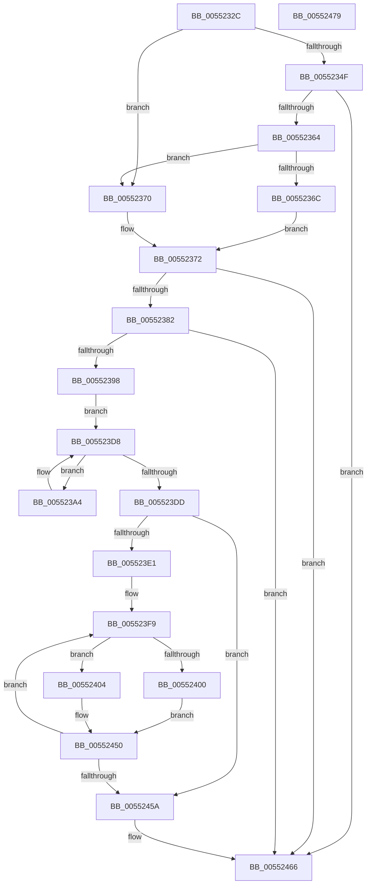

# HalpDmaGetReservedRegionsForTranslateDomain

- RVA: `0x0055232C`–`0x0055247A` (길이 `334` bytes)
- VA: `0x000000014055232C`
- 실행 섹션: `.text`
- PDB 이름 있음: `예`; PDB Function 태그: `아니요`
- unwind 정보 RVA: `0x000C4368`
- 디코드: `97`개 명령, `334/334` bytes 표시
- 미해석 바이트: `0` (있으면 어셈블리에 `.byte`로 보존)

> 이 문서는 커널 이미지의 기계어와 PDB 기호를 분석해 생성했습니다. 4번과 5번은 함수 원형과 자료형을 바이너리 사용 방식에서 추정한 C 해석이며 원본 소스 복구 결과는 아닙니다.

## 1. Dependencies

- 직접 호출 지점: **2**; 고유 호출 대상: **2**
- 직접 호출자로 확인된 함수: **1**
- RIP 상대 이미지 참조: **2**

### Outgoing calls
- `0x00552357` → [HalpIommuGetReservedRanges](HalpIommuGetReservedRanges_function_005552A4.md) (function, `0x005552A4`)
- `0x00552387` → [HalpMmAllocCtxAlloc](../3E/HalpMmAllocCtxAlloc_function_003E10B8.md) (function, `0x003E10B8`)

### Direct callers
- [HalpDmaAllocateDomain](HalpDmaAllocateDomain_function_00551C10.md) at `0x00551DFC`

### Static image references
- `0x00552374` → RVA `0x00FC1788` (`.data`; read)
- `0x00552398` → RVA `0x00FC1780` (`.data`; read)

## 2. Other-region calls and transfers

- 다른 실행 섹션으로 향하는 call: **0**
- 별도 외부 분기/꼬리 이동을 확인하지 못했습니다.

## 3. Assembly (complete function range)

```asm
0055232C  48 8B C4                        mov rax, rsp
0055232F  48 89 58 10                     mov qword ptr [rax + 0x10], rbx
00552333  48 89 70 20                     mov qword ptr [rax + 0x20], rsi
00552337  57                              push rdi
00552338  48 83 EC 20                     sub rsp, 0x20
0055233C  33 DB                           xor ebx, ebx
0055233E  33 FF                           xor edi, edi
00552340  48 21 58 18                     and qword ptr [rax + 0x18], rbx
00552344  48 8B F2                        mov rsi, rdx
00552347  89 78 08                        mov dword ptr [rax + 8], edi
0055234A  48 85 C9                        test rcx, rcx
0055234D  74 21                           je 0x140552370
0055234F  4C 8D 40 18                     lea r8, [rax + 0x18]
00552353  48 8D 50 08                     lea rdx, [rax + 8]
00552357  E8 48 2F 00 00                  call 0x1405552a4
0055235C  85 C0                           test eax, eax
0055235E  0F 88 02 01 00 00               js 0x140552466
00552364  8B 7C 24 30                     mov edi, dword ptr [rsp + 0x30]
00552368  85 FF                           test edi, edi
0055236A  74 04                           je 0x140552370
0055236C  B0 01                           mov al, 1
0055236E  EB 02                           jmp 0x140552372
00552370  32 C0                           xor al, al
00552372  88 06                           mov byte ptr [rsi], al
00552374  8B 35 0E F4 A6 00               mov esi, dword ptr [rip + 0xa6f40e]
0055237A  03 F7                           add esi, edi
0055237C  0F 84 E4 00 00 00               je 0x140552466
00552382  8B D6                           mov edx, esi
00552384  C1 E2 05                        shl edx, 5
00552387  E8 2C ED E8 FF                  call 0x1403e10b8
0055238C  48 8B D8                        mov rbx, rax
0055238F  48 85 C0                        test rax, rax
00552392  0F 84 CE 00 00 00               je 0x140552466
00552398  48 8B 15 E1 F3 A6 00            mov rdx, qword ptr [rip + 0xa6f3e1]
0055239F  45 33 C9                        xor r9d, r9d
005523A2  EB 34                           jmp 0x1405523d8
005523A4  48 8B 42 08                     mov rax, qword ptr [rdx + 8]
005523A8  41 8B C9                        mov ecx, r9d
005523AB  48 C1 E1 05                     shl rcx, 5
005523AF  41 FF C1                        inc r9d
005523B2  48 89 44 19 08                  mov qword ptr [rcx + rbx + 8], rax
005523B7  48 8B 42 10                     mov rax, qword ptr [rdx + 0x10]
005523BB  48 89 44 19 10                  mov qword ptr [rcx + rbx + 0x10], rax
005523C0  8A 42 18                        mov al, byte ptr [rdx + 0x18]
005523C3  88 44 19 18                     mov byte ptr [rcx + rbx + 0x18], al
005523C7  41 8B C1                        mov eax, r9d
005523CA  48 C1 E0 05                     shl rax, 5
005523CE  48 03 C3                        add rax, rbx
005523D1  48 89 04 19                     mov qword ptr [rcx + rbx], rax
005523D5  48 8B 12                        mov rdx, qword ptr [rdx]
005523D8  48 85 D2                        test rdx, rdx
005523DB  75 C7                           jne 0x1405523a4
005523DD  85 FF                           test edi, edi
005523DF  74 79                           je 0x14055245a
005523E1  4C 8B 44 24 40                  mov r8, qword ptr [rsp + 0x40]
005523E6  49 C7 C3 00 F0 FF FF            mov r11, 0xfffffffffffff000
005523ED  44 8B D7                        mov r10d, edi
005523F0  49 83 C0 08                     add r8, 8
005523F4  BF FF 0F 00 00                  mov edi, 0xfff
005523F9  41 80 78 08 00                  cmp byte ptr [r8 + 8], 0
005523FE  74 04                           je 0x140552404
00552400  FF CE                           dec esi
00552402  EB 4C                           jmp 0x140552450
00552404  49 8B 08                        mov rcx, qword ptr [r8]
00552407  49 8B 40 F8                     mov rax, qword ptr [r8 - 8]
0055240B  48 03 CF                        add rcx, rdi
0055240E  49 23 C3                        and rax, r11
00552411  41 8B D1                        mov edx, r9d
00552414  48 C1 E2 05                     shl rdx, 5
00552418  49 23 CB                        and rcx, r11
0055241B  48 2B C8                        sub rcx, rax
0055241E  48 85 CF                        test rdi, rcx
00552421  48 89 44 1A 08                  mov qword ptr [rdx + rbx + 8], rax
00552426  B8 00 00 00 00                  mov eax, 0
0055242B  0F 95 C0                        setne al
0055242E  C6 44 1A 18 01                  mov byte ptr [rdx + rbx + 0x18], 1
00552433  48 C1 E9 0C                     shr rcx, 0xc
00552437  48 03 C1                        add rax, rcx
0055243A  48 89 44 1A 10                  mov qword ptr [rdx + rbx + 0x10], rax
0055243F  41 FF C1                        inc r9d
00552442  41 8B C1                        mov eax, r9d
00552445  48 C1 E0 05                     shl rax, 5
00552449  48 03 C3                        add rax, rbx
0055244C  48 89 04 1A                     mov qword ptr [rdx + rbx], rax
00552450  49 83 C0 18                     add r8, 0x18
00552454  49 83 EA 01                     sub r10, 1
00552458  75 9F                           jne 0x1405523f9
0055245A  8D 4E FF                        lea ecx, [rsi - 1]
0055245D  48 C1 E1 05                     shl rcx, 5
00552461  48 83 24 19 00                  and qword ptr [rcx + rbx], 0
00552466  48 8B 74 24 48                  mov rsi, qword ptr [rsp + 0x48]
0055246B  48 8B C3                        mov rax, rbx
0055246E  48 8B 5C 24 38                  mov rbx, qword ptr [rsp + 0x38]
00552473  48 83 C4 20                     add rsp, 0x20
00552477  5F                              pop rdi
00552478  C3                              ret
00552479  CC                              int3
```

## 4. C-style interpretation (structured pseudocode)

```c
__int64 __fastcall HalpDmaGetReservedRegionsForTranslateDomain(__int64 a1, __int64 a2, __int64 a3, int a4)
{
    __int64 result;
    __int64 v_r10;
    __int64 v_rbx;
    __int64 v_rdi;
    __int64 v_rsi;
    __int64 v_rsp;
    unsigned __int64 v_stack_p10;
    unsigned __int64 v_stack_p18;
    unsigned __int64 v_stack_p20;
    unsigned int v_stack_p8;

    *(unsigned __int64 *)(v_rsp + 16) = v_rbx;
    *(unsigned __int64 *)(v_rsp + 32) = v_rsi;
    v_rsp = (v_rsp) - (32);
    v_rbx = 0;
    v_rdi = 0;
    *(unsigned int *)(v_rsp + 8) = 0;
    if (a1 == 0) goto loc_00552370;
    result = HalpIommuGetReservedRanges(a1, v_rsp + 8, v_rsp + 24, a4);
    if (sign_flag) goto loc_00552466;
    if ((unsigned int)((unsigned int)(v_stack_p8)) == 0) goto loc_00552370;
    goto loc_00552372;
loc_00552370:
    result = 0;
loc_00552372:
    *(unsigned __int8 *)(a2) = 0;
    v_rsi = (unsigned int)(((unsigned int)(*(unsigned int *)(v_rip + 10941454))) + ((unsigned int)((unsigned int)(v_stack_p8))));
    if (condition_is_equal) goto loc_00552466;
    a2 = (unsigned int)(((unsigned int)((unsigned int)(v_rsi))) << (5));
    result = HalpMmAllocCtxAlloc(a1, a2, v_rsp + 24, a4);
    if (result == 0) goto loc_00552466;
    a4 = 0;
    goto loc_005523D8;
loc_005523A4:
    a1 = (0) << (5);
    a4 = (unsigned int)((a4) + 1);
    *(unsigned __int64 *)(a1 + result * 1 + 8) = *(unsigned __int64 *)(*(unsigned __int64 *)(v_rip + 10941409) + 8);
    *(unsigned __int64 *)(a1 + result * 1 + 16) = *(unsigned __int64 *)(*(unsigned __int64 *)(v_rip + 10941409) + 16);
    *(unsigned __int8 *)(a1 + result * 1 + 24) = (unsigned __int8)(*(unsigned __int8 *)(*(unsigned __int64 *)(v_rip + 10941409) + 24));
    result = ((unsigned int)(a4)) << (5);
    result = (result) + (result);
    *(unsigned __int64 *)(a1 + result * 1) = result;
loc_005523D8:
    if (*(unsigned __int64 *)(*(unsigned __int64 *)(v_rip + 10941409)) != 0) goto loc_005523A4;
    if ((unsigned int)((unsigned int)(v_stack_p8)) == 0) goto loc_0055245A;
    a3 = (v_stack_p18) + (8);
loc_005523F9:
    if ((*(unsigned __int8 *)(a3 + 8)) == 0) goto loc_00552404;
    v_rsi = (unsigned int)((v_rsi) - 1);
    goto loc_00552450;
loc_00552404:
    a1 = (*(unsigned __int64 *)(a3)) + ((unsigned int)(0xFFFULL));
    result = (*(unsigned __int64 *)(a3 - 8)) & (0xFFFFFFFFFFFFF000ULL);
    a2 = ((unsigned int)(a4)) << (5);
    a1 = (a1) & (0xFFFFFFFFFFFFF000ULL);
    a1 = (a1) - (result);
    *(unsigned __int64 *)(a2 + result * 1 + 8) = result;
    result = ((((unsigned int)(0xFFFULL)) & (a1)) != 0) ? 1 : 0;
    *(unsigned __int8 *)(a2 + result * 1 + 24) = 1;
    a1 = (a1) >> (12);
    result = (result) + (a1);
    *(unsigned __int64 *)(a2 + result * 1 + 16) = result;
    a4 = (unsigned int)((a4) + 1);
    result = ((unsigned int)(a4)) << (5);
    result = (result) + (result);
    *(unsigned __int64 *)(a2 + result * 1) = result;
loc_00552450:
    a3 = (a3) + (24);
    v_r10 = ((unsigned int)((unsigned int)((unsigned int)(v_stack_p8)))) - (1);
    if (condition_is_not_equal) goto loc_005523F9;
loc_0055245A:
    a1 = (v_rsi - 1) << (5);
loc_00552466:
    v_rsp = (v_rsp) + (32);
    return result;
}
```

## 5. (Beta) C Style

```c
int64_t HalpDmaGetReservedRegionsForTranslateDomain(int64_t Arg1, void *Arg2, int64_t Arg3, int32_t Arg4)
{
    uint8_t *arg2 = (uint8_t *)Arg2;

    int64_t result;
    int64_t local_r10;
    int64_t local_rbx;
    int64_t local_rdi;
    int64_t local_rsi;
    int64_t local_rsp;
    uint64_t v_stack_p10;
    uint64_t v_stack_p18;
    uint64_t v_stack_p20;
    uint32_t v_stack_p8;

    *(uint64_t *)(local_rsp + 0x10) = local_rbx;
    *(uint64_t *)(local_rsp + 0x20) = local_rsi;
    local_rsp = (local_rsp) - (32);
    local_rbx = 0;
    local_rdi = 0;
    *(uint32_t *)(local_rsp + 0x8) = 0;
    if (Arg1 == 0) goto loc_00552370;
    result = HalpIommuGetReservedRanges(Arg1, local_rsp + 8, local_rsp + 24, Arg4);
    if (sign_flag) goto loc_00552466;
    if ((uint32_t)((uint32_t)(v_stack_p8)) == 0) goto loc_00552370;
    goto loc_00552372;
loc_00552370:
    result = 0;
loc_00552372:
    *(uint8_t *)(arg2) = 0;
    local_rsi = (uint32_t)(((uint32_t)(*(uint32_t *)(v_rip + 0xA6F40E))) + ((uint32_t)((uint32_t)(v_stack_p8))));
    if (condition_is_equal) goto loc_00552466;
    Arg2 = (uint32_t)(((uint32_t)((uint32_t)(local_rsi))) << (5));
    result = HalpMmAllocCtxAlloc(Arg1, Arg2, local_rsp + 24, Arg4);
    if (result == 0) goto loc_00552466;
    Arg4 = 0;
    goto loc_005523D8;
loc_005523A4:
    Arg1 = (0) << (5);
    Arg4 = (uint32_t)((Arg4) + 1);
    *(uint64_t *)(Arg1 + result * 1 + 0x8) = *(uint64_t *)(*(uint64_t *)(v_rip + 0xA6F3E1) + 0x8);
    *(uint64_t *)(Arg1 + result * 1 + 0x10) = *(uint64_t *)(*(uint64_t *)(v_rip + 0xA6F3E1) + 0x10);
    *(uint8_t *)(Arg1 + result * 1 + 0x18) = (uint8_t)(*(uint8_t *)(*(uint64_t *)(v_rip + 0xA6F3E1) + 0x18));
    result = ((uint32_t)(Arg4)) << (5);
    result = (result) + (result);
    *(uint64_t *)(Arg1 + result * 1) = result;
loc_005523D8:
    if (*(uint64_t *)(*(uint64_t *)(v_rip + 0xA6F3E1)) != 0) goto loc_005523A4;
    if ((uint32_t)((uint32_t)(v_stack_p8)) == 0) goto loc_0055245A;
    Arg3 = (v_stack_p18) + (8);
loc_005523F9:
    if ((*(uint8_t *)(Arg3 + 0x8)) == 0) goto loc_00552404;
    local_rsi = (uint32_t)((local_rsi) - 1);
    goto loc_00552450;
loc_00552404:
    Arg1 = (*(uint64_t *)(Arg3)) + ((uint32_t)(0xFFFULL));
    result = (*(uint64_t *)(Arg3 - 0x8)) & (0xFFFFFFFFFFFFF000ULL);
    Arg2 = ((uint32_t)(Arg4)) << (5);
    Arg1 = (Arg1) & (0xFFFFFFFFFFFFF000ULL);
    Arg1 = (Arg1) - (result);
    *(uint64_t *)(arg2 + result * 1 + 0x8) = result;
    result = ((((uint32_t)(0xFFFULL)) & (Arg1)) != 0) ? 1 : 0;
    *(uint8_t *)(arg2 + result * 1 + 0x18) = 1;
    Arg1 = (Arg1) >> (12);
    result = (result) + (Arg1);
    *(uint64_t *)(arg2 + result * 1 + 0x10) = result;
    Arg4 = (uint32_t)((Arg4) + 1);
    result = ((uint32_t)(Arg4)) << (5);
    result = (result) + (result);
    *(uint64_t *)(arg2 + result * 1) = result;
loc_00552450:
    Arg3 = (Arg3) + (24);
    local_r10 = ((uint32_t)((uint32_t)((uint32_t)(v_stack_p8)))) - (1);
    if (condition_is_not_equal) goto loc_005523F9;
loc_0055245A:
    Arg1 = (local_rsi - 1) << (5);
loc_00552466:
    local_rsp = (local_rsp) + (32);
    return result;
}
```

### 관측된 메모리 오프셋

구조체 형식이 확인되지 않은 접근은 인자 기준의 오프셋으로만 기록했습니다.

| 기준 인자 | 오프셋 표현 | 폭 (bit) | 접근 |
|---|---:|---:|---|
| `Arg2` | `+ 0x0` | `8` | `W` |

## 6. Execution-region graph

[열기: 2D/3D 그래프와 함수 탐색 컨트롤 패널](../../../control-panel.html?section=text&rva=0x0055232C&view=graph)

- 2D 그래프는 위에서 아래로 흐르고, 3D 그래프는 빈 공간을 드래그해 회전합니다. Shift+드래그는 이동, 휠은 확대·축소, 함수 노드 선택은 대상 보고서 이동입니다.

### Static fallback


