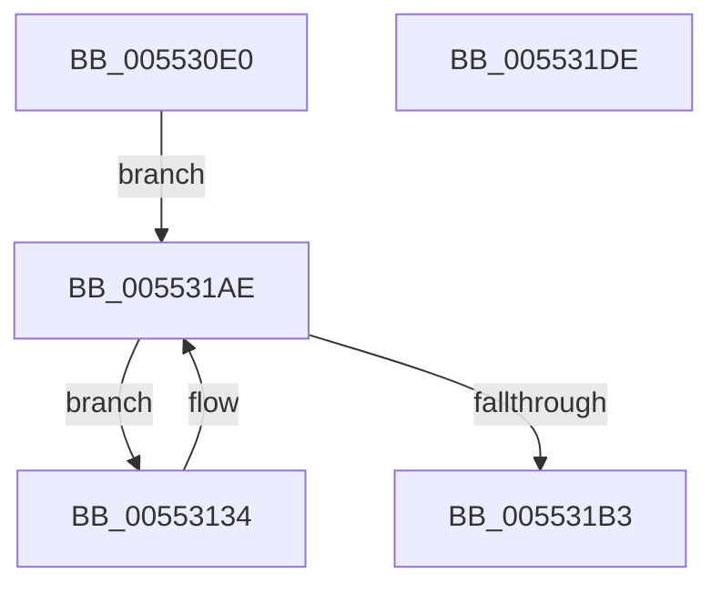

# HalpDmaInitPowerManagement

- RVA: `0x005530E0`–`0x005531DF` (길이 `255` bytes)
- VA: `0x00000001405530E0`
- 실행 섹션: `.text`
- PDB 이름 있음: `예`; PDB Function 태그: `아니요`
- unwind 정보 RVA: `0x000C3E9C`
- 디코드: `61`개 명령, `255/255` bytes 표시
- 미해석 바이트: `0` (있으면 어셈블리에 `.byte`로 보존)

> 이 문서는 커널 이미지의 기계어와 PDB 기호를 분석해 생성했습니다. 4번과 5번은 함수 원형과 자료형을 바이너리 사용 방식에서 추정한 C 해석이며 원본 소스 복구 결과는 아닙니다.

## 1. Dependencies

- 직접 호출 지점: **5**; 고유 호출 대상: **5**
- 직접 호출자로 확인된 함수: **1**
- RIP 상대 이미지 참조: **3**

### Outgoing calls
- `0x0055313E` → [memset](../6C/memset_function_006C6C40.md) (function, `0x006C6C40`)
- `0x00553184` → [PoFxRegisterCoreDevice](../../page/75/PoFxRegisterCoreDevice_function_00758800.md) (function, `0x00758800`)
- `0x00553197` → [PoFxActivateComponent](../2D/PoFxActivateComponent_function_002D9D30.md) (function, `0x002D9D30`)
- `0x005531A6` → [PoFxStartDevicePowerManagement](../4B/PoFxStartDevicePowerManagement_function_004B5740.md) (function, `0x004B5740`)
- `0x005531BC` → [_security_check_cookie](../6A/_security_check_cookie_function_006AC640.md) (function, `0x006AC640`)

### Direct callers
- [HalpDmaInitSystem](../../pagelk/B5/HalpDmaInitSystem_function_00B5DB50.md) at `0x00B5DB85`

### Static image references
- `0x005530FF` → RVA `0x00E0A740` (`.data`; read)
- `0x00553111` → RVA `0x00FC16F0` (`.data`; read)
- `0x00553159` → RVA `0x00554340` (`HalpDmaPowerCriticalTransitionCallback`; read)

## 2. Other-region calls and transfers

- 다른 실행 섹션으로 향하는 call: **1**
  - `0x00553184` → [PoFxRegisterCoreDevice](../../page/75/PoFxRegisterCoreDevice_function_00758800.md) (`.text` → `PAGE`)
- 별도 외부 분기/꼬리 이동을 확인하지 못했습니다.

## 3. Assembly (complete function range)

```asm
005530E0  48 8B C4                        mov rax, rsp
005530E3  48 89 58 08                     mov qword ptr [rax + 8], rbx
005530E7  48 89 70 10                     mov qword ptr [rax + 0x10], rsi
005530EB  48 89 78 18                     mov qword ptr [rax + 0x18], rdi
005530EF  4C 89 78 20                     mov qword ptr [rax + 0x20], r15
005530F3  55                              push rbp
005530F4  48 8D 68 A1                     lea rbp, [rax - 0x5f]
005530F8  48 81 EC 90 00 00 00            sub rsp, 0x90
005530FF  48 8B 05 3A 76 8B 00            mov rax, qword ptr [rip + 0x8b763a]
00553106  48 33 C4                        xor rax, rsp
00553109  48 89 45 4F                     mov qword ptr [rbp + 0x4f], rax
0055310D  83 65 4B 00                     and dword ptr [rbp + 0x4b], 0
00553111  4C 8D 3D D8 E5 A6 00            lea r15, [rip + 0xa6e5d8]
00553118  48 83 65 37 00                  and qword ptr [rbp + 0x37], 0
0055311D  48 83 65 3F 00                  and qword ptr [rbp + 0x3f], 0
00553122  48 8B 3D C7 E5 A6 00            mov rdi, qword ptr [rip + 0xa6e5c7]
00553129  33 F6                           xor esi, esi
0055312B  C7 45 47 0A 00 00 00            mov dword ptr [rbp + 0x47], 0xa
00553132  EB 7A                           jmp 0x1405531ae
00553134  33 D2                           xor edx, edx
00553136  48 8D 4D E7                     lea rcx, [rbp - 0x19]
0055313A  44 8D 42 50                     lea r8d, [rdx + 0x50]
0055313E  E8 FD 3A 17 00                  call 0x1406c6c40
00553143  48 8D 45 37                     lea rax, [rbp + 0x37]
00553147  C7 45 E7 01 00 00 00            mov dword ptr [rbp - 0x19], 1
0055314E  48 89 45 2F                     mov qword ptr [rbp + 0x2f], rax
00553152  48 8D 9F D0 00 00 00            lea rbx, [rdi + 0xd0]
00553159  48 8D 05 E0 11 00 00            lea rax, [rip + 0x11e0]
00553160  C7 45 EB 01 00 00 00            mov dword ptr [rbp - 0x15], 1
00553167  48 8D 8F C0 00 00 00            lea rcx, [rdi + 0xc0]
0055316E  48 89 45 FF                     mov qword ptr [rbp - 1], rax
00553172  4C 8B C3                        mov r8, rbx
00553175  C7 45 27 01 00 00 00            mov dword ptr [rbp + 0x27], 1
0055317C  48 8D 55 E7                     lea rdx, [rbp - 0x19]
00553180  48 89 7D 0F                     mov qword ptr [rbp + 0xf], rdi
00553184  E8 77 56 20 00                  call 0x140758800
00553189  48 8B 0B                        mov rcx, qword ptr [rbx]
0055318C  85 C0                           test eax, eax
0055318E  0F 48 F0                        cmovs esi, eax
00553191  33 D2                           xor edx, edx
00553193  44 8D 42 01                     lea r8d, [rdx + 1]
00553197  E8 94 6B D8 FF                  call 0x1402d9d30
0055319C  48 8B 0B                        mov rcx, qword ptr [rbx]
0055319F  C6 87 D8 00 00 00 01            mov byte ptr [rdi + 0xd8], 1
005531A6  E8 95 25 F6 FF                  call 0x1404b5740
005531AB  48 8B 3F                        mov rdi, qword ptr [rdi]
005531AE  49 3B FF                        cmp rdi, r15
005531B1  75 81                           jne 0x140553134
005531B3  8B C6                           mov eax, esi
005531B5  48 8B 4D 4F                     mov rcx, qword ptr [rbp + 0x4f]
005531B9  48 33 CC                        xor rcx, rsp
005531BC  E8 7F 94 15 00                  call 0x1406ac640
005531C1  4C 8D 9C 24 90 00 00 00         lea r11, [rsp + 0x90]
005531C9  49 8B 5B 10                     mov rbx, qword ptr [r11 + 0x10]
005531CD  49 8B 73 18                     mov rsi, qword ptr [r11 + 0x18]
005531D1  49 8B 7B 20                     mov rdi, qword ptr [r11 + 0x20]
005531D5  4D 8B 7B 28                     mov r15, qword ptr [r11 + 0x28]
005531D9  49 8B E3                        mov rsp, r11
005531DC  5D                              pop rbp
005531DD  C3                              ret
005531DE  CC                              int3
```

## 4. C-style interpretation (structured pseudocode)

```c
__int64 __fastcall HalpDmaInitPowerManagement(__int64 a1, int a2)
{
    __int64 result;
    __int64 v_rsi;
    __int64 v_rsp;
    unsigned __int64 v_stack_m8;

    *(unsigned __int64 *)(v_rsp + 8) = v_rbx;
    *(unsigned __int64 *)(v_rsp + 16) = v_rsi;
    *(unsigned __int64 *)(v_rsp + 24) = v_rdi;
    *(unsigned __int64 *)(v_rsp + 32) = v_r15;
    v_rsp = (v_rsp) - (144);
    result = (*(unsigned __int64 *)(v_rip + 9139770)) ^ (v_rsp);
    *(unsigned __int64 *)(v_rsp - 95 + 79) = result;
    v_rsi = 0;
    *(unsigned int *)(v_rsp - 95 + 71) = 10;
    goto loc_005531AE;
loc_00553134:
    a2 = 0;
    result = memset(v_rsp - 95 - 25, a2, a2 + 80, a4);
    *(unsigned int *)(v_rsp - 95 - 25) = 1;
    *(unsigned __int64 *)(v_rsp - 95 + 47) = v_rsp - 95 + 55;
    *(unsigned int *)(v_rsp - 95 - 21) = 1;
    *(unsigned __int64 *)(v_rsp - 95 - 1) = v_rip + 4576;
    *(unsigned int *)(v_rsp - 95 + 39) = 1;
    *(unsigned __int64 *)(v_rsp - 95 + 15) = *(unsigned __int64 *)(v_rip + 10937799);
    result = PoFxRegisterCoreDevice(*(unsigned __int64 *)(v_rip + 10937799) + 192, v_rsp - 95 - 25, *(unsigned __int64 *)(v_rip + 10937799) + 208, a4);
    if (sign_flag) { v_rsi = (unsigned int)(result); }
    a2 = 0;
    result = PoFxActivateComponent(*(unsigned __int64 *)(*(unsigned __int64 *)(v_rip + 10937799) + 208), a2, a2 + 1, a4);
    *(unsigned __int8 *)(*(unsigned __int64 *)(v_rip + 10937799) + 216) = 1;
    result = PoFxStartDevicePowerManagement(*(unsigned __int64 *)(*(unsigned __int64 *)(v_rip + 10937799) + 208), a2, a2 + 1, a4);
loc_005531AE:
    if ((*(unsigned __int64 *)(*(unsigned __int64 *)(v_rip + 10937799))) != (v_rip + 10937816)) goto loc_00553134;
    a1 = (*(unsigned __int64 *)(v_rsp - 95 + 79)) ^ (v_rsp);
    result = _security_check_cookie(a1, a2, a2 + 1, a4);
    return result;
}
```

## 5. (Beta) C Style

```c
int64_t HalpDmaInitPowerManagement(int64_t Arg1, int32_t Arg2)
{
    int64_t result;
    int64_t local_rsi;
    int64_t local_rsp;
    uint64_t v_stack_m8;

    *(uint64_t *)(local_rsp + 0x8) = local_rbx;
    *(uint64_t *)(local_rsp + 0x10) = local_rsi;
    *(uint64_t *)(local_rsp + 0x18) = local_rdi;
    *(uint64_t *)(local_rsp + 0x20) = local_r15;
    local_rsp = (local_rsp) - (144);
    result = (*(uint64_t *)(v_rip + 0x8B763A)) ^ (local_rsp);
    *(uint64_t *)(local_rsp - 0x5F + 0x4F) = result;
    local_rsi = 0;
    *(uint32_t *)(local_rsp - 0x5F + 0x47) = 10;
    goto loc_005531AE;
loc_00553134:
    Arg2 = 0;
    result = memset(local_rsp - 95 - 25, Arg2, Arg2 + 80, a4);
    *(uint32_t *)(local_rsp - 0x5F - 0x19) = 1;
    *(uint64_t *)(local_rsp - 0x5F + 0x2F) = local_rsp - 95 + 55;
    *(uint32_t *)(local_rsp - 0x5F - 0x15) = 1;
    *(uint64_t *)(local_rsp - 0x5F - 0x1) = v_rip + 4576;
    *(uint32_t *)(local_rsp - 0x5F + 0x27) = 1;
    *(uint64_t *)(local_rsp - 0x5F + 0xF) = *(uint64_t *)(v_rip + 0xA6E5C7);
    result = PoFxRegisterCoreDevice(*(uint64_t *)(v_rip + 0xA6E5C7) + 192, local_rsp - 95 - 25, *(uint64_t *)(v_rip + 0xA6E5C7) + 208, a4);
    if (sign_flag) { local_rsi = (uint32_t)(result); }
    Arg2 = 0;
    result = PoFxActivateComponent(*(uint64_t *)(*(uint64_t *)(v_rip + 0xA6E5C7) + 0xD0), Arg2, Arg2 + 1, a4);
    *(uint8_t *)(*(uint64_t *)(v_rip + 0xA6E5C7) + 0xD8) = 1;
    result = PoFxStartDevicePowerManagement(*(uint64_t *)(*(uint64_t *)(v_rip + 0xA6E5C7) + 0xD0), Arg2, Arg2 + 1, a4);
loc_005531AE:
    if ((*(uint64_t *)(*(uint64_t *)(v_rip + 0xA6E5C7))) != (v_rip + 10937816)) goto loc_00553134;
    Arg1 = (*(uint64_t *)(local_rsp - 0x5F + 0x4F)) ^ (local_rsp);
    result = _security_check_cookie(Arg1, Arg2, Arg2 + 1, a4);
    return result;
}
```

## 6. Execution-region graph

[열기: 2D/3D 그래프와 함수 탐색 컨트롤 패널](../../../control-panel.html?section=text&rva=0x005530E0&view=graph)

- 2D 그래프는 위에서 아래로 흐르고, 3D 그래프는 빈 공간을 드래그해 회전합니다. Shift+드래그는 이동, 휠은 확대·축소, 함수 노드 선택은 대상 보고서 이동입니다.

### Static fallback


