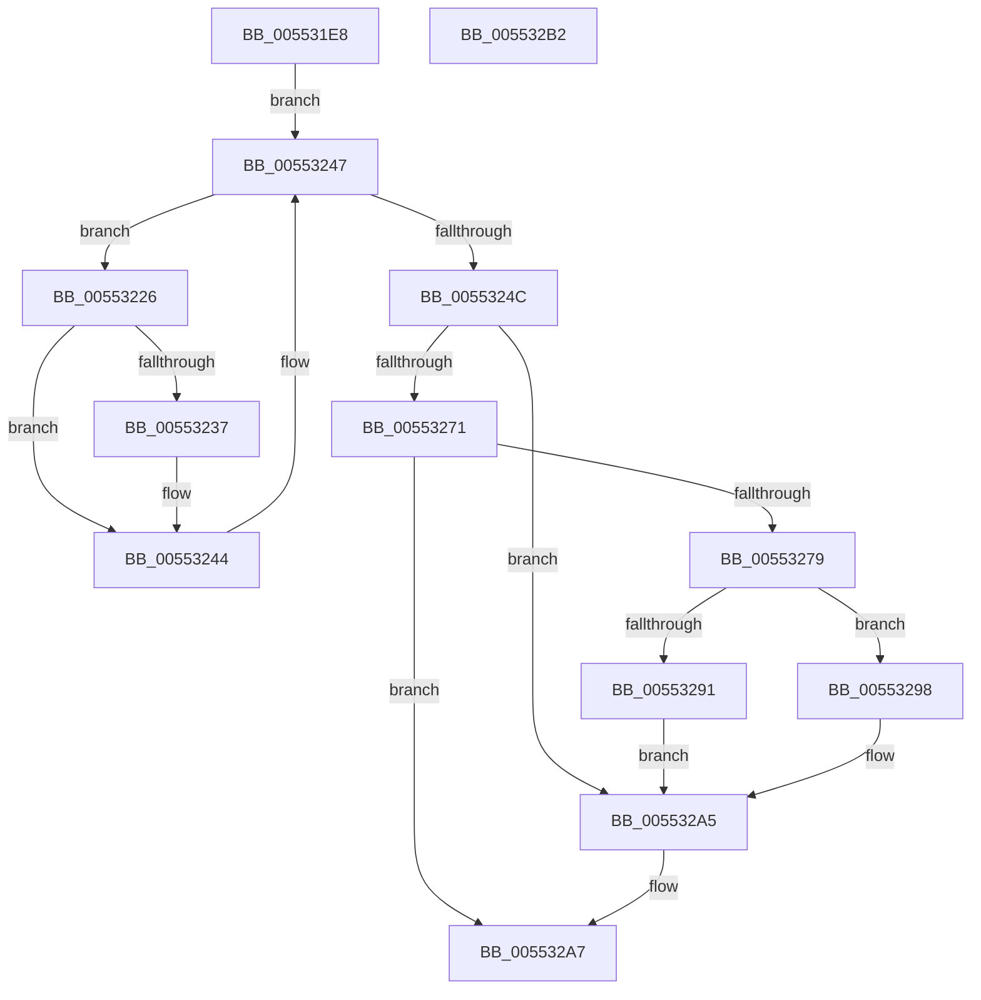

# HalpDmaInitializeControllers

- RVA: `0x005531E8`–`0x005532B3` (길이 `203` bytes)
- VA: `0x00000001405531E8`
- 실행 섹션: `.text`
- PDB 이름 있음: `예`; PDB Function 태그: `아니요`
- unwind 정보 RVA: `0x000BDD0C`
- 디코드: `55`개 명령, `203/203` bytes 표시
- 미해석 바이트: `0` (있으면 어셈블리에 `.byte`로 보존)

> 이 문서는 커널 이미지의 기계어와 PDB 기호를 분석해 생성했습니다. 4번과 5번은 함수 원형과 자료형을 바이너리 사용 방식에서 추정한 C 해석이며 원본 소스 복구 결과는 아닙니다.

## 1. Dependencies

- 직접 호출 지점: **5**; 고유 호출 대상: **5**
- 직접 호출자로 확인된 함수: **1**
- RIP 상대 이미지 참조: **6**

### Outgoing calls
- `0x00553229` → [HalpDmaControllerInitializeController](HalpDmaControllerInitializeController_function_00554198.md) (function, `0x00554198`)
- `0x0055323F` → [HalpDmaConfigureInterrupt](../56/HalpDmaConfigureInterrupt_function_005693FC.md) (function, `0x005693FC`)
- `0x00553266` → [guard_dispatch_icall](../6B/guard_dispatch_icall_function_006BAAD0.md) (function, `0x006BAAD0`)
- `0x00553280` → [HalpMmAllocCtxAlloc](../3E/HalpMmAllocCtxAlloc_function_003E10B8.md) (function, `0x003E10B8`)
- `0x005532A0` → [memset](../6C/memset_function_006C6C40.md) (function, `0x006C6C40`)

### Direct callers
- [HalpDmaInit](../../init/C2/HalpDmaInit_function_00C20D34.md) at `0x00C20E60`

### Static image references
- `0x005531F8` → RVA `0x00FC16F0` (`.data`; read)
- `0x0055320D` → RVA `0x00FC7120` (`ALMOSTRO`; read)
- `0x00553218` → RVA `0x00FC7128` (`ALMOSTRO`; read)
- `0x0055324C` → RVA `0x00E00400` (`.data`; read)
- `0x00553253` → RVA `0x00FC3E58` (`.data`; write)
- `0x00553285` → RVA `0x00E103F0` (`.data`; write)

## 2. Other-region calls and transfers

- 다른 실행 섹션으로 향하는 call: **0**
- 별도 외부 분기/꼬리 이동을 확인하지 못했습니다.

## 3. Assembly (complete function range)

```asm
005531E8  48 8B C4                        mov rax, rsp
005531EB  48 89 58 10                     mov qword ptr [rax + 0x10], rbx
005531EF  57                              push rdi
005531F0  48 83 EC 30                     sub rsp, 0x30
005531F4  83 60 08 00                     and dword ptr [rax + 8], 0
005531F8  48 8D 3D F1 E4 A6 00            lea rdi, [rip + 0xa6e4f1]
005531FF  48 8B 1D EA E4 A6 00            mov rbx, qword ptr [rip + 0xa6e4ea]
00553206  33 C9                           xor ecx, ecx
00553208  33 D2                           xor edx, edx
0055320A  0F 57 C0                        xorps xmm0, xmm0
0055320D  66 3B 15 0C 3F A7 00            cmp dx, word ptr [rip + 0xa73f0c]
00553214  0F 11 40 E8                     movups xmmword ptr [rax - 0x18], xmm0
00553218  48 0F 42 0D 08 3F A7 00         cmovb rcx, qword ptr [rip + 0xa73f08]
00553220  48 89 48 E8                     mov qword ptr [rax - 0x18], rcx
00553224  EB 21                           jmp 0x140553247
00553226  48 8B CB                        mov rcx, rbx
00553229  E8 6A 0F 00 00                  call 0x140554198
0055322E  80 BB B1 00 00 00 00            cmp byte ptr [rbx + 0xb1], 0
00553235  74 0D                           je 0x140553244
00553237  48 8D 54 24 20                  lea rdx, [rsp + 0x20]
0055323C  48 8B CB                        mov rcx, rbx
0055323F  E8 B8 61 01 00                  call 0x1405693fc
00553244  48 8B 1B                        mov rbx, qword ptr [rbx]
00553247  48 3B DF                        cmp rbx, rdi
0055324A  75 DA                           jne 0x140553226
0055324C  48 8D 05 AD D1 8A 00            lea rax, [rip + 0x8ad1ad]
00553253  48 89 05 FE 0B A7 00            mov qword ptr [rip + 0xa70bfe], rax
0055325A  48 8D 4C 24 40                  lea rcx, [rsp + 0x40]
0055325F  48 8B 05 9A D1 8A 00            mov rax, qword ptr [rip + 0x8ad19a]
00553266  E8 65 78 16 00                  call 0x1406baad0
0055326B  8B D8                           mov ebx, eax
0055326D  85 C0                           test eax, eax
0055326F  78 34                           js 0x1405532a5
00553271  8B 44 24 40                     mov eax, dword ptr [rsp + 0x40]
00553275  85 C0                           test eax, eax
00553277  74 2E                           je 0x1405532a7
00553279  C1 E0 03                        shl eax, 3
0055327C  8B D0                           mov edx, eax
0055327E  8B F8                           mov edi, eax
00553280  E8 33 DE E8 FF                  call 0x1403e10b8
00553285  48 89 05 64 D1 8B 00            mov qword ptr [rip + 0x8bd164], rax
0055328C  48 85 C0                        test rax, rax
0055328F  75 07                           jne 0x140553298
00553291  BB 9A 00 00 C0                  mov ebx, 0xc000009a
00553296  EB 0D                           jmp 0x1405532a5
00553298  4C 8B C7                        mov r8, rdi
0055329B  33 D2                           xor edx, edx
0055329D  48 8B C8                        mov rcx, rax
005532A0  E8 9B 39 17 00                  call 0x1406c6c40
005532A5  8B C3                           mov eax, ebx
005532A7  48 8B 5C 24 48                  mov rbx, qword ptr [rsp + 0x48]
005532AC  48 83 C4 30                     add rsp, 0x30
005532B0  5F                              pop rdi
005532B1  C3                              ret
005532B2  CC                              int3
```

## 4. C-style interpretation (structured pseudocode)

```c
__int64 __fastcall HalpDmaInitializeControllers(int a1, int a2)
{
    __int64 result;
    __int64 v_rsp;
    unsigned __int64 v_stack_m18;
    unsigned __int64 v_stack_p10;
    unsigned __int64 v_stack_p8;

    *(unsigned __int64 *)(v_rsp + 16) = v_rbx;
    v_rsp = (v_rsp) - (48);
    a1 = 0;
    a2 = 0;
    *(unsigned __int64 *)(v_rsp - 24) = v_xmm0;
    if (0 < (*(unsigned __int16 *)(v_rip + 10960652))) { a1 = *(unsigned __int64 *)(v_rip + 10960648); }
    *(unsigned __int64 *)(v_rsp - 24) = a1;
    goto loc_00553247;
loc_00553226:
    result = HalpDmaControllerInitializeController(*(unsigned __int64 *)(v_rip + 10937578), a2, a3, a4);
    if ((*(unsigned __int8 *)(*(unsigned __int64 *)(v_rip + 10937578) + 177)) != 0) {
        a2 = v_stack_m18;
        a1 = *(unsigned __int64 *)(v_rip + 10937578);
        result = HalpDmaConfigureInterrupt(a1, a2, a3, a4);
    }
loc_00553247:
    if ((*(unsigned __int64 *)(*(unsigned __int64 *)(v_rip + 10937578))) != (v_rip + 10937585)) goto loc_00553226;
    *(unsigned __int64 *)(v_rip + 10947582) = v_rip + 9097645;
    result = guard_dispatch_icall(v_stack_p8, a2, a3, a4);
    if (sign_flag) goto loc_005532A5;
    if ((unsigned int)((unsigned int)(v_stack_p8)) == 0) goto loc_005532A7;
    result = (unsigned int)(((unsigned int)(v_stack_p8)) << (3));
    result = HalpMmAllocCtxAlloc(v_stack_p8, (unsigned int)((unsigned int)(result)), a3, a4);
    *(unsigned __int64 *)(v_rip + 9163108) = result;
    if (result != 0) goto loc_00553298;
    goto loc_005532A5;
loc_00553298:
    a2 = 0;
    result = memset(result, a2, (unsigned int)((unsigned int)(result)), a4);
loc_005532A5:
loc_005532A7:
    v_rsp = (v_rsp) + (48);
    return (unsigned int)((unsigned int)((unsigned int)(0xC000009AULL)));
}
```

## 5. (Beta) C Style

```c
int64_t HalpDmaInitializeControllers(int32_t Arg1, int32_t Arg2)
{
    int64_t result;
    int64_t local_rsp;
    uint64_t v_stack_m18;
    uint64_t v_stack_p10;
    uint64_t v_stack_p8;

    *(uint64_t *)(local_rsp + 0x10) = local_rbx;
    local_rsp = (local_rsp) - (48);
    Arg1 = 0;
    Arg2 = 0;
    *(uint64_t *)(local_rsp - 0x18) = v_xmm0;
    if (0 < (*(uint16_t *)(v_rip + 0xA73F0C))) { Arg1 = *(uint64_t *)(v_rip + 0xA73F08); }
    *(uint64_t *)(local_rsp - 0x18) = Arg1;
    goto loc_00553247;
loc_00553226:
    result = HalpDmaControllerInitializeController(*(uint64_t *)(v_rip + 0xA6E4EA), Arg2, a3, a4);
    if ((*(uint8_t *)(*(uint64_t *)(v_rip + 0xA6E4EA) + 0xB1)) != 0) {
        Arg2 = v_stack_m18;
        Arg1 = *(uint64_t *)(v_rip + 0xA6E4EA);
        result = HalpDmaConfigureInterrupt(Arg1, Arg2, a3, a4);
    }
loc_00553247:
    if ((*(uint64_t *)(*(uint64_t *)(v_rip + 0xA6E4EA))) != (v_rip + 10937585)) goto loc_00553226;
    *(uint64_t *)(v_rip + 0xA70BFE) = v_rip + 9097645;
    result = guard_dispatch_icall(v_stack_p8, Arg2, a3, a4);
    if (sign_flag) goto loc_005532A5;
    if ((uint32_t)((uint32_t)(v_stack_p8)) == 0) goto loc_005532A7;
    result = (uint32_t)(((uint32_t)(v_stack_p8)) << (3));
    result = HalpMmAllocCtxAlloc(v_stack_p8, (uint32_t)((uint32_t)(result)), a3, a4);
    *(uint64_t *)(v_rip + 0x8BD164) = result;
    if (result != 0) goto loc_00553298;
    goto loc_005532A5;
loc_00553298:
    Arg2 = 0;
    result = memset(result, Arg2, (uint32_t)((uint32_t)(result)), a4);
loc_005532A5:
loc_005532A7:
    local_rsp = (local_rsp) + (48);
    return (uint32_t)((uint32_t)((uint32_t)(0xC000009AULL)));
}
```

## 6. Execution-region graph

[열기: 2D/3D 그래프와 함수 탐색 컨트롤 패널](../../../control-panel.html?section=text&rva=0x005531E8&view=graph)

- 2D 그래프는 위에서 아래로 흐르고, 3D 그래프는 빈 공간을 드래그해 회전합니다. Shift+드래그는 이동, 휠은 확대·축소, 함수 노드 선택은 대상 보고서 이동입니다.

### Static fallback


