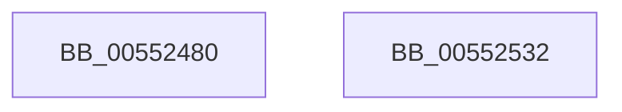

# HalpDmaInitializeObjectType

- RVA: `0x00552480`–`0x00552533` (길이 `179` bytes)
- VA: `0x0000000140552480`
- 실행 섹션: `.text`
- PDB 이름 있음: `예`; PDB Function 태그: `아니요`
- unwind 정보 RVA: `0x000C43B4`
- 디코드: `39`개 명령, `179/179` bytes 표시
- 미해석 바이트: `0` (있으면 어셈블리에 `.byte`로 보존)

> 이 문서는 커널 이미지의 기계어와 PDB 기호를 분석해 생성했습니다. 4번과 5번은 함수 원형과 자료형을 바이너리 사용 방식에서 추정한 C 해석이며 원본 소스 복구 결과는 아닙니다.

## 1. Dependencies

- 직접 호출 지점: **4**; 고유 호출 대상: **4**
- 직접 호출자로 확인된 함수: **1**
- RIP 상대 이미지 참조: **5**

### Outgoing calls
- `0x005524B5` → [memset](../6C/memset_function_006C6C40.md) (function, `0x006C6C40`)
- `0x005524F9` → [RtlInitUnicodeString](../42/RtlInitUnicodeString_function_0042A780.md) (function, `0x0042A780`)
- `0x00552510` → [ObCreateObjectType](../../page/70/ObCreateObjectType_function_00705230.md) (function, `0x00705230`)
- `0x0055251C` → [_security_check_cookie](../6A/_security_check_cookie_function_006AC640.md) (function, `0x006AC640`)

### Direct callers
- [HalpDmaInitEarly](../../init/C2/HalpDmaInitEarly_function_00C20F3C.md) at `0x00C20F40`

### Static image references
- `0x00552492` → RVA `0x00E0A740` (`.data`; read)
- `0x005524BA` → RVA `0x00024F68` (`.rdata`; read)
- `0x005524C5` → RVA `0x00550E30` (`HalpDmaFreeChildAdapter`; read)
- `0x005524CC` → RVA `0x00024EE0` (`.rdata`; read)
- `0x005524FE` → RVA `0x00FC6D38` (`ALMOSTRO`; read)

## 2. Other-region calls and transfers

- 다른 실행 섹션으로 향하는 call: **1**
  - `0x00552510` → [ObCreateObjectType](../../page/70/ObCreateObjectType_function_00705230.md) (`.text` → `PAGE`)
- 별도 외부 분기/꼬리 이동을 확인하지 못했습니다.

## 3. Assembly (complete function range)

```asm
00552480  48 89 5C 24 08                  mov qword ptr [rsp + 8], rbx
00552485  55                              push rbp
00552486  48 8D 6C 24 A9                  lea rbp, [rsp - 0x57]
0055248B  48 81 EC C0 00 00 00            sub rsp, 0xc0
00552492  48 8B 05 A7 82 8B 00            mov rax, qword ptr [rip + 0x8b82a7]
00552499  48 33 C4                        xor rax, rsp
0055249C  48 89 45 47                     mov qword ptr [rbp + 0x47], rax
005524A0  0F 57 C0                        xorps xmm0, xmm0
005524A3  48 8D 4D C7                     lea rcx, [rbp - 0x39]
005524A7  BB 78 00 00 00                  mov ebx, 0x78
005524AC  33 D2                           xor edx, edx
005524AE  44 8B C3                        mov r8d, ebx
005524B1  0F 11 45 B7                     movups xmmword ptr [rbp - 0x49], xmm0
005524B5  E8 86 47 17 00                  call 0x1406c6c40
005524BA  0F 10 05 A7 2A AD FF            movups xmm0, xmmword ptr [rip - 0x52d559]
005524C1  80 4D C9 04                     or byte ptr [rbp - 0x37], 4
005524C5  48 8D 05 64 E9 FF FF            lea rax, [rip - 0x169c]
005524CC  48 8D 15 0D 2A AD FF            lea rdx, [rip - 0x52d5f3]
005524D3  66 89 5D C7                     mov word ptr [rbp - 0x39], bx
005524D7  48 8D 4D B7                     lea rcx, [rbp - 0x49]
005524DB  C7 45 CF 00 01 00 00            mov dword ptr [rbp - 0x31], 0x100
005524E2  F3 0F 7F 45 D3                  movdqu xmmword ptr [rbp - 0x2d], xmm0
005524E7  C7 45 EB 00 02 00 00            mov dword ptr [rbp - 0x15], 0x200
005524EE  C7 45 E3 00 00 1F 00            mov dword ptr [rbp - 0x1d], 0x1f0000
005524F5  48 89 45 0F                     mov qword ptr [rbp + 0xf], rax
005524F9  E8 82 82 ED FF                  call 0x14042a780
005524FE  4C 8D 0D 33 48 A7 00            lea r9, [rip + 0xa74833]
00552505  45 33 C0                        xor r8d, r8d
00552508  48 8D 55 C7                     lea rdx, [rbp - 0x39]
0055250C  48 8D 4D B7                     lea rcx, [rbp - 0x49]
00552510  E8 1B 2D 1B 00                  call 0x140705230
00552515  48 8B 4D 47                     mov rcx, qword ptr [rbp + 0x47]
00552519  48 33 CC                        xor rcx, rsp
0055251C  E8 1F A1 15 00                  call 0x1406ac640
00552521  48 8B 9C 24 D0 00 00 00         mov rbx, qword ptr [rsp + 0xd0]
00552529  48 81 C4 C0 00 00 00            add rsp, 0xc0
00552530  5D                              pop rbp
00552531  C3                              ret
00552532  CC                              int3
```

## 4. C-style interpretation (structured pseudocode)

```c
__int64 __fastcall HalpDmaInitializeObjectType(__int64 a1, int a2)
{
    __int64 result;
    __int64 v_rsp;
    unsigned __int64 v_stack_m18;
    unsigned __int64 v_stack_m50;
    unsigned __int64 v_stack_m5F;
    unsigned int v_stack_m74;
    unsigned int v_stack_m7C;
    unsigned __int64 v_stack_m8C;
    unsigned int v_stack_m90;
    unsigned __int8 v_stack_m96;
    unsigned __int64 v_stack_m98;
    unsigned __int64 v_stack_mA8;
    unsigned __int64 v_stack_p8;

    v_stack_p8 = v_rbx;
    v_rsp = (v_rsp) - (192);
    result = (*(unsigned __int64 *)(v_rip + 9142951)) ^ (v_rsp);
    v_stack_m18 = result;
    a2 = 0;
    v_stack_mA8 = v_xmm0;
    result = memset(v_stack_m98, a2, 120, a4);
    v_stack_m98 = 120;
    v_stack_m90 = 256;
    v_stack_m8C = v_xmm0;
    v_stack_m74 = 512;
    v_stack_m7C = 0x1F0000ULL;
    v_stack_m50 = v_rip - 5788;
    result = RtlInitUnicodeString(v_stack_mA8, v_rip - 5428723, 120, a4);
    a3 = 0;
    result = ObCreateObjectType(v_stack_mA8, v_stack_m98, a3, v_rip + 10962995);
    a1 = (v_stack_m18) ^ (v_rsp);
    result = _security_check_cookie(a1, v_stack_m98, a3, v_rip + 10962995);
    v_rsp = (v_rsp) + (192);
    return result;
}
```

## 5. (Beta) C Style

```c
int64_t HalpDmaInitializeObjectType(int64_t Arg1, int32_t Arg2)
{
    int64_t result;
    int64_t local_rsp;
    uint64_t v_stack_m18;
    uint64_t v_stack_m50;
    uint64_t v_stack_m5F;
    uint32_t v_stack_m74;
    uint32_t v_stack_m7C;
    uint64_t v_stack_m8C;
    uint32_t v_stack_m90;
    uint8_t v_stack_m96;
    uint64_t v_stack_m98;
    uint64_t v_stack_mA8;
    uint64_t v_stack_p8;

    v_stack_p8 = local_rbx;
    local_rsp = (local_rsp) - (192);
    result = (*(uint64_t *)(v_rip + 0x8B82A7)) ^ (local_rsp);
    v_stack_m18 = result;
    Arg2 = 0;
    v_stack_mA8 = v_xmm0;
    result = memset(v_stack_m98, Arg2, 120, a4);
    v_stack_m98 = 120;
    v_stack_m90 = 256;
    v_stack_m8C = v_xmm0;
    v_stack_m74 = 512;
    v_stack_m7C = 0x1F0000ULL;
    v_stack_m50 = v_rip - 5788;
    result = RtlInitUnicodeString(v_stack_mA8, v_rip - 5428723, 120, a4);
    a3 = 0;
    result = ObCreateObjectType(v_stack_mA8, v_stack_m98, a3, v_rip + 10962995);
    Arg1 = (v_stack_m18) ^ (local_rsp);
    result = _security_check_cookie(Arg1, v_stack_m98, a3, v_rip + 10962995);
    local_rsp = (local_rsp) + (192);
    return result;
}
```

## 6. Execution-region graph

[열기: 2D/3D 그래프와 함수 탐색 컨트롤 패널](../../../control-panel.html?section=text&rva=0x00552480&view=graph)

- 2D 그래프는 위에서 아래로 흐르고, 3D 그래프는 빈 공간을 드래그해 회전합니다. Shift+드래그는 이동, 휠은 확대·축소, 함수 노드 선택은 대상 보고서 이동입니다.

### Static fallback


